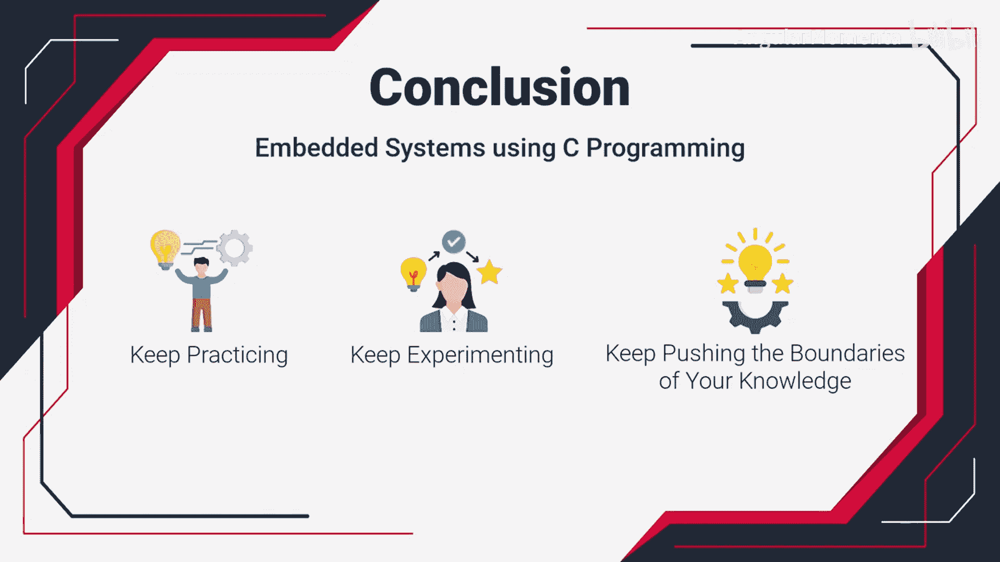

# 【EDUCBA】构建嵌入式系统 ｜ ARM Cortex (STM32) Fundamentals： Building Embedded Systems p70 04_03_08_课程总结 -BV1KjcTzUEeY_p70-

Hey learners， congratulations on completing a comprehensive course on embedded systems using Cpro throughout this course you have gained a deeper understanding of the fundamental concepts。

 practical skills and real world applications of Cpro from the basic data types and user input handling to advanced topics like bitwise operators。

 embedded C coding and looping constructs you have covered a wide range of essential concepts that form the backbone of Cpro as you reflect on your journey take a pride in the progress you have made and the knowledge you have acquired you have mastered the art of manipulating data types。

 making decisions with conditional statements and leveraging operators for efficient code execution you have delve into the inacs of pointers gained insights into memory management and haunt your skills in controlling hardware feryfis through embedded C programming but your journey doesn't end here as you continue to explore the vast world of programming remember the solid foundation you have built in C programming。

Whether you are pursuing a career in software development， embedded systems。

 engineering or any other field that requires programming skills knowledge and skills you have gained in this course will serve as a solid groundwork for your future endeavors As you move forward keep practicing keep experimenting and keep pushing the boundaries of your knowledge We hope you have enjoyed this course as much as we have enjoyed creating it for you Thank you for being a part of this learning journey and we wish you the very best in your future endeavors That's it from this entire course Thank you so much。

😊。

