# 【EDUCBA】使用jQuery UI构建交互式Web应用程序 ｜ Build Interactive Web Apps Using jQuery UI p04 02_02_01_编写日常任务脚本 -BV11rFozDEvA_p4-

So the UI content of the daily task has been created。

 now we will create the scripts in order to work with this data。 Okay。

 so we will write the script over here itself like。

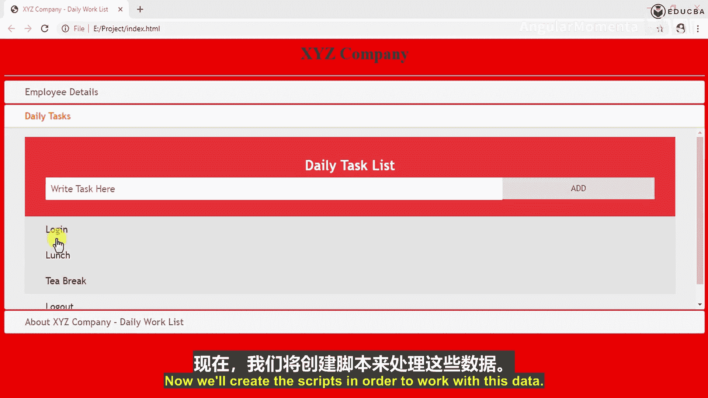

We have created here the URL right so after this you will only just write the script so I will be having an idea that the script is for a particular section now in this first script what well do is we'll create a close button and append to each list that means we will create a close button and add to each list so creating a close button variable。

😊，Let's say my Lord list。Is equal to。Document dot。Get element。Get elements by。Dag name。

And let's see the tag name is。Eied， that's the list titletan。

So whatever list items are there that will be shown over here。Now， variable I。Over here。

 we it a for loop at4。I is equal to 0。I， less than。My noiseless do。Lent。And I plus plus。

 so I just adding a bit of Javascript to this。Now， what we' will do is over here。瑞典本。

Will create a span So creating a span equals through document。Dot。Create。Element。Of span。

Than variable， TXt。Is equal to document dot。Create。Text node。That is。You。😔，0，0， D 7。Okay。Then。

Pand dot。嗯。Last name。Is equal to close。So all this span will be having a class name called close and span dot。

Upend。Child。To text。 and my node list。Index of I。Dot a pen childild。

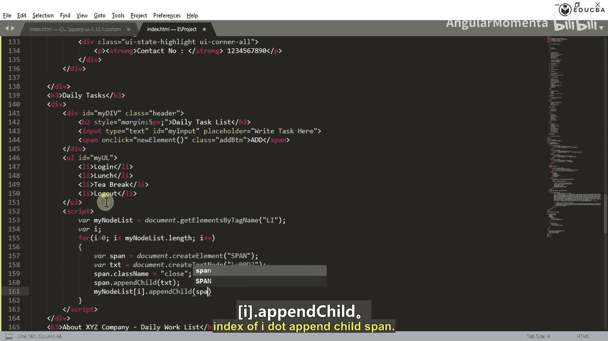

板。So now when I just write this script。And I try to execute this。

 So as you can see we get a close button over here。

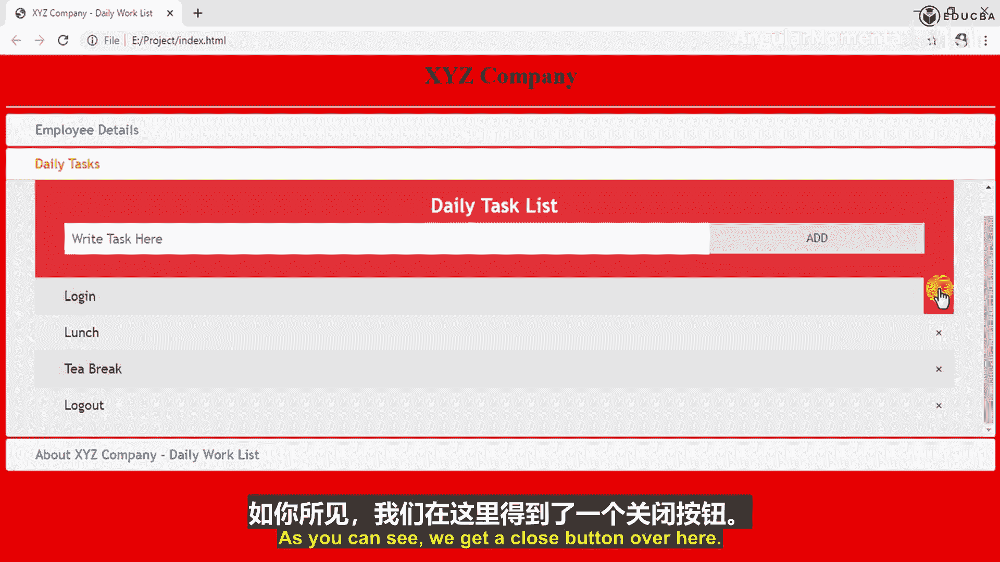

And how many list that much close buttons will be getting over here and this I。

 this is which we have wrote slash you 007 is the list for that close button or is the name for the close button。

😊，Now， what we want to do is whenever we click on the close button。

It should hide that list item for us should delete that list item for us， correct， So for that。

 what are we going to do is。We will write。A variable。Name as close is equal to。Document do。You get。

Elements by。Glassy。And well give that last name as close。Now， variable I again。

 the for loop for i is equal to 0 i less 10。Close that length。And I plus， plus。Now。

 what you want to give is close index of I。Dot。On click。Rs equal to function。

And what function do we need to perform over here this？Variable， whatever depth variable is there。

Is equal to this thought。Parent element。And。😊，Deve dot， style dot。Display。Will be equal to none。

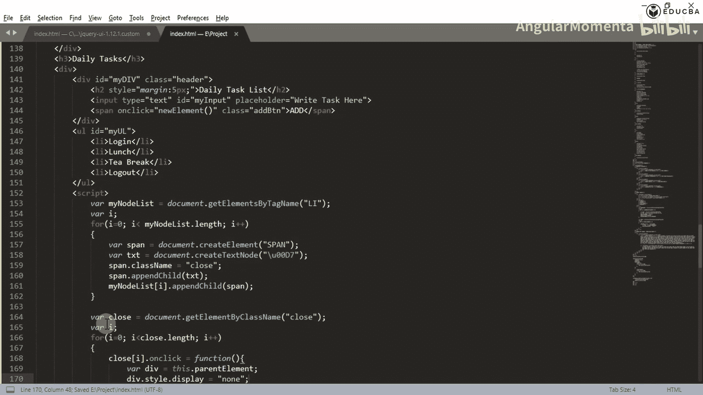

Okay， so suppose if I now execute this part and lets say if I have want to reduce my de break I don't want to take my de break so I just click over here so whenever we click on this button okay the first thing I will do is variable very closely equal to get element by class name。

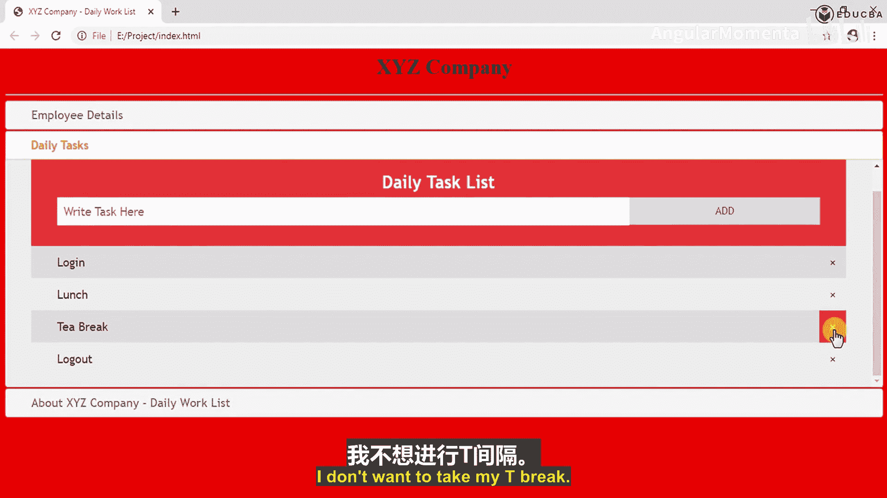

So we'll get the element by the class name。And that particular class will be stored over here whenever we click over there。

 so that whatever parent element is it display will be equal to none。Okay， now。

In order to add a checks symbol onto this， we what will do this variable。List。

Is equal to document dot。Quri selector。And which query we need to select is U。Yeah。Now。

List dot add even。Listener。And which event list we need to add is。Click event。

Which will perform a function for us。And function is E。 That's the event function。 So remember。

 we have given the parameter while creating this thing。So that is use for this event less enough。

 Okay， so whenever we have created this event for dialogueog click button and all these buttons we have given for this event only now over here which event we will do is。

Here。E dot。Darlicate。Dot。Daad name。Is equal equal equal to all that' is the list item。

That means whatever event which have to click that is equal to the list， So event dot。Datagate。Dot。

Glass list。Dot。Dogan。And the toggle will be。Check that means。If the tag name。

 whichever we are writing， is a list。And we click on that so that particular class name will be name as checked over there and we have done the styling for the checkers with whether if it' is a checked event。

 then it should be happen that way， right？And after this event is done。

 we will just add a false over here in case if this is not appeared。Okay， so。

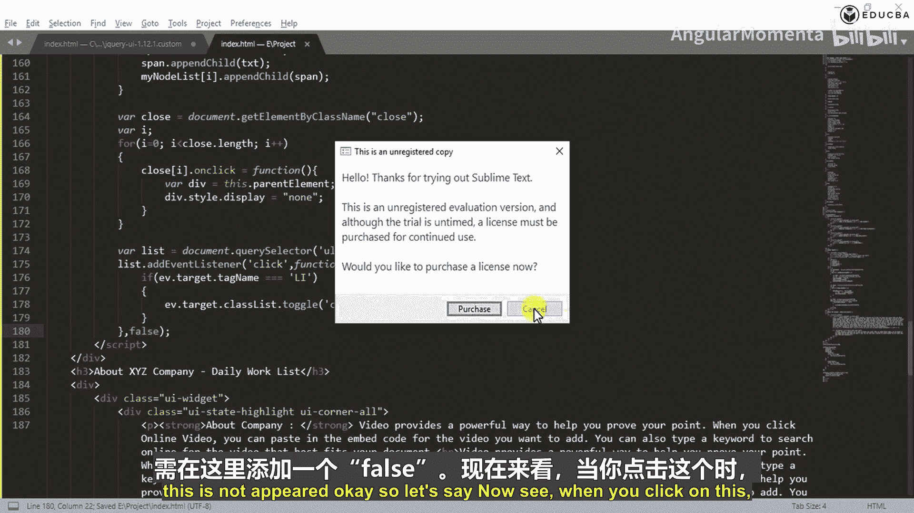

Let's see。Now see when you click on this， that particular style will become that event effect。 Okay。

 so lets see。

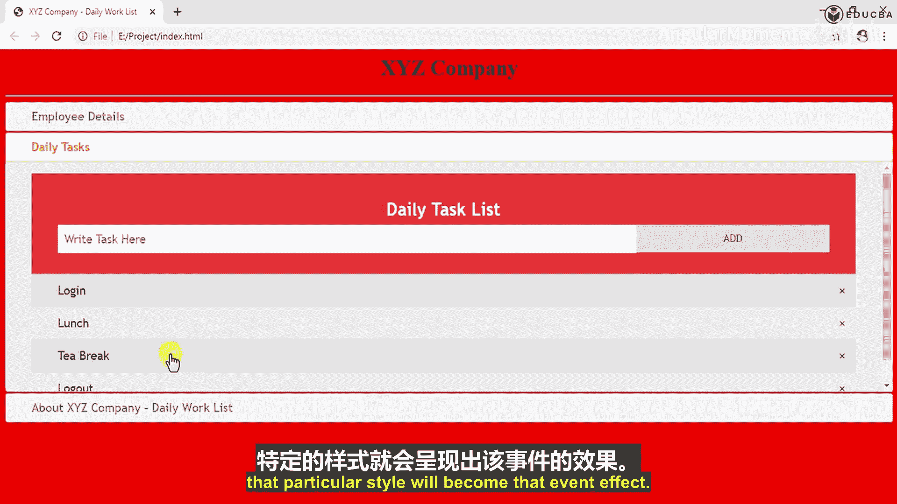

Okay， so whenever we are working with this。 okay， let's see now。

 So this first one is for adding the close button。 The second one is for closing the event and third one is for selecting the target list。

 Okay now let's see if I just come here and I just refresh this page so we can see we have got the close button now suppose if I am trying to skip my tea break so I just click on the close button so I can see that tea break is now not visible over here。

 I have done my login and suppose I have done my lunch also so Im going click on this way for showing me that this particular task is。

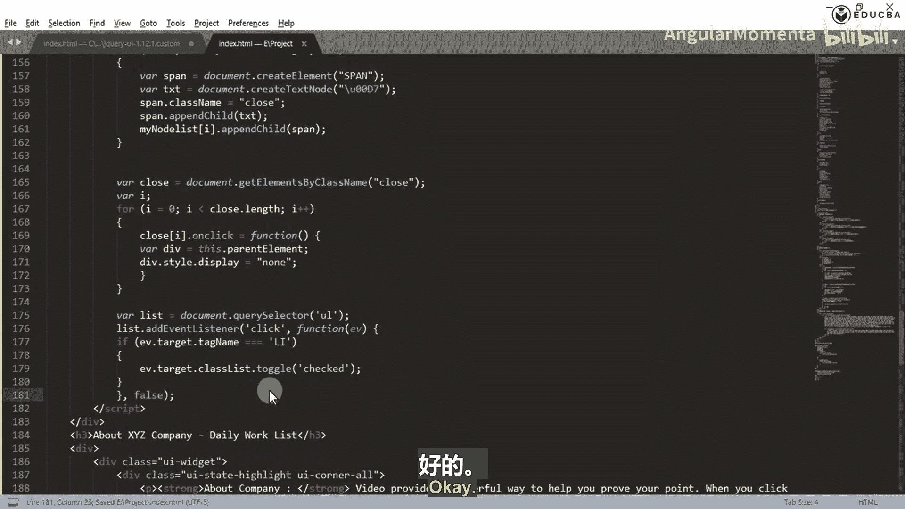

Completed for us。 Okay， so by this thing， by these three events。

 which we have wrote from these three events， we are able to。

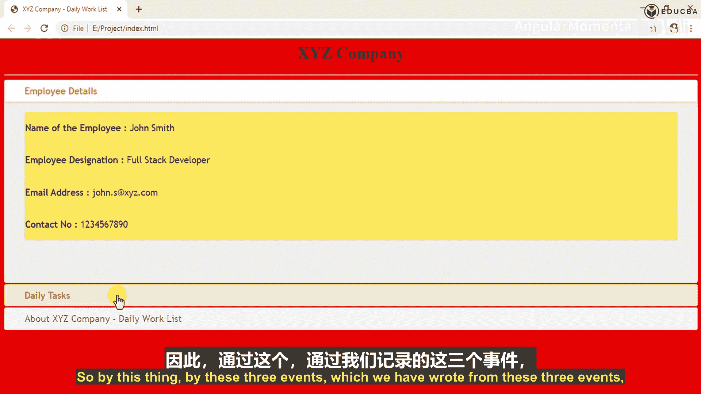

Add close button。To close on click of the event of the data。And。2。

Check whatever we have finish in our target list Okay。

 so now we have road scripts for removing data and for displaying the data right now we will write the script to right click on the new list now。

 for example， if this is my task right I can close this task。

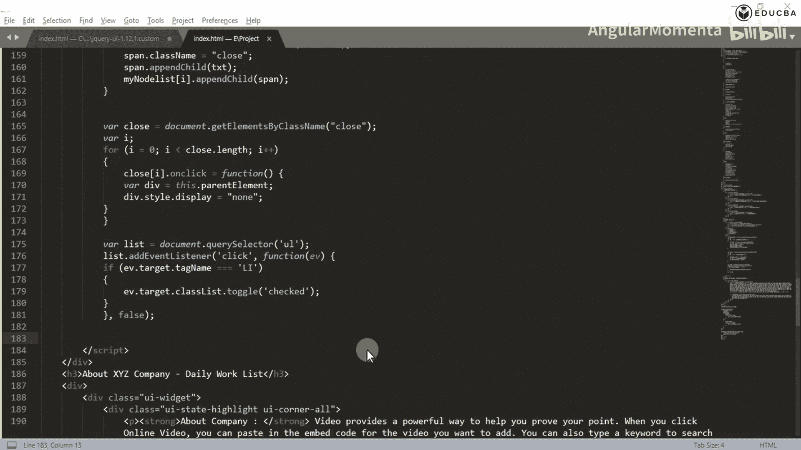

I can hide this up but when I like something and I will just click on the addd it should get added in my list right so for this we will write a skip now。

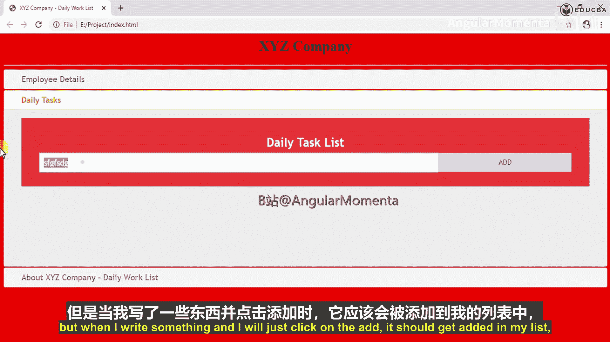

So lets say for adding the data will you remember when we have created a span over here for adding the data come up okay。

 when we have adding a data， we have this add button and that button is calling a function called his new elementary so we will create a function and the function name will be。

New element。So， this function will be storing the data now how will it be storing the data variable all is equal to。

Document that。Create element of all。 So we have created a ally list。After this， variable。Input value。

 that means whatever values which we have wrote in that box that will be will get from document dot to get。

Element by I D。아。And the Id is。My input。Dot。Value， so whatever value which we will be writing will be coming over here。

Vable text。Is equal to document thought。你你这个。Create text node for our input。Value。And then。Allied do。

Aventure。And a pen for text。Now， the next thing which you want to do is if we need to also check that data is nulon also if。

Whatever input value is equal equal equal to blank。 that's a nu value or a blank value。Okay。

 then we should give an alert box。That。Daた。Cannot be nu。If it is not there。

 if the data is not none then else。Document do。Get element by I D。 I D is my U well。Dot。Apen childd。

And a pen of ally。That means create a child for ally。Then。After this document。Dot。Get element by Id。

My input。Dot value。Yeah。Is equal to blank。那。Just we have told that this is to be creating a node。

 but then we need to store a node also right Now the thing is that from this data from this ally。

 from this value， we have stored the data right， but we also need to apply a close button to that right。

 so。How to apply a close button， we already have created right so variable span。Is equal to。不会。

Document that。Create element of span。Then variable dxt is equal to。Yeah。Yeah。Document that。

Create text node。And the text node we know that slash U。0，0， D7。Then。San dot。Yeah。Last name。

And that last name will be close。Yeah。Then， span dot。U pen child of the X D。And then allied do。

 that is the list。Not。Yeah。Avannge of span。Then， the for loop。I is equal to 0。Then we have I S than。

Cls dot length。I， plus， plus。Yeah。Thank。Close index of I dot conflict click。Is equal to function。

And we write the function。 We do not have any argument to this function。Where the body。

 which will be writing， is。Re liveブ。Deive。Is this do。Parent element。And they've do。不。Style dot。

Display。Will be equal to none。Now， let's see if I try to add a data。

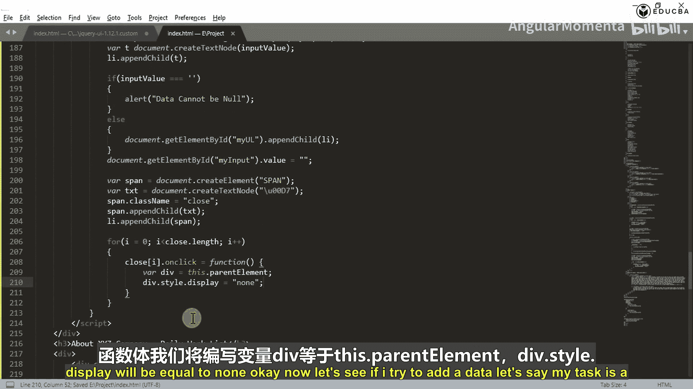

。Lets say my task is a meeting today， so I am writing meeting and I click on the a buttonton Okay。

 still it is not working right， lets see where it we get stuck up。

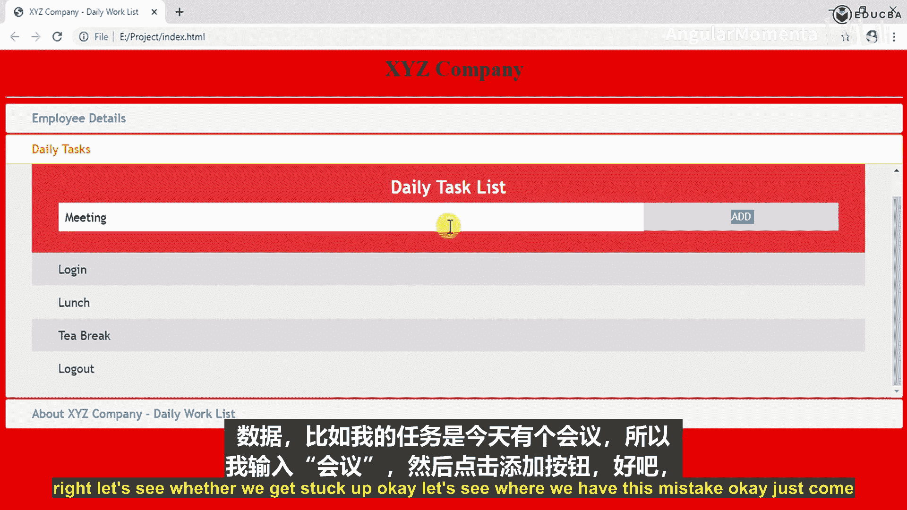

Okay， let's see where we have this mistake。 Okay， just come to the project code and。Okay。It's。

Data cannot be。Now， and let's press controlts will' save this file。

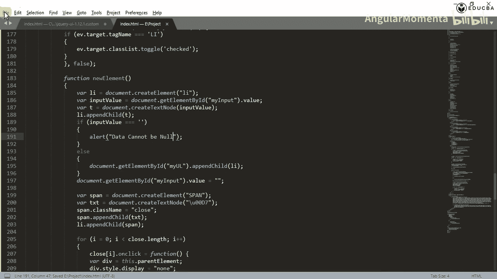

Okay and lets refresh this again now when I come to dailyta lets say I have a meeting today so I am just writing I have a schedule of meeting so this click over here you can see that is added in our daily task list now after meeting I also have an appointment。

那不是他。Appointment with。ABC company。So you can see it is also mentioned now I have logged in my dataum。

 I have took my lunch break， I have done appointment now there three taskcar remaining。

 so if you just come employee details and daily work list。

And to task we can see that this three tasks are still pending for us okay and suppose if I keep it blank and just try so it is showing me data cannot be now。

So this is what we wanted to create， right。So let's see the project output right now。

 So we have created a CsS file which has the jquery Uicss file。

 which is an inbuiled file for our jquery Ui， then we do not have any images。

 but if we wanted to add an images you can add it later on then we have a javascript file which has jquery do Gs and jquery file and jquery do Ui do Gs that's for the Ui concept now whenever you are working with the jque Ui internally you have to add the jquery file with it otherwise it will not execute and we have created a one page application which is our index do htl page So whenever I click and open this page and get the first tab this is the first tab c in which we have created three aus right in this accordus we have said the first aorus for employee second is for the daily task and third is for the company details so we just mention a company details over。

So when I click over here， I will get to see the name of the employee。

 the designation of the employee， the email address of the employee and the contact number of the employee Okay。

 whenever I come to daily tasks， so these are the few very daily tasks which has to be done you want to add it as let's say if I have a meeting。

So meeting with person name。 So let meeting with。ABC， I just wrote the name and I mentioned it。

 this click on add。So when I click on that this particular data will be added in our list now lets say if I have appointment as well。

Okay， so I'm just writing appointment。With x Y Z and click on Add。

 so I got one more data added in a list which is appointment。

And also I have one project deadline today， So I'm just writing like this project。Deadline 4。

Let's say G。对。So this all things are now added in my list right now from this I have completed my task as a login task。

Suppose by chance if I click on it， I can I can re clicklect on it， it will get to toggle case okay。

 so I completed my login task I completed my tea I have completed my lunch。

 I have completed with meeting appointment。 So like this I can do it。 Now this task I want to remove。

 suppose let's say right now that the appointment with X Y had got。Cancellled。

 so I can remove this from the rest。So this was my editors out of which have completed dismal data and this is about this company and about this software this creating a jquery Ui dialog box okay the best and ideal use of jquery Uis is that it provides you the user interface the provides you the CS files as well So whatever file we are calling there is already styling done for it we do not need to style according right so it is like most simpler concept for us comparing to any other because if we work with jquery we have to write styling by our own right but we are working with jquery Ui we do not have to write more of styling which is need to mention that which styling has to be called with the class which has to be called that's it the styling will automatically appear on it thats the most advantage and benefits of jquery Ui。

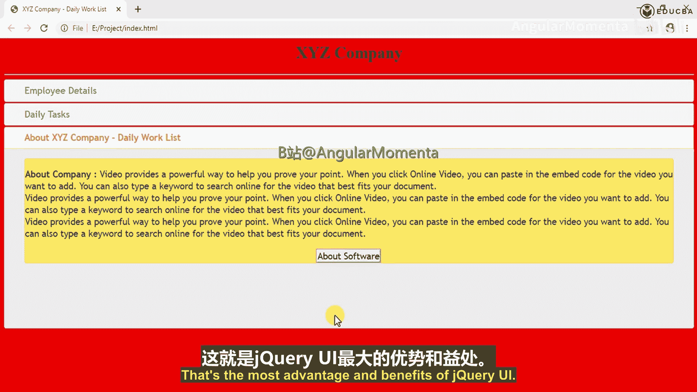

I hope you like this。 Thank you for watching。😊。