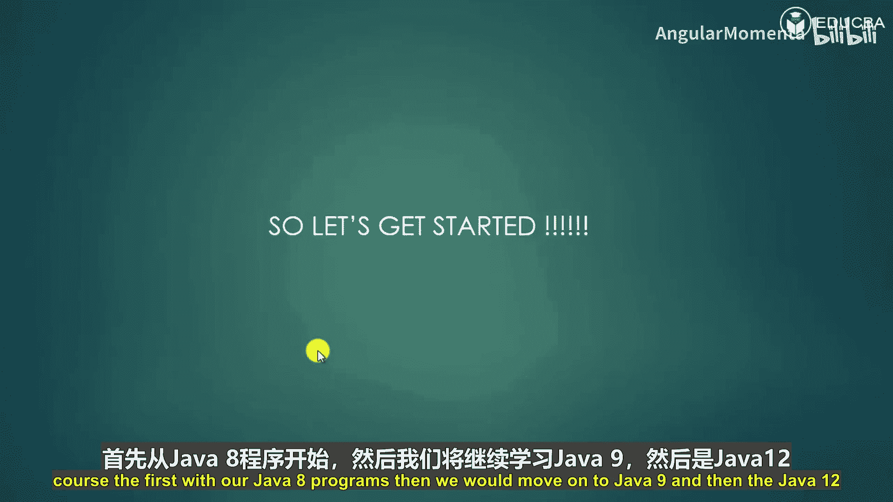
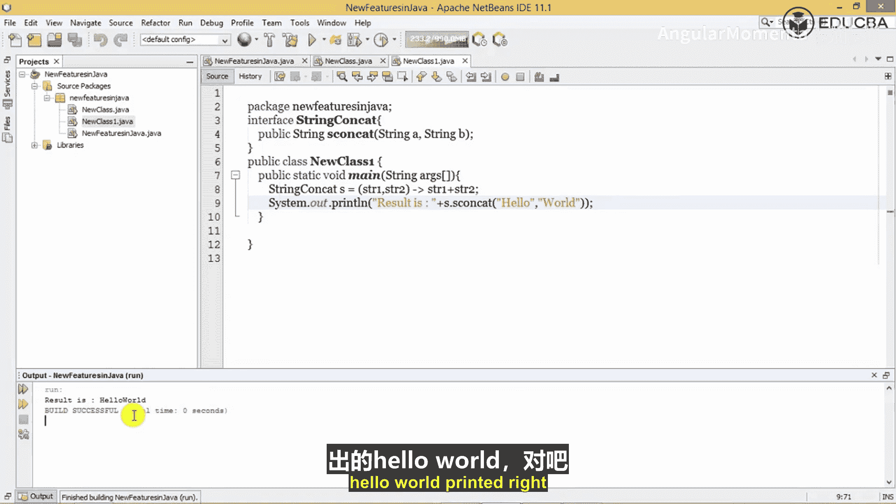

# 【EDUCBA】应用现代Java特性编写简洁高效的代码 ｜ Apply Modern Java Features for Clean and Efficient p01 01_01_01_课程简介 -BV1twFSzNEZ3_p1-

🎼Now， we will see in this course some new features which are added in Java 8。

 Java 9 and Java 12 features Okay， so now first let us see what topics we would be covering in Java 8。

 We would take a look at what are the Lambda expressions， What are the method references in Java 8。

 What are your functional interfaces Similarlyly， what do you understand by Java strings。

🎼More advancing strings is your stream filters， and then we would look at also interface changes in Java 8。

 Similarly， some enhancements which are done for Java for each loop。

 Then your stream collector classes。Moving ahead， we would look at what are string joiner classes。

 What is the optional class and what are your aries， parallel sorts。 Now After this。

 we would move on with some topics in Java 9 session。

🎼That is your private method in interfaces try with your resource enhancements Moving ahead。

 we would look at anonymous inner classes， Similarlyly。

 what is stream API enhancements and your Java 9 modules。

🎼Then we'll also take a look at Java 12 in which we have G stream API。

 some compact number format examples， new methods which are there in strings。

 and your switch expressions。🎼Now for all these things what you need is first the Aure Nebes IDdeE。

 which you can download freely from the given link below Similarlyly。

 you will have to also download the JDK 13 version from the given link it is also freely available and downloadable on your Windows Mac or。

🎼Uix operating systems Okay， so with this let us start creating or let us start in this course the first with our Java 8 programs。

 then we would move on to Java 9 and then the Java 12 version。

🎼So let's get started for it。Now in this session we will start with our Java Lambda expression Now a Lambda expression is basically a new feature which is introduced in Java 8 and it is an anonymous function which basically doesn't have a name and it doesn't belong to any class also now the basically the concept of Lada expression was first introduced in aISP programming language now to create a Lambda expression we specify the input parameter if there are any on the left side of the Lambda operator now the Lada operator is a dash and a greater than sign and place the expression or a block of the statements on the right side of the Lambda operator so now we can create the Lambda expression versuss some methods in Java for example a method or a function in Java basically has main parts like name the parameter list the body and the return type whereas a Lambda expression in Java has only the main parts like only has a body and the parameter。

No name function is anonymous so we don't care about the name parameterrameter list is there body is the main part of the function and there is also no return type as Java 8 compiler is able to infer the return type by checking the code。

You need not mention it explicitly in Java 8， Okay， so to use Lambda expression。

 you need to either create your own functional interface or use the predefined functional interface provided by Java an interface with only one single abstract methodist called functional interface。

 For example， you can have runnable callable action listeners etc。

SoWe'll create one Lambda expression example now without using a Lambda expression like prior to your Java 8。

 we use the anonymous inner class to implement the only abstract method of the functional interface。

 so let us see an example for that， for example， let us go to a new project well create here and Java application。

Let's give your name， new。Features in Java。Finish now。

 all the quas we would be saving it inside the sea。Particular function。 Okay and now。

Well create the first Lambda expression with no parameters as an example。

 So let us just quickly remove the comment part which are not required at all。So， now here。

Let's create。Seeing， she utter it。Functional。Interface。And then， we create your。Say interface。Now。

 let us move this here。😔，Okay， see interface and my。Functional。Interface now inside this。

 we are creating a public。String。s。Hello。With no parameters。 Now in this class here。

 we are having the main method。 Okay， which is taking the string expressions。 and in this。

 we are saying， say my。Functional。Interface， say MSD is equal to。0， and here we are giving。

Say return and double quotes， hello。End it。 and then we say。System dot out dot。Saapprint Ellen。

Say Mg dot。See hello。Close it。And then close this。 Okay， so now here。

So now if we execute this block of core， we'll get the string hello as printed as the output now well see another Lada expression with a single parameter how to create it。

 so let us go to our source package and let us create here a new Java class。Finish。

 and in this Java class， well have to again， create an interface。See。My。Functional。

Enterface inside this will again create heres public end。Increment。By 5。

 which takes int a as the parameter that's it with the interface 1， right。

Now here well have to give a different name since our package is the same。 Okay。

 so now in this class， we are going to create public。Static void mean with string arguments。

 and inside this， we are going to create semi my。Functional。Interface 1。F is equal to pass their nu。

Sa nu plus5 is what you want to return and then you say system dot out dot， print El， say F dot。

Increment by。5 is the one that you are calling and you are passing there the parameter as 22。

 So now if you try to execute to get the 22 plus 5 that is 27 as the output right now let us see another blur Java example for multiple parameters to be passed in the Lambda expression。

 so let us create a new Java class here。And， unlike。We'll have to， again， create， and。

Interface see string。Concat and the name。 and here we are having public say string S concat。

 which is taking string。A as the parameter and string， B as the parameter。 Then in this class。

 we would be creating public。Static void main with string arguments and inside this we are creating string。

Conc object S is equal to say S 1 comma， SR 2， and that is equal to you want it as S 1 plus S 2 and here you are saying out do print Ellen。

 say result is。And giving her a start S concat， give her two strings， say hello， comma world。

Ended with the semi column so here you will get the output as hello world printed， right？

