# 【EDUCBA】应用现代Java特性编写简洁高效的代码 ｜ Apply Modern Java Features for Clean and Efficient p07 03_01_01_Java 9 模块 -BV1twFSzNEZ3_p7-

Now let's see in Java 9， we have introduced modules as a new feature。

Now we'll cover basically everything like why do we need modules What is a module and how to create a use module in Java。

 So let us just get some little background on water modules basically Now a Java module system is a long overdue feature of Java and the module system is a part of the project which was initially planned to release in Java S7 but got delayed and postponed to release in Java 8 yet again because it was huge and prestigious project it has been deferred from Java 8 release and finally released in nine version So now here why do we basically need module in Java the most important feature of Java is reusability and it allows us to reuse the classes that we have created with the help of inheritance and even interfaces we can inherit behavior of a class with the help of inheritance and can inherit the abstraction using interfaces Now to reuse these classes。

Efficiently， Java has grouped them in packages， and it is done in such a way that so similar types of classes are in a single package。

 Now， for example， when we are working on collections。

 most of the classes and interfaces that we need are in the Java do U package so they basically are been clapped together into one package over time。

 as our code size increased， the packages in Java also got increased。

 So imagine working on a very large program using hundreds of packages in such case。

 it is very difficult to understand which class is using what So packages are a great way of organizing classes but there needs to be way to organize packages also when we need to use several of them in our code Now。

 also the only way to make a class reusable between package is to make it public and when we make it public。

 it can be used by anyone。 This needed to be addressed as well。 So in Java 9。

They have introduced a cool new feature to solve the issue that we discussed about。

 It has introduced a new feature called moduleule， which is a set of packages。

 moduleule not only organizes packages， it also takes care of the accessibility so that the part of module that we want to be reused can be used and the part that we don't want to be reused。

 can't be reused。 Okay， so now let us see how this modules we can create with the help of codes and some statements which we can use for creating them。

 Now let's understand what types of modules do we have moduleule is a set of basically a package and we have two types of packages in a module One is the exported package。

 One is the concealed packages。 Exported packages are intended to be used outside of the module。

 which means any program residing in any other module can use these packages and concealed packages are not intended to be used outside。

 They are internal。to the module and can be used inside the module only now to further understand the concept of exported packages and conceal packages。

 we'll take an example， say of Java dot base module now let's understand with the help of the particular diagram that we have here exported packages which have several number of exported packages but only few of them these packages mentioned as outside the class and these packages are conceal packages where we have accessible to these packages are accessible outside the module also now in Java if we define the module in the module dash in4 dot Java file and to mention any packages as exported packages we mention the name of the package after export keyword as suppose for example。

 now in Java dot base suppose you have some exported packages like Java do iu or Java dot time or Java dot Uil or Java donet。

Or Java dot Lng， you may even have some console packages like Sun dot security dot provider。 Now。

 while creating this， you may have a file name like a module dash info dot Java in which you may have a module。

 say Java dot base in which you are exporting Java dot iu Java dot time Java dot uil net or Java dot language。

 So now let us see an example of creating and using a module。

 So first we'll see creating a class in a module and then use that class in another module。

 So for that we will create here a module with a name， say create a module dash info dot Java okay。

So now here we are going to say right click here， say a new， let's go to other。

 and here we would be creating a Java module info。

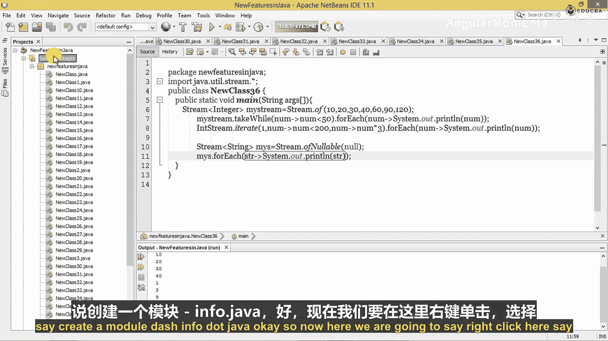

Okay this is the module info which we are creating and let's finish Now you see you get this module new features in Java as a name created now inside this you now this you will require Java 9 on the higher versions for this two created so once you have created this module now what you can do is okay now better optioners will create here a new project and we'll go for a Java modular project here let's create a Java modular4 and the platform will be JDK 13。

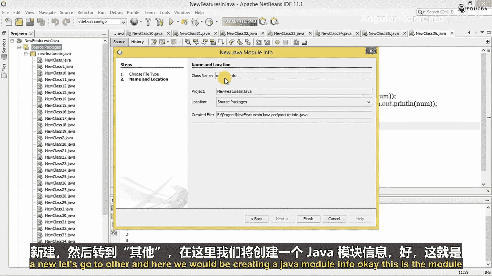

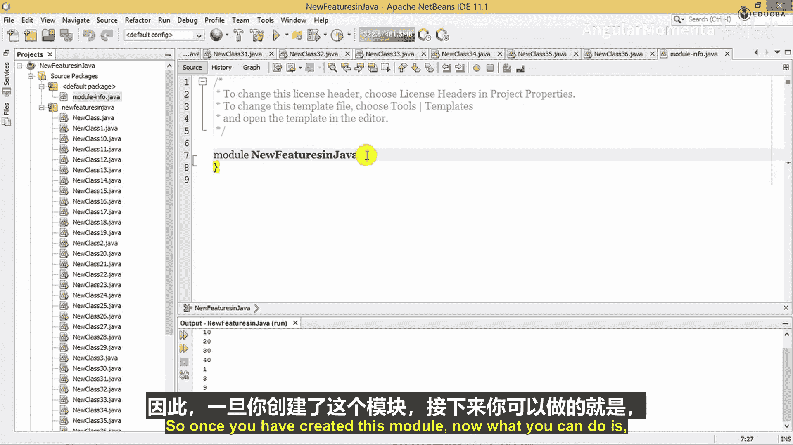

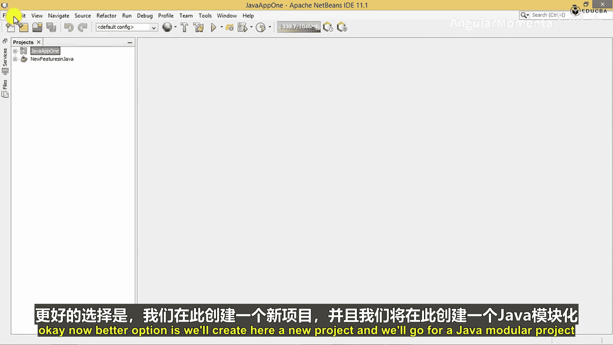

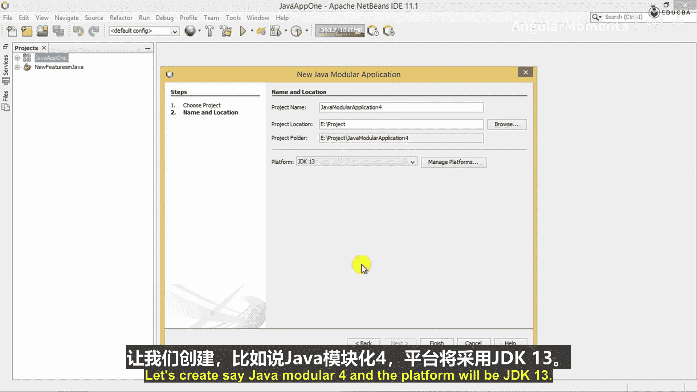

So here first thing is we'll have to create here a module Okay。

 so now let us create here a module name as okay， so let's create here， say hello world。

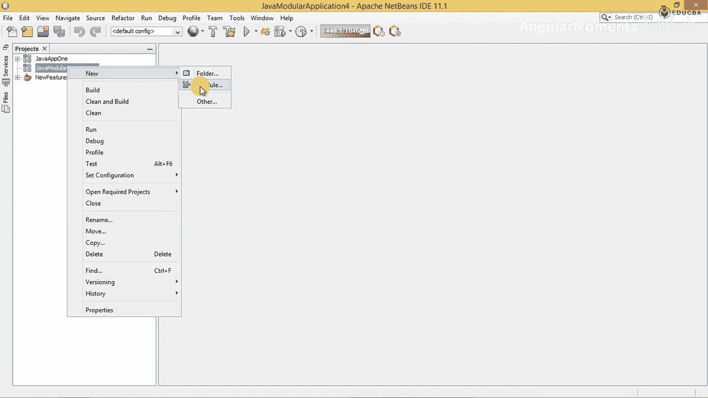

And。We'll create one more module， set test。没丢了。Okay， now， first in the hello world module。

 we will create a package， we name it a calm dot。Hello world dot appP。And in this。

 we will create here a class named。Hello world。Okay。

 now this is the package that we have created and inside this module now。

 what we will say is we will say export。

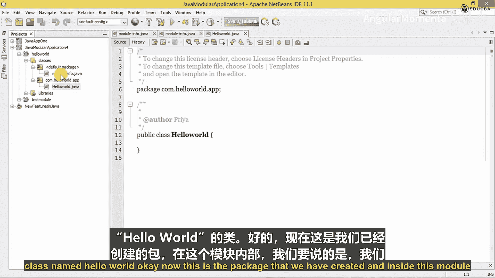

Comm dot hello world dot APP， Okay， and in this， say will have a public。Vid。Okay。

 let's take it public static void。See。Hello， and here we are going to say system dot out that。

Sa print Ln。Welcome to module。Okay， now this is what we have created in module info we have told export this package。

 We have this package wherein we have this class created， which is having a static method。

 say hello now in this test module， okay。What we would create is inside this module。

 the first thing we would say is。Now， here will give。Sa requires。Hello world。Okay， and again here。

We will create a package now that package will be in test module。

 lets give your Com dot appP as the package name and here we create a new Java class say new class okay。

 and now in this here。

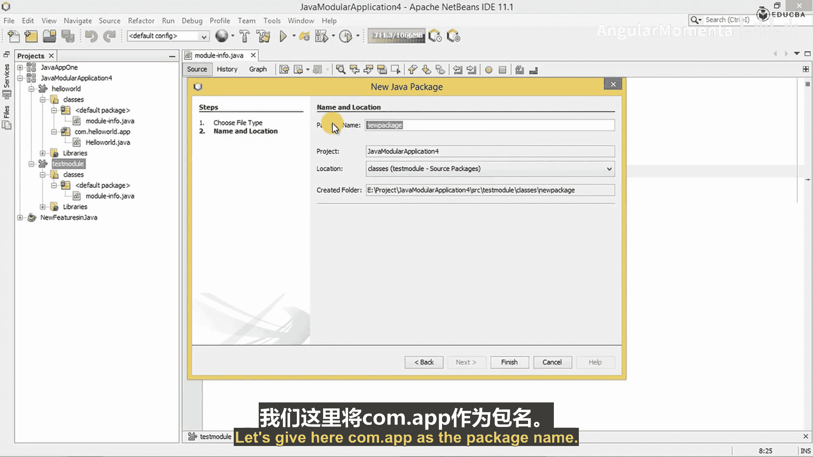

Well say， import。See calm dot。Hello worldld dot app dot hellello world。And inside this。

 we will have public static void main， which is having。A string arguments。And inside this now。

 again here we'll say。Hello， world dot， say hello。So now if we try to execute this main。

 we get welcome to module printed， which we have created as a module in hello world package Com do hellello world。

t app， hello world。 Javava， so this particular package we are importing it in another module。

Wch says requires hello world and we import co hello world app do hello world and we print or we call the static method here。

 So this option of creating such modules inheriting those are importing those in some different modules and use those classes in some different modules is available only after Java 9 versions or later than that。

 not earlier to Java 9 Okay so with this we have seen an example of module also how to create and how to use it in the same Java application fine so now well continue more on such examples of Java to2。

 but in the next session thats it from this session Thank you very much。

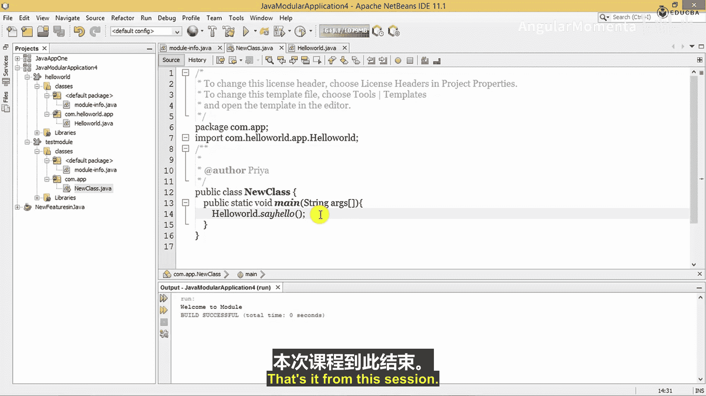

Okay， so now let's see some new features which are introduced in Java 12 out of which the first is our stream API collectors taughtt teeing。

 Now， Java 12 have added a new static method named Ting for collectors that accepts two collectors and a function to merge their results。

 Okay， now we will see an example on the same。 So for that the first thing we will do is let's add a new Java class。

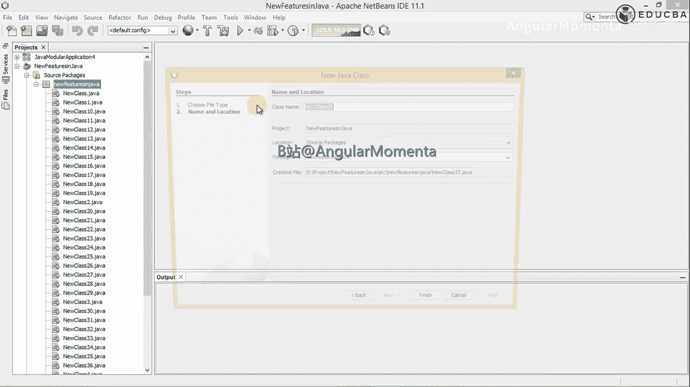

And let's add the。First， let's import some statements and then we'll go for main methods。

 So here we first import C Java dot uil dot。

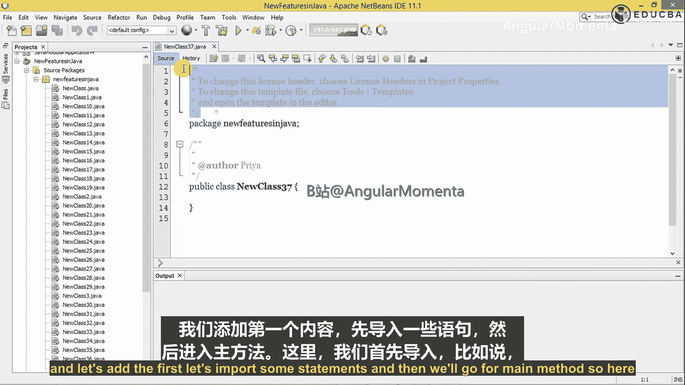

List is the first class that we are importing here。

 after which will also require u dot arrayries to be imported， so well say import Java dot u dot。

Adds。Okay， and then we will import， say， a static。Java dot。

Uil dot stream dot collectors dot star so all the classes or methods of the collector class is what we are importing then we have a class created in which we will create public static void main we take here string arguments and in this method we will first create say a list of in teacher named numbers is equal to we say array dot as list and in bracket we give some values here okay after which we will create a double variable named average which is equal to initially0 D which is no value initially then we run a4 loop saying4 say。

Integer number in。Numbers， and in this furlough， we say。

The value of average plus is equal to you will。Convertted to double the value of number。

 then divided by。Same number， dot。Size， open close bracket。 and it。 Okay， after this， we go for。

Say system dot out dot print Allen， and we print a value of average here。

 then using a collector Teaing class， lets see how can we do it， we say here， say average。

Is equal to say number dot stream dot， collect， and then here we write down Ting。Okay。

 and in this we give in the bracket say。Summing dot。Double in bracket， I。

Is the navigation mark that we are given and then we give here a comma and we give there。Sa counting。

Then。Here we give in brackets， say sum comma n。Navigation。Saying sum divided by n。

Divided by n okay and after this we say here system dot out dot print L again print D value or average。

Okay。So， here。We are seeing summing double。Okay。So we will just remove the double part。

 and that is summing double in bracket we give the。

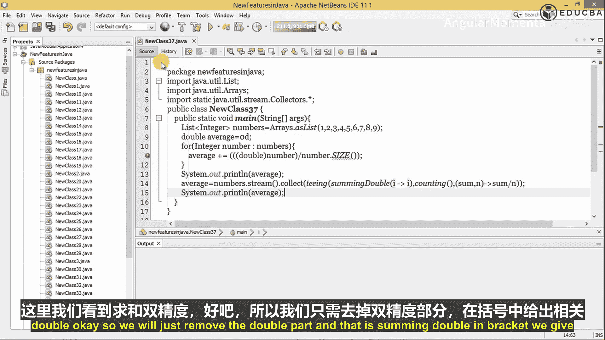

Tings and then we try to print it now after this， let us try and execute and see both the output that we are getting what is the value when we are doing it as a normal way。

Okay， this issue is of your size method。 So here we are using。

Sa numbers do size because numbers is what array we have created。

So now we give use here number dot size fine so now well get the output by using in a normal way by running a loop and putting on the average or just by using one single line of using the Teaing method of your collector class so in both the ways your output doesn't differ it is the same right now we will see another example which will be basically demonstrating the use of your stream filtering to get the downstream collectors okay now in this case we will be filtering some cities in Asia say with the cost of living which is less than or equal to 1000 so for this we will first have to add a Java class and we will have to start with the import packages first so。

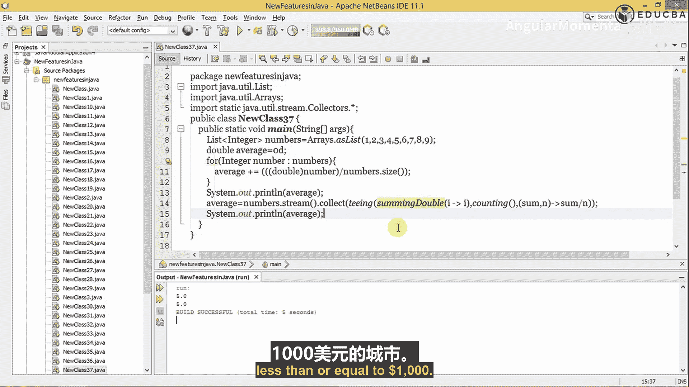

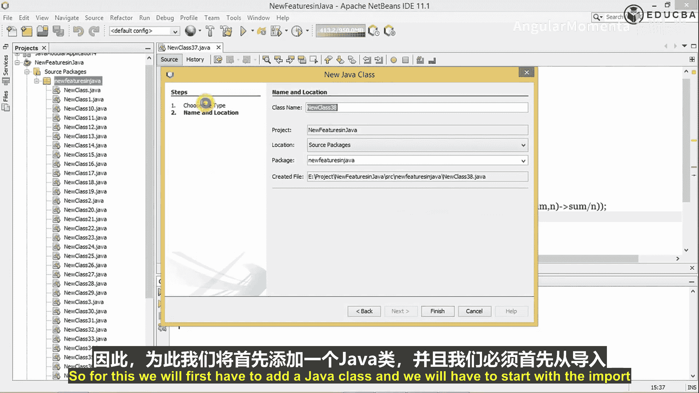

Let's start with import， say Java dot， Uil dot。Stream dot。Collectors then will import Java dot U dot。

Stream dot， stream， and then say import static Java dot。Uil dot， stream dot。Collectors dot star。

 Okay， now after this， we have the class。 and now here we would be creating public static void main with string。

Arguments and here we would be creating first a result variable。Okay， so here we create save result。

 which is equal to we say here stream dot of and then in the bracket we say here。Same new。City， okay。

 and here we are going to create， say。这龙不。In south。Asia。Say 9，8，7。Then， new。City。In bracket。

 next it is say。Dalt。South。East。Asia， say 9，1，4。Then again， new city， Okay。

 and again here we say another city name。In。Said Eastton。Europe。One，3，3，4。Again， new city。

Now here we give say Melbourne。😔，And。Australia and here we give 30，50。

Then against a new city in bracket， we give here。Shanghai in East Asia。And that is 1，9，9，8。

 Then again， new city as。Doug has out。In say， north。Africa。And that is 1，0，6，7。

2 and the last one will take new。City as a wood。In Southeast Asia， that is 1，3，3，1 with this。

 we close it。 and here then we say dot。Collect。Se collector start。Ting in bracket here again。

 we use first option。 That is say。

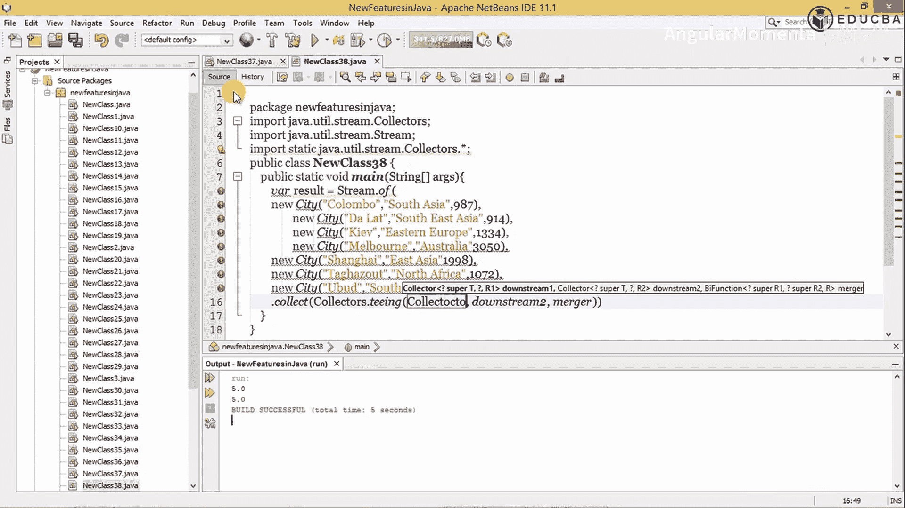

Collectors。Dot。Filtering。And we use here in bracket。Say all。And that's your city。Oh， dot。Region dot。

Contains in bracket， Asia is what we want to check it for。 bracket close。 We use your and。Yeah。

Let's continue it。On the next line and here we are giving。

 say again city O dot the cost of living less than equal to 1000 comma。Then， we give here。See。

Collectors dot mapping in racket O。With your。City。Dot name。讲吗？Collector， start。Toolest。

Bracket close again， a comma after that。 And then here。

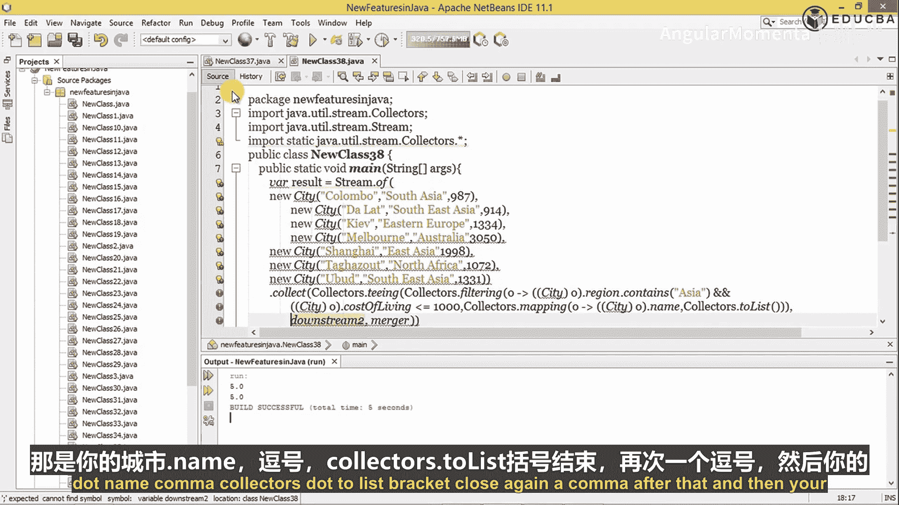

Let's write down the next one that is your collector stored。Filtering， and here we take。

Let's remove this part， or， as say。City。Oh， dot。Region dot。Contains again。Asia。Okay， and。

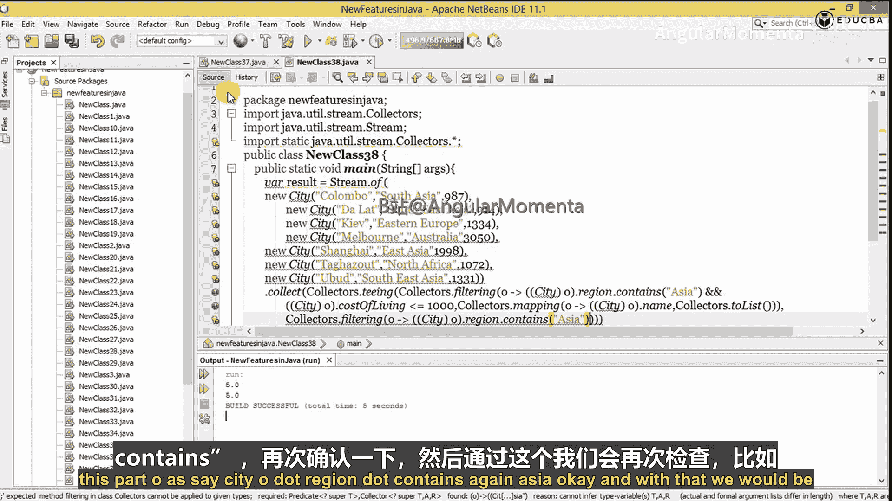

With that， we would be checking again， say the city。哦。Dot the cost of。Living is less than equal to。

1000。Gma。Sa goウピ。Coma and then for the merger one， we use here， say L C。

As we say here result in bracket， we say cities is equal to and the value of L。

 then again open double quotes， give a comma， say count is equal to。The value of C。

Then again close the bracket， close it and end it with the semicolon。

 after which we say system dot out dot separate Ln the value of result to be printed okay and then we close it here the main method okay and now we open another static class below so here we say static class city now and inside this class city now we create say private。

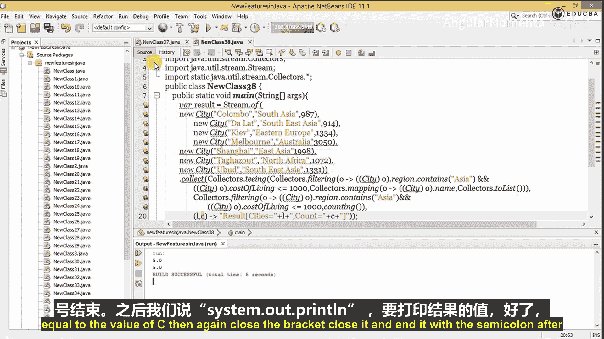

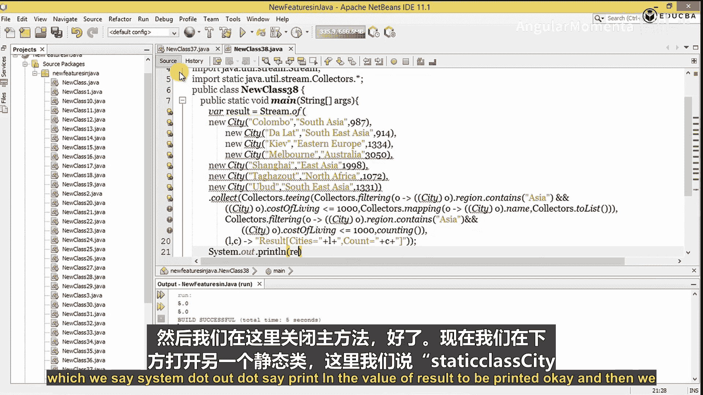

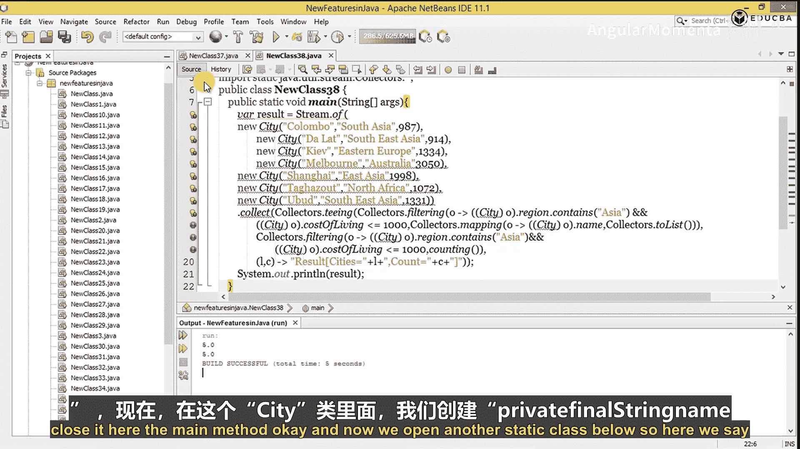

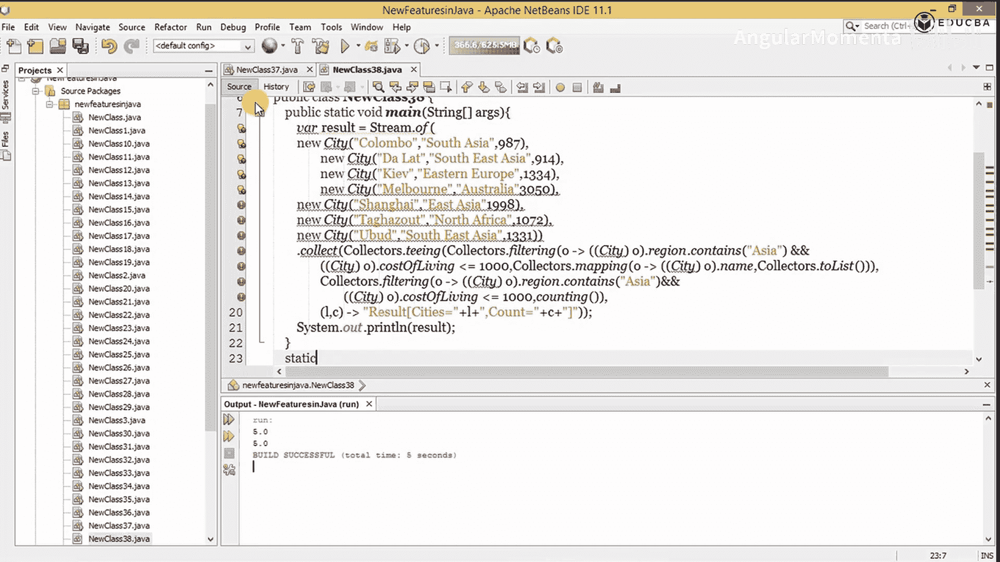

Final。String name。Then we have private final string region。And then， we create。Private， final。

In teacher， say cost。O。Living。And then we create here public city as a constructor。

 which takes string name， it takes string region， it takes in teacher。

cost of living as the parameters and it initializes this dot name equals to name this dot region equals to region and this dot cost of living equals to cost of living with this the constructor ends here after the constructor ends we create here a public string saying get。

Region。And here we are saying return the valley of region。 Then we have another。Public inte。

 Se the cost。Off。Living and this is going to return the value of cost of living here。Now， after this。

 we close everything， let us save it now if we see the errors must have gone here。 Okay。

 now why is this where error coming here， we are creating a new result variable inside the main method。

 Okay， so for that， we have imported everything proper， if we see here where result。

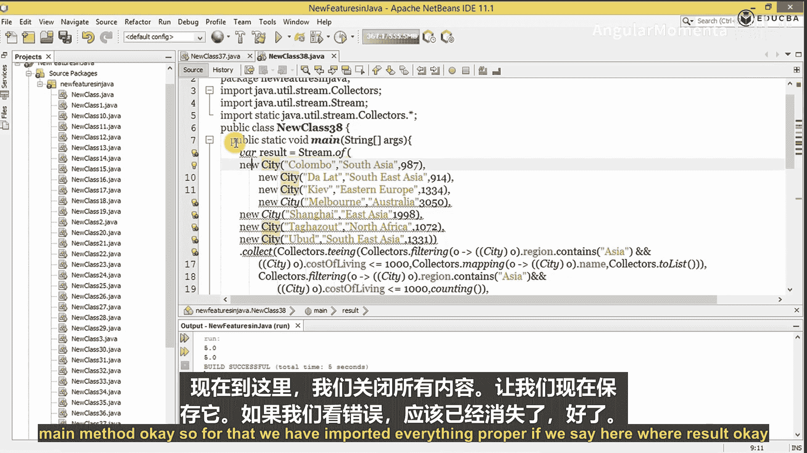

Okay。

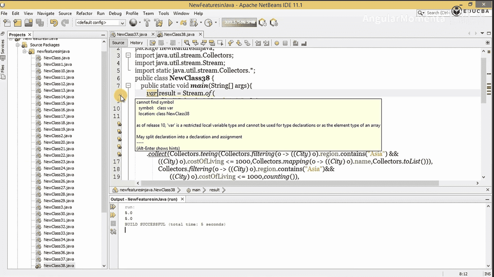

Yeah。Let's see。One thing， if you go in the properties option here， okay。

 the source has to be more than this because now you are using all the concepts which are there in Java 12。

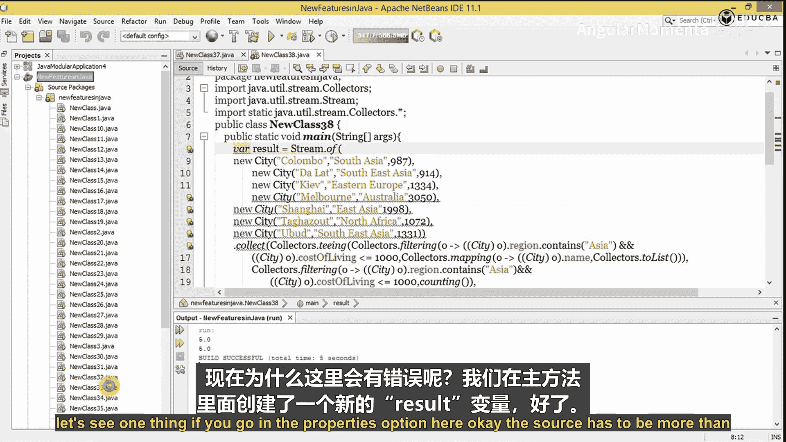

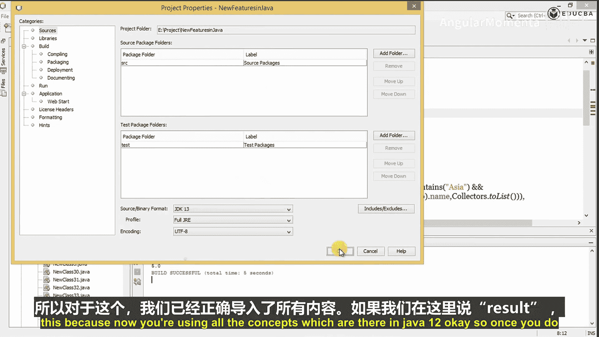

Okay， so once you do that， then the error would be gone and now here。You are getting this， okay。

 because you have not given here commarma， similarly goes over here also。

So all the errors have been gone now fine。 so now if you try to execute this。

 you will get the results it is asked Colombo because Colombo it is less than 1000 and it comes in Asia then you have dial which is also in Asia and it is also less than 1000 rest all are more than 1000 so both the conditions are not matching hence you will get only two values being fetched depending on the filtering and the mapping option which is there into your Java dot collectors do Ting option right so now with this we have completed some examples on the Ting part now let's move on to the next new feature introduced in Java2 which is your compact number format examples so we'll look at those examples in the next session that's it from this session。

 Thank you very much。

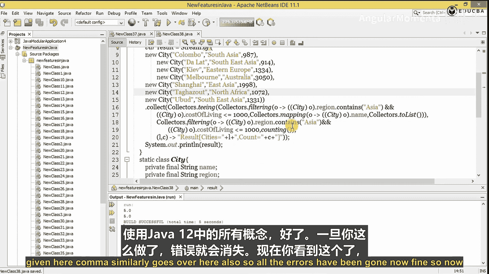

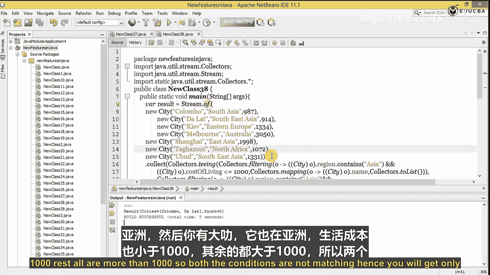

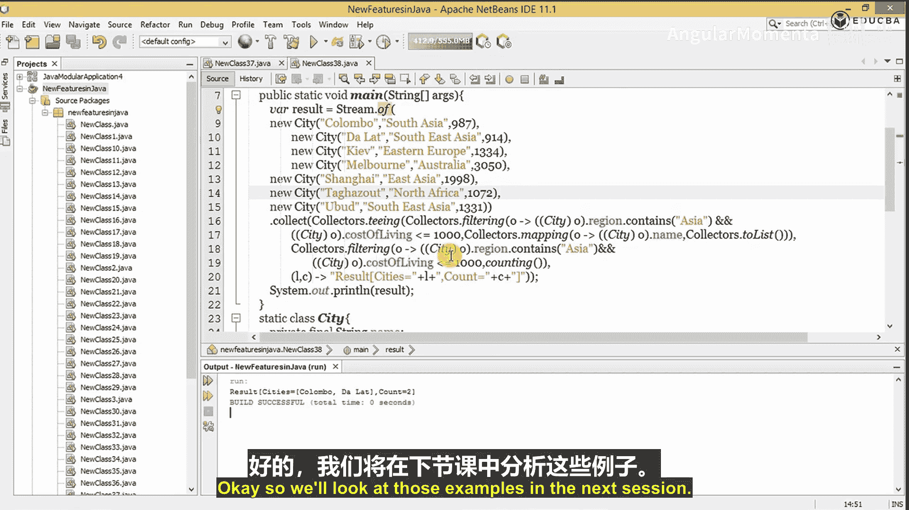