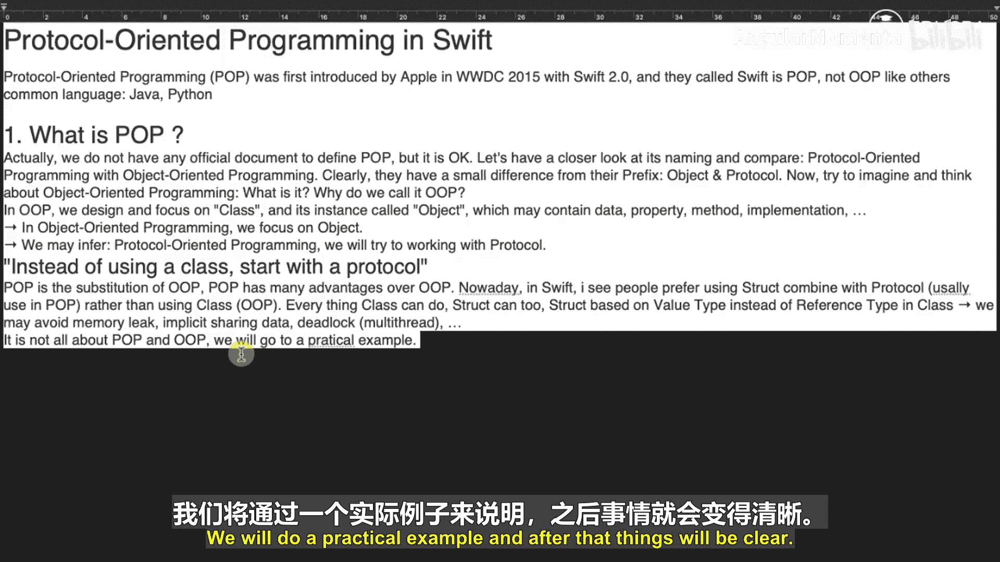
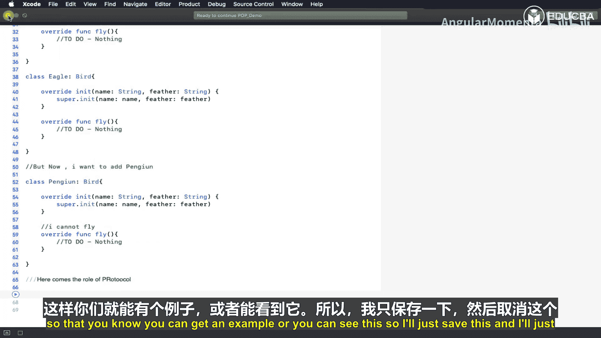
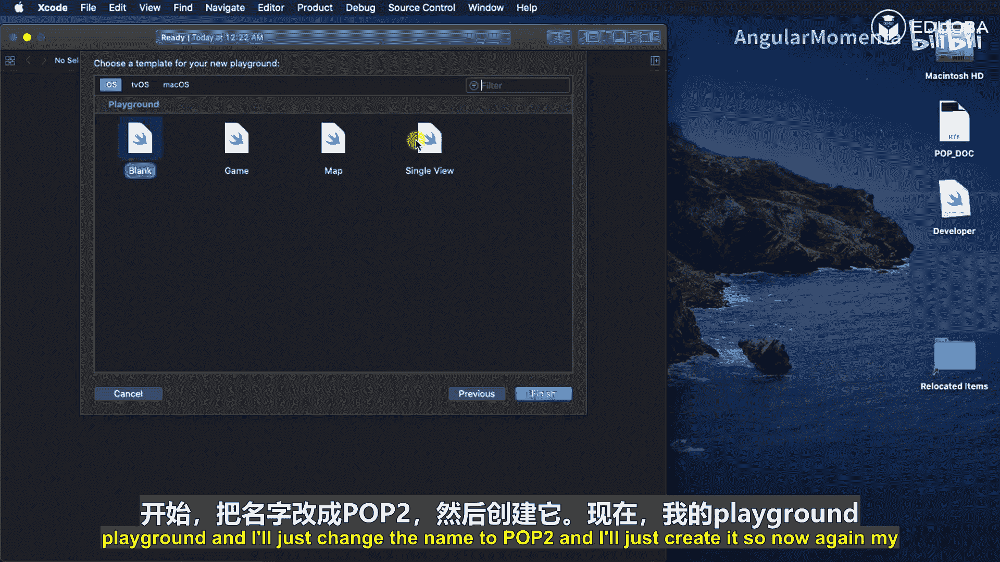
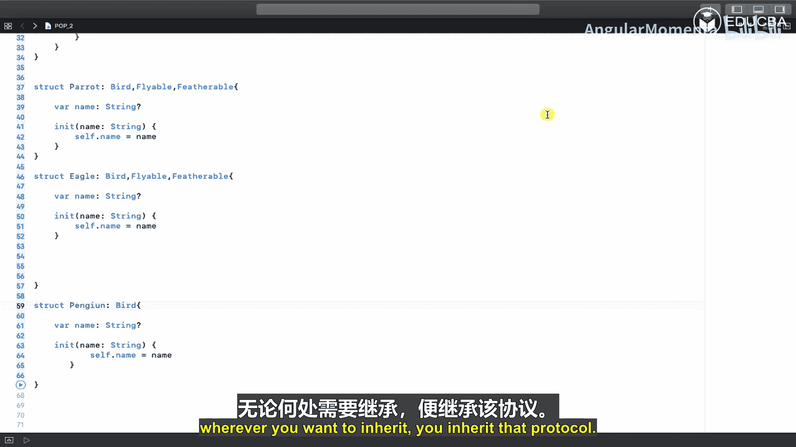

# 【EDUCBA】在Swift应用中应用面向协议编程 ｜ Apply Protocol-Oriented Programming in Swift Applica p01 01_01_01_面向协议编程导论 -BV14AFSzeE8A_p1-

Hello friends， a very warm Good morning to you all Today I'll be giving you a presentation on protocol oriented programming and it is one of the most important topic in shift So before giving you a practical example of protocol oriented programming。

 let me first give you some important points about protocol oriented programming So this is my protocol oriented programming in shift Pro oriented programming which is also called asPOP was first introduced by Apple in Wwdc 2015 with shift 2。

0 and they are called in shift SPOP not Oops which we have studied。

Oops is famous in other languages like Java， Python， Shisha， etc， etc。

 But now in shift there is a new concept protocol oriented programming。

 So now what is protocol oriented programming。 Actually。

 we do not have any official document to define protocol oriented programming。

 but it is okay let's have a closer look at its naming and compare Pro oriented programming with object oriented programming。

 Since everybody of us are familiar with object oriented programming So let's discuss something more details about protocol oriented programming。

 Clearly they have a。Small difference from their prefix，1 is object， and one is protocol。

In object in oops we define as object toiented programming in P we define as protocoliented programming。

 so this is a difference now try to imagine and think about object toiented programming what is it why do we call itOops。

 in object toiented programming we design and focus on class and S instance what we call as object。

Which may contain data， property， method and implementation in object oriented programming。

 we basically focus on objects。 We may infer protocol oriented programming。

 We will try to working with protocols。Instead of using class。

 start with protocols since protocol oriented programming is based on protocols。

 so start with protocols。Protocol oriented programming is a substitution of Oops。

Protocol oriented programming has many advantages over Oops nowadays in shift I see many people prefer using structure combined with protocol oriented programming rather than class which uses Oops。

Everything class can do， structures can do。Structure is based on。

Value type instead of refresh types as class is based on reference type。

We may avoid memory leak in protocol in program， which is a very good thing implicit sharing data。

 deads that is multiple threading。It is not all about PopianOs， we will do a practical example。

 and after that things will be clear。

Hello friends， So now I will be giving you a practical example of protocol oriented programming and object oriented programming。

 So for that I am taking a class。Im taking a class called B， and B will have。Bird class。We'll have。

Two properties。1 is。One is name。And the other one is。Feaathm。So according to that。

 I am creating a class called B。完成嘅。This is a playground which I am using。 So whenever you open Ex。

 you do a new playground you'll get this， so this is a bird class。And just opening。

 I said that word class will have two properties， one is named。Which will be of type string。

 as everyone knows。And second one is feather。Which will also be your type string。

And one function every bird has common is fly， every bird can fly， so I made a fly function。Here。

 I'll do nothing。For now。And here I'll be calling a constructor。But。Two parameters。

1 is name and the second one would be。Feaathers。And。Yeah。Self do name。And enter。nameame。😔，Secondly。

 self。Nord feather。Enter feather。喂。So。This is my bird class with two properties and one function。

 the two properties are name and feather and one function fly， then I have to subclass bird。

Illustrate for parrot and eagle， because bird is a kingdom or bird is a class。

 And in this bird class， I want to take two more class with a name called parrot because parrot is a bird。

 And the second one would be eagle。 So what I'll do is I'll create a parrot class。Gasss name parrot。

And here Ill narrate bird class because I want to implement name and feather features of the bird class right。

 so Ill just open here。So now what I'll do is Ill override。

Name and federal feature of the bird class。 Okay， so here I'll just write super。Dot in it。

And here I just post name。😔，And Alpas。Feaer。Okay， and one more thing I need to override is the flight。

Function， so。Function， play。A close。And here， also。😔，Dodo。Nothing。Right， so。This。

I have taken word class。😔，So this is my parent class where I have inherited bird class。

 and I overrite the bird class initializeizers into this class。😔，F。

 because parrot comes under bird category， So I have taken the class name as parrot。

 e also comes under bird category， so。And just do the same thing。 and just copy this。

And I'll just paste this and I'll just change the name to Ee G El。😔，Eagle， right， but now。But now。

I want to add penguin。So there is one problem while adding penguin。 The penguin is a bird。

 but penguin does not have feather and cannot fly。 You know， it's sad for my little penguin。

 We can say， but let's see I create a class called penguin。😔，Class。Pangguin。

 which shall inherit bird again。😔，And， you know， I'll just copy this again， and I'll just paste this。

 and just change the name to。😔，Penguins do that， you know， users will understand properly。And。

I don't want because penguin cannot fly， so I'll just write。I cannot flee。So this is the problem。

 so how to fix this problem in Os。Bird and penguin class in os。 So see。

 So this is a problem because penguin cannot fly， so we cannot do anything。

 but we have to overwrite this。😔，And we have to take these features right so to overcome with this we have to write a protocol so that you know penguin can also enjoy its speeches so create protocol illustrate for flyable we have to rewrite many chors okay and change to static function in case we have 10 to hundred subclass so that is also a bad idea or that is the only thing we can。

You not fix this issue， So what we'll do is here comes the roll of protocol。

So what we'll do is here we create a protocol oriented programming example see。This。

 which I commented this， is a drawback for oops because see this we have override everywhere。

 but one place。We cannot break the chain because， you know， we are using everything for that。

 So in oops。So this is one drawback os， secondly in protocol oriented programming we can redesign our base code change from class to protocol。

 so this class to protocol and structure to solve the problem so now we here what we will do is。

So this was about class。 What I'll do is I'll just save this so that， you know。

You can get an example， or you can see this So as I save this。

And I just cancel this。 right。 So now what I'll do is I'll。😔，Create an open X。

 L do started with new playground。😔，And I'll just change the name to P of P2。😔，And Alice created。

So now again， my playground is open。Now， what I'll do here is I'll create a protocol protocol bird。

Since I told you I replace class with Pro and structure。biird。But we'll have a property call name。

Which will be of type string。Yeah。Get set because we need to set。And one more protocol。Slaable。

Wch will do not have a function called fly。😔，And。Jear， Ill create extension of flyable。😔。

In this extension。What I'll do is。😔，I'll take the function。Flay again。In here， I just print that。😔。

I can fly。Okay。One of protocol I will create。The protocol name would be。Federable。Okay， and。Again。

 here， I'll grade。😔，Feaer。So after string， these are the two properties of birds， right？SoAgain。

Get set。And I need to extend this。Federable。And need to give extension。

 extension are basically giving extra features to the class protocol structure wherever we extend anything。

So， and site feather。😔，Stng and openness。I said， get。Theten， as right， I have。Feaer。In block。

 I don't want to do anything。 So I'm just keeping it open。😔，With extension。

 we do not need to rewrite many codes just when we need to modify or in some special behavior of the flying。

 so we do not need to modify right now so well keep as it is right now what we'll do is we'll create a structure。

Greater structure。As we have。As in the previous example。

 I showed you that we had a class called parrot， so here we' will create a structure called parrot。

Okay。Which will inhererate bird。Fable。Two protocols were unfeavtherable。So Iide where name。😔。

Sative string。ok。In it， El just right name should be named and just type stringing El justite cell taught name。

😔，Equal to name。喂。So this was about bird protocol。And I took this。Now， what I do is。

I'll take one more。Like， like parrot， I'll take some do the same thing to e。Okay。Ele also have name。

 Eaglele also have a flable feature if I do this。😔。

F this method is coming because I have inherited this protocol okay。And infeable also， if you want。

 you can just do。😔，nake。Like this。没。Well。Feaer string。 And here you can do whatever you want， right。

 So this is eagle and Ive taken the bird protocol flyable and featherable， right。

 so ele is a bird I have taken that and bird has a name so I took that eag can fly。

 so Ive inherited this fly。 eagle have feathers I inherited this right So now in case of penguin。

 what will do is I'll just write。😔，Structure。I hope things are getting clear。

 and here I'll just write penguin。😔，And penguin is a bird， first of all， right， So first。

 I'll just implement this。😔，And。See， when I implement this。Its coming structure does not。R to。

So here， they need to implement name seaboard as a name。😔。

This I will copy and Ill just paste this here， right。

 see now flyable protocol had a function called fly。 So since I have inherited this。

 I'll just write fly it will come。Okay， but here in this case， fly will not come。

Because I have not inerated that protocol so as you can see that penguin does not implement too flyable and featherable and does not break over design and structure。

So this is the main funder of using protocol oriented programming is that。See。

 in class we had two properties， so we need to， you know implement those two properties。

 Nevertheless， that two properties are shooting that shooting that class or not。

 but by using protocol or enter programming what we are doing。

 see if penguin yeah penguin is a bird we are just inerrating bird and we are just implementing if penguin has flyable feature well just inhererate the flyable protocol and will do whether penguin has feather or not well just inhererate if penguin have feather will implement feather and from here。

😔，We can just do the necessary action。So you can try to add new birds like ostrich cannot fly。

 but ostrich has feather and see the magic， so friends。You can do all these things and， you know。

 you can test to example by creating protocol or you can create object oriented programming and see different different things。

 What is happening。 So my conclusion is very simple。

 I hope you have a smart look at protocol oriented programming。 Of course POP just be a concept。

 you can apply it if you want， or you do not need to apply it depends on your decision and your problem So friends。

 this was all about protocol oriented programming where we have learned that what is the difference between protocol oriented programming and object oriented programming in case of object oriented programming If we have created a class and we have set those properties to the class。

So， whenever we inherit that。Clas， we have to access that two properties that is compulsory because we are calling the initializers that is constructed。

 But in case of protocol oriented programming， we have protocols。

 and let's suppose we don't want to use some features So we will not inherit that protocol and will not use it。

 So friends this was all about protocol oriented programming， I hope you enjoyed it。

 And whenever now youll be working on any project， please be sure that what is your requirement。

 And accordingly， you just create the protocol。 And wherever you want to inherit you inherit that protocol。

 Thank you。

