# 【EDUCBA】在Swift应用中应用面向协议编程 ｜ Apply Protocol-Oriented Programming in Swift Applica p02 01_02_01_显示水果列表 -BV14AFSzeE8A_p2-

Hello friends Today we be making a favorite list using delegation and model class in this project today。

 what we'll be doing is well be creating a list of fruits。

And well be selecting the fruits which is favorite。

 and whichever the user wants to select and that fruit will be saved in the model class and in another view controller we will be displaying that fruits。

😔，In the list format in the table view。 So before going more further。

 I would like to tell you that we will be also managing the states of the cell selected by the user。

 So let's start with that， let's create。😔，Open Ex my export is 1。2， Ex new project。

 this is a single way application okay。😔，And the one important thing is that in Ex learn。2。

 there is an option for interface。😔，Storyboard or shift I we are creating a storyboard。

 So this it is and I'll just make a name of the project。 I'll just write。😔，Favourite list。Okay。

 and I don't want to use core data， I don't want to include unit testing。

 I don't want to include your testing right， so Ive just created。😔，A project in my desktop。

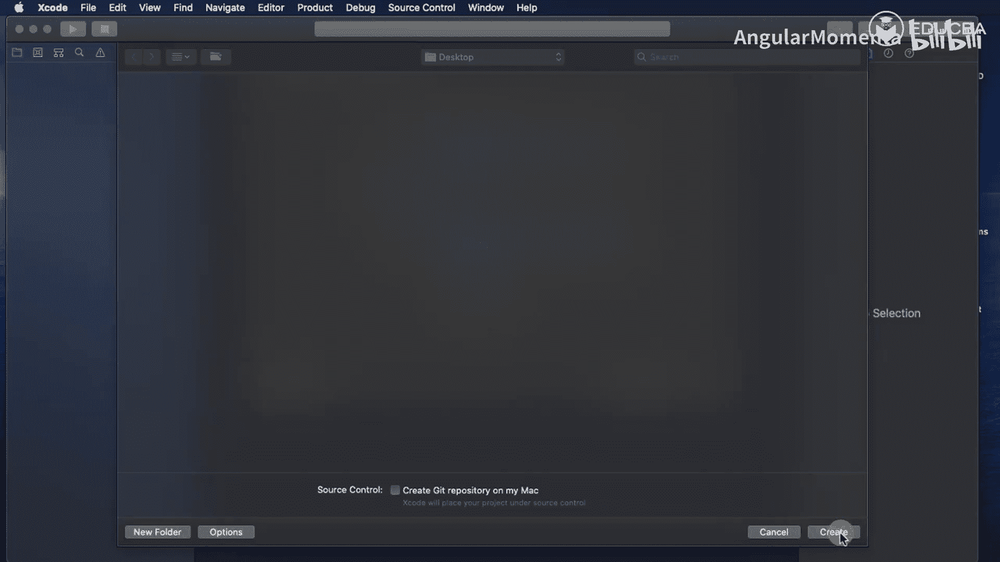

The。Here is the project created， this is the app delegate file which will handle the application lifecycle。

 this is the view controller， this would work in case if I was not creating the UI with help of Stboard so I don't have work of any the scene delegate。

 so this is my view controller class， this is my main do storyboard。😔。

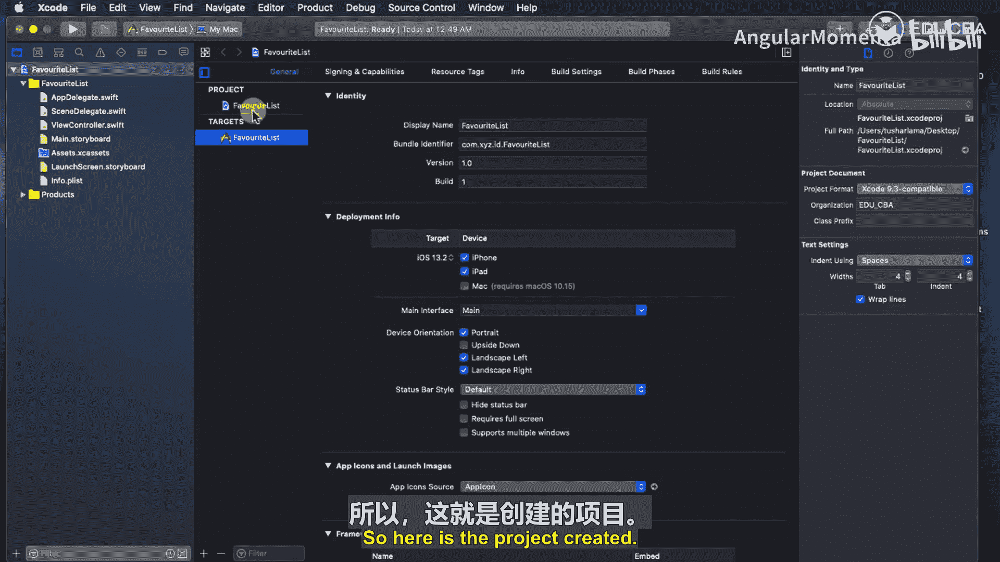

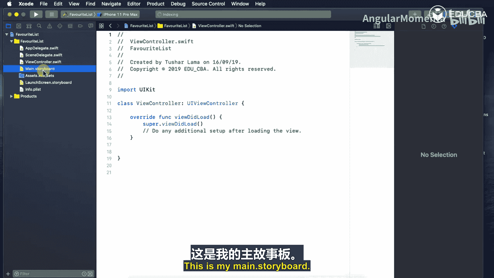

Okay。So now the important thing is that。Firstly。I'll be taking a view controller from here， and just。

Called object library， and I'll just call the table view。😔，And just drag my table onto this。😔。

I'll just make it little small so that， you know， I can see it。😔，And I'll just give that。😔。

Table view。The constrain， right， So now my constraint are satisfied。 so there is no problem。😔，Now。

 the important thing is that。Inside a stable view， I want to give a custom view to the cell。

 So for that， I'll be just calling。😔，U Dev。😔，Youen。So here is my ur USA。😔，Insert the table here。

 right？😔，So my Ui table with will consist of two things，1， the name of the fruit。

 which Ill be displaying and the second would be the button， the favorite button， right。

 So what I'll do is。😔，I'll go again to my object library。

 firstly I'll give a color to the cell so that you know， it is easier for the user to understand。

Let's suppose I gave green color and I took a label。😔，That label I just drag here。😔。

Let increase the height of this level。😔，The increase is the font size to 20。😔，Okay。

 and I'll change the background curve of label to blue。😔，Okay。

 and one more thing is like I'll be creating a button。😔，For the action。

So this is the button where I am just adjusting the size of the button to like40。😔，2，4。

So here will be my button。😔，And one important thing would be I'll give background color to my pattern also I be giving orange。

😔，Okay， so now I'll be giving auto layout also for this。 what I'll do is I'll just open。😔，Leading。

 sorry， leading top bottom。And the second thing would be all this button。

 So button height would would be same。 So not changing anything and。😔，Yeah， I'm making changes。

Right so my cons are satisfied， so now for this cell I need to make a cell class because I need to create the outlet panel。

😔，So， what I'll do is。😔，I'll create a group here。😔，Circus。

But inside this cell class group I will create a new class。And the class would be co qua touch。

And it would be a subclassus of here W cell， So I'll just create。😔，Favorite。Said， right。

So now I'll just copy this and I'll just paste it here， I mean I'll just create a cell。😔。

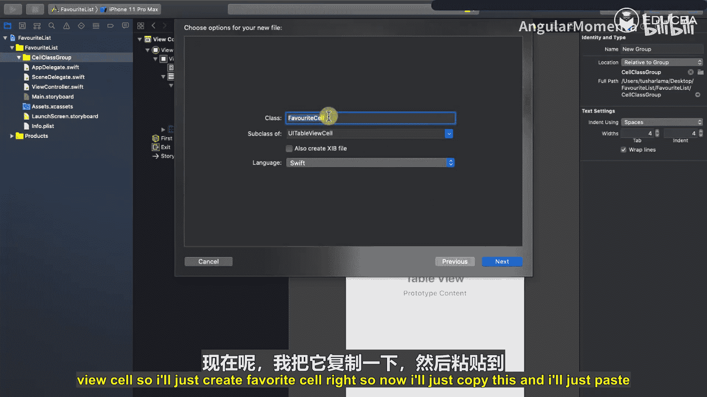

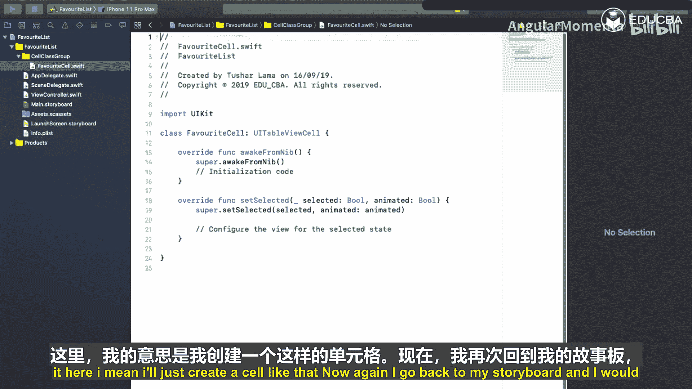

Like that。 Now， again， I go back to my storyboard。And I would assign class to this。

 So this is my table with， I am giving the identified name as the same class name so that it is easier for me to。

😔，You dont understand。So now the second thing would be I would be creating the outlet。😔。

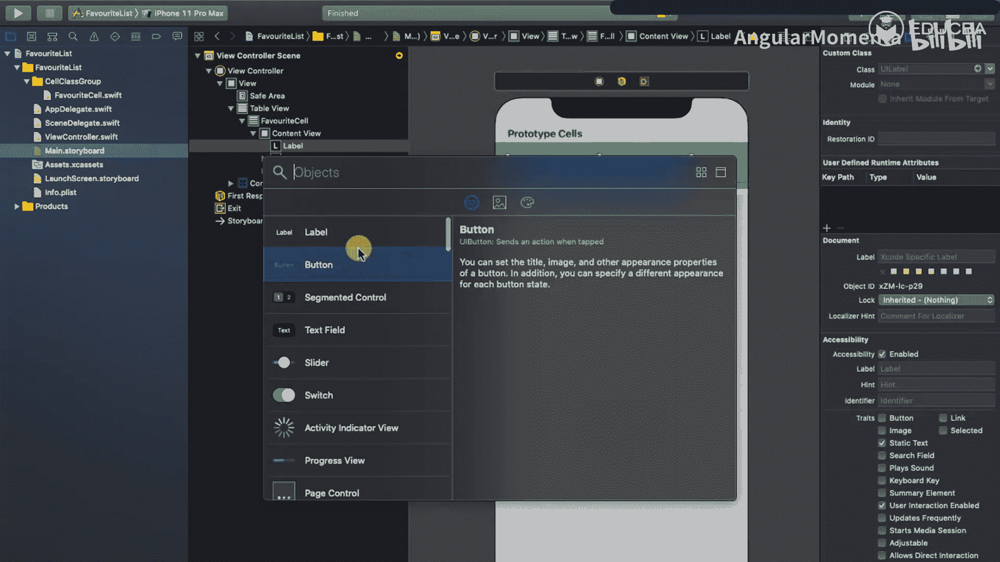

So， here。What I'll do is， firstly， I'll create the outlet of this table view。 So I'll go here。😔。

And assistant。So， now。And just drag。And ho this and。Favorite。Davieven没。😔，Right。

 so this is favorite table view second would be。😔，The class。

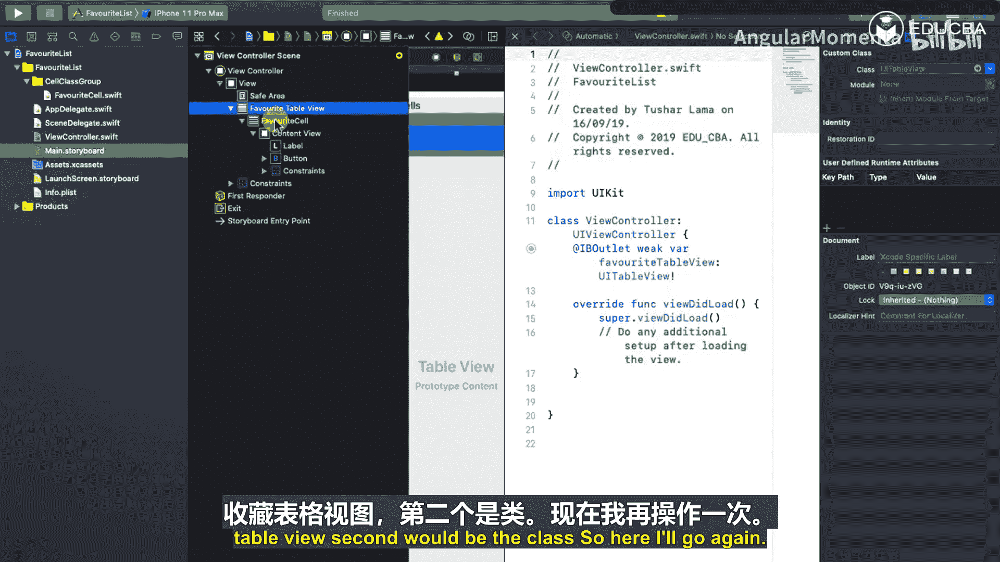

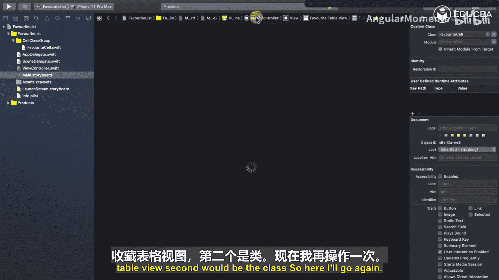

So here I'll go again。😔，And again。I'll go to assistant and I need to create the class。😔。

So this is my favorite cell。😔。

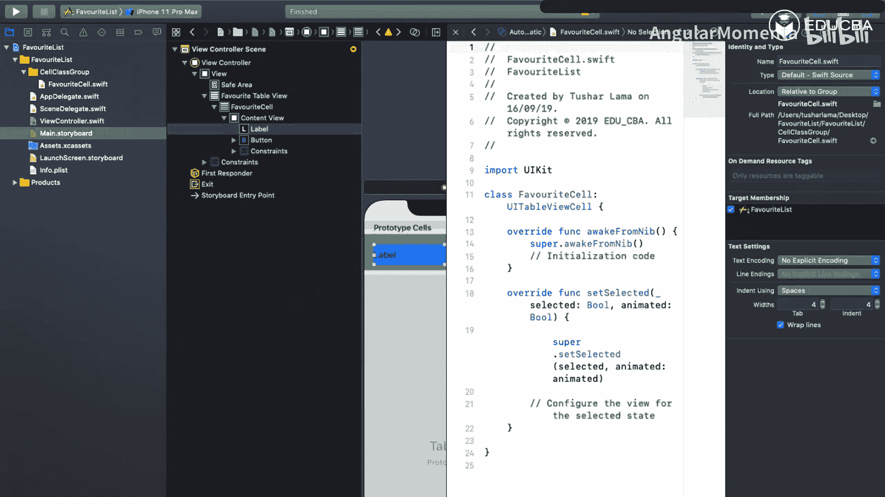

So， this my label。Tranestrate。😔，Fruute name。1even。😔，Okay， and。This would be my。😔，Favorite button。

Outlet， and here what I'll do is I'll create the action of this favorite button because I'll be calling delegate with the help of this only。

😔，So。F A V， O， U are T favorite。😔，Maten。Action。Sir。

Now I have created the outlet for my table view in my view controller class and Ive created outlet for this cell also。

😔。

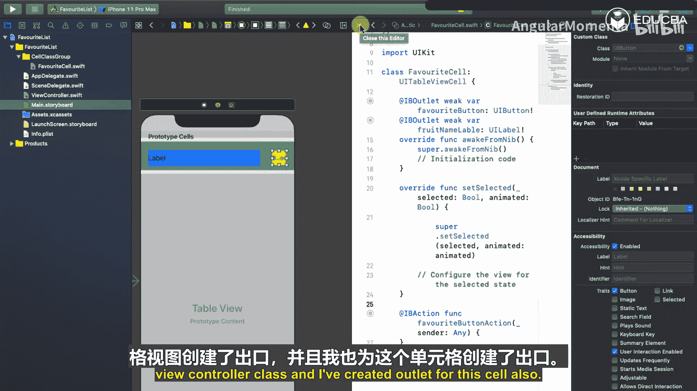

Now what I'll do is， since my work is done， I would be changing colour here。😔。

Myground color I would be changing。😔，To again， to。Wait。And the cell background color， also too white。

😔，And here in the label， I'm just removing this。😔，And here button also， Im just removing this。😔。

So now what I'll do is。😔。

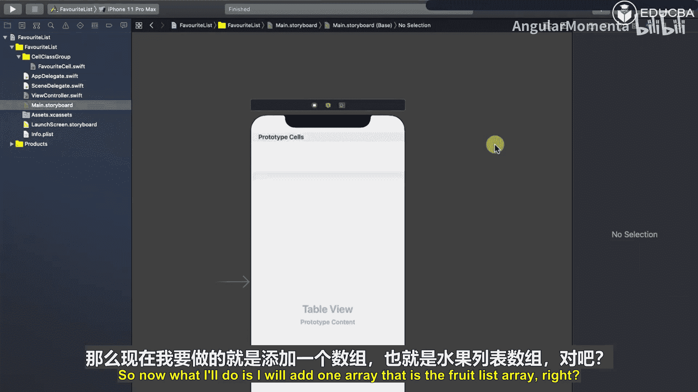

I will add one array。😔，That is the fruitless array， right， so as I say。😔。

To display on the table view。😔，So in my fruitless chrry would be type of。😔，String， area of string。

So I'll just give the fruit name as Apple。😔，mango。米娜娜。😔，我怎个能。拜拜啊。😔，Cherry。Go on。Mananana。讲啊。

I think this man's fruit name is okay。 So this is my fruit list array， and this array contains。😔。

All my fruit name。 So friends。Till this month， I think it is easy to understand。

 So now what I'll do is I'll。

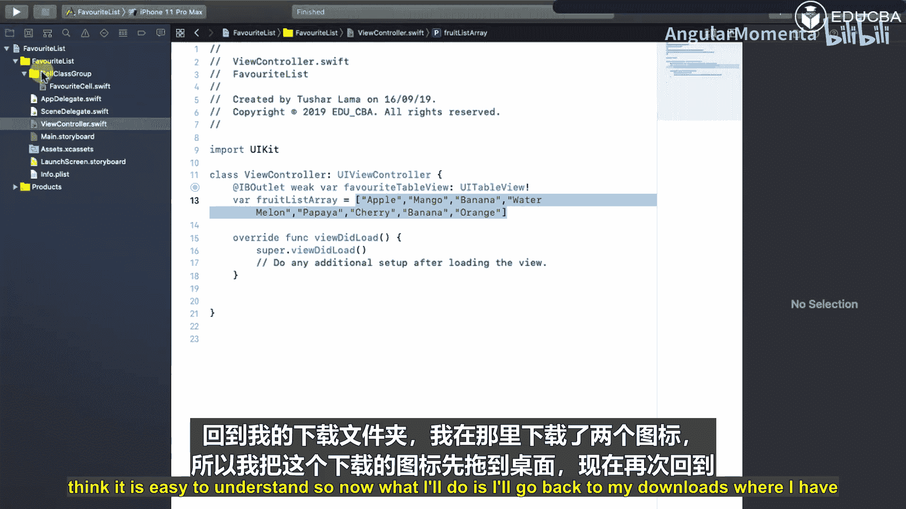

Go back to my downloads。When I have download it。2 as。

So this download I can drag to first to test off。😔。

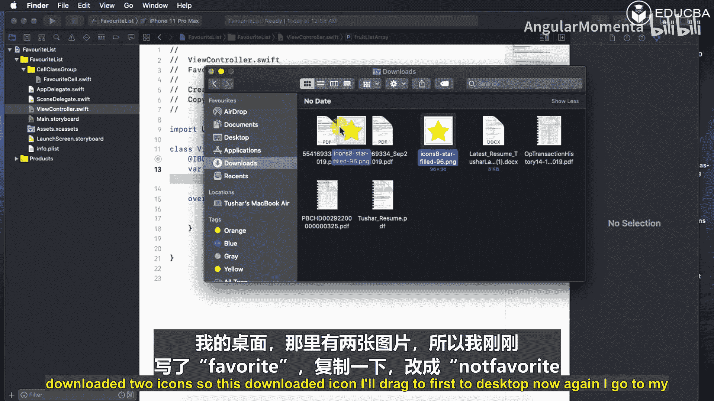

Now again I go to my desktop where I have two images， so I just wrote。😔，Favorite。This copy。As it not。

Favorite。Okay， so these two images， what I'll do is Ill open my caskecade。😔。

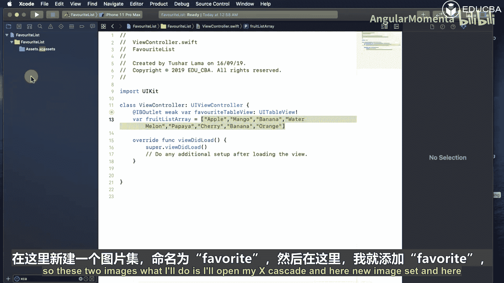

And here。Name is set， and hear。😔，Favorite， And here Els add favorite。😔，And one more as not favourite。

Unless God。Not favourite。Okay， this not favorite I just add this。😔，Timple。So my image also added。

 so now what I'll do is， I'll go again。😔。

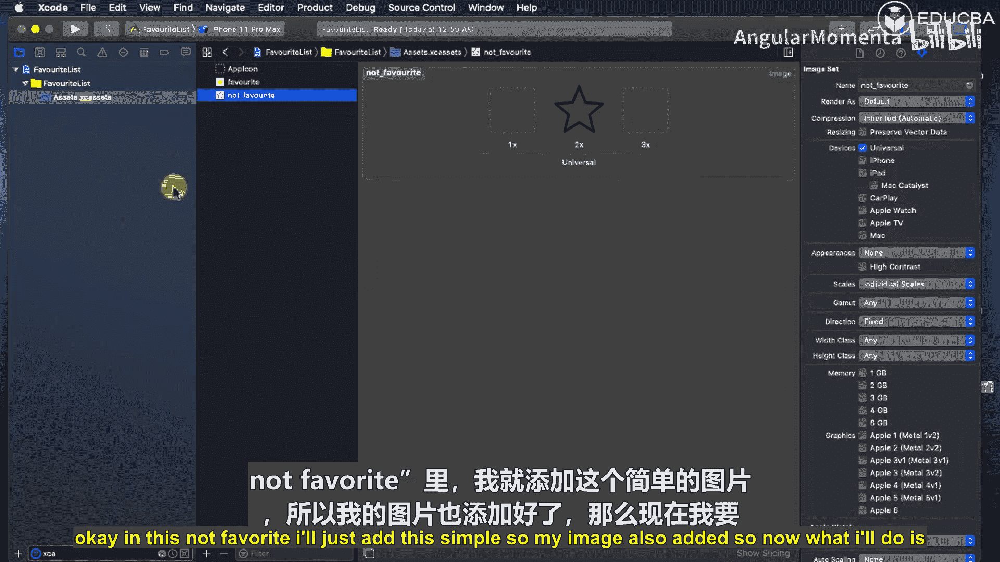

To my view controller。And here what I'll do is I'll create extension。😔，A few controller。

Where I extend your view。😔，Meddigate your table view data source， right。😔。

So here and because there are two。😔，Manditary methods to write。1 is number of rows in section。😔，Well。

 I'll just written my Eric account。😔，The second would be self forward index path。😔，Wet and。😔，Godlet。

Sell equal to。😔，Tableable view dot tick reusable with identifier。😔，As。Favourite son。😔。

Now is the same favorite cell Ill put inside because every time I create a cell。😔。

I give the identified name as same as class name， so this is the benefit。And here I've just written。

 I don't want anything。😔，And here， what Ill do is I'll again re myself。😔，Yeah interested anyway。😔。

这边就。Now， youl do sell dot。😔，Fruit name label dot text。😔，It would be equal to。😔，Fruitless array。

Index part do row。😔，Okay。And the second would be cell。Dot favorite button。Dot tag。Qualter index part。

Dot row see why I am giving the tag name as index part dot name because lets suppose my button is lets suppose my button is like mango fruit and there is my favorite button so when I click on the favorite button my mango is in second number right so the tag of that button would be equal to my whatever the index part dot row in that location my button is。

😔，In whatever action I need to perform， I will be performing that on basis of this tag only so that is the reason I am implementing tag。

Secondly， in my viewed Lord， what I'll do is。😔，And just， write。

Favoritely stable rule dont delegate equal to self because it should work。😔。

Favorite list value dot data source equal to self should work。😔，Favoritely stable view。😔，Not re data。

😔，And the sell not favorite button。😔，Dord said。Sa image。😔，And U image。😔，Name， I need to give this。😔。

State dot normal。

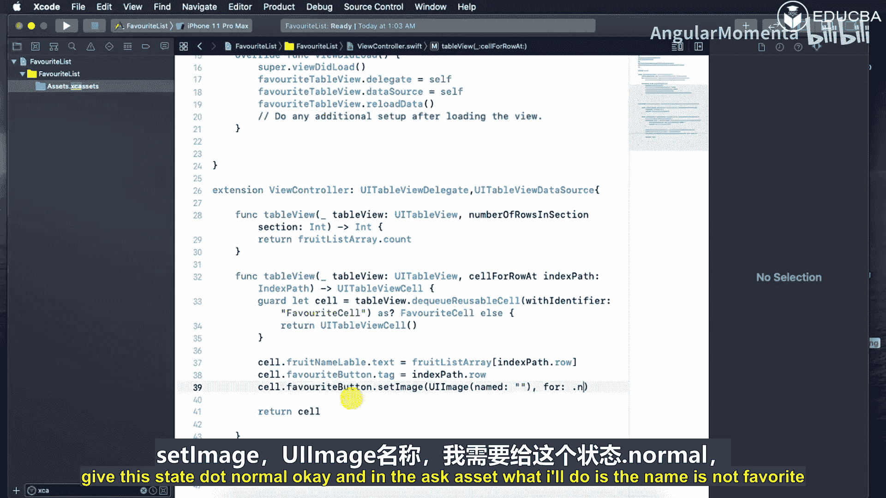

Okay， and in the ask I said， what I'll do is。😔。

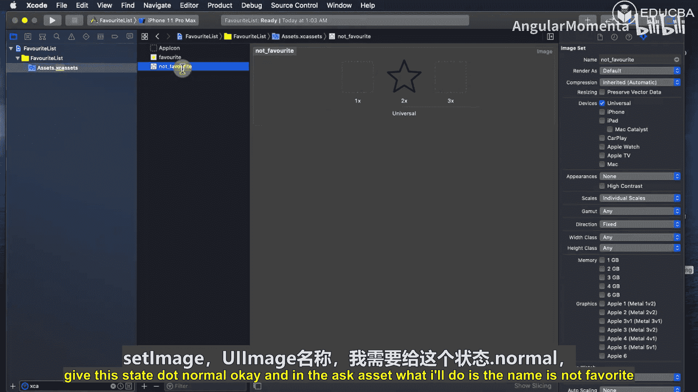

The name is not favorite， initially。Not being right。So， let's run and see。😔。

What positive output we are getting， And after that。

 this was the first few controller we implemented with the fruit name and all。😔。

Now what I'll do is now we' will be working on the logic behind the favorite cell。

 like when we touch the favorite cell， like when we click on the favorite button。

 firstly the color should change， secondly the data should be saved somewhere。😔，Right， the state。

So my simulator is working， so we also need to create a model class to pass the data。Firstly。

 we will be working on the logic to， you know， save the favorite button， change the color and all。😔。

See， so this is my。Table view。 So this is my fruit list， and。😔，It is successfully coming。

So now since the fruit list coming well be working on the action of the favorite button for that。

 what we'll do is firstly we'll create a delegate so that you know well fire the delegate and from the cell class that delegate would come on the controller。

 that is my view controller and accordingly we create one dictionary where mut dictionary where we'll be saving the state of the cell。

😔，And in the sfurro index path will be showing the color。 I mean。

 we putting the star will removing the star By that， we will be doing。 So friends。

 we be working on the logical part on that， right。😔。

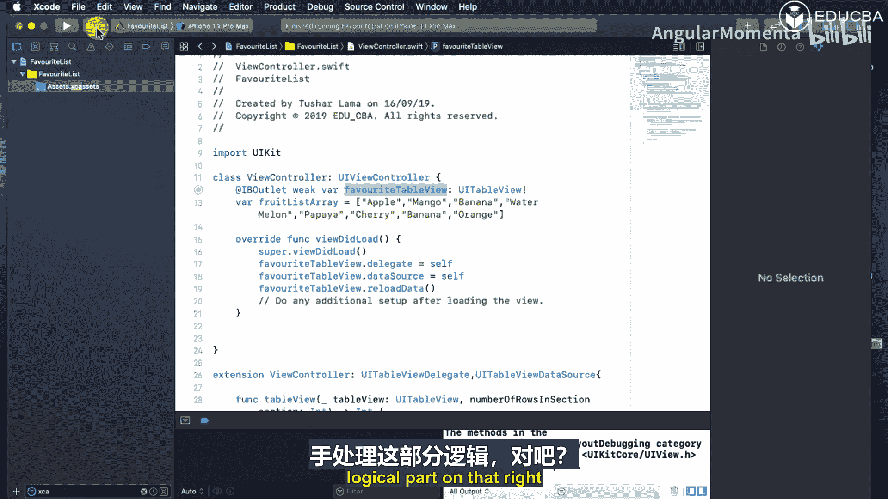