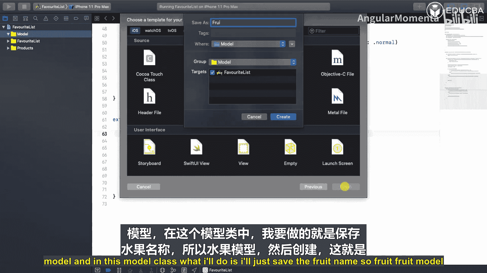
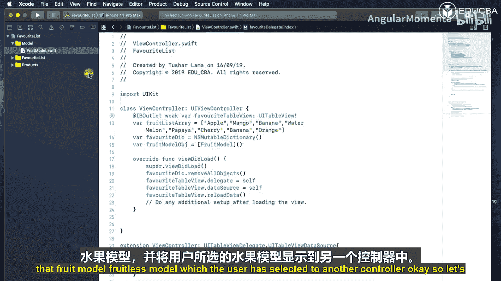
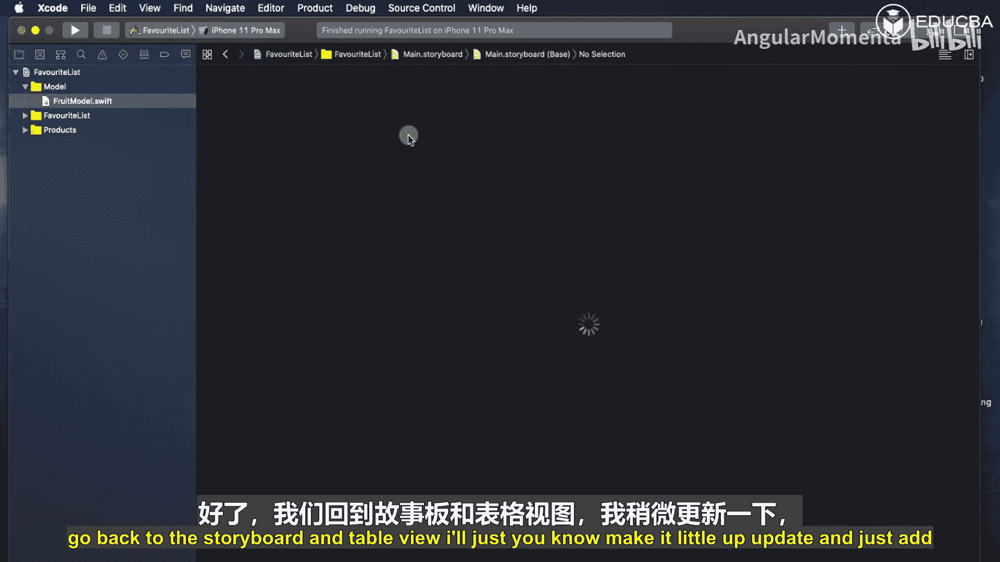
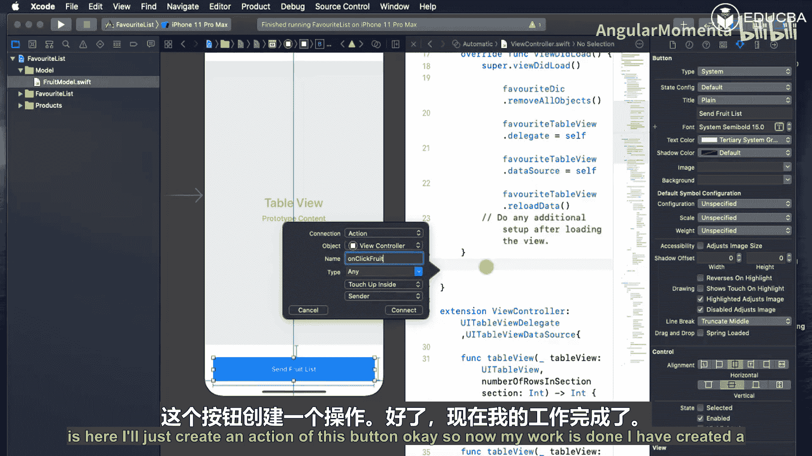
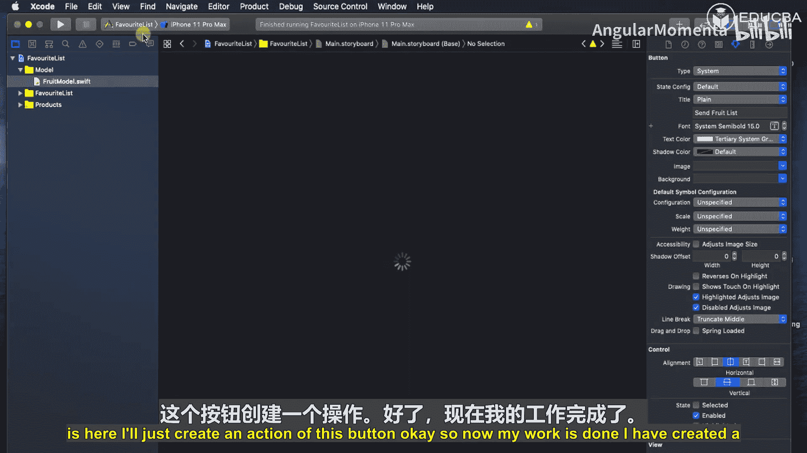
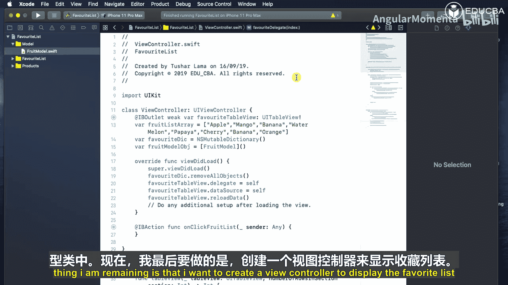

# 【EDUCBA】在Swift应用中应用面向协议编程 ｜ Apply Protocol-Oriented Programming in Swift Applica p03 02_01_01_逻辑选择偏好 -BV14AFSzeE8A_p3-

Now friends， we will be working on the logical part of the fruit list view controller where we will be clicking on the button that is my favorite button and we will be changing the color of the star after finishing that well be creating a model class where we will be storing the names of the fruits which we will be displaying in the next view controller。

 so friends for that firstly in my fruit cell what I'll do is Ill create a protocol。😔。

Protocol is nothing， but it is just a set of methods which we create for classes so that whenever we want to inherit that or whenever we want to make use of any functionality that we have used in protocol。

 we inherit that protocol in our class and use that functionality。😔，Yeah。So， Ill just。Write this as。

Favorite。Deleggate in this favorite delegate。In this favourite delegate one I do is I'll just pass the index。

😔，Should we of end。He end in the cell。😔，Class， Ill just create object of this。😔，I this delegate。😔。

Now， what I'll do is。😔，Since in my view controller。

I have taken the favorite button tag is equal to index parts。 So when I click on the。😔。

Favorite button cell number  two。 So my button tag would also be sent number two。

 so it will reflect on that only。 So again when I go to the cell。

 what I'll do is in my favorite button。😔，Here， what I' going do is delegate。Dot。Favorite delegate。

 and in the index what Ill do is I'll pass the favorite button dot tag。😔，안。Easy and simple。

 Now what I'll do is and just go here in my view controller again。😔，And yet。Firstly。

 I want to access the delegate， so to access the delegate， I'll just write favorite delegate。😔。

Firstly， I'll just check what is the name of that delegate， Okay， delegate， right。😔。

Sell not delegate equal to self。😔，Now， the next thing would be your extension view controller。😔。

And hear the delegate name。😔，Like this。Okay， so now what I'll do is I need to save the state of this。

Of the data， of this index， what I'm getting and I'll be reloading the table and once I reload the table。

 Ill be showing that data， or I'll be changing that button image， background image， right？

So here I'll go， I'll just create a mutable dictionary。😔，Favorite dictionary。

 And this will be object of N S。😔，Mutable so now the reason behind me creating mutable listen is that I need to remove I need to add。

 I need to you know， remove data from that。😔，If I create an S diary， I cannot do all that function；

 I cannot remove anything at all。So here what I'll do is， firstly， I'll do favorite。😔，Dationary， do。

Removal object。😔，So this removal object is not available in N dictionary only in computerary， right？

So now what Ill do is this favorite。😔，Dtionary dot set value。😔，Sid value is int。😔。

And key would be is asking strings。 I am just converting my。😔，Decentarian。ok。So。

And here address just order to his favorite table。😔，You don't re data。😔，Okay。

So now what I'll do is first in myself for it index but I'll just check if favorite dictionary。😔。

Do count。Is greater than 0。😔，If favorite additional dot count is 0 for my oldest cell。😔。

This will work。ok。And if。Count is not 0， so here I'll check if favorite dictionary dot value for key。

😔，String and string between next part。哪知。Is not equal to Neil if it is not empty。😔，So。

If it is not empty， so I'll just。😔，Right that。If it is not empty means that cell is selected。😔。

And yet， at the said favorite P G， right， So now。😔，Let's see what is happening。

What I did here is that。Just created a favorite cell and when I click on the button。

 I add a delegate and the delegate would come here here setting the data and。😔，Changing the column。

 right？So this is my dish。 And when I press here see my colors getting change。😔，P is getting jay。

 right。Now， one nothing when I。Now what this is the only one condition like once I click now colors say now what I want is once I click back the colors should。

 you know the colors should go back like if I touch it on it it is on now when I touch this again Apple it should touch off right so again I open my export and again I go here so now here I need to make one condition in this condition firstly what I need to do is first I need to check its favorite。

😔，Dtionary。No。Value 4 key。 value4 key。 What string。😔，So。😔，I need to check here。😔，As not Nell。

If it is not Nell， means。😔，It's already in favorite list。 So favorite take dot。😔。

Remo object for key would be this index。😔，Else。Let keep on saving， right。嗯。To now。

 let's run again and see。So， it is building。And now， let's see what will happen。😔，See apple， mango。

 banana。 I don't want mango。 So just remove it。😔，And papaya watermelon this， no， I don't want banana。

 So I just remove this， and I don't want papaya。 I again， remove this。 I don't want apple。😔，Okay。So。

This is there。So this I'm doing C this。😔，Again， when I select when I click， so friends。

 my this logic is also working fine。😔，So now what I want to do is whichever fruit I have selected。

 I want to save that fruits name first and after that I want to send that fruit name to another v controller and show the list of favorite fruits which I have selected。

 So for that what I'll do is。😔，And just create a model class。😔，Model， and in this model class。

 what I do is I'll just save the fruit name。😔，So I through it。

Fruit model and just create。So this is my fruit model。 What Ill do is I'll just write open class。😔。

Open class。A fruit model。 Okay， and。Open this class and just stop this。 Okay， so in this open class。

 and'll just。You know， store or Ill just create one property。😔，Name fruit name， okay。

 and visual of type string。😔，Now what I'll do is I'll call the initializer that is called constructors。

Public in it。 And here。😔，Fruit name。After a string。不是。Itself。Dod。Truat name， equal to。Fruit name。

 right。So my model class is also created。Now， the only thing left is I need to save my fruit's name into my model class。

 right。😔，So again， I go to my view controllers。Okay， so where I was。

So here Ill be creating the object of the model class and that object would be of error type because I need to check the count of that object and I to remove the fruit's name of that object。

 that is only possible if I create that。😔，Object as errortype。So where。Fruit model。

Object equal to fruit model。Which is error type。And yet。En， so here I'll go again。😔，What I'll do is。

😔，Firstly。Holy start a pen。New element。And that new element would be。😔，Fruitless。 and y。Index。

 whatever index will it will remove。😔，So here it is asking。

 cannot convert a value of type string to expected type of。😔，Fruit argument， okay， no problem。

 so here what I need to do is I need to first remove this。😔，It to call fruit model， fruit model。😔。

Yeah， now I need to add this。😔，So now， it will happen， right。 So by this way， I am appending it。

And by this way， I need to remove all sorts of fruit model object thought。😔。

Remove it index and year index and it to pass。😔，Fine， so now my also saving on。Sing。So this is done。

 right， So now what I'll do is firstly， I'll add a break point here。😔，And before。Reloading the table。

 I'll just check my。😔，Throughat model object here。 What is going on。He saw here。😔。

And just print some stars so that， you know， it is differently printing and it would be easy for me to understand。

 Yes， my fruit model object is printing， okay。😔，So， now。Let's open the console。Let's remove this。

 Now， let's run。Once you run you again get the fruit list。

 one more important thing friends I forgot is I want to create one more button in my fruit list where I'll press that button and all the fruit list will go to the next view controller。

😔，说。😔，See， one object is added。系。If Iも。No object is there One object。2 object，3 object。 Okay。

 so this is working perfectly fine。Now what I need to do is now I have completed with the logical part also。

😔，Now one more important thing is that I need to create a button in my view controller because with the help of that button。

 I'll be clicking on that button and I'll be navigating to another screen。

 taking all the fruit model， and displaying that fruit model fruitlash model with the user selected to another controller。

Okay， so let's go back to the storyboard。

And。T I just， you know。Make it little up。How dead。And just add a button。😔，Okay。And I'll just write。

Send fruit list， right。And this would be in black color。😔。

And I think my text should look little bold。😔，Or I can just take semifold。😔，Okay。

 and the background color would be。😔，Blue。And the text color should be white。😔，Okay。And。Al ladderda。

Notal layout also so this。And the last thing what I do is I just give it to。😔。

Ororizonal training through centers。😔，To this container。

 So here again I go and horizontally this container， right。

 so now my fruit send fruit list is also the button。

 Now what I do is I go back again to my inspector。😔，And。Here the assistance。

 what I'll do is here I'll just create。😔，An action of this button。

Okay， so now my work is done。😔。

I have created a。😔，View controller in that view controller have a table and a cell。

 and I am showing that。😔，Fruit list into the view controller and I have made a favorite button also when the user click on that button and when the it will add to the model class and when the user when the user don't want to add that fruit in the favorite list so again when the user click on the the same fruit which the user have selected。

😔，That favorite list would be removed from the model class。 So friends。

 my two things are completed one。And displaying favorite list， second， adding logic。

To the favorite list button that when the user will click。

 the image should change and when user will click again， the image should。😔，Wet to the default one。

 and the third thing is saving the data to model class。 Now。

 the last thing I am remaining is that I want to create a view controller to display the favorite list。

😔。

