# 【EDUCBA】在Swift应用中应用面向协议编程 ｜ Apply Protocol-Oriented Programming in Swift Applica p04 02_02_01_显示收藏列表 -BV14AFSzeE8A_p4-

Now I'll be displaying the favorite fruits selected by the user into new view controller。

 So for that Ill be first。😔。

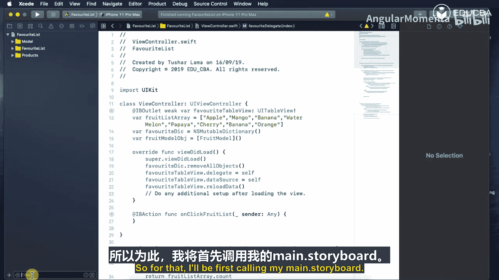

Calling my main dot storyboard。And in that main note story， what what I'll do is。😔。

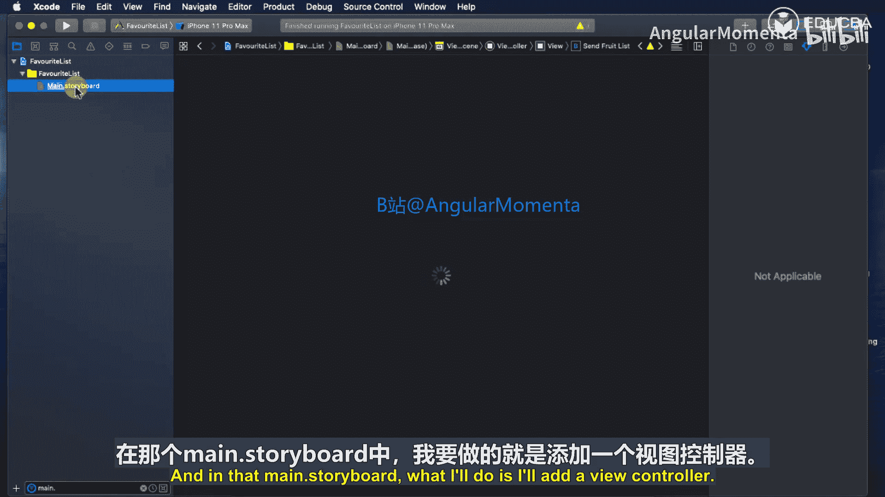

I add a view controllers。

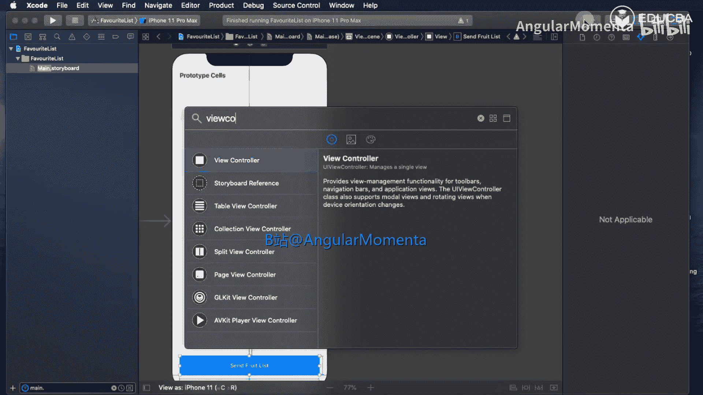

So here I have added a view controller。And in that view controller， I will add a table view。😔，Okay。

And inside I table you again， and I table you。😔，And inside a table you Ill just add a label。And。

Firstly， as Table View is acting as a container for tableable View cell。What I'll do is。

 let lets go here again。😔，Whenhy then do it 0。😔，Well said。If so your table view。 What I'll do is。😔。

I'll just add the constraint。 Okay， now， inside the cell what I'll do is for this。

 I add a constraint。😔，So now， this is good。Now what I'll do is firstly I'll create a class for this view controller。

 So what I'm thinking is I'll take the class name as display view controller。😔，New file。

And this would be a subclassus of U controller。 So here I'll go and I'll choose U view controller。😔。

And the class name would be display。😔，This。Favorite list。😔，V CVC stands for your controller。

Always remember whenever you are giving name to the class。

 give a meaningful name so that another developer。

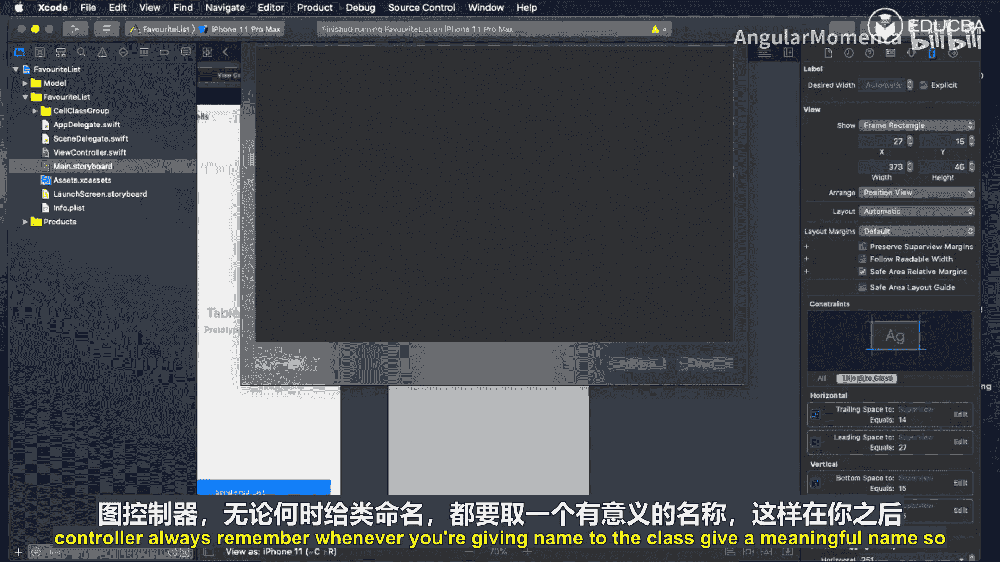

Who would be working after you or who would be working with you would understand Yes， yes。

 this view controller is for this class。Okay。So， you know， naming convention should be good。

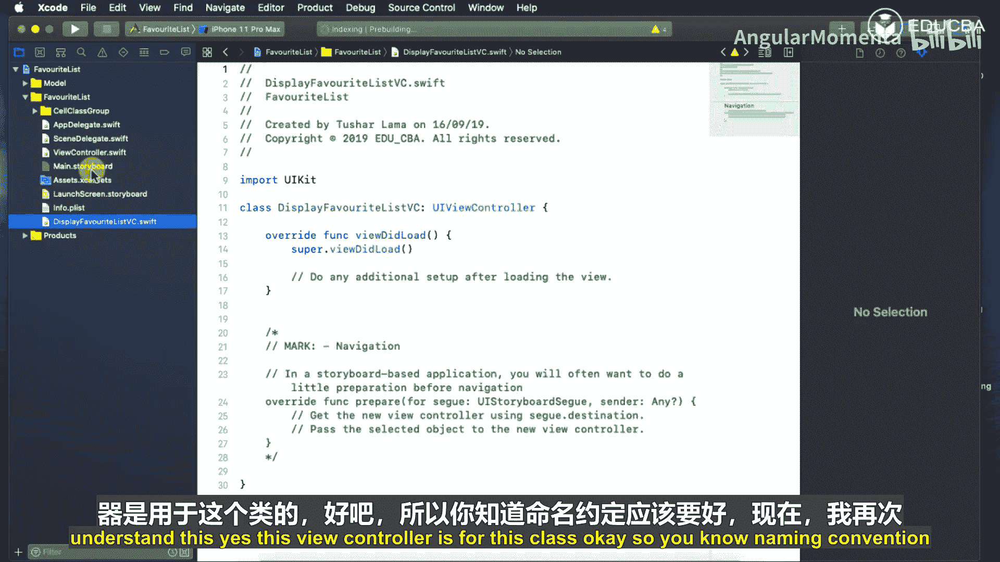

So now can I go here。😔，I chose。😔，Yeah。Re view controller I gave the name and in my storyboard idea also I gave the same name。

 you know I told you while given the class name for seller or why I do this。

 give the same name it becomes easier for me。Now， the next thing would be。😔，Again。A new file you。

 you must be thinking why I am creating a new file I am creating this for my cell。Table yourself。

 So it would be table yourself。I was given him a display list。😔，So this is my display cell。

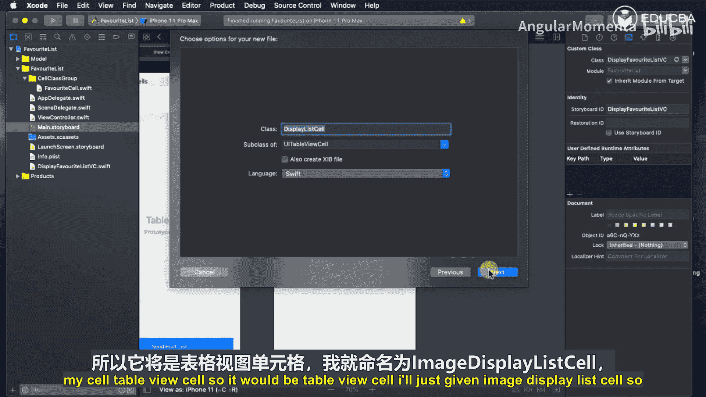

Where。I will be。😔。

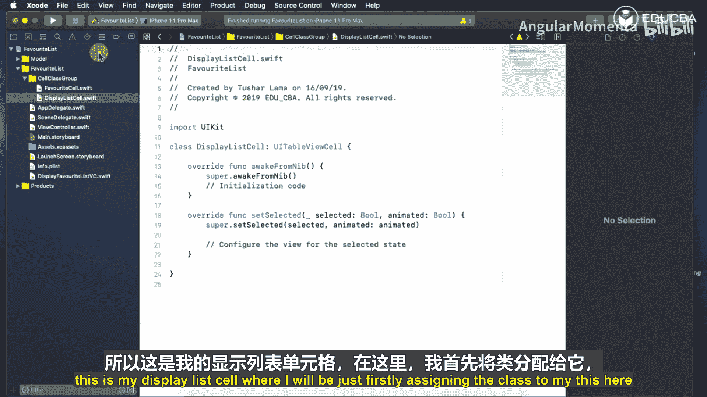

Just firstly assigning the class way。😔，This。Yeah。Here。

 right now what I'll do is I'll give the outlet for this table。

 So for that I need to open again this。😔，And go to the assistant。And， yes。Bestplay。List。ok。Now。

 the second thing would be I go to this。😔。

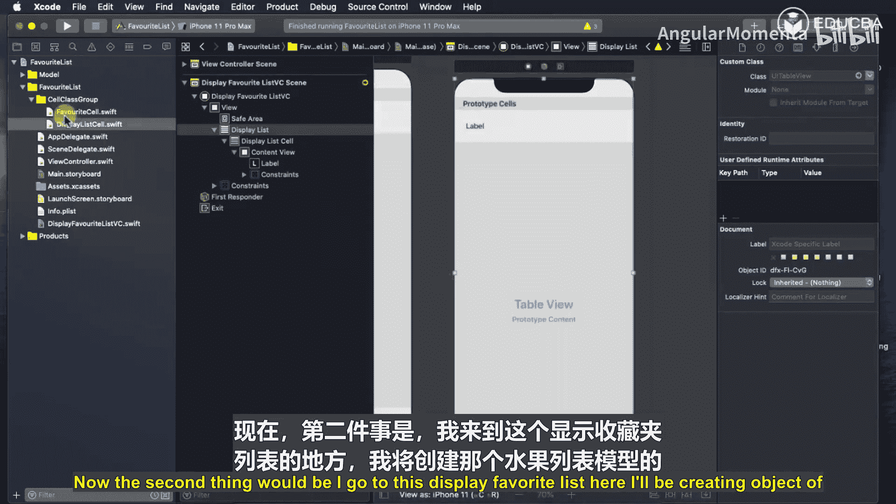

D favorite list here Ill be creating an object of that fruitless model。

 which I'll be sending back to my discuss where。😔，Receive fruituthless。😔。

Names should be meaningful as I told。😔，Fruit model， and。I in this。喂。So now what I'll do is。😔，Yeah。

Am I viewed it， Lord。😔，I just do display list。Not delegate。Which is equal to cell。At displaylish。

Dot data source， which is again equal to self and。😔，Deparlish。Not reload data。 right。

 So these two things I've got。 Now， what I'll do again here is that I'll create the extension。😔。

Extension。And this is like display。😔，Is pay favorite list and the extension table view。😔，Delegate。

Comll my your table。😔，Data source， right。2 many3 me are number of row section。A return。Sorry。😔。

Dat count。And。Sllphoneware index。😔，Yeah again， I do guard。God， garlet sell。For two table view。😔。

Do take you reusable with identifiers。😔，As。Displeant。Un written， you I table you。😔，7。

And here written。7en。Now what Ill do is I want to show the fruit list with the userF selected， right。

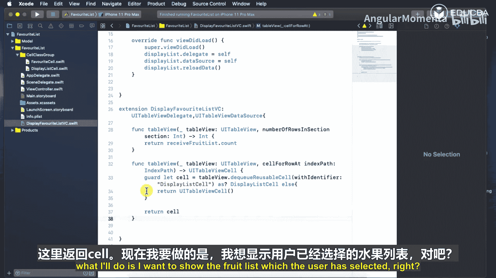

Again， I go to my。😔。

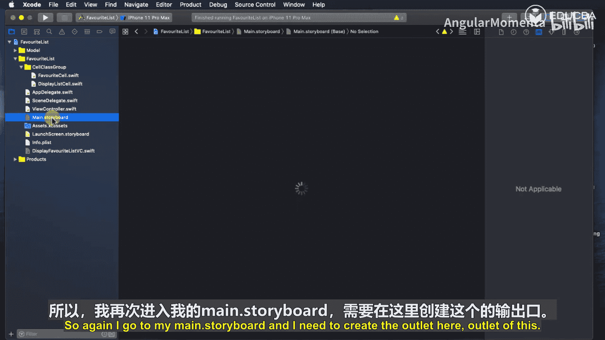

Man out storyboard。 and I need to create the outlet outlet of this。Again， I open this again。

 assistant。😔，And again， I go to Y getcount， but I need only this class。😔，So I go get my yet。

I just stick。FR U I fruit name。😔，11， okay。My work is done now， when I go back here again。😔。

To my fruitless display， what I'll do is。😔，Cll dot throat。It won't come like this， I just。

Sll do fruit name level。😔，Not tax。In order to。Save route and index part。Not row。 So here。

 all the details will come。 all the fruit list will cannot assign a value of type root model。😔，Okay。

 and dot。Roroot name。Right， so here my work is done。 Now， the only thing left is the navigation part。

😔，So what I'll do is first I go to my view controller。😔。

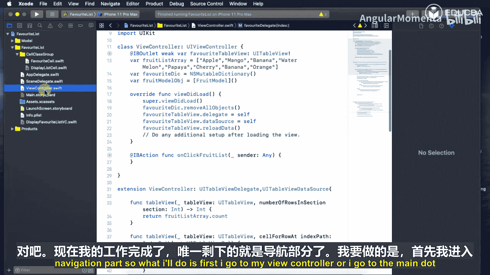

Or I go to the mainor story board first to perform navigation。 we need to emede。😔。

Navigation controllers。 So here I go。 I go to my editor， editor。

I get em in and your navigation controller。 then only you can navigate， right。😔。

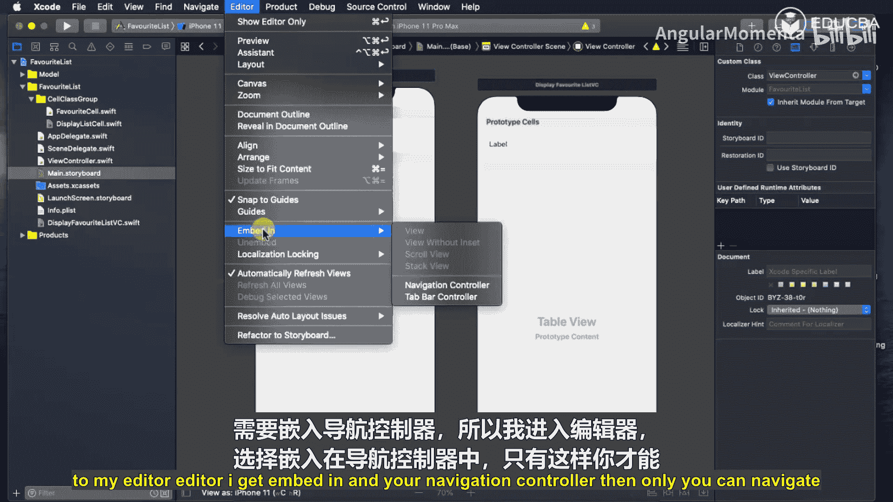

Now， here I go， You're just right。😔，The title。Equal to。AU ID。Haveav it。Favorite。Fruit list。

 it will come inside bread。😔，It will come inside this because this is a string。😔，So， visit the title。

And。Here can I go。😔，E to， again， dull course and。User。Selected routes。ok。

And now I go back to my view controller。 I need to perform navigation。

 so I'll just write let object equal to self。😔，Dot storyboard。

Notin State view controller with identifier。As。Dissplay favorite list。And just copy paste here。Self。

Dot navigation controller， dot push。Push your controller to this object。😔，Animation I want true。😔。

And again， I go here， objectject dot。😔，The safe fruit。Which will be equal to my。😔，Fort Martin。So now。

 here I'll be getting an error。😔，To force a draft this， but I would do that。 I'll just write if。😔。

If let value， if the value is valid。😔，Mo V J， if my value is valid， everything is valid。

 like if my instance is valid。😔，I just write。😔，ok。And now let's run and see。😔，The output。

Running on iPhone 11 promax。So on that view control， what I did is Ive just passed the model object。

😔，Okay， I just pass the model object and I am just displaying the fruit selected by users。😔。

So friends， this was about making favorite list using delegation and model class。😔。

Which I've done so fast， let's run and see if everything is working fine。😔。

So this is my see this is the title of navigation favorite fruit list she has selected Apple。

 I selected papaya。And when I send fruit list。I didn't get anything， right。 Now。

 I tell you why I didn't get anything。😔，Because。Here I you go。I ran need to check。

Whether the daytime passing is coming or no。So friends。

 as we can see that when we selected the fruits， we didn't get the data。

 so we need to check where the actual fault is going on， so what we will do is。

We firstly close this x code， first will。Go back to our display favorite list where we are sending the data。

Well put a breakpoint here。😔，And check。 But before going to that breakpoint。

 what we'll do is firstly， we willll open。The storyboard I have slightly one doubt。

 which I think because of that the data is not coming。

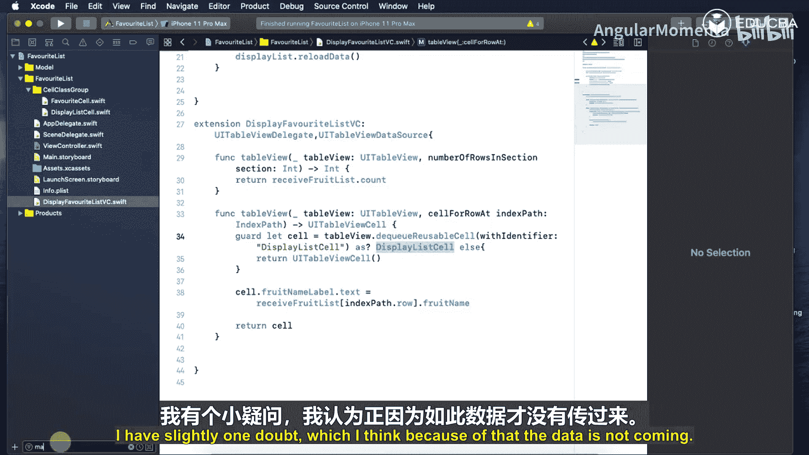

And I need to check myself cell。So display this cell， and I added。The identity here。And instead。

 I had to add the identity here Now， when I see。😔，I think it is because of that， only。

The identifier have not said。

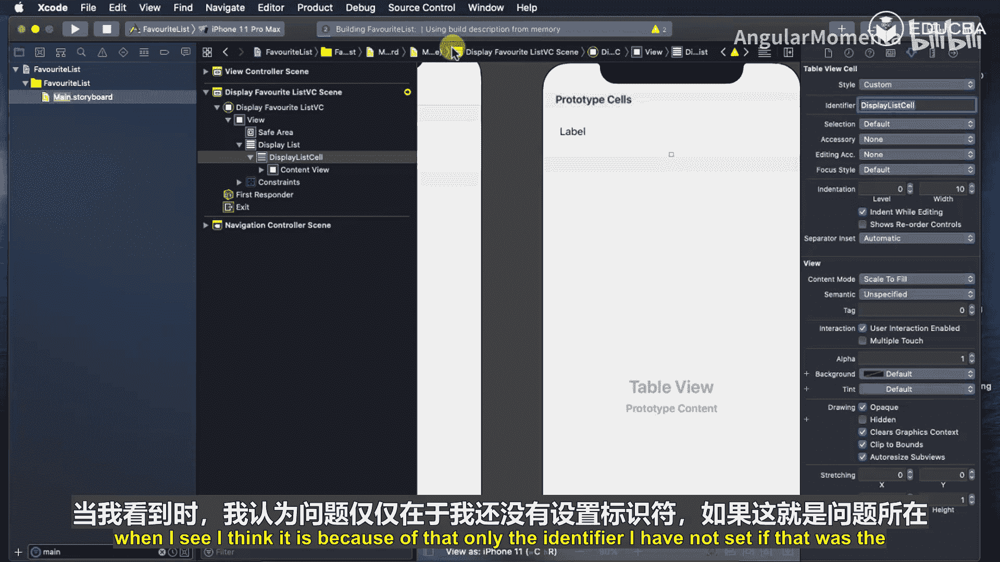

If that was the problem， so one more important， think。Has solved is that C。

 the importance of God rate is that if。It will not get the cell and the identifier。

It will just return a normal UA table Vi instead of crashing。

 so this is one of the main advantages of using Garlet and a。So I choose apple， mango， and banana。

 so let's see。😔，And again， Ive set a breakpoint， see。😔，Now， I got apple mangoin bananaana。

 So when I come back， the state is still there。😔，Again， when I go， see what happens。😔。

RightBut I wont like when I click back my data should get erased right So what we can do is。😔，Again。

 close it back， again， go to the view controller。And when you click on the action。This。

Remove everything from this favorite do。😔，Remoal object。Right。

 so now let's run and see now see what is happening。

 One more condition we can make is if the user hasn't selected any favorite list。

 he cannot go it into the favorite list。😔，Controller to see which all fruits is selected。

So what I'll do is if。😔，Favorite list。😔，Foreic dot count is greater than 0。

Then only it will work Or rest if count does not greater than 0， it will not work。So friends。

 this was all about like displaying the data。 So today， we have covered three things。😔。

Making favorite list。Using delegation， using model class， how to push data， how to send data3。

 it will not work because it is 0。 Now when I click orange， you get orange when I come back。

 the state is still。😔，There， right。So now what we need to do is we need to check where。😔。

I thing we are missing。And maybe we will appear。 Ill just。😔，AndReload my table。Now。

 let's see what what will happen。Now let's run and see。Papaya， I've selected some fruit。

 And when I come back。😔，It changes The friends， whenever listen one thing like you did Lord will be called only once when you。

Application or the when that particular view will open。

 but view will appear will be called every time when you come back to this view。 So I did the same。

 I choose papaya I event here。😔，And when I select this， it all get back。 right， friends。

 one more important thing here I am getting Papa account too， because I have not。😔，You know。

I am not clearing the data also， So again， I am going to my view controller。😔，And when I'm。

Removing here so from a model class also I need to remove。😔，Their data。Not remove on。😔，Okay friends。

 so this was all about making favorite lists using delegation and model class。

 so what we have learned in today's tutorial is that how to firstly about storyboard。

 what is storyboard， how to create a view controller in that。

 then we have learned that how to work with table view cell。And how to， you know。

 when we when the user select how to get the delegation back to the controller from any other class like any other class means from the cell class I am clicking on the button。

Favorite button。 And I am firing a delegate to my view controller。

 And there I am receiving the action。 And in when I am receiving the action there。 So therell。

In my view controller I have taken a mutable dictionary and in that mut dictionary I am appending the data and after appending the data I am just reloading the table and in the cellfur index path Im checking whether that button which I have click if it is if it exist in dictionary it it will show the favorite sign if it does not exist in dictionary it will remove the favorite sign。

 So friends after that once we have selected all the favorite things when I click on the send favorite button it will just go to another screen and display the favorite list So friends this was all about today's tutorial。

 Thank you so much。

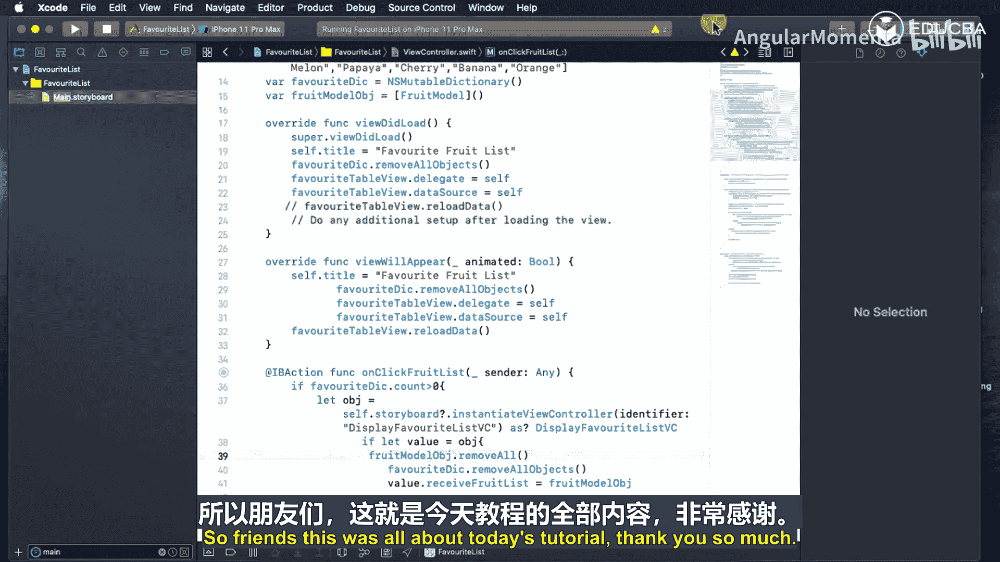

Hello friends， today Ill be giving you a presentation on delegation using collection view before I had given you a presentation on delegation using UI Table view。

The only difference is that that time I was using Ui table view now I'll be using Ui collection view right。

 so I'll be giving the project name as delegation。Okay。And Im just creating it in my desktop。😔。

So my project is created， so today what we will do is first thing is Ill be creating a U correction view。

😔。

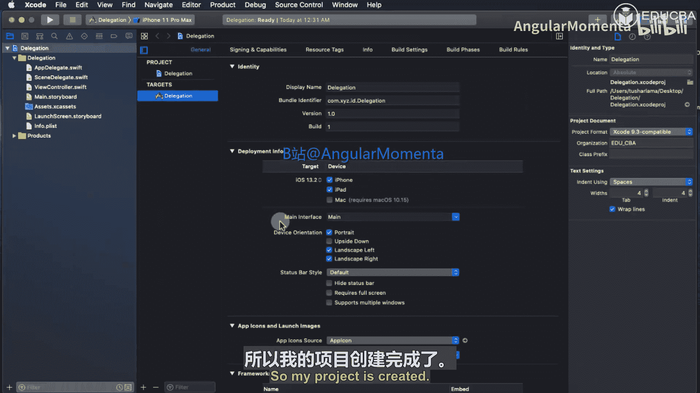

Into the view controller after that I'll be giving colors to the cell of the collection view and whenever I click on any of the collection view cell。

 there will be delegate getting fired and after that。

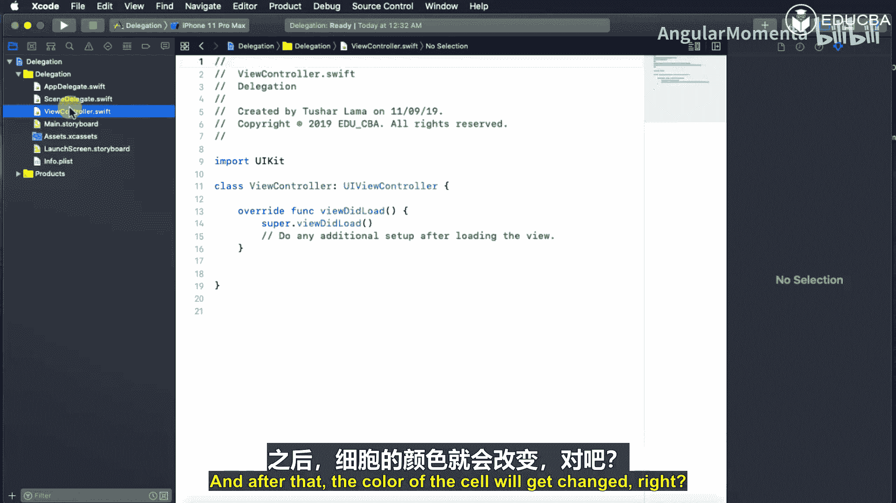

The color of the cell will get change right， so let's not waste time and let's open the main story board。

In May， our story reward。You。Crection view。So friends， basically delegation is nothing delegation。

 I am performing with the help of protocols and protocols are nothing but a set of functions that is being created。

A protocol is like a set of rules written， and whenever we implement that protocol we need to follow that set of rule right。

 so friends。I have created my collection view successfully。😔，So this is collection we if you want。

 you can take a button。Inside that correction view。Right， and the collection view cell。

The background color would be。Let's say I give system green， right。

 and you have a button on top of that。So I'm just first Im giving auto to that button。And enter。

Right， so。Now， what I'll do is。I'll be creating a collection We sell class。For this correction view。

 so Coa touch and instead of table correction view。Fction you。Se， okay， it will be a subclass of。

越 collection view。

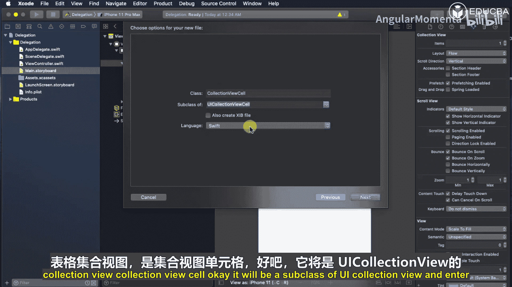

And enter。right。Yeah。So。Now， what I'll do here is。

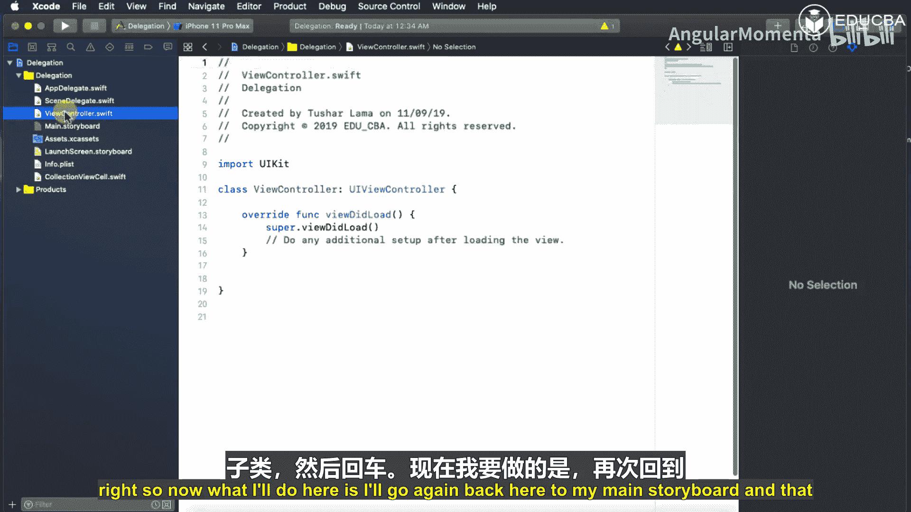

I'll go again back here。To my main story board and。That collection view， there is a button right。

 So again， I go back here to my assistant and I would create a。😔。

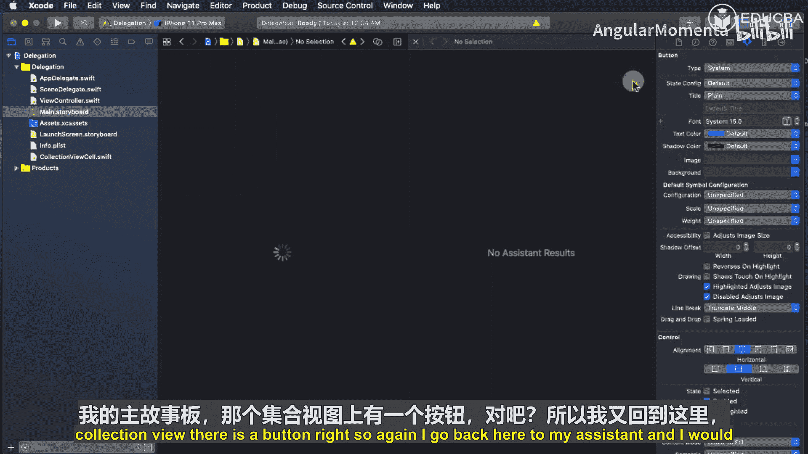

Action。Of that button。 So before that。Just create a collection view outlet。And you。Okay。

 so now my collection we out is also done now collection we sell。So， collection will sell。😔，And。

Im giving the identifier name also I do this every time because the class name and ident name is same so while giving to the by writing the data source name it becomes easy。

So， now。Again， Gure， assistant。Okay， and。This is my collection view。So it is still not coming。

 so what I need to do is I need to close this assistant first and I need to build one。😔，I run once。

Once I run this。My simulator。Will come first， My simulator will be loading。

 So now the task will get built。 And once the collection views created。😔。

We can run back to collection view cell and with the help of that button we'll fire a delegate。

 So let's do one thing， go to the collection view。 Okay， so here I'll create a protocol。😔。

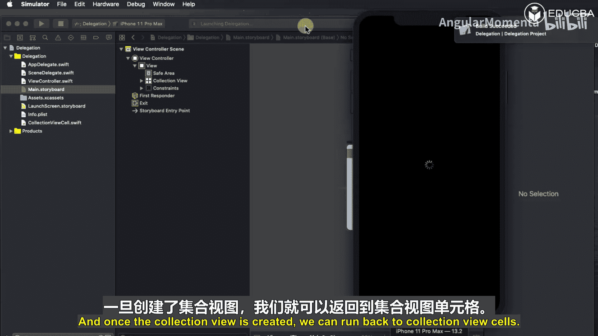

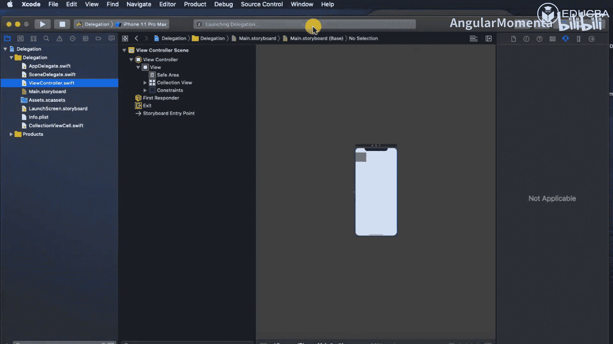

Proug call a set of methods I told you earlier。😔，This is protocol。Collection。View protocol。

And just function。Method core， right， simple。 So now herell create a instance of this。😔。

Fction we protocol， right？And now what I'll do is I'll create action of the button。😔。

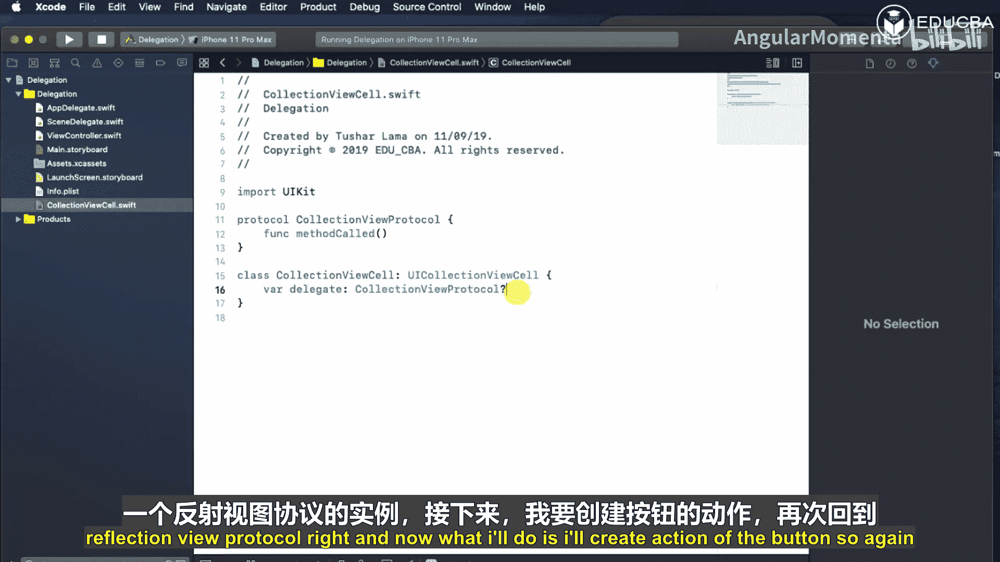

So again， I go to my main Doory board。Again， I click on this。😔，Now， I hope I'll get。Asistent。

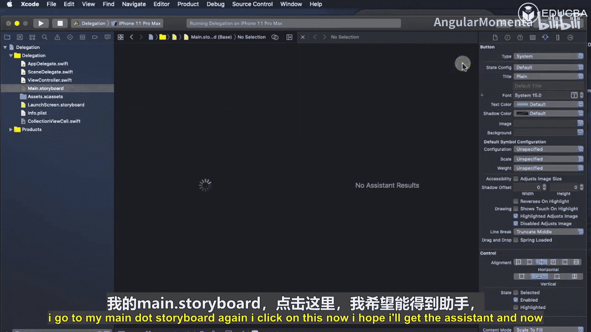

And now automatics， here I got two。 So this is correction yourself。

 And now here what I do is I create the action of the button。😔，On click。Collection button。ok。

I wanted to make action， but it created the outlet。 No worries。 I'll just cancel it。 And again。

 what I do is again， I go here and again， I change this to action。😔。

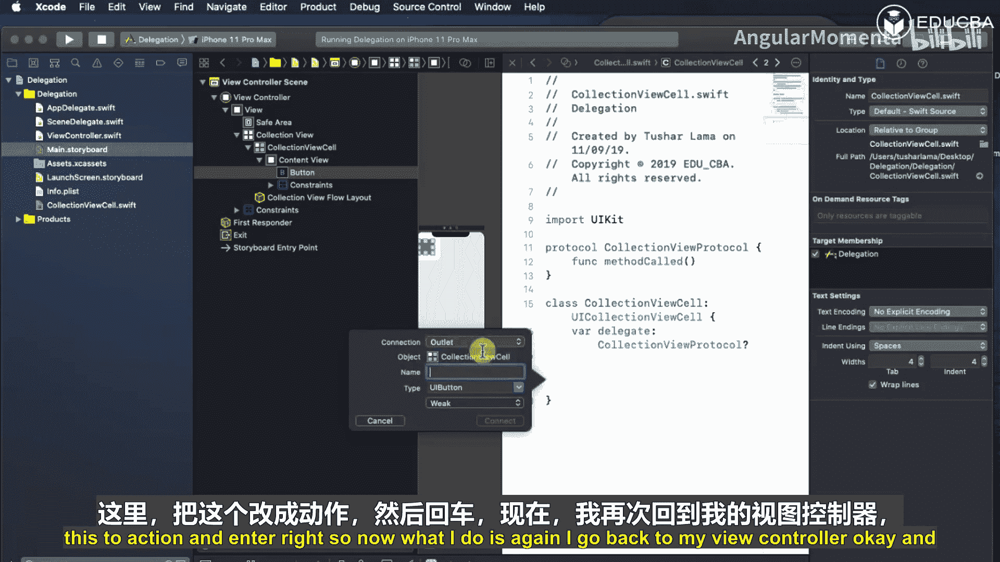

And enter， right。So now what I do is again， I go back to my view controller。😔。

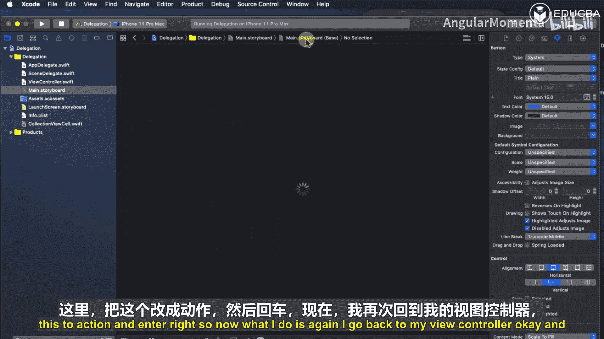

Okay， and correction reset。From here， what I'll do is I'll call the delegate， which Ive delegate dot。

Mettercore。ok。So now what I'll do is in my view controller， I'll create extension。😔。

Because I want that delegates should perform something， right。Your controller。

So I review controller firstly this extension。😔，And as a right function。Method call， right。 So again。

 I go to see the protocol and。都。This is the collection we've method also created the protocol。Now。

 it is saying that the type of view control does not conform to protocol because I have not implemented yet。

 So the last step would be like extension。Vi controller UI collection you delegate。😔。

Com my Ui collection with data source。ok。H open。Sa yeah。Number of item Ill return 10。😔。

An item for index。😔，See the function here so self for row。😔，This is the function。

Sellur item at index。 So again， I go here。😔，Yes。😔，Right。So now here I'll take a bull is。😔，年零一。Car。

I will assign initiated ready to false。ok。So。Here again。What Ill do is。God let cell equal to。

Collection view dot T reusable with identifier。😔，Okay， here firstly， I'll pass index path。And。S。

Collection view。Send， right， and the name。As you know， it took you same。And y have to return。Yi。

Collection use。O。And here。Is delegate card if。His De call is true。😔，Else。So here， what I do is sell。

😔，Sell dot， background color。Equal to that， right？And if it is not called， so it will be。😔，Right。

And in this method， the only thing I need to do is。😔，I had to call his delegate call to true。😔，ok。If。

If is delegate。Call is true。😔，To make it false。Wes to make it false。😔，And if it is false。

 make it true。😔，You getting my point what I am doing here and in the last what I do is collection view。

 not reload data。😔，Right， and here in the varied load， what I need to do is。😔。

Election view dot delegate equal to self。😔，Ellection view dot data source。Or to self。Eection view。😔。

Dot reload data， right， So now what will happen Firstly， the data will get reloaded。I need to return。

😔，Ss， right。 So first， yeah data will。Re lod。Then Iro it， so each delegate call is false right。

 so firstly the color would be yellow and when I press the button there in my cell class。😔。

It will fire this delegate， and it will come here。😔，And the color will change， right。

So now let's run and see this。😔，Once this is complete。So， I was like。Extension， like delegate。

Protocol， right。 So U table view with delegation was complete。 So now U table view with。😔。

The collection view with delegation will also get completed because firstly to display delegation view using table view。

 now to display delegation by using collection view。

So now this delegate is not called because I have not created the instance of this delegate。

 So what I need to do is sell。😔，Not called the delegate， which have create equal to。Self。Okay。

 if you want， you can go and see that delegate also here。So now let's run and see。😔，It is built。See。

那。See。Is the delegate working fine now when I click on collection we cell。

Here the delegate is calling， it is setting it to true When it is true， I am setting to red。Now。

 since it is true， when again click on any of the say。😔，So， friends， this is the。😔。

Main advantage of using。Delegations and protocol in our project。And this is the exact matter。

 how to use it while firstly assigning the delegate to self and after that。

 calling that delegate from any U action。 Thank you。

 French So this was all about collection view and delegations。

 And so we can say that delegations using collection view and collection view cell before that it was delegation using table view Now it is delegation using collection and collection view cell。

 Thank you， friends。

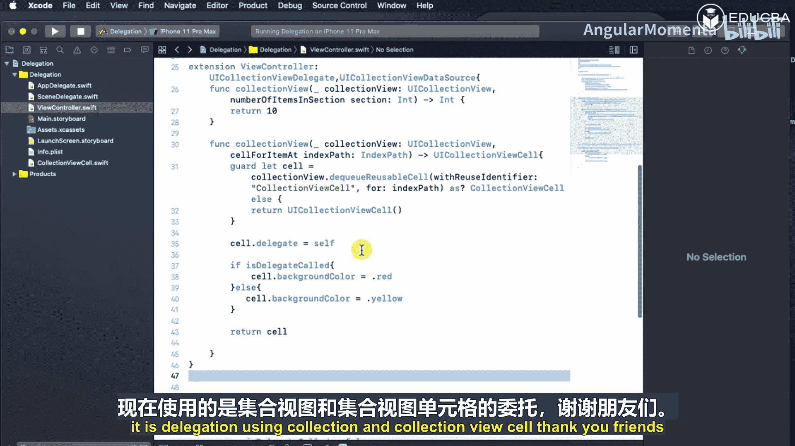