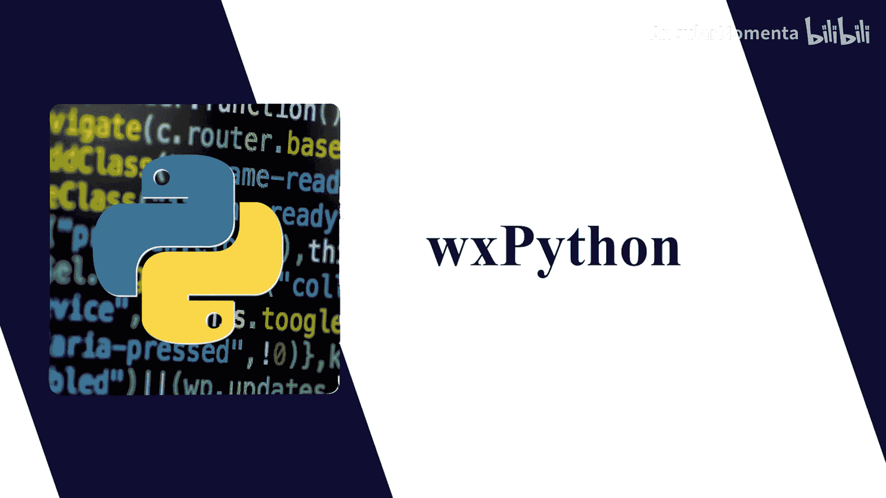
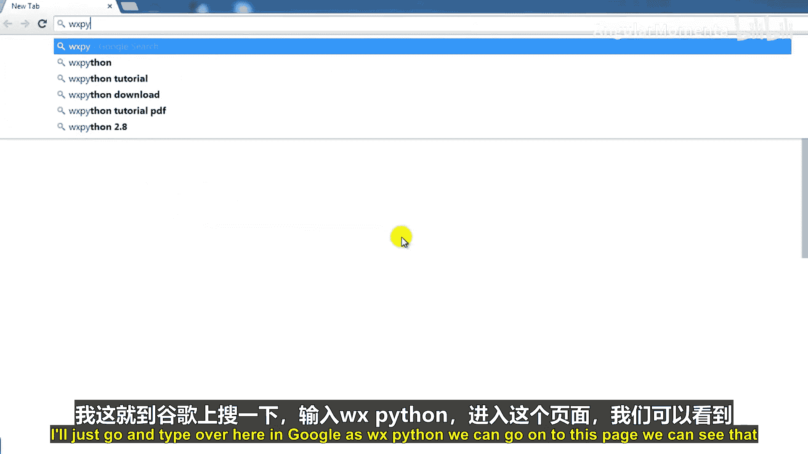
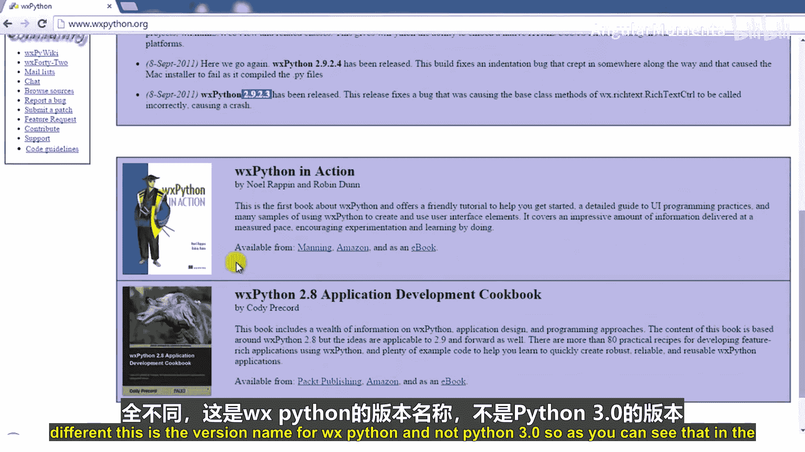
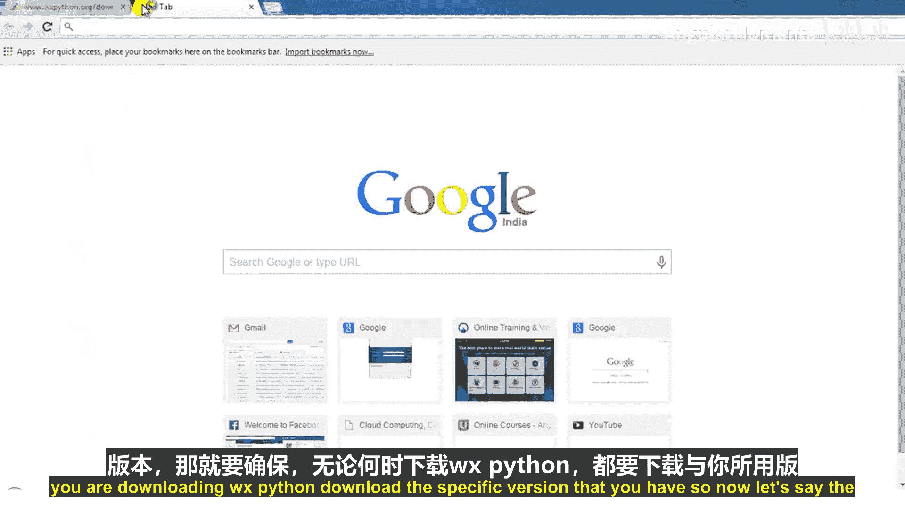
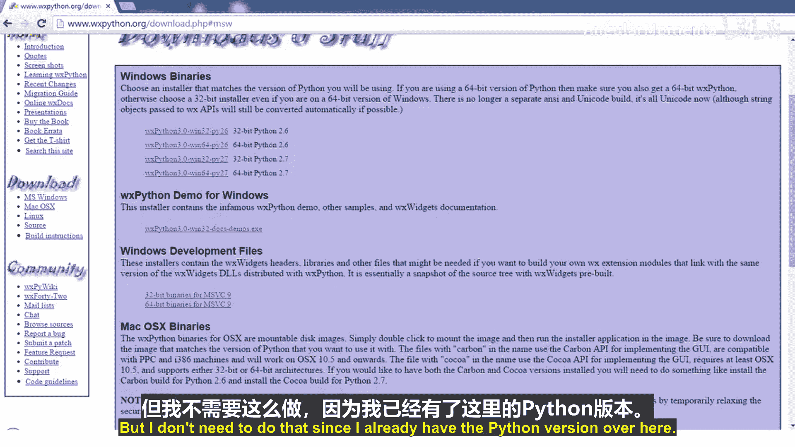
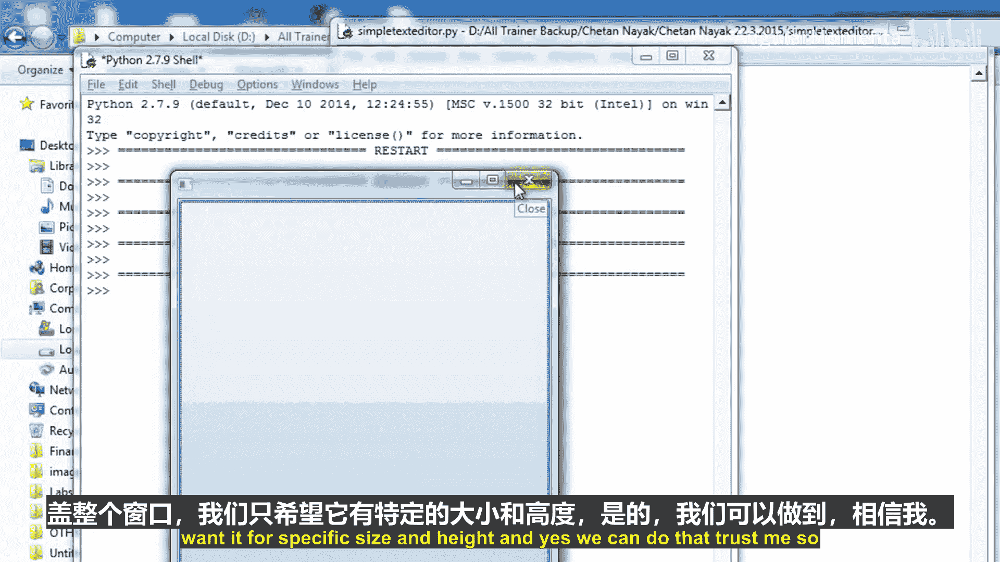
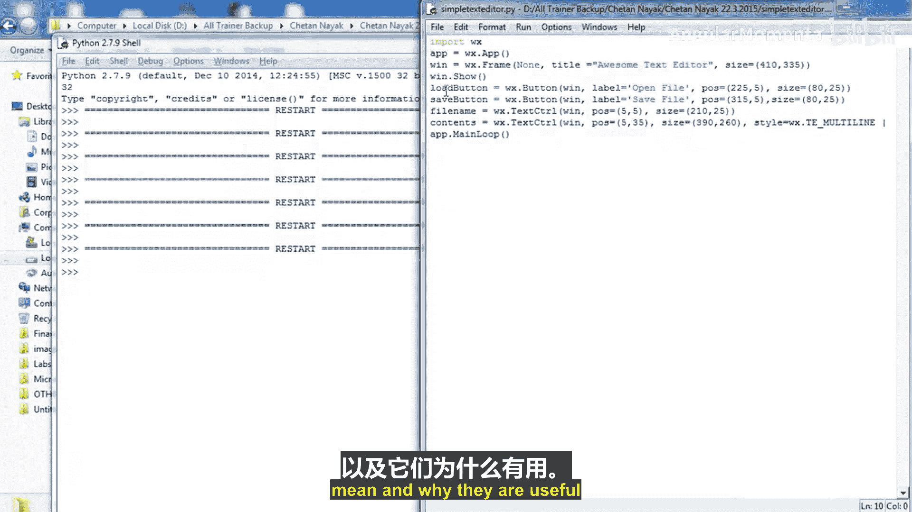

# 【EDUCBA】使用Python开发和部署Web应用程序  Developing and Deploying Web Applications with Pyt p01 01_01_01_wxPython_1 -BV1fGFoz6EpL_p1-

Welcome to the next tutorial in Python programming In this tutorial I'll be teaching you something different until now we have learned how we can use the command line tools to go ahead and create different kinds of program for our Python but as of now today I'll be teaching you something different I'll be teaching you how we can go ahead and work around the graphical user interface of Python so in this chapter you will learn how to make graphical user interfaces for our Python programs you know to be in order for me to tell it in a simple language we will learn how to create windows along with buttons text fields and some stuff like that it will be pretty cool so there are plenty of so-called such as GUI toolkits graphic user interface toolkits available for our Python but none of them is recognized as a standard graphic user interface toolkit。

And this has its advantages and drawbacks as well so there are different types of graphical user interface toolkis such as Wx Python after that this one more called as stncter and other one that is for Java Python that's Python but as if now in today in this tutorial I'll be teaching you the Wx Python and just to make sure that we are on the same page in this tutorial I be using Python 2。

7。9 not Python 3。4 the quotes are almost the same for Python 3。4 as well as 2。7。

9 the only difference is that Wx Python this GY is not available for Python any version of Python which is greater than 3。

0 I don't know the reason but they have not yet announced any different version they only have snapshots available and for you being intermediate it will be very。

Hard for you to go and actually use the snapshot so Sm now just install the Python 2。7。

9 and just also I teach you how to go ahead and download the Python Wx Python also so that it will be easier for us to go ahead and proceed with that。

And to make things easier to follow， Ill use a running example in this chapter。

 our task will be to create a basic program that enables us to edit text files。

Writing a full flatedged text editor is beyond the scope of this chapter but I'll stick to the essentials and after all my goal is to demonstrate the basic mechanisms of GUI programming in Python and the requirements for this minimal text editor that I would be creating today would be that it should allow us to open files that are already there in the systems to give these files specific names we must allow it must allow us to edit these files to save these files and it should also quit in the end and when writing a GUI program GUI's short form for graphic user interface in in you are just confused。

And when writing a GUI program it is often useful to draw a sketch of how we want it to look a simple layout in short so in my the one which I would be creating would be something similar to this command line tool。

 the only difference would be here it would be there would be option such as the name of the file that we want to open an open tab a save tab and here it would be everything that I want to write。

So and the elements of this interface can be used such as type a file name in the text field to the left of the buttons and click open to open that specific file the text contained in the file is put in the text field at the bottom that means it is over here。

And we can edit the text as we want and what we want to write and we can even save them and there won't be an quit button as of now I will just create open over here a open tab。

 a save tab and the name of the file and over here the what its contents and there won't be any specificqui option as soon as we quit the interpreter the file will also get closed。

😊，So there are， you can call it as their plethora of platforms。

Before writing a GUI program in Python， we have to decide which GUI platform we want to use。

In a simple language， a platform is one specific set of graphical components accessible accessible through a given Python module such as a GI toolkit。

😊，And there are n number of toolkits。One is the Tinter it uses a Tk platform it's also readily available but it's a semi standard and Tinter is available for Python programming 3。

4 as well but I think that since Wx Python is more popular it' is based on Windows and it a standardized platform I would be using Wx Python and since Wx Python does not support 3 any version greater than 3。

0 Ill be teaching you 2。7。9 in this specific version and if in case you are trying to make a career in Python programming you also need to know how Python 2。

7。9 works because most of the places Python 2。7。9 is still used there that's the region Now there are several other versions of GI toolkit such as Python win Java Sw P GtK or Pqt and it but these are more popular in the Linux version and SF now I am considering that most of us。

Using the Windows version that's why I would using the Wx Python。And yes。

 that's it So I'll just teach you how we can go and download these file specific file。

 I'll just go and type over here in Google as。W X， Python。

We can go on to this page。You can see that the different types of Python and Python classic is not available for Python 3。

4 don't get confused by this version because this version and the version of Python 3。

4 if they are totally different this is the version name for Wx Python and not Python 3。

0 so as you can see that in the left pane over here there are several different so if you are using Linux you can use Linux if you are using Mac then you can go and download the Mac version in my case I would be using the Microsoft Windows so I just clicked over there。

And after that I would just go and check these are demo versions if you don't know which Python you are and just make sure that whenever you are downloading Wx Python download the specific version that you have as of now let's say。

And the best version that I can think of in Python would be there are only two versions。Python 3。4。

3 and Python 2。7。9 if you are using Python 3。2 or 2。9 or 2。

4 then don't consider using those because most of them are ded as of now only these two versions are most popular。

And come to this part just make sure that whichever version you have just download the same version of Python Wx Python if you don't then it won't work。

 it won't be able to detect the Python in art system and it won't work that is a reason so if you have Python 2。

6 these are the versions for these version and just in case you don't want to straight away go ahead and download and install this file you can also download the demo version over here you can check whether it supports and after it supports you can straight away go ahead and download the specific one do you want。

So as of now I am using Python 302 bit Python over here。

 so I'd be using this version once I click over there it will take me to the download side and it will start downloading。

 but I don't need to do that since I already have。

The Python version over here that is 2。7。9 and it is for the same version just after it is installed just double click on that run and just go ahead and next next next I won't be doing that since I have already installed that but just for you to know can just go and installed this specific file。

And yeah that's it for us so now I have showed you how we can go and download for Mac OSx Python we should use a Wx version that agree with our Python version but if you are using Linux then you don't need to worry about all these because if you are using a Linux distribution with RPM we should at least download the Wx Python common and runtime packages along with that and if you are using Linux you will probably know what runtime packages are so。

If none of the bin are fitting your hardware or operating system。

 you can always download a source distribution， getting this to compile my further downloading source packages for various prequisites but I won't be teaching you that because that is beyond the scope of this chapter and just in case you are using the best thing would be if you're using Linux and you are just using aptitude get installed come online to install then you don't need to worry about getting any wrong version on your Linux because it will state over select the actual and the perfect version for your Python the version of Python that you have in your system so yeah to see how our installation works and you could just add out the Python demo that I told you in Windows it should be available in the start menu and once you have installed you will see it over there you don't need to use any of these just go and open the Python shell and you can just import all and each and area program that you have in the Python 2。

7。9 shell so you don't need to specifically go ahead and open the WX Python version。

So that's it for this tutorial in the next tutorial I will be teaching you how we can go ahead and start for making our specific text editor program。

😊，So let's get started with the program that we are about to create。

 so to get started let's impose the Wx module that we need to work so I'll just go and create a new file。

And just for the sake of it， I'll be just saving it and the empty file in my computer。

<|OTHER|>And I'll name it as。A simple。Text。Editor dot Pva。😔，Or the simplest editor perfect？

Okay fine and as of now I'll just go ahead and run this Ill just start with I'll just import the WX module import and there are several ways of writing WX program but one thing you can't escape is creating an application object the basic application class is called X WX period app and it takes care of all kinds of initialization behind the scenes。

The simplest WX Python program would be something like this such as app equals to WX period app。

And parentheses， and I'll write a period main。Look， parentheses。 And I'll just save it。

So if you are having trouble getting this Wx because some versions of Python there are problems。

 then if you are having problems writing this Wx period app then you can straight run such as app equals to WX period PY simple app you can also run this but in in my version it's running perfectly or you can just go and try to import it over here and check whether its working or not you can type Wx perfect app equals to WX period app parentheses just turn it over here and check whether it' is importing if it's importing perfect if it's not then you can just import the other thing。

And Ill just create okay so since there are no windows that we the user can interact with SF now。

 the program will just quit immediately if you go and try to run this。

 nothing happened and thats what exactly should happen because since there are no windows over here。

So as you can see from this example the methods in the Wx package are capitalized and contrary to the common practice in Python the reason that is for this is that the method names mirror method names from the underlying C++ package which are in the Wx widgets so even though there is no formal rule against capitalized method or function names the normal norm is to reserve such names for classes and we would be using the capitalizeized letter since now on for creating these modules。

 so let's take a look on creating Windows and components。

So windows are also known as frames and they are simply instances of the WX period frame class widgets in the WX framework are created with their you can call it as parent as the first argument to the constructor if you are creating an individual window there will be no parent to consider but if you are creating multiple windows as of now we dont need multiple windows but I am just letting you know that just in case。

So there are no other patterns to consider just simply use the nu Ill just show you how we can go and use that I can just write and it won't be over here the main loop would be the end point of our so Ill be just inserting this over here when equals Wx period and note that after Wx it would be in capital。

Frame。😔，And since then there is no panel over here， I had to insert none。And after that。

 I'll have to use win period show。Since I need to show this and we can also call the win period show in an event handler I'll discuss that a bit later but we need to make sure that we call the Windows show method before we call the app period main loop。

 otherwise it will remain hidden that is why。So now if I go and I just save this。

 if I go and run this。Perfect this is the window that we needed。

 but as we can see that there are no boxes over here since I have not created it So what I would be doing I would be creating a single text box over here。

 the name of the file that we want to open over here it would be the open tab save tab name of the open file tab and over here I'll create simple text whatever we want to write and as soon as we click save it will get saved and as soon as we click this button it will get closed there won't be any specificqui button for that this is perfectly find the way I'm creating this Now let's go ahead and add a button to this frame So in order for me to go and insert a button I'll just go and write let's say B TN equals to W X period。

😊，Button。And I'll write， when。Perfect， and this will give us a window with just a single button。

 I'll just go down and save it。 I'll run this。And this is one button。

 if you can see that there are borderline over here。And this is one button。

 as you can see that I can click this and whenever I click this。

 there is some visual effects happening over there。😊，And if you， if I go and delete this。

As Ill say this and I'll run， then there are no buttons as we can see。So。

I'll just go and save this since I am meetinging the button there is one single button but I need to change that so there is still a few rough corners over here this window has no title this button has no label and we probably don't want the button to cover the entire window we only want it for specific size and height and yes we can do that trust me。

So。

Lets go and set some labels and positions for our widget and when we create them we can use the label argument of the constructor Similarlyly we can set the title of the frames by using the title argument I find it most practical to use keyword arguments with the Wx constructor so that I don't have to remember them or with auto that's the reason so have w been perfect so Ill just go and write I'll just delete this because I don't need this kind of button over here。

So， perfect。And we could a B X frame。 And I need to edit the title。

 So I'll just write since we have only one parent directory。 I'll just write none and title equals。

Let's say。Simple， or I'll just write。Since we are programmers are awesome。 I like awesome。Text。

Editor。Perfect， and I've been， there will be need for me to go ahead and install button。

 So I'll write load button equals。W X period button。Picees spin comma label equals to。Open。Or。

 I'll just write。😔，Open file。Perfect parentheses O。

 and I'll just try save button since we need two buttons。Say button equals to W Exp button。

Parentheses win comma label equals。So。F then， yes。We need to use the coats。<|OTHER|>Perfect。

 and now when I go ahead and just run this。Perfect So this is perfectly fine so now you might be wondering that we have created two buttons over here。

 but it's showing only one button over here。 then where did the save button go Yes。

 and I was about to give the answer for that that this we have not given any specific position or any specific width or height to our save and load button we need to give that else whatever button we create it will be just going ahead and saving all those buttons over here So even if we create five different buttons we will only see the first button that we have created and all of the buttons will be behind that and we won't be able to use that So now what we need to do is we need to go ahead and create specific different or we can say we need to go ahead and create give it X and a y axis so that it will go and assign itself to some specific position So let's go ahead and do that and just remember that the save button is not missing It's just hiding by。

😊，Bsing the buttons more carefully we will be able to uncover the hidden button and a very basic method is to simply set the positions in the size by using the pause and the size argument to the constructors so Ill just write I'll just code an write to pin equals to W X frame awesome text editor comma Ill need to insert the size。

😊，Equals。sizeize would be 4 10 and 335， you can write whatever you want。

 I just consider these as specifics and as I need to show this specific buttons I'll write win period show。

And yes， the show should be capital in the start perfect of that load button W X button open file。

And after that， I need to give position。Equals to parentheses 2，25， comma 5 and。<|OTHER|>Yes。

 that's it for that and。Size。Equals。Prenheses，8 come out 25。

And the same for save button that write save comma plus equals parentheses。😔，Size equals parentheses。

<|OTHER|>And inside position， let me just go and row 3，15， comma 5。

And you might be wondering that why the the end integers are the same I'll let you know。

And the size would be the same 80 comm 25， since you want both of the same size。嗯。

<|OTHER|>And I'll just go and write。F name。😔，Equals to W X period。Text， control。

Prenicees when comma pause equals to。5hi comma5hi。And I'll write。Size equals to parentheses。

80 comm 25。And perfect。Oh， no， sorry。 It will not be Dcoma 25 be 2，10 comma 25。😔，Perfect。

 and I also need to insert the contents。Rls to W period。Text control。Prenheses， win come pause。

Equals to parentheses，5hi comma 35。And this size would be equal to 2。😔，3，9 he come 2，60。

And I also need to insert these tiles， I'll just write。Style。Equals to W X period。T， E。

 underscore multi。Multiline。And this would be a bit new for you。

 I know that now explain this to you what these are exactly。

So you don't need to worry about that HS scroll perfect。😔。

And so now I don't need the win show since I have already inserted that over here。Perfect。

 I'll just go and save this， I'll just try to run this。Perfect。

 so I'll just go and quit this is the end of this tutorial in the next tutorial I' will be teaching you what these file names mean and why they are useful。

