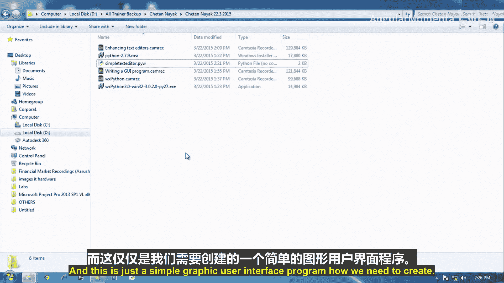
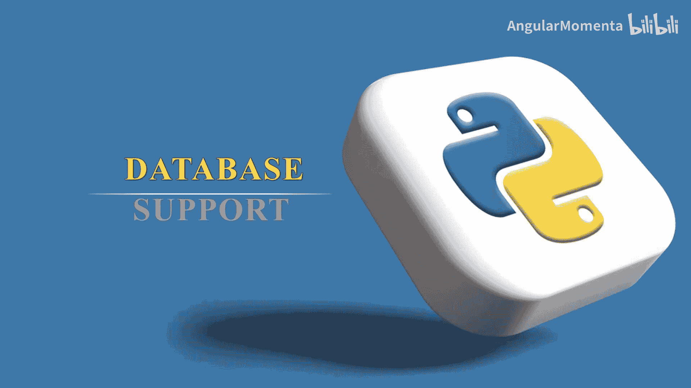
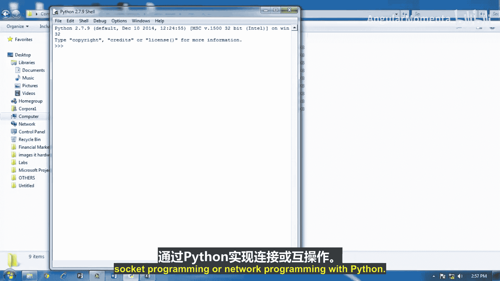

# 【EDUCBA】使用Python开发和部署Web应用程序  Developing and Deploying Web Applications with Pyt p02 01_02_01_增强文本编辑器 -BV1fGFoz6EpL_p2-

As you can see that in the previous tutorial we created this application。

 our own program for creating a simple file text editor When I go and run this we get this specific This is everything that we have created writing from this specific space to go and save the name of our own text file or to open that file here is where I would be entering anything that I want to save that and save button and when I close this it will get saved perfect to explain what I did over here in the previous example I told you that I would be telling you what I did exactly as you can see both position and size or pair of numbers the position is a pair of X and y coordinates and we need both of these on the same coordinates so let me just run this program it will be easier for me to run so as you can see that a need open and save file to be on the same line that is why I used this five over here just to let you know if I go and change it to 10 and if I run this it you can see that。

😊，Has moved a bit below this is the reason why we need to go and use the same line because we want it on the same exact and next addition to the open file because that would be that would look actually very good and that's what we want to create a graphical good looking user interface text file editor and the size over here it consists of width and height so there are another couple of things a new things in this piece of code I have created a simple text control that's W X period TxT Txt control object and I have given them one custom style The default text control is a text field with a single line of editable text and no scroll bar but in order for us to create a text area we can simply tweak this style with this style parameter this one over here。

😊，The style is actually a single integer， but we don't have to supply it specifically or directly instead we can use bitwise or to combine various style facets。

 The number of these things available and special names and the Wx module you can have a look at that in this case I just combined the Wx period T multiline to get multiline text area to get a horizontal scroll bar as you can see if I run this program you can see that Ive got over here these two scroll bars That is the reason I have written this program because what will happen that if there are no scroll bars and if I just go and writing this I ended at this point and you still want to write more there would be no scroll I just have to go and click over here just using myarrow bars to go up and down that would be quite frustrating That is the reason I have written this specific line over here This is the result of running this program let's go ahead and try to create it a bit more intelligent let's go and check a look all the specifying the geometry of each component is easy to understand。

😊，can be a bit tedious like just doodling a bit on graph paper may help in getting the coordinates right but there are some more serious drawbacks to this approach that we created they're having to play around wind numbers let's say if we run the program and try to resize the window you will notice that the geot of the components don't change just don't disaster but it looks a bit odd as I showed you that changing the the y axis does a lot of difference but when we resize the window we assume that it contents will be resized and relocated as well if we consider how I did the layout this behavior should not really come as surprise I explicitly set the position and the size of each component but didn't say anything about how should they behave and when the window was resized the many ways of specifying this one of the easiest way of doing this layout in Wx is using the sizes and easiest one is to use the Wx period box sizer Yeah that's how we I tell it box sizer sounds pretty cool let's go and take a look at that I'll just go to the end of the line。

😊，A size imager before I proceed a size manages a sizer or size imager it manages the size of contents that we simply have to add the widgets to a sizer together with a few layout parameters and then give this sizer the job of managing the layout of their parent component in our case we will add a background component that is called a WX panel and create some nested WXP box sizes and then set the sizer of the panel with its set sizer method let's go and take a look at that Miche perfect and over here I need to add a line BKG。

😊，Equals WX period。😔，嗯。Pael and I'll write you over here and I'll just separate each and everything over here so that I know what exactly I' am writing perfect and I don't need this show button over here actually I'll just delete this load button instead of this I'll just write BkG label open file I won't set the position over here and again save file I won't set the position again。

嗯。BKG。And I don't need this extra come to run me create a mess again。

And I'll just write file name equals to W X per text control and again。

 I won't specify anything over here， I'll just write。

B K G is because I'll let you know what why I' am doing this。

 This might be a bit confusing and over here as well。I won't specify this。

 I'll just write B K G style scroll perfect。 And okay， here starts our new line of code。 I'll write。

 let's say edge box here are where we are going to go and specify each and everything like the border and the proportion and everything。

 So I'll just write edge box equals to。W X period box， sizer parentheses。It box， period。

Add parenticeses， file name， comma proportion。And I yes， I know my spell is wrong。 Pro perfect。

 proportion equals to one。Flag equals to W X period expand and expand will be in capital。如果。

Explained parentheses。File name proportion1， and the file name should have been。F should be small。

 perfect for 1。<|OTHER|> let me check yeah， perfect， and I'll have to write another edge box。Period。

 add and again， edge period box again， add。In yes I have to write give them specifications。

 I'll write load button。Proport again。A portion equals to。Ccipher。

Flag Cypheramine0 flag equals to W X period left。From a border， equals 5。Perfect， and I'll again。

 copy all of these。Because I am a bit lazy。And I'll right。So。Button。Perfect portion。

 And over here I need to name the V box。Equals to Wx period。Box sizer。Pheses W period。

Vertical and just make sure that you are writing these codes exactly the way I am in capitalized letters else everything will again be a mess period add parentheses。

The box， period， add。And this is al right。Edge box come。Proport equals to 0。Flaag equals W X。

He period， expand。And W X A level all。The border equals 5， perfect。 Yep。

 and I'll hear ever write contents。Pportion equals one。对。Flag equals W period。Expand。

 and I'll have to write 1，2，3， perfect。应该我。Interview period。Again， W X period left。And yes。

 we need to put some spaces。Perfect， and again， W X period。Left。😔，Porder equals to 5。

And I need to bookmark these over here with these things so that they understand， so Ill right。B， K。

 G period set sizer parentheses， V box parentheses。And in the end， I'll write win。Period。

Show parentheses。Just， let me check if everything is perfect。Perfect。

 this code gives the same result as the previous program。

 but instead of using lots of absolute coordinates。

 I am now placing things in relation to one another。

 The construction of the Wx period box sizer takes an argument determining whether it's horizontal or vertical with horizontal being the default the ad method takes several arguments the proportion argument sets the proportions according to which the space is allocated when the window is resized。

 for example in the horizontal box sizeizer the file in widgets get all of the extra space when resizing if each of three had。

 let's say had their proportion set to one each would have gotten their equal share and we can set the proportion to any number the flag argument is similar to the style argument of the constructor we construct it by using the bitwise or between the symbolic constants the WX period expand flag makes sure that the component will expand to the allotted space and nowhere else WX period left and。

Top bottom and all flags the determining on which side the border argument applies and the border arguments gives the width of the border and yes thats it and I've got the yard I wanted and one crucial thing is lacking however if I go and run this just go and take a look as to how this works。

Perfect， if you go and check open file text files and nothing happens。

 lets go and check how we can go and handle these events。

 which I'll be actually teaching you in the next video。😊。

So now we have created the simple program and everything is done except to create functions to for the buttons to go and actually apply them These are called as event handling in Python or in the programming language let's take a look at event handling in graphic user interface language the actions performed by a user or call as event we need to make our program notice that these events somehow that these are events and they react to them I understand what I mean that we accomplish this by create a binding by binding a function to our widget that we have created where the event in the question might occur and when the event does occur that function will then be called we link the event handler to a given event with a widget call as bind BND let's assume that we have a written a function responsible for opening a file and we have called it by using the load button LOad then we can use that as an event for the load button and I can just go and write something such as like this。

Load。Button period， bind。During the season， I can write the VX period EVT underscore button。

AndNot button it button perfect and load by giving such kind of bind statement I can simply go and run the program So you might be thinking that what it is exactly there's nothing magical about this specific choice to use the load button and load as the button and the handless name even though the option says open It's just that I had called the open button open would have been a natural name to the handler and it's not that you need to name something which is exactly like this you can name anything you want I just name this because I found it easier to use this specific name just go and let's fill the remaining blanks and all we need are to handlers load and save So when an event handler is called it receive a single event object which holds information about what happened but let's ignore that because we're interested in the fact that I click occurred that means we have click the specific statement even though the event handlers the main heart of this function they are very very simple actually let's go and take the load function I'll just open a new file。

on't be running that， I'm just creating that so as to show you how it looks like。

 I'll create a new function such as define load parentheses。

 event parentheses and right file equals to open parentheses file name period。Get value parentheses。

 parentheses。 All right， contents。あの。Period set value parentheses。File period， read parentheses。

And yes， it should be contents， perfect。Set well again。 file period close。Fheses。

Perfect so the file opening and reading part have to be familiar because as you can see the file name is found by using file name get value method which I have taught you previously and the file name is just a small text field just simply put the text into the text area we simplify its contents using the set value and the save function is just similarly simple it is the exact same as load except that it has a w and a right for the file handling part thats a W method so let's go and create that event as well define save parentheses event file。

Equals open parenthees file name。No。该说。Period get value。

 you can see that these are almost same except with one difference that I have already given the right function over here。

😊，Because since we need to save we need to write and then save it and I dont need to save this specific model that I have created I'll let you know the reason for that and for that I want to write file period。

Right， parentheses。And then content period。Get。Value parentheses， parentheses。

 perfect and meing file period close。Penthesesis is perfect This is it Now I will just simply combine these to the respective buttons and the program is ready to run so I'll just copy each and everything over here that I created I'll just go ahead and insert it over here import Wx and I'll just define each of these events and I'll just save it。

I'll close this one since I don't need that so let's go and take a look if everything is perfect import W X Python define load Even。

 define save event app equals to W X Windows W frame we have created load button save button perfect and now just one thing I think I need to insert one more thing over here yeah I need to insert the event button over here so I'll just try it。

H load button， since I need to call that specific event period bind parentheses， W X period， E， V。

 T underscore B， U。TDUN。And load。And similarly goes with the save button alert save button。你。

Equals to， let me check。Yeah， perfect。 W experience。And I need to bind these。

 So period bind parentheses。W X。Period。P V T underscore P， U T D O， N from save。

 and it should be underscore。Perfect， now let's take a look at the remaining file name。

Content edgebox， W excr add add V box addisr Win app mean perfect。 before proceeding further。

 let's try out few things that so that we can check whether this is running perfectly things that we need to do right now is run the program and we will type something in that with a specific file name and we will save the button and then close the editor。

 restart the program。 These are few things that we are going to check and again。

 go ahead and open the same file and check whether we can access that So let's go and run this。Okay。

 I have it over here lets say and just make remember that wherever you have saved this file I have saved this file over here so wherever you have saved that file only over there it will save the file since we have not given it any specific address that is the reason we have given it a save file not save file as you can see that I do not have anything except these files over here so I'll just go ahead and run this program I'll just try let's say。

This。Its newly。Created text。Editor。Created by Mr。Awesome。And I'll just use the name as Mr。Awesome。

Perfect， now I'll say this file。And as you can see that in the background a file has been created。

 but you can see that when I try to click it it is showing me as to which program to open it will just save it as a simple file and I dont want to do that so what I will do I will go and write at the end period T XT and I will save this now you can see that this is a text file that I have created and I have everything in it perfect it is a new created text file by Mr。

 Awe。SoAnd I can if let say I wanted to， I'll just close this。We already have this file over here。

 perfect， everything is saved in that。 So now I'll just go and run this program again。

Now'll name it exactly what it is over here rather than opening creating a new file I'll just write Mr。

Awesome。Here T X T。And I'll let open file perfect so you can see that I have each and everything that I have over here and I'll just go and change it。

This note has been changed。And let me check if I could just also change this。Mr。 double， awesome。

 let me check if I can take that as well。So you can see that it has created another text file with the note that this has been changed。

So this runs perfectly as you can see， and I'll just delete these two files。And before I proceed。

 I like to tell you that this is P Wi file， I just go and close this since I have saved everything。😊。

NowThis is something I would be teaching you out of the box if I go and run this file it should open my simple text editor perfect but as you can see that this is this looks a bit dirty that we have this black screen of command line over here and let's say we have created some good programs if we do not want these kind of command line or command prompts to open we just want this application to open so for that so this is not really a big deal if you want to doublecler file I can just go and close this now just rename it and as I can see that this is a Py extension most probably I have enabled a specific setting in my file due to which I can see the extensions if you cannot see the extension go over here let me check the folder options no not this one over here you can see the folder options view here most probably in your computer it should be like the simple text editor then you won't see the extension so for that it can go folder options view and you can go and unclick。

😊，This hide extensions for unknown file type apply Okay Now when you see this Py extension just go and rename it。

And in the end， just type W， PY W。It will say that this file might become usable just ignore that continue yes and when you go and double click it it will only run the program it won't run the command line。

 so this is a special feature of Python。And this is how we can go ahead and create an awesome text file in Pyth so just go and mess up with the program。

 you can add Unicode and strings and a lot of other things and this is just a simple graphic user interface program how we need to create。

😊。

Welcome to the next chapter in Python programming in this chapter I would be teaching you database support using simple plain text files can only get us so far。

 but at some point we may need some extra functionality we may want to add some automated serialization and we can turn to what you can say as pickle and shelf but we may want features that go beyond even this for example we may want to have an automated support for concurrent access to our database that is you want to allow several users to read from them and write to disk based database without causing any corrupted files or somewhat like that or we may want to be able to perform complex search using such as many database fields or properties at the same time rather than just using a simple single key lookup of the shelf there are plenty of solutions to choose from but if you want this to be a large scale or to be a large amount of data then the only solution that we have is that it should be easily understandstable by other programmers because let's say if we have。

Created a program The employee or the programmer working for my company has left the company and some other programmer joins it then the other programmer should be able to understand that it should not be like he will allowed to create the whole database again that should not happen。

 He can modify but first you need to understand what exactly has written this choosing a readily standard form of database is probably a good idea at that point of time This chapter I will discuss about Python database API It is a standardized way of connecting to SQl databases and demonstrating how to execute some basic SQl using this API I won't be giving you a tutorial relation databases or SQl languages the documentation for the foremost database should cover what you need to know So let's start with the Python Db API there are lots and lots of SQL databases available out there and many of them have corresponding client modules in Python of the most basic functionality of all the databases is the same a program written to use one of them might。

Eily in theory be used with another the problem with switching different modules that provide the same functionality is that it usually that there are different interfaces that is the API they are different in order to solve this problem for database modules in Python a standard database API has been agreeded upon by the Python database API specification version 2。

0 This section gives us an overview of the basics I won't cover the optional parts of the API I will cover the main term what actually this APIs it covers the first thing that is global variables Any compliant database module must have three global variables which can be described as the peculiarities of the module The reason for this is the API is designed to be very flexible and to work with several different underlying mechanisms without too much rapping you can that is be the perfect term for that if you want our program to work with several different databases this can be a nuisance because we may have。

To cover a lot of many possibilities and in reality it will never happen to give you a better suited example is that let's say the use of Microsoft Office that would be a better way in the beginning。

 Microsoft Office was only there for the Windows rate programs later on it started with developing such as a Linux but if you're using Linux then there is already something called as library Office which can be used instead of Microsoft Office but still M Office was created for Linux after that it went on Android and later on it again came for Mac when they are trying to create different types of program it's not actually necessary that it that they will had to cover a lot of different possibilities because the way a program is saved in Linux is a bit different from the way it is saved you can say it as Windows because when you save let's say Excel sheet in Windows then it is saved as a period Excel6 file and if it is saved in Linux it is mostly saved in period ODT file for that it would be better if you have open Office or library office because that is。

Most used version in Linux that way when you're creating a program。

 you will have to cover several different possibilities that these are the ways which it can be saved。

 this is most compatible and which are not so a more realistic course of action in many cases would be simply check these variables to see that a given database module is acceptable or not for the program to check whether the compatibility is there or not in that specific operating system and if if it is not compatible then we could simply exit with an appropriate error message or raise some exception famous global variables are the API level is simply a string constant giving the API version in use according to the database API version 2。

0 it may either have a 1。0 or the 2。0 value if the variable isn't there the module is not 2。

0 compliant and we should assume that database API version is 1。

0 is in effect it also probably will not hurt to write our code to allow other values there who knows say let's say if 3。

0 database API will come out at that point of time then。

Tread safety level again is an indtigent ranging from0 to3 which is inconclusive0 means that threads may not share the same module at all and three means that the module is completely threadsafe a value of one however means that threads may share the module itself but not connections and two means that thread may share modules and connections but not cursors if you don't use thread probably you won't but still if you don't use them you don't have to worry about these variables around and the third and the most important is the parameter style the parameters style or called as the parameter style indicates how parameters are fliesd into sQl queries when you make the database is perform multiple similar queries the value format indicates standards string formatting that whenever we insert m percent S where we want to splice the parameters for example the value by format indicates extended format codes as using the dictionary splicing in addition to these pythonic styles there are three ways of writing the splicing fields。

Call us a Q mark simple QMK It means that Que marks are used numeric fields are used colon1 of colon 2 and there are also other models used at as colon any random name and after that there are exceptions the APA module defines several exceptions these are the connections and curses these are also the important exceptions the API defines several exceptions to make finegrained error handling possible However they are defined in a hierarchy so you can also catch several types of exceptions with a single exception block of course if you expect everything to work nicely and you don't mind having your program shut down in the let's say unlikely event or something going wrong we can just ignore the exceptions altogether but that's not how a programmer works the exception hierarchy is shown over here standard errors it's just a generic superclass of all exceptions warning is raised if in all fatal problem occurs error is raised when general superclass or it is a general generic superclass of all error conditions。

Interface error these are the errors you to the interface and not the database superclass is error not standard error and database error obviously it it occurs when its errors are there related to database Data errors when problems related to data example values are out of range or something like that operational errors they occur due to internal or creation error or databases again。

 integrated error occurs when there are let's say when the key check fails。

 there are keys inside different modules they are fail to check at that point of time integrity error occurs Similarlyly internal errors are there in the database in valid cursor programming occurs when user programming errors are there that is example tables are not found or not supported errors are found when there are any unsupported feature requested These are the reasons for that after that in order for us to use the underlying database system we must first connect to it and for us to use the named function connect it take several parameters exactly which depends on the。

😊，The API defines the parameters as a guideline， it recommends that they should be usable as keyword arguments and they should follow the order given in specific table and in order to interoperate properly with the underlying SQ databases which may place requirements on the values inserted into columns of certain types the DB API defines constructors and constants used for special types and values for example if we want to add data2 database it should be constructed with the data constructor of the corresponding database connectivity module this allows the connectivity module to perform any necessary transformations behind the scene each module is required to implement the constructors and special values and that's it for the tutorial and that's it for this chapter in the next chapter I would be teaching you how we can go and connect or interoperate using Socket programming or network programming with Python。

