# 【EDUCBA】使用Python开发和部署Web应用程序  Developing and Deploying Web Applications with Pyt p03 02_01_01_联网模块 -BV1fGFoz6EpL_p3-

Welcome to the next tutorial in Python programming In this chapter。

 I'll give you a sample of the various ways in which Python can help you write programs that use the network such as internet as an important component。

 Python is a very powerful tool for network programming It's also called a socket programming as well and there are many pre-existing libraries for common network protocols and for various layers of abstractions on top of them so you can concentrate on the logic of a program rather than on shuffling bits across via second it's easy to write a code for handling various protocol formats that may not have existing code because Python is really good at tackling various patents in bystream and because Python has such an evidence of network tools available that we can use I can only give you a brief example of its networking capabilities。

 we can find some other examples and different book as of now it's just a part of this chapter thats the reason I'm teaching you that and in the following sections I'll be giving you an overview of some of the networking models。

in Python standard library then comes a discussion of Socket server class and it friends followed by a brief look at the various ways in which you can handle several connections at one time。

 let's go ahead and check this and just keep in mind that if you have got a strict firewall in place it will probably one one you once you start running your own network programs it will probably stop them from connecting to the network as you should either configure it to let your python do its work if the firewall has an interactive interface or else you should straight a disconnect's note that any software connected to a network is a potential security risk even if you wrote the software yourself。

 just keep in mind before you proceed with this tutorial there handful networking modules there are plenty of networking models available in standard library and many more elsewhere in addition to those that clearly deal mainly with networking many modules may be seen as network related and let's take take a look at this socket a basic component in socket programming or the network programming is called as the socket a socket is。

an information channel with a program on both ends。

 the program may be on different computers and may send information to each other through the socket。

 most network programming in Python heights。 the basic workings of the So module and doesn't interact with the sockets directly Sockets come in two varieties server sockets and client sockets after you create a server socket you tell it to wait for connections it will then listen at a certain network address a combination of IP address and a port number until a client soet connect and then the two can communicate dealing with client sockets is usually are quite a bit easier than dealing with the server side because the server has to be ready to deal with clients whenever they connect and it must deal with multiple connections while the client simply connects does its thing and then disconnect in this chapter I will deal with server programming through socket server class family and the two Socket is an instance of the socket class from the Socket module Yes it sounds perfectly same way it is instantiated with up to three。

Aits an address family， whether it's a stream or datagram socket and a protocol and for just a plain vendor socket。

 you don't have to supply any arguments。 a service soet uses its bind method followed by a call to listen to given address a client socket then can connect to the server by using its connect method with the same address as user bind in this case an address is just called as a tu or a tuple of the form where the host is a host name and the port is a port number It is an integer so the listen method takes a single argument which is the length of its backlog or can say the number of connections it's allowed to queue waiting for acceptance before the connection starts So once a server socket is listening it can start accepting client this is done using the accept method the method of a block until a client connect and then it will return a tripleple of the form where client is just a client socket and address is an address such as ww do Python org the server can deal with the client。

It sees and fits and then start waiting for the new connection with another call to accent。

 This is usually done in an infinitefin loop。 The form of server programming is called blocking or synchronous synchronous program and network programming。

 let's take a look at some of that for translting data Sockets have two methods send and receive you can all send with a string argument to send data and receive with a desired number of bytes receive the data if you're not sure what number to use just a random data would be 1024 is always a good choice anyway。

 So if you run a client and a server pair on the same machine the server should print out a message about getting a connection and the client should then print out a message that it has received from the server we can run several clients while the server is still running by replacing the call to get a host name such as get host name in the client with the actual host name of the machine where the client is running you can。

 however， have the two programs connect across a network from one machine to another Let's take a look at that and。

The port numbers they are are normallyly restricted Linuxer units you need administrator to allow the use support below 1024 These low numbered ports are used for standard services such as port 80 is used for web server if you stop a server with control C you might need to wait a bit before the same port number may start again let's take a look at a simple or minimal server I'll just try it import。

So开的。Mgaite。S equals to， let's say， socket period， socket。诶。Post equals to or rather than this。

 I will just try new， ideally。Yes。S is right include socket。As。Subject to you。So。こ一。傻。

Create get post name parentheses。4 equals to， let's say，1，2，3，4 as period5。Pheses， parenthees。

ポストマコール。And so all programming is mostly used to create databases such as Google's database of gathering information。

 or mostly in ethical hacking and stuff a virus is not actually it's mostly used for creating Trojan hosts you can see that would be a better example so that when you go on this on someone else's computer you get their computer as a host and you can straight away go and access each and every information in their computer that's a region address equals to。

P to accept。AndAnd this is。Briend。说。Connection。嗯。CP extend。没有。嗯。Or making。

Kind of that it is can sleep very close。Just let me take a look if everything's perfect。

And I'll just check and look。Perfect if I tried to go and run this I will I should probably get a firewall wording that someone is trying to connect to this computer and I should allow it not so Ill just try to run it okay only one usage of its soness permitted okay。

So I'll just go and close this， let me check if that it's still running with that print no， you know。

 just let me go and run that。

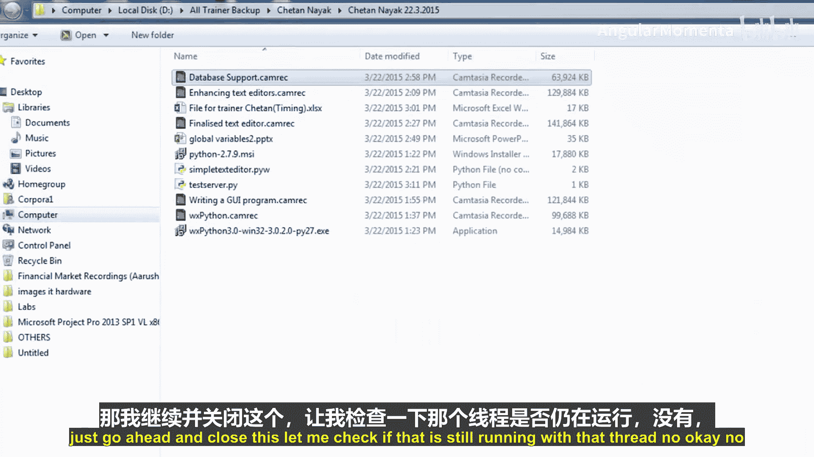

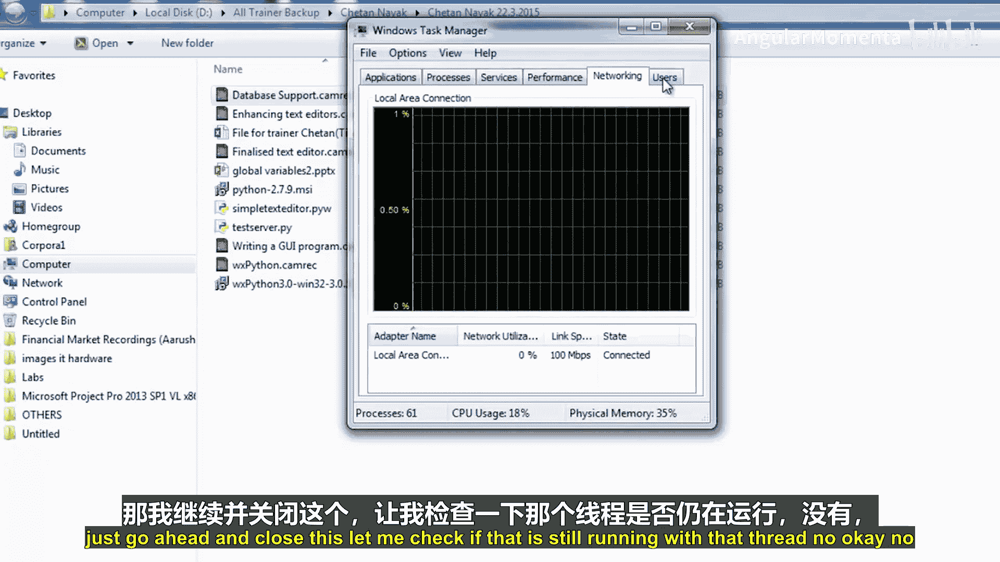

啊。So what it probably said in the previous error that only one socket camera run at a time。Yes。

 perfect。 So what I need to do is I think I need to go and change the port number and I'll need to change it to 1。

2，987。Soで。没有来。Yes， perfect so I have disabled my file but that's reason I'm not getting any error。

 but if I had gone ahead and。

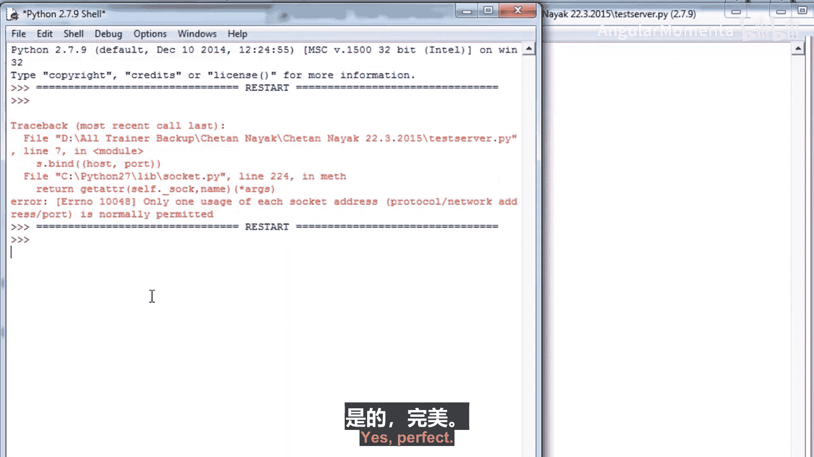

I can just go and breathe the control C， yes I want to tell it。I again， run it。

This time I I get into the same number。I just try to run this module。

Okay as thats the reason if I went 12，9，7 again again it will show me the same because I ran that in the previous so once I have run on specific port I cannot on this same let me just try can yes I can。

And check perfect when it's not permitted and the me if I could change2 960 I'll save it up on it Yes。

 if I change the port number it runs if I don't then it won't add since I have not given any specific address as to where it should connect。

 it won't connect perfect。So I'll just create a new file。

 This is how a service socket looks like and I'll show you how client looks like not a server client。

 So I'll just go and run。You bought socket。And S equals to socket。So fantas another like post。Its to。

So good。Here you get pushed name。Andicees。Pd equals2 p， I need to do the same1，2，3，4。

 and I now least same me year 123，4。Okay and then。To coming。但是你一个。呃，那个。Post port。嗯。Prenheses。

🎼SP REC B parenthees and0，2，4 ands。Ha died。Try to run this perfect the reason' because I have not given any specific address to get to。

This is how it works and in the next tutorial I'll be teaching you what URLL and URLL libraries are。

 so as of now these are the examples as to how this is how a service socket looks like。

 this one and this is how a client socket looks like。

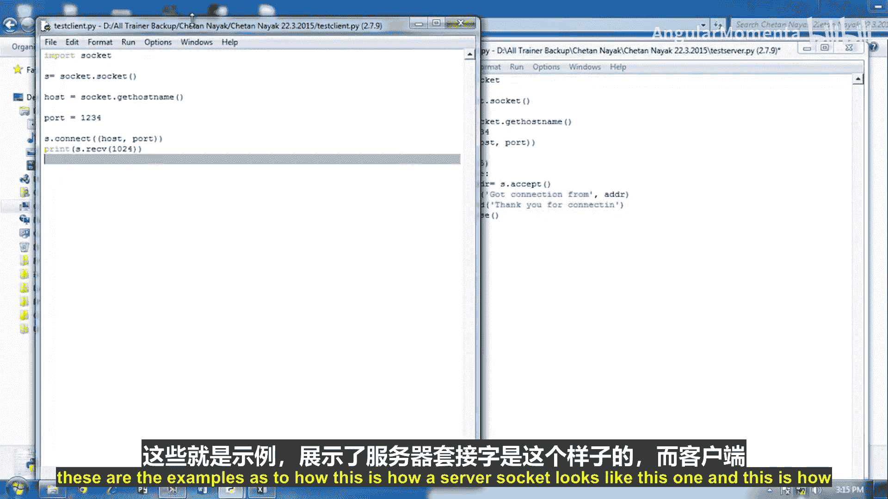

Of all the networking libraries that are available。

 the ones that probably give us the most bang for the buck are URL libraries and your libraries too。

 they are called URL L and URL they enable us to access files across a network just as if they were located on our own computer through a simple function call virtually anything you can refer to the uniform process locator that's URL can be used as an input to our program。

 Just imagine the possibilities you get if you combine the module that's regular expression module。

 we can download web pages extract information and create automatic reports of own findings。

 The two modules do more or less the same job。 however。

 but URL L2 is just a bit more fancy for a simple downloads we can just use the URL L if we need STtP authentication or cookies or we want to write extensions to handle our own protocols。

 then URL L might be the right for us。 let's see how we can open remote files。

The simple command for opening a remote file would be I can just type from URL LIB import URL open。

And I can write let's say web page equals to URL open and not URL K open URL open parenthees from HtTB。

Not three piece。 Okay，3 people found slash Sky WW dot by thing。Dot g。

Pfi any part that it enter perfect。If you are online the variable web page will now show a file like object linking to the Python webp page if you want to experiment with these。

 but you are not online you can access local files in the URL such as since you can just copy these file addresses and you can paste it over here and you can just open these files。

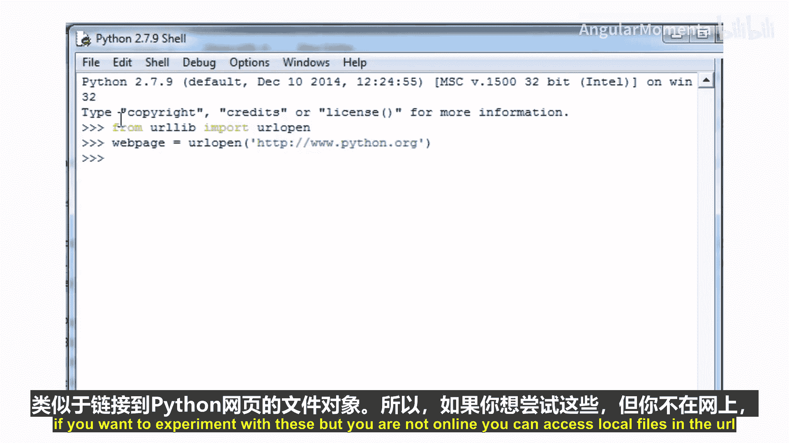

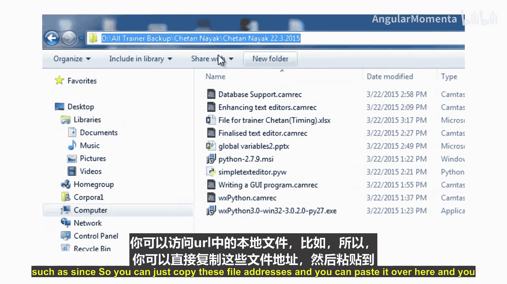

Let's say we wanted to extract URL of tutorial link on the Python web page that we just opened so we can do that with regular expressions as well。

 let's say I can just saw it。If report R E my right text equals to Web page period。

 read me write M equals。R period segment regular expression search。And over're here。Now。

 if you're already， this might be a bit tough for you to understand。

 you can just ignore this section if you are totally new to HML else， you can go through this。你说。

Perfect， let me close this。ま。Material。很东西。不ect。Just ignore this。Now， just ignore this。

Just keep mind as to how we can go and use this R E and yes， I just。No， I got this error。

And over here， I need to。P分。Unexpected end of regular expression。 Let me chat。这。Thispect。

I can just paste it over here。With two changes in these。It this is private。Perfect。

And I can just write it。And period。Group。喂。And yes， it does not have a S of now that's the reason。

 So as you can see that if we had attributed a group object to the type it would straightaway open the specific given us the Http do or that specific web page this is a specific way we can go ahead and access these files just at the time just remember that three scisors that I am getting you would be getting1 me because at the point of time that you are trying to access specific web page the same page that I'm trying to access add may have been changed and can just have to modify the expression to make your code the same way I'm getting this error this is a way how we can go and access the remote files but what about reing remote files the URL open functions gives us a file like object we can read from if we would rather have a URL take URL to take care for downloading the file for us stor a copy in the local file we can just use URL retrieve instead rather than returning a file like object it returns a typical a。

including file names and headers where file name is the name of a local file the name is created automatically by our URL drive and headers contain some information about the remote file if you want to specify a file name for a downloaded copy you can also supply that second parameter such as like this you can just type。

言わる。I be you the spelling perfect and unit parentices。ST T。W Pyon。这个啊。I can say with the C。There。

That's it I want to save what here and I want to save it as。X a。By turn。嗯HML。We will retrieve。Wecha。

 And yes， I need to import the URL retrieve first。So have to just strike。From you on live。こ。

You are old。Tat， and then if I go ahead and copy paste this over a here。Perfect。你。

So what it will do is permission denied that the reason because that I have denied any access to any outgoing connection that is the reason why it is not working。

 but since if you had already given your access to your Python to go and access a specific we had given access file while it would have probably open This retrieves the Python homepage and it stores it in the C drive and name it as Python webp page period Hm if you don't specify a file name。

 the file is put in some temporary location available for you to open， but when you are done with it。

 you may want to have it removed so that it does not take up space on your hard drive clean up such temporary files。

 you can call the function， you all clean up without any arguments and it takes care of other things for us。

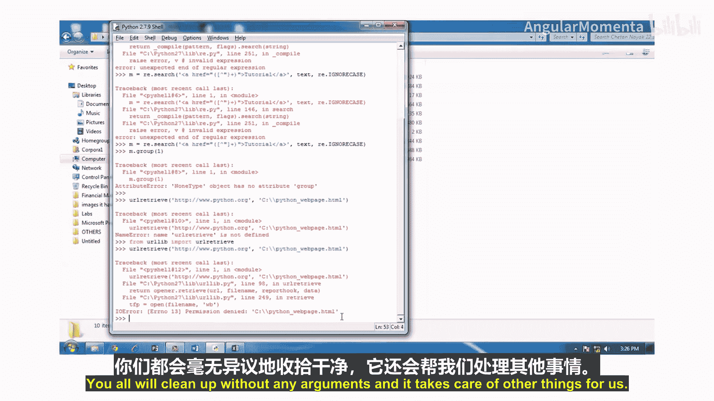

Welcome to the next tutorial in Python programming In this tutorial。

 I'll be teaching you what or more details about Socket server。

 So till now you might be doing that Socket server isn't really very hard writing code in a socket server is very easy we want to go beyond the basic getting some help can be nice So the socket server module is a basis for the of several server a standard library including base server simple server。

 C serverp server and many more So as server as well So all of these various functionalities to the basic server Socket server contains full basic classes server for the soet streams UD server for UD Sockets and more obscure stream server and server probably won' need unique stream and but most likely you will need the most the TC server even a UD server。

Probably wouldt need that。 So right server using the socket server flavor。

 you put most of your code in a request handle。 each time the server gets request。

 request handle is iniate and various handler methods are called upon it with the request。

 So exactly which methods are called depends upon specific server and and handler use and you can also surpas them to make server a custom set of handlers a basic basic handler class based on all the actions in a single method on the handle called。

 which is called by the server This method that has access to the client Soet in attribute self period request。

 So if you're working with the stream， you can use the stream request handle which sets two other attributes as self period file and period file each for rate and writing can use this server for file like objects to communicate with the client。

 So let's take a look at how you can go to create socket server which is actually a based minimal server I can just want and。

Soocket server input PCP server and the model name Soet server。 So first。

 I think I'll have to ete the Socket server in the start， the reason why I got this error over here。

 module name Socket servers because as of now Im using Python 3。4。2。

 But this module name Socket server with the capital S in the start and in the middle。

 this was the name which was used in Python 2。7。9。 So till Python 2。9。 So since I'm using Python 3。4。

 the name has changed a bit from the capital S to small S in the start as well as in the middle。

 See if I write from Socket server each with lowercase S。 and I can write server。

 it will we get imported perfect。 And so I'll just go and create a right class handler。

 or rather than over here， I can just plus handler from the C。

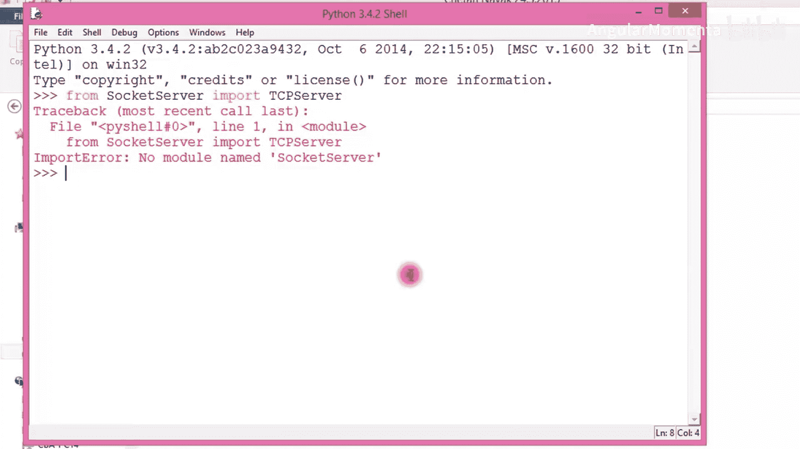

Dream。Request。And then。I see is。 And yes， before I go ahead and it's just ignore this line。 Okay。

 just ignore that line。 So I also forgot to put and add one more module。Stream。Request。

And so I needed to import that before I can go and proceed with this line of code。

 So I'll just pop it over here， paste it Col right fine。Handle parenthees， Se parenthees。Ads。

The self period request period。Get。May have disease。Now， like。Connection。From A DPR。 And yes。

 I be over here。Perfect， I can write。 Okay， let me check， just copy it and past it over here。

We got connection from ADDR。And this， I need students。

Use this in the wrap format invalid synt to be check。

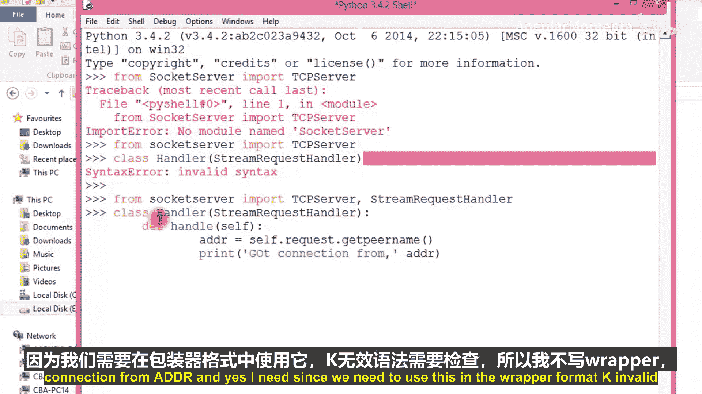

Soent of writingologist just include this in parentheses。Alright。

Sales period W file period right And the seasonal right。Thank。要。So。考えて。Prenes and。

Server equals to PCP。We to seas。 We the sea alright。Yeah。

Before which we would probably be the board and。Iello。Server， and yet。

 since I had run this specific thing， it asking me whether it wants to clean it。

 I just wouldn't allow access to it right server period。So， I just sort。For。And， okay。

 just let me check if I miss Bill anything again。

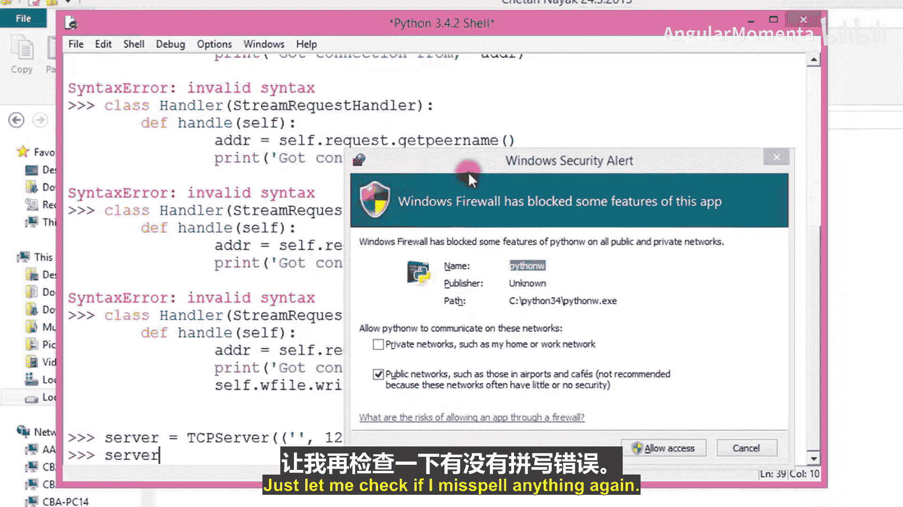

It should be server forever， not server forever。

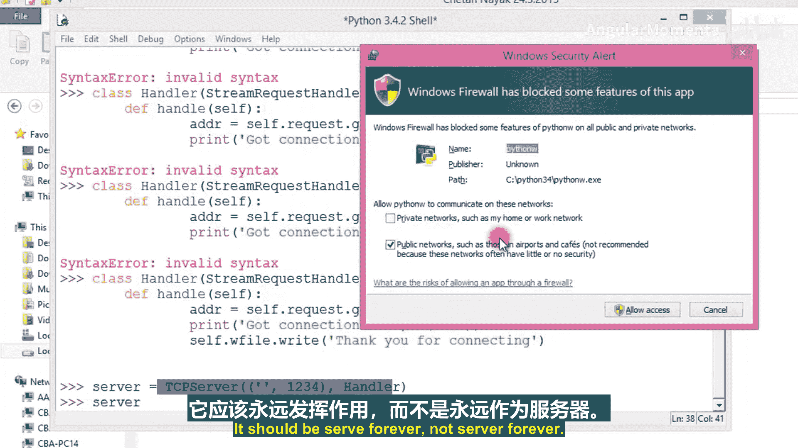

Perfect， so now if I go ahead and press Android will just keep on continuing because since I haven't read this piece of code over since I don't want to。

 I'll just go ahead and read this piece of code by control see So you can find more information about socket server framework in the standard library。

 but this is how we can go and write simple socket module so that it will be easier for you to go and connect to your clients and create your own network modules by using these set of frameworks。

 So the server solutions discussed so far， they have been synchronmous or only one client could connect and get its request handle at one time。

 So if one request takes a bit of time such just for example。

 a complete chat session like a Facebook chat or something it's important that more than one connection can be dealt with because we don't want to chat to one person。

 it should work with multiple persons。 So there are three main ways of achieving this when iss called。

Forking， another they call is threadreading and third one is called as as synchronous IO that's input output forking and threading can be dealt with very simply by using mixing classes with any of the socket service servers Socket server server main socket server is the name that's the reason so if you want to implement them yourself these methods are quite easy to work with they do have the drawbacks as well however。

 forking takes a resources a lot of resources and it may not scale well if you have many clients。

 so it's good for if you have one to three clients。

 but although if you have reasonable number of clients or modern units or Linux system forking is quite efficient and it can be even more if you have a multiCp system。

 but still threading is better because threading can lead to synchronization and but still even threading has some synchronization problems it wont go into I won't go into these problems in detail。

 but I'll show you how to use different techniques in the following sections。

As synchronous input output is a bit more difficult to implement at a low level The basic mechanism is the select function of the select module。

 which is quite hard to deal with luckily we have frameworks that work with as synchronous input output on a higher level giving us a simple abstract interface to a very powerful and a scalable mechanism a basic framework of this kind which is included in the standard library consist of a synch code that's asy or and S in chat ASy and CH18 and twisted it of module which I'll be discussing last in this chapter it's a very powerful as synchronous network programming framework at teach that in the later end of this chapter but as of now just keep these things in mind and just in case you don't know about forking or threads I'll give you a little more clarification forking is a unique term when you fork a process that is a running。

basically duplicated and both resulting processes keep learning from current point of execution each its own copy of memory variables and such。

 for example。 So when process will be the parent one or the other that the copy will be its child and even if you are let's say a science fiction plan。

 you might think of like say a parallel universes， the forking operation creates a in the timeline and you end up with two universes to be more specific。

 and they exist independently， like the process able to function to determine whether the original or the child they are able to determine that。

 And by looking the written value of the full function that gives us whether it's a copy or the original one so that they can act differently and if they won't be able to differentiate。

 then it won't be actually the point that you want to process over here because one processes will do the same thing and we are just one ballgged down。

Computer and you don't want that。 That's the reason。 So ining server。

 a child that the child for is fold off with every client connection。

 the parent keeps listening for new connection， let's say the when the child connection creates a new connection or a copy of that。

 then the parent becomes a grandparent of the parent connection and the child becomes a parent。

 So that way it keeps on continuing until there are more copies of that。

 And when the client is satisfied， the child process simply exists。

 and each and every process it gets shut down because the food process running pal and the clients don't have to wait for each other。

 becauseing can be a bit resource intensive like， let's say each for process needs in old memory。

 So it may eat up a lot of space and lot of memory in your that's random access memory。

 an alternative thread exists that' threading threads are， however。

 lightweight processes or subprocessses。All of them existing within the same process and sharing the same memory。

 This reduction in resource consumption comes with the downside。 It's because they share memory。

 you must make sure that they don't mess up variables with each other or try to modify the same things at the same time。

 which can actually create a mess。 these issues fall under the heading up synchronization with modern operating systems except micro windows。

 which doesn't support4 actually and forking is actually quite fast and modern hardware like poor ifi third generation of four generation。

 they can easily deal with such resource consumption much better because they are made for such high end processing。

 That's a reason if you don't want to bother with synchronization issues。 however。

 then for may be a good alternative。 if you have a processor with a good amount of power。

 the best thing however， we to avoid thought of we can call it as a parallelism because later in this chapter。

 Ill give you。Solutions based on the select function That is another way to avoid threats and folk is to just switch to Staless Python a version of Python designed to be able to switch between different context quickly and painlessly and it supports a form of thread like parallelism such as microts which scale much much better than the real threads and for example Staless Python microts have been used in eve online to serve thousands of users which are much more efficient than just normal threadreading or 4 you can find more information about this on Stp called Stalesst co or www do eve online dot co Evs hyphen onlineline dot co So just check these things if you are still confused you can come back and read this tutorial again so that you will get more and more efficient in this network program。

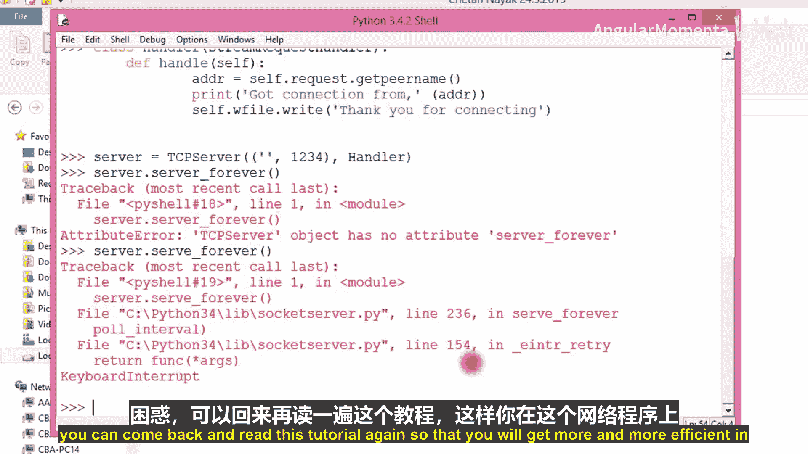