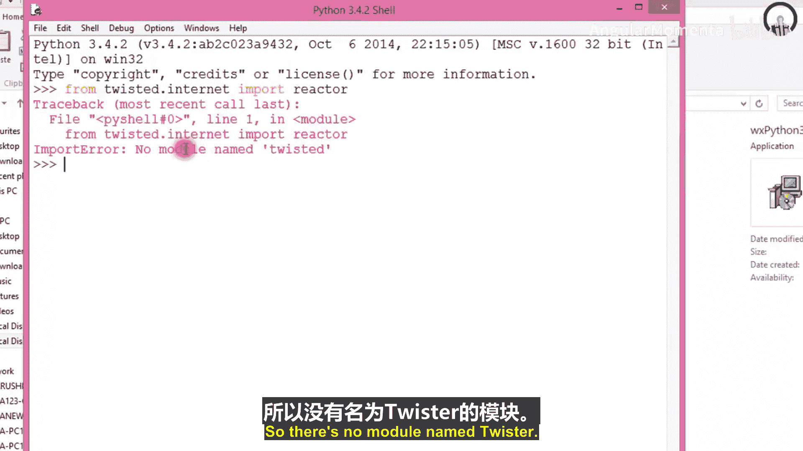
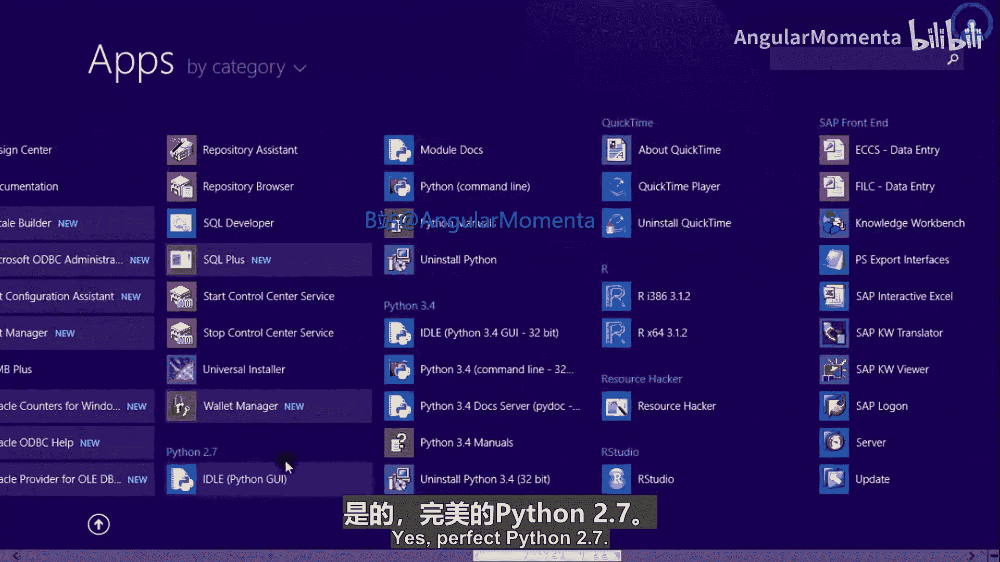
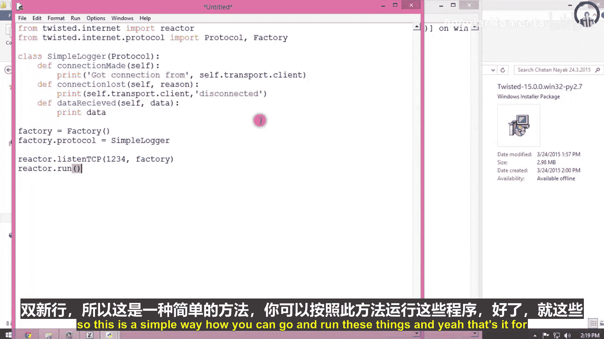

# 【EDUCBA】使用Python开发和部署Web应用程序  Developing and Deploying Web Applications with Pyt p04 02_02_01_异步输入输出 第一部分 -BV1fGFoz6EpL_p4-

Now， let's take a look at forking and threading with socket servers。

 C a forking or threading server with socket server framework is so simple that it hardly needs an explanation。

 Let me show you how we can go and create or make a server using forking and threading respectively。

 the forking and threading behavior is， of course， only useful if the handle method takes a long time to finish。

 And just note that forking doesn't work in Windows。 It's mostly used for Uni or leanance。

 That's a reason。 So I'll just right from。Soet server。In board， I need。TCB。So。And， I need。14 mix in。

 And I need a stream。Request。And。Let's check if these gets imported， perfectect。 It's important。 Now。

 right class server。Or then over here， I just。Copy this in the new file。

Because I don't want to create multiple processes running in my system， so I can just write it from。

あて。すごい。Maybe Ill just completed over here some server yeah for。Ms in。ECCB。Server parenthe color。U。

 and outright。So。Hlepar。Stream。Request。はる。During the sea So， Yeah， and I need to define it， define。

Apprenheses， self apphees， golden。O。可能。And right。Addre。Cl to the south period。Request here。

Here name parenthees。And print。Dicees。就说。Connection。From。And right， when this he address。

Self period right file。Ped right。Fes。Okay。You for tonight。

AndIt will probably run as soon as I enter the next code。Server equals to。S parenthees。

Prirenheses children。for theこ。ある。AndTo run right now。 you're running in the background to write。

Several period。So。Im this good for everyone。あれです。And Ill just， it will just keep running on forever。

 So as since I need to close this， I just control see。

And now I'll show you how a trading server looks like。

 so for that I need to write the same dates again， so I'll just write from song。server。微波BD。So。

For King or I just copy and past over here。 That would be better， I think。

The only difference would be， I need to change。Fork mixing good。O， O。

Just one thing that I copied it from over here。I need to change the4 medicine to。Streing。ベえ。Perfect。

😊，Now I can write the same thing。Except that again， over year， I'll use。ItT mixing。

 It's most probablyably all the same。 Only difference with。Because define handle perfect。

 and everything will be the same organ over here from about N address and perfect。嗯。

Even the last twist business would be the same。我。And you can see that multiple sentences statements are found comping a single statement。

 The reason being that I have ran two servers with the same port。

 That is a reason it won't be able to run that。 but it just a way that I wanted to show that how the difference between a for in and a soet server。

 This is what they do right forking4king mixing servers and threading mixing servers。

 So a synchronous input output with secret poll， I'll tell you what this is when a server price to communicate with a client。

 the data it receives from client may come in fits and spurs。

 if you're using4king and threading that's not a problem。 but while one panel waits for data。

 other parallellets and continue dealing with their own clients。 another way to go， however。

 is to deal with the client that actually have something to say at a given moment。

 we don't even have to hear them out。 we just hear say a little bit and then put it back in line while with the others。

 This is the。sTaken by the frameworks， S core or S in chat and twist module。

 and the basis for this kind of functionality is a select function。 or where available。

 the poll function， both from the select module or the two poll is more scalable。

 but it is only available in Uni sister。 The select function and takes three sequences as its mandatory argument within optional timeout in seconds as in fourth argument sequences are file descriptor integers。

These are the connections that that we have been waiting for。

 The three sequences are for input output and exceptional conditions until one file descriptor is2 to let's say for action if given timeout is accessed by that so the return value from select is a triple of sentences such each representing an active subset of the corresponding parameter for example。

 let's say the first sequence return will be a sequence of the input file descriptors and there is something to read sequences can。

 for example， contain file objects and all the data the server is a simple log that simply prints out all the data received from its clients and we can test it by connecting it using Tt try connecting the multiple T connections to see whether it can serve more than one client at once so I'll just close the server this in a file because I don't want to run。

Silver， which would actually float on my。Computer， so I can just write。Import soccer from a select。

All right， as equal do。If socket turn disease。First the。So good。Period。一。😊。

Post names then the season I right For， let's say we 1，2，3，4。Sper bind parenticees。Purtices。Was。あと。

YourS period listen is5。Input。Corrctic， correct as。诶我。Through。RScomaWScomaES。Equals to。是 select。

He and I con provide。Input。Brackackds。来率。Perfect。Thank for all。R。E R， N S。C comma address equals to。

As do you accept。Print。And this is。那个。Connection。From。そです。I just。And。Can boots period aend。

 parentheses， C， parentheses。Is。Da。ま？可以。N see frequencies。To do to write E this。equal to log data。

I think it won't be able to。Except。So。这是。good。Throughe， and if it is。Disconed。Print。Our period get。

Your name。This is come。Yes。Perfect。Inputs。Remo her car。As。Strange。Data perfect。

 So the poll method over here， it's easier to use than select and when we call poll。

 we get a poll object we can then register file descriptors or objects with file number method with polling object using its register method we can even later remove such objects again using the underregistered method as well。

 once we have register some objects， for example， let's say sockets we can call the poll method with an optional time argument and get a list of possible possibly empty of pairs of the form and event where every is the file descriptor and event that is what actually happen It's a bit mask you can say meaning that it's an integer where the individual bits correspond to various events and the various events are conscience of select module and I can explain that to you by showing you a present So these are the poll。

Even constants in the select module， in Paul Pri， call out and Paul and So the poll is there is a data to read from the available descriptor that's what it says Paul Pri means there's urgent data to read from the file descriptor so that will be the first priority poll out means the file descriptor is ready for data and not block if written to that means it can be written to give the output error it means that some error condition condition is associated with the file descriptor means that the collection has been lost it may just means that it has hung up and Paul and it means that it has an in request。

 but the collection is not open So this example is a rewrite of the server that instead of select I have you can see that I have used map or I can just show you one more example for that in the next tutorial that how we can write a simple server using poll by creating adding a FMA。

And hints to create so objects。So we come to the next tutorial in Python programming so in this tutorial I will actually show you that how we can go and write the same example using the same simple server using poll method and I will rewrite this server using the port instead of select as you can see that I have used the select module over here I'll be using the poll module so I'll just keep this intact over here so that just for reference if you want to know what the difference is I'll just go and take a grid view on this one。

And Ill just create a new file and just resize it a bit。

And you can just see the difference that I will be writing， I can like input socket。Select。S一 to。

So okay to you。Soet parenticees。Pot because to software。Who was named？Theices。Or equals to 1，2，3，4。

You can see that most of them are almost same just with a bits of difference host come up。

So now here you can I'll be using a map for file scriptors such as ins。

 so the main difference would start from over here。Cllly drafted S period。F name。S as friends。

Perfect， and。う生。诶。AndP equals to。Select。Pd tall parentices， people register。this is S。

And registers to。I sure perfect。And。🎼true。Polen。Events equals to P period poll。

 you can notice that the difference between these two comments and this server that I would be writing this one is far more efficient than using the select method。

嗯。Events。E呃DMB。That。At the。Is S。C看。呃，就是。Es to。Except。And to see out。Friend。租定。フズスス。那个。Connection。

From。Address。When like period。呃，実是。C。嗯， sorry。The see period。5 another。Fendices， and。

Weport to say that I need。Esive。Even。嗯。Select。Period。高温。Then word and been data。ピ。Perfect。NDMAPP。

if not data， since this will get a close， I need to tell that connection will get close。

 So Ill write print left the。Map the commission gets closed over here。Can you get。He。メイ？Eheses。And。

I need this information to be printed out。For the current user and check perfect P period。

Then I need to underister that。So this is not create a mess。right。そ的。Yeah。え。Pect。

So you can find more information about this select and poll in the Bthon standard library reference and also reading the source code of standard libraries modules such as SsIco and Sing chat and they can give you much more information it can be very enlightening as to know the difference between these so that's it for this tutorial and just go and take a look at that if you have any doubts just to go through any of my previous examples in which I have discussed the socket。

 the select or the poll modules in detail and you will get to know if you have any kind of doubts from that and just understand the sentences why I have returned these statements why these differ from each other and why they are much more efficient than this film because it does not go and create heavily modified threads which this can do in short that's the reason that asynchs is one of the best modules out there so that's it for this tutorial and then next tutorial I'll be teaching you what twist how we can go and download twist。

And we can write twisted servers， even the bind servers， which can actually go and help us a lot。

 So that's it for this tutorial。 Welcome to the next tutorial in Python programming in this tutorial I'll be teaching you what twisted is twisted generally derived create from the twisted matrix Laboratories it isn't even driven networking framework for Python it was originally developed for network games actually but now it's used for all kinds of network software and in Twi we can implement event handlers much like you can use it in a graphic user interface toolkit In fact。

 Ter works quite nicely together with several graphic user interface toolkits the twisted documentation may not always be easy to navigate however。

 because it's continuously improving but there's much information to be found on its own website and this section I cover some of the basic concepts and show you how we can go and use this twisted to you create some。

R simple networking programs。 And once you grab these basic concepts。

 you can however check the twisted documentation and do some serious network programming。

 Twi is a very rich framework and it supports many other things such as web servers clientsH2 SmtP P3 im A am that ICq IRC MN Jaer N NTP DNS and many more。

 So now you know that it's a versatile kind of that can used on versatile platforms and it's very you can see as very much more it is much more compatibility as compared to any other frameworks。

 So let's first go and check how we can go and download these models I'll just put these things。

 I don't know to save this neither this as well So I'll just go and in order for you download I can just go and twisted matrix perfect and I can just go and type Python 3 have this over here I'll just remove this just twisted as well。

And as you can see that we have fish available in Python 3 and with the same functionality it is currently available as Python 2。

7。 That means that the version that we have for Python 2。7 that works in Python 3。3 as well。

 and let's check perfect so it works in Python 3。32。6 and 2。7 as well and。Okay， perfect。

 you choose a single module。 So since now we want to download 3。3。

 I'll just go and can just go and click this and it will start downloading。

 I already have this in my computers。 So I don't need to use that can also use a zip module if you're using Python in Uni or Linux version or any other different packages。

 If you're using a package manager such as port or RPPM package of Linux。

 you can probably get it to download and install past it directly。

 the Windows installer is just a selfex step by to type next next just click on it and it will get it will compile itself and startpacking things if you want to install any source archive or to unpack it using a zip because it will be a zip file and you can just type in the terminal Python space set period install and then you will have to on your computer。

 and check we can go and write a simple。twisted server around using Python 2。

7 for this one not Python3 because it's not that compatible So let's go ahead and check how we can use this and the basic socket servers a twisted server written earlier in this chapter they were quite explicit but some of them have an explicit event loop looking for new connections and new data Socket server based servers have an implicit loop where the server looks for connections and creates a handler for each connection but the handlers the handlers still have to be explicit about trying to read data Twi uses an even more eventbased approach write a basic server we can implement event handlers that deal with situations such as new client connecting new data arriving and even a client disconnecting specialized classes can build more refined events from the basic ones such as wrapping data around events collecting the data until a new line is found and then dispatching a line of data。

Arived events so all event handlers are defined in a protocol and we also need factory that can construct such protocol objects when a new line constructor or new connection arrives but if we want to create instances of custom protocol class we can use the factory that comes with twisted the factory class in the twisted module which is named as twisted period internet period protocol and when you write or your own protocol use the protocol from the same module as your superclass because when you get a connection。

 the event handler connection made is called and when we lose the connection connection loss data is all and data is received from the client through the handler data received Of course we can just use we can use the event handling strategy to send back data to the client for that we use the object cell transport which has the right method because it also has a client attribute which contains the client address and one thing that I will not be dealing with this in。

it is also a characteristic of twisted is that it is a concept of deferred and deferred execution you can see twisted documentation for more information because okay no matter you can just go and check there and you will have more information but we probably won't need that S of now because you readister the startoff networking tutorials at the region so I'll show you an example a simple server using twisted and I hope that you too agree that the twisted version is quite a bit simpler and more readable there's little a bit of step involved that we have to instantiate factory and set its protocol attribute so that it knows which protocol to use when communicating with client then we start listening at given port with the factory stranding by let's say handle connections by instantiating protocol objects we do this by using the listen TCP from the reactor module finally we start the server by calling the run function。

the same module。 so let's go and create this simple protocol just use a new file justtry if this is。

First of all， if it's getting connected。This Internet import board。Reactor。

 let's check if this thing works。 So there's no module named twister。

 let me check if that works in Python 2。7。 Let's check versus Python，2。7 kill buildder Eq。 Okay。

 I think that yes perfect Python 2。7。 I'll just。

Then this to my start。And let's check if this thing gets imported over here。Okay。

 so there's no model in twisted Internet。 So I think that that is the reason because I have installed Py I have first installed Python 2 point I first installed the twisted module。

 then I have installed the Python 2。7。 So I'll just go and remove these first。

 I'll just check unins and I'll just remove the Python twisted。

 The reason for that was because I first installed Python。 twisted。 and then I installed Python 2。7。

 9。 Now， if I go and run this。It should work perfectly。 Okay， perfect。

 So it will just add itself to the 2。7 directory。So it's complete。Now。

 if I go ahead and run this module， it should get imported probably。 so just let me check firm twist。

譬。Internet。The good react to。Justted no model name Z here interface。 Okay me check okay。

 so this means that Z interface iss not installed over here。

 So what you can do is you can just go and download these from over here。

 you can just absorb interface 3。6 you can go and download this Z interface from over here and I have it installed in my system。

 So just in case you get this error， you just go and download the Z interface or later。

 But since I already have this in my system， I won't need to install that。

 can just download it from over here， you can check the refining interfaces。

 So once you have installed， you won't get the Z interface error。

So I'll just go and create my new file， I'll show you how we can go and create a simple server using the twisted module。

 so I'll just try it from twisted period。Internet。And important。Reactor。Right from。We to internet。

这是一个。😊，To。 And yes。And is in protocol period internet history period protocol。Input。Proto call。

Factory。Alright， plus。Simple longer。努力高。And then I would like to define it。

 So I'll write define connection made。Myself also。And when you have made the connection by self。

Friend。But。Connection from。And it will be self period， transport period client。And now again。

 I need to define the second one outright。Connection sorry got connection lost。

 and you need to call the cell， but with the reason。

Because I need to give the reason why it got lost print。Disconed。

 and I need to write the reason for that。 Sal preier。Onranport period， client。Connected perfect。

 I need to give one more design。Data received。P the。追家。And then print。Data。

 and then I can write factory。Invers to。3。F。Soと call。Es？新ぶ。Blogger， perfect。

I need a reactor for that。Reactor period。Listen， TP parentheses。 The port would be。One， two， three。

 four， that's my favorite port， but it's easy to remember。

And factory and I need to close that So write reactor period to run so that it just runs。

 So if you are connected to this server using Tnet to test it out you can you may have a golden character on each line of output depending upon the buffering and the like So you could of course use simply use as a system period that's Sy period3 out period right instead of print。

 but in many cases， you might like to get a single line at a time instead of just an arbitrary data So writing a custom protocol that handle this you would be quite easy but there is。

 in fact， such a class already available the module twist period protocols period basic contains a couple of useful preexisting protocols among the line receiver it implements data received and calls the event handle line received whenever a full line is received。

 if you do need something when you receive data in addition to using line received which depends upon the line receiver implementation of data received。

can use the new event handler defined by land receiver called as raw data receipt so switching the protocol requires only a minimum of work if you are using or resorting output when using this server you'll see that new lines are stripped however using print won't give you double new line so this is a simple way how we can go and run these things and yeah that's it for。

