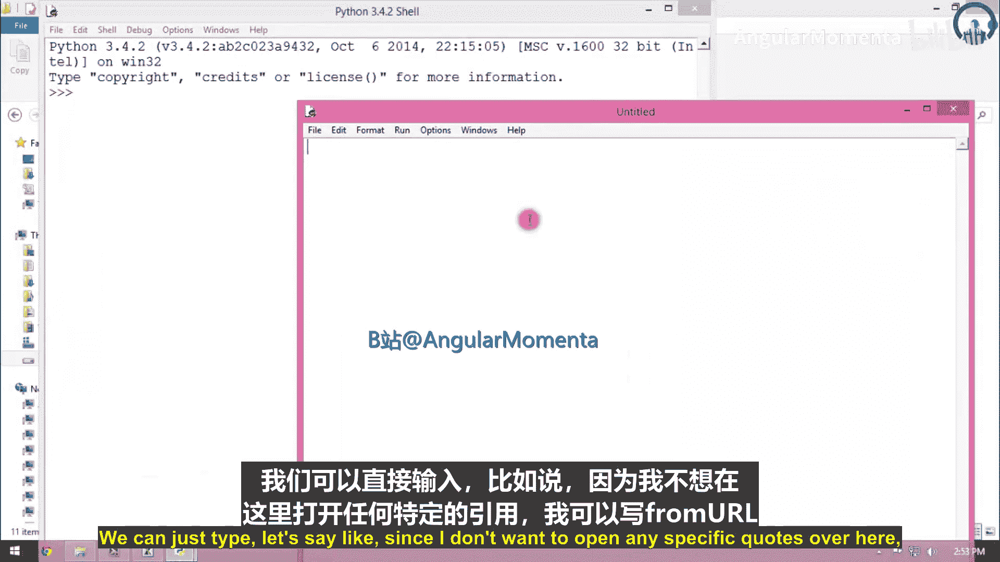
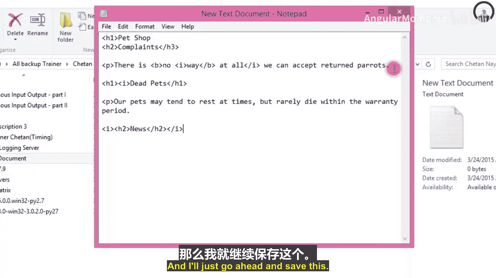
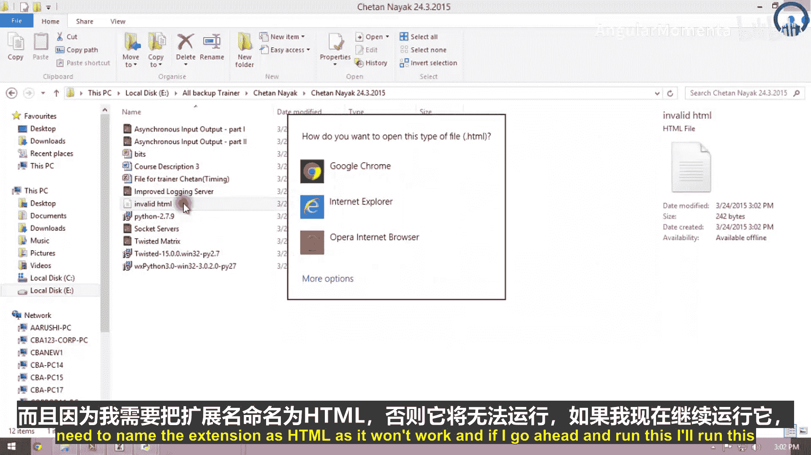
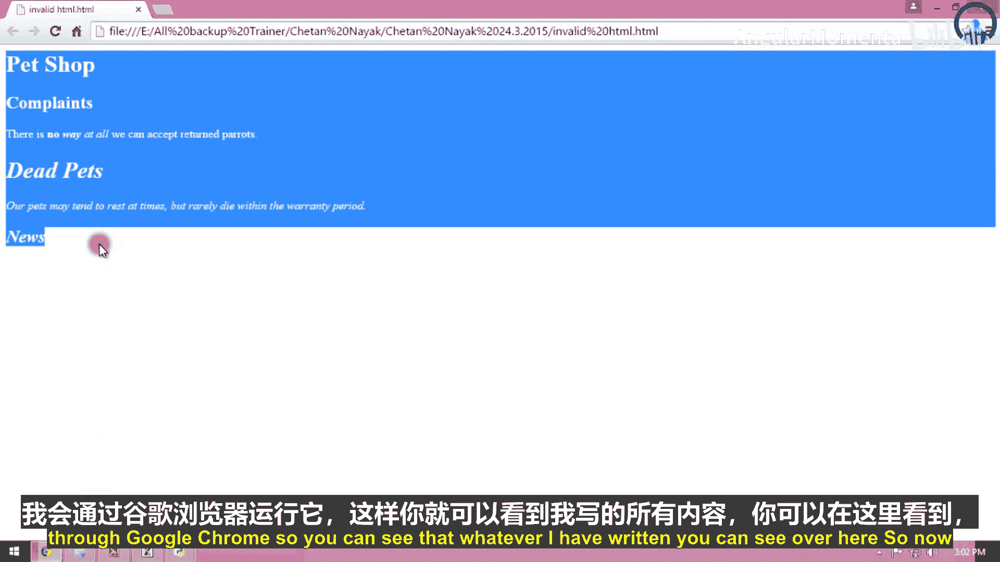
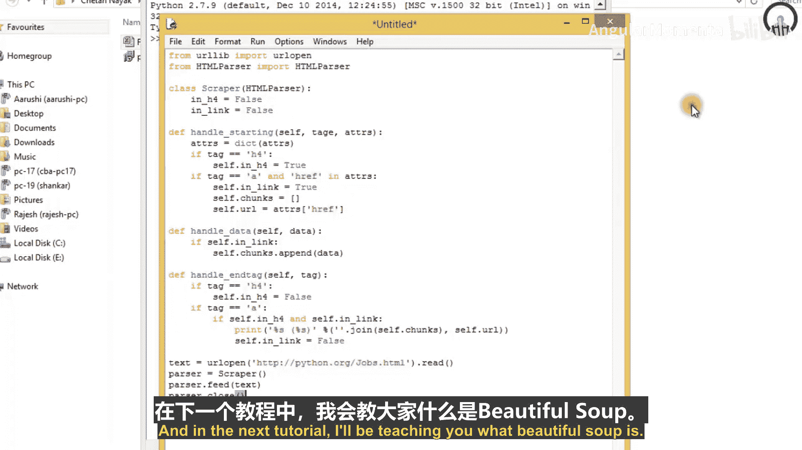

# 【EDUCBA】使用Python开发和部署Web应用程序  Developing and Deploying Web Applications with Pyt p05 03_01_01_改进型日志服务器 -BV1fGFoz6EpL_p5-

And just and welcome to the last tutorial of this chapter。 So just before I go。

 as you know that in the previous tutorial， I made this simple server using the Christian module。

 but in this tutorial I'll be going ahead and making this even a more simpler。

 more improved logging server using the line receiver protocol。 So let's go and create a new file。

 and you can see the difference that I will be creating in this server。

 So I'll just go and re over here。 The few things would be the same that I have to write from。

Twisted period， Internet。Import reactor。And from。Bted。这约。Internet。Import factory。And yes， period。

Pto call。Here fact， we don't need protocol over here。 I won't be importing that。

 And when more I need to import from Twitter period， Internet period pro。Toto calls。Re basic。ポ？Hello。

Deivever， perfect。Pま。せ分。Ler parent disease。来。Sea room and ice should be small。I need to define。

 define。Connection made when season it could call self。And I'll write。Friend parenticees。

The convention。From。So。Tsport。Rightight。And。Perfect， and I need to write another word， defined。

Conmissionction。Lost。 And yes， also over here。 I need to buy L in capital with USL in capital。

And shes so from。Razising。🎼Train parentes， self to your transport。という。Duiand。Disconnected。

AndI't need you the reason for that。Bye。来 C。I perceive。来。Okay， then line。Andright。Facty equals to。

Factory， decision number， factory。Equs to， Im sorry。T to do protocol。Heか to。Simple。拉ger。

And I need this over here。嗯。Reactor。Create。TCP， again， my favorite。こ。Call factory for that。

And react period。对。Perfect， so as you can see the difference that I have created a class using the line receiver and not the protocol and this in the end it does not use the data received it used a line receiver because it needs to get the line for that and print the line after that and please。

Would be in parentheses， just in case you might be wondering。

Perfect and this in the end you can also see that it is also the same the only difference is when you use when you create that class and you need to import the line S module instead of the protocol module。

So there are a lot of more twisted framework from what I've shown you here。

 if you're interested in learning board then you can obviously check the online documentation available on the twisted website So let's go through a quick summary of what I have taught you in this whole chapter this chapter has created a several different approaches towards network programming which approach you choose will depend on the specific needs and preferences when you have chosen you will most likely need to learn more about that specific method than I can explain to you in this chapter you can learn specific things that I have pledge in this chapter sockets and sockets module they are just information channel that lets programs communicate possibly across a network Socket module gives us low access to both clients and server socket server sockets listen at a given address for client connections while clients simply connect directly URL Li and URL to these modules let us read and download data from various servers given a URL to a data source the URLlib module is。

Simpr implementation while URL2 is very extensible and quite powerful。

 Both work through straightforward functions such as URL open。 The socket server framework。

 this is a network of synchronous server based classes found in the standard library。

 which lets us write servers quite easily This is even us there is even support for the socket framework socket server framework such as simple web servers with CG。

 if you want to be handled several connections simultaneously you need to use a forking or threading mix in class。

 and the last room comes to select and poll。 these two functions。

 lets us consider a set of connections and finds out which ones are ready for reading and writing。

 This means that you can use several server connections pieceme in the roundro in fashion。

 This gives the illusion of handling several connections at the same time。

 and all the superficially it's a bit more complicated to code。 It's much more。

Sable efficient solution then threading or forking and the last one comes to twisted framework。

 This framework from twisted Matt laboratories is very rich and complex with support for major network protocols it started for the use with the use of network gaming gaming but it's not almost used everywhere as of now in every network modules and even the dislo and some of the idioms you used maybe a bit foreign for you basic usage of it is very simple and intuitive and the twisted framework is also as synchronous So it's very efficient and scalable So if you had used if you have twisted available it may very well be the best choice for many custom framework or network applications so that's it that's the end of this chapter just go device everything if you don't understand just if you don't understand technical terms that I am telling you just go research a bit more about that and you can use Google which is obviously your best friend。

Any point of time to get any kind of information that's it for this tutorial Heaven asJ by Welcome to the next tutorial in Python programming in this tutorial I'll be teaching you web programming with Python this is a really vast area but has selected four more topics for your amusement that would be screen scrapping CG Python and web services and for examples you can go ahead and check the different withna I've been letting you know what's exactly and one area that it do not cover over here which is Z would be because it is really a topic worth its own book and there are different books that you can search for that web development with Z if you want to know more about Z Python application server for web development you should check the Z specific website that Z org content management system built in on Z it quite popular with loan as well it too is definitely worth a。

So there are many different web development frameworks available with Python same based on Z and some not and some Oly options include twister along with it a built in server such as cherrrys Conweab Quicks code and spies albatross so for discussions on these apps these options you can see the web framework shoot out that theres specific website you can also check the Python Wiiki page on web programming but since I won't be teaching you Z I've been producing you Python programming I've been teaching you only phone chapters over four parts over here。

 screen scraping CG or Python and web services and Z will not be included just in case you might be wondering so screen scrapping is just a process whereby our program downloads web pages and extracts information from them this is a useful technique that pops up every time there is a page outline online that has information that we want to use in our program it is especially useful of course if the web page is in question is quite dynamic that is it changes over。

So especially at that point of time we could just download specific information。

 extract that information manually and keep it with this conceptually this technique is very simple you download the data and analyze it you could for example simply use the URL live from the webage Hl and get the HTMLl source and then use regular expressions that is re or to some extent to extract this information let's say for example you wanted to extract various employer's name and websites from the Python's job board let's say from Python。

gtml that if there is specific something like that then you browse the source and see the names and URL that can be found in the H4 element and if you know what hml is you probably know that and if you don't know how hml or hl4 works you might first need to go and take a look at the hml versions how the hl4 ortml hl5work and then come back to this tutorial because if you have the basics in that then only you would be able to proceed with this chapter。

You would just be a blind guy it would just be something like me being a blind guy showing another blind guy road and not knowing where exactly to work we both would be stuff that's a reason so let's go and check how we can go and create some simple files we can just try let's say like since I don't want to open any specific quotes over here I can write from URL library。

In important。URL open and I can drag import R， and I can write P equals to R period compile。

 and I can write parentheses。 Now this would be something that you have not seen before。

There's edge 4 that means it's a header again。A space period。Atri。Question mark。

Arrows they again space period。Pa strict。Yeah， that right。Reerference。Equals to。

Heio that's to pushing mark perfect again through and。

Now if you're new to this and you would be thinking that I'm just writing some random expression that you are not understanding quite a bit。

 but this is how it is written to be frank and if we don't understand this then you probably won't understanding anything hence both so that's the reason why I told you that you need to go and take a look at how HTMLl and HTMLl works and if you might be thinking that why I am not teaching you that vision because is that I am here to teach you Python programming and not to teach you any other things such as HTMLl HTMLML。

Polash。は turn到。给 you a。B slash jobs， career， HM L， and I want the all the employees names。

 so Ill write period read parentheses。I don't need this one， neither this perfect。

 So what this will do is this will just recompile everything from the specific web page and this will open our web page and read all each and everything from them。

 And just to repeat this again so that I get all the information right for URL well。他吗。

Name in the period。Find all these。Text。可能。Print。Atrophy， close S space。Pocent S。All right。

 person indeed。And this is name my URL perfect。 so this code can certainly be improved， for example。

 by filtering our duplicate， but it does its job pretty well there are however。

 at least three weaknesses with this approach the regular expression isn't exactly readable for more complex STml code and more complex queries the expressions can become even more can say as unmatainable it doesn't deal with STm peculiarities like C data sections and character entities such as ampers and am if you encounter such beast the program program will most likely fail the regular expression is tied to details in the STl source code rather than some more abstract structure。

 this means that small changes in how the web page is structured can break this program so I'll teach you how there are two possible solutions for this program posed by the regular expression based approach the first solution is to use a program。

Call ti T D Ti It's Python library together withtml par so second is called is a beautiful soup specially designed for screen scraping So I'll let you know how ti andtml passing works the Python standard library has plenty of support for pars structured format such as html and Xml and I' will discuss Xml and Xml passing more in depth in the following chapters in this sectionll just give you the tools needed to deal with Xtm to date dialect of hml which just happens to be a form of Xml if every web page consisted of correct and valid Xtml the job of par it would be quite simple The problem is that older hl dialects are a bit more sloppy and some people don't even care about the structures of this sloppier dialect The reason for this is probably that most web browsers are forgiving and will try to render even the most。

T and meaning this HTMLml as the best they can So if this happens to look acceptable to the page author here or may she may be satisfied。

 but this does make the job of screenscape scrapping a bit harder though so the general approach for parsing hml in the standard library is even based you write even handlers thatll call as the parser which moves along the data standard library modules G and hml let you partsse really sloy hl in this manner but if you really want to extra data based on the document structure you will have to do some heavy caing if they are missing tags for example you certainly welcome to do this if you like but there's another way which is called as tidy So ID is a tool for fixing illform and Sloppy HTMLml if you can fix a range of common errors in a rather intelligent manner doing lots of works that would probably save a lot of time because you won't have to do anything yourself it's just the tidy application which。

Do everything for you。 it's also quite comfortable because letting you turn various corrections on or off you can configure everything by yourself。

 So Ill just give you quite a good example of how and if you are new to this I'll try to give you quite a good example of how you can call as a sloppy hm version looks like so I can just type let's say I'll just go and create a new text file over here and I'll just write it as let's say I will be writing a h documents。

 All right H1 parent colon so。S。It's true。And this is not。just for your information。

 this and this yeah I mentioned it two times because this is much more important this is not Python programming。

 this is HTMLml programming Xml Xtml5 so sorry X HTMLtml so just in case you might be wondering that you don't understand that that I haven't taught you that I won't be teaching this because this is X Xtml and not Python programming。

Yeah。So， I'll just write。Lets say you are use on the paragraph。There is。あの。The。哦。エス？Good let's。

Parroents。Should I need to complete this break over here？Our board over here。 Thats perfect。

 and under header。他是3。好。Perfect， and I'll just go ahead and save this。

 And what I need to do is I need to change in the Hml documents or H T。 Okay， sorry。

 I'll just go and do one thing just open a notepad because and I'll open this I'll copy this。

Pa it over here。ITo read this。And I'll save this as I need to say this is all files。

 I say this in my own folder should be 24 today。 learning， this has new。Inval。D and I name it does。

And since I need to name the expression as HTMLml as it won't work if I go and run this Ill run this through Google Chrome so we can see that whatever I have written you can see over here so now you can see that this has been run perfectly but when you go and check with the page source there is a lot of mistakes over here this H1 header it was not completed and it was given H3 instead of H2 so there are a lot of errors but still the page will try to give it in the best way possible and we do not want this to happen I'll just so what I need to do for that that I can you go and use the tidy application and it will straight away good and fix each and everything by going ahead and giving it a do type HTMLml giving it the head the paragraph endings and everything but of course tidy cannot fix all problems with HTMLl file but it does make it well form which。

It's easier for us to pars it so you can get the version of Tidy and the library version of tidy at ww do tidy period SF period net。

 the rappers for this library for several languages， however at the time of writing。

 theres none for Python at this website and you can get Python rappers for tiD from other places。

Such as UTD library or EgenX。com files Python at the time of writing。

 UTD library seems to be most up to date of the two。

 but MXID is a bit easier to install and in Windows simply download the installer for the MXID run it and you will have the module period MX file and TiD file at your fingertips。

If you're using Linuxux or RPM or other versions， there are also RPM packages。

 you can just simply run the disk utility script using the Python space setup period by space install so that's it for this tutorial in the next tutorial I'll be teaching you how to use the command line tidy in Python and why exit Tml are used We to the next tutorial in Python programming in this tutorial I'll be teaching you more about how we are going to use a tidy libraries and the command line in Python so you can get tidy and the library version of tidy or tidylib from etctP called tidy period SF。

net over the web there are rappers for this library for several languages however at the time of writing there is none for the Python at this website you can get Python rappers for tidy from other places through the U tidy library at different or the Mx type tidy so there are a number of such kinds of different libraries for Tidy you can get any of。

It won't matter until unless you are getting into extreme programming so tidy library seems to be the most up to date version of the two but Mx tiD is a bit easier to install in Windows can simply download the installer of Mx tiD run it and you can have the module and tidy is at your fingertips there are also RpM package available if you're trying to install it in a Uni or Linuxux environment so the package containing Mx tiD will in fact give you more tools than just tidy but that should not be a problem and I'll tell you how we can go and use the command line tidy in Python you don't have to install either of the libraries though if you're running a Linuxux or Uniix machine of some sort it's quite possible that the command line line version of tiD is already available and no matter what OS using you can probably get an let's say executable binary of the tidy library for your windows as well and once you've got that you can use the subprocess module to run the tidy program and let's say zoom for example。

That you have a messy HTMLl file called as let's say messy HTMLl then you can run a following they can run a fantastic program which will run the tiD on it and print the result instead of printing the result you most likely get or extract some useful information from it so let's say for example if the name is let's say messy period HTML then you can just go ahead I'll just go and run this and you can just go ahead and type from sub process。

Import open。PI。The E type will quite perfect and you can write。

Text equals to open parentheses and you'll have write the name so my name is in the name will be MC period Hl and I'm using this name because it would be easier for guys to understand actually as of now I don't have the actual messy HTMLM I'm just giving an example and write tidy equals to Per and yes。

 this P should have been capital Per。Ficees。Cat泰dy。Comma the Sta island equals to a pipe。

S TD out equals to hyp。🎼SJD3。Equals to a gain。はい。Perfect， I and right。

 let's say tidy period STDIN period， right。Parrenheses text。It the period， and。🎼TDPU STTDINPU。

Close curencies right print。Fta。Tredy pull the city out。譬如。

Close and which perfect and one more parent disease。

So this is how we can go ahead and write a tidy example so to go ahead and clear out any kind of messy HTMLtl that does not have a proper header or proper ending。

 let's say of a paragraph and it has just run so we want it to be tested before we can run it and this is how we can go and use the tidy。

And you might be wondering why I' am using an Xhtml over here the main difference between an XXtml and order forms of Stml is that XXtml is quite strict about closing all elements explicitly So where you in Xtml might and one paragraph simply by beginning another but an XXtml you first have to close the previous paragraph and then start another paragraph。

 you cannot just start on the paragraph randomly in between in Xxtml and that is the reason I' am choosing stml of now This makes XXtml much easier to pass because you can tell directly whether you enter or leave the various elements Another advantage of XXtml is that it is an Xml dialect so you can use all kinds of Xtml tools that you have on XXtml such as let's say X path for example and the links of the the forms extracted from the program over here it can also be extracted by using the。

Exper expression。A very simple way of parsing the kind of let's say Xhtml we we get from TiD is using the standard library module Html parsor I'll show you how we can go and use the Xhtml parsor to go and override various even handling methods by subclassing it and we can use it such as handle underscore start tag handle score start and so you won't usually the lot of a number of things like this but you won't need to implement all the parsel call bagss and you probably won't have to construct some abstract representation of the entire document to find what you need if you can just keep a track of the minimum of the information needed to find what you're looking for you are in business that will work perfectly fine so I'll show you one screen scrapping program using the HTMLl parsel module how we can go and write So now I'll just go ahead and delete that since I' won't be needing this。

And I'll just write the the screen sweeping program similar， which I wrote in the previous tutorial。

 but this time I'll be using H in the parer， so I'll just try let's say from。URL A IP。Inport。

You are open。是啊。St。Paer。ここ？PCR。Now I'll create a class name scrappper。て right。

Because since I wanted to pass through pass the screenstaper， Scper to HTMLl parsers。

 so I have to write these now right？In a score heading for。To thoughts。And。こで。Ss。Dfin。あすく。Starting。

T come啊。よし。Perfect， and I can try it。Jack。Perfect。そ回た。嗯。就说。嗯。て。是。で。S me the link later。Yeah。嗯，这个。い？

他不的。Yeah。Yeah。Perfect。So before I end this tutorial I would like tell you that a few things that are worth noting first of all I have dropped the use of tiD over here because the HTML in the web page is well behaveved enough so if youre lucky you may find that you don't need to use tiD either also note that I have used a couple of boan state where able such as the false and true attributes to keep track of whether I am inside the H4 elements and links or not because if I am not there it will create a hell of me that's the reason。

And I check and update these in the event handlers and the attributes the attributes argument to handle handle start T is a list of key and value to so I have used dictionary to turn them into to turn them into a dictionary which I find to be more manageable the handled data method may need some explanation it use a techniques similar to that used in the previous examples which is quite common in event based par of structured mark such as HTMLml or the Xml and instead of assuming that I will get all the text I need in a single call to handle data I zoom over here that I may get several chunks of it spread over let's say more than one call and there are several reasons why this may happen let's say some of them may be buffering character entities markup that I have ignored so that these are the number of reasons and I just have to make sure that I get all those text than when I' am ready。

To present my result I just simply join all the trunks together to actually run the parsel I call it feed method and with a text and then the call closed method so the solution here is more likely let's say more robust to any changes in the input data then the version using regular python expressions and still you may object that it's two verbo and perhaps almost as hard to understand as the regular expression but to be let's say to be frank on the other end for more common extraction to us the arguments in favor of this sort of parsing might seem a bit more convincing but one is still left with the feeding that there has to be a better way and if you don't mind installing other module there is something called as a beautiful soup and yes you heard me beautiful soup is a spiffling you can see it as a spiffling little module for parsing or dissecting the kind of HTMLl document that you often find on them it's a little。

It's sloppy and the ill formeded kind but it would be far better than using anything else so this is for it this is for it yes that's right and in the next tutorial I'll be teaching you what beautiful soup piece。

