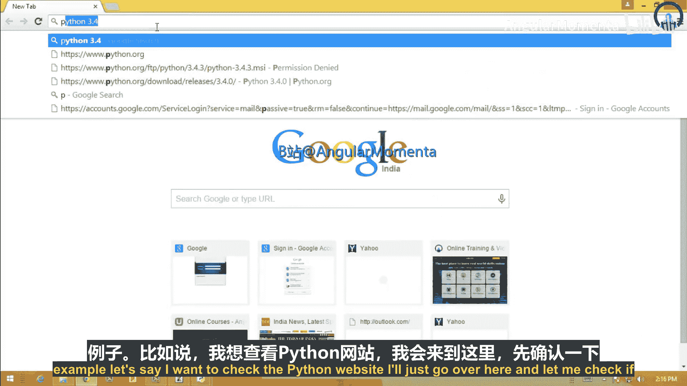
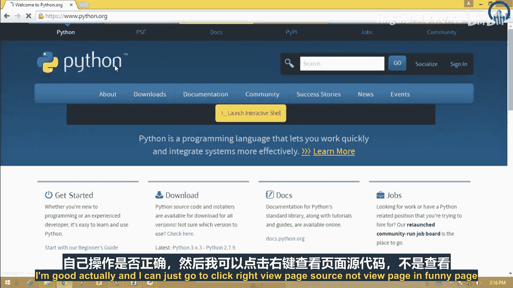
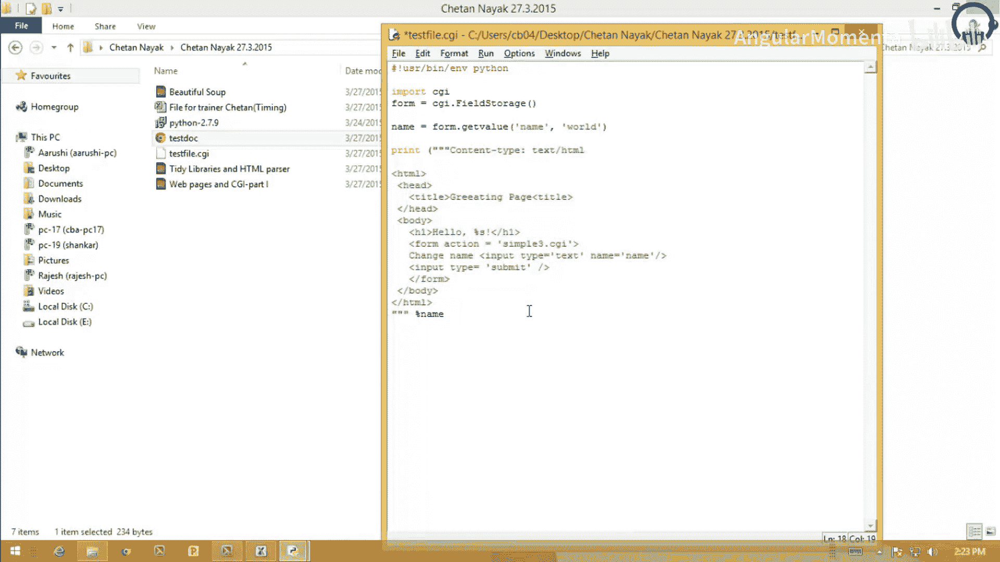

# 【EDUCBA】使用Python开发和部署Web应用程序  Developing and Deploying Web Applications with Pyt p06 03_02_01_Beautiful Soup -BV1fGFoz6EpL_p6-

So welcomee to the extratro studentdent Python programming in this tutorial I'll be teaching you what beautiful soup is So I can just to be on a specific note or to compose it as a quote I can say that there is something that is called awful page that someone has written It's not good and it's not that bad but it doesn't look good usingml。

 So we are just trying to get some data out of it right now。

 but we don't really care what the hl is supposed to look like neither does par So that's not a beautiful it just gets out the required data out of it and it does not want how does the hml look like。

 So you can download the beautiful soup from its website crumpy do co software beautiful soup you can download it over there if you want I wouldn't be downloading I would just be showing how it runs just download the beautiful soup put it in one of your Python part let's say package directory if you want download。

T archive for with the installer script and text for your let's say Linuxux or Uni version so as I'll show you that in the previous example this is it looked very dirty the previous example that we created it was just like you can call it as a messed up answer using the X parel but in this tutorial I'll be teaching you a very simple way to clean up an X Xt using the simple beautiful soup method so in order for do that I can just try let's say from URL。

しね。And I can do， I want to import the beautiful soup。

 so about the further I want to import Ill open I right from。你洗不觉。そ。很吃。こ一度。

So I that Jo3tl is our document。And I wanted to open and read。

 so I just when you were open and breathe。Right。It close to。申行。

Perfect so over here you can see that it just took me a few lines of code to go and clear out the XXtl document。

 but in the previous tutorial you could have seen it it took hell or you can say it as a large number of coding for me to simply go and use that So instead of the HTMLl par through we can use simply use the beautiful soup out here and you can just make things a bit more easier than it is over here I simply instantiated the beautiful soup class with the Xml text that I wanted to scrap and then I used various mechanisms to extract parts of the resulting past three for example over here I I call the soup H4 that's header4 to get a list of all H4 elements it over these binding the header variable to each one inter turn and call header that's a or the reference and to get a list of the child elements of the reference class and talking CSs over here and I could just have followed status。

From the previous example of returning the A elements from the H reference attributes so in beautiful suit using class attributes like this makes it easier and I'm sure that you must have noticed that I also added the use of set and sorted this has nothing to do with the beautiful suit it was just to make the program more useful by eliminating any duplicates and printing the names in a sorted order。

😊，So this is how we can go ahead and write you simple examples that's it with this tutorial in the next tutorial I'll be teaching you creating dynamic pages。

 web pages with CGI， and yeah， that's it。Welcome to the next tutorial in Python programming this session deals with basic web programming technology and creating dynamic web pages using CG that is common gateway interface which is in short form called a CG so CGI is a stamped mechanism by which a web server can pass its queries typically supplied through a web form for example or a dedicated program so for example let's say I can write a Python programming myself to go ahead pass different queries to our web server so and display the result as a web page so it is a simple way of creating web applications without writing our own special purpose application server so for more information in CGI programming can see its online topic that's web programming topic guide but as of now I've be teaching you the basics and intermediates in dynamic web pages with CGI the key tool in Python CGI programming is a CG module you can find a thorough description of it in the Python library reference other module。

That can be very useful during the development of CGI script CGI TV That's more about later I'll teach you that。

 but I nowll just remember about these things that I'm telling you right now。

 And before you can make CGI scripts accessible through our web you need to put them where a web server can access them and add and add a found bank line and set a proper file provisions So there are three steps that I will be explaining to you in detail as to how we can go and prepare the web server assuming that you have access to web server in other words that you can put them on the web。

 usually this is just a matter of putting your web pages and images and so on in a particular directory let's say called a Uni you can call as a public underscore Tml。

 something like that。 if you don't know how to do this you can just go and contact your intern service provider or a system administrator to do that so now I don't have these things but that doesn't mean that I won't be teaching you that I will be teaching you how to do these things or I cannot actually。

run these programs over here to teach you that because somehow I don't have the access to the web server as's a reason。

 but I'll surely teach you in a detailed manner as to how we can do that。

 and you can try it on your own once you have that。

 So let's go back to preparing the web server our CG programs must also be in a directory where they can be accessed via the web So in addition。

 they must somehow be identified as Cgi script so that the web server doesn't just serve the plain source code as a web page that two ways of doing this。

 The first thing is called putting the script in a subdirecty called a Cgihen bin and the second thing is to give our script the file name with extension period Cgi exactly how this works verystorm server to server again so you can check that with your IP about that for example。

 if you're using ap you may need to turn on the E CG option the called the director in the question So let's come back to the second step that is adding the poundline So when you have。

The script in the right place in the right directory。

 you must add a pound bang line to the beginning of the script。

 So it is a way of executing our scripts without actually having to execute the Python interpreter。

 you can save them using the P and you can just run them in the background So one way to do that is you can just go and let's say if you are using Python you can using rubby let's say for example。

 or you can using unix you can just go and type foundlamation forwardlashR that's user forward bin and environment Python and note that the first line has to be hash if that doesn't work。

 you may find out where exactly the Python executive and just go and use the full path in the line you can just type it as hash exclamation haslamation and then you can write let's say if that director is user bin Python then you can simply go and。

Something like this。 and then yeah it's as simple as that。

 if this doesn't work it may be that there's something wrong that you cannot see and namely that the line ends with something like let's say backlash or backlash something like that That may be the reason why you are unable to go and run your script just go ahead and change these things and once it perfect the final thing that comes to setting the file permissions。

 this is the last thing that we have to do because we need to set the proper file permissions。

 we need to make sure that everyone is allowed to read and execute our script file otherwise the web server won't be able to run it but at the same time we also make we also have to make sure that we only we are allowed that means I the only person I am allowed to go and write it。

 And so that nobody can change our script So anyone can read or execute but it's only me who can edit the script。

 That's the reason So sometimes if you edit a script in the windows and it is stored in a unique di server。

The file permissions may be followed up and after you have made a change to the script so if your script won't run make sure the permissions are still correct So the unique command for changing file permissions is just go and type in the command CHMOD plus X space and you can just go and type your CGI file name it should be something like this CHMOD plus X。

let's say the file name is ABC period CGI， then you can type something like this so ABC is a file name and CMD plus x gives it the change and modify。

 make it accessible only to root that's what it does。

So after having performed all these preparations you should be able to open a script as if it were a web page and have it executed and just make sure that you don't open the script in the web browser as a local file。

 you must open it with a full URL so that we can actually fetch it via your web else it only it will only be able to accessible by you and no one else can access it and we don't want that and our CG script won normally be allowed to modify any files on our computer if you want to allow it to change a file。

 we have to explicitly give it a permission to do so we have two options if we have root privileges。

 we may create a specific user account for our script and change the ownership of the files that needed to be modified if you don't have root access we can set the file permissions for the file so all users on the system are allowed to write the file can set the permissions again something like again driving CM and AcH whatever the text files name is and this also means that everyone。

wWho has a user account on the machine can edit your file so you should be extremely cautious with this especially if if the file you're modifying is accessible through a web server。

 so let's go and check what are the CG security risk note that there are security issues a lot of security issues involved using CG programs if you allow your CG script right to files on your server that ability may be used to destroy data unless you code your program very carefully Similarlyly if you evaluate data supplied by user as Python code or a shell command。

 your risk performing the arbitrary commands which is huge and a very huge risk in myter that's what I think for relatively comprehensive source of information about web security you can check the WwW consortdium security frequently asked questions and you'll find more information over there in the web so let me show you how we can go and create a simple CG screen。

CGS scripts looks something like this， let's say if you're using Uni that I can write information usR my directly is let's say environment inside user which is inside bin then I can write EV if you're not a Uni user and it's hard for you to understand that it just means that this is the file is in these directly which is inside user if it's in Windows you will probably like something like C colon and forward s let's say Windows or something like that but in over here since Im assuming that you're using Uniix it will be something like this and then Ill write let's say print to so you going let's say。

Content。Ione。Next。对对。I like drink parentheses。And as。And还是个。Yeah。Pnce。嗯。MT line。

 And this is a simple code that written that shows that this inputs empty line nothing else。

 Let me just gives out a space。 you can also use the forward slash n but I like use a print so that the user knows where I have given that。

 So this is as simples that it can get。 So if you save this file call as let's say simple ph C G and open it through a web server。

 you should be see a C of H in web page containing only hello works in plain text to be able to open this file through web server。

 you must put it where the web server can access it in a typical Uni environment。

 you can put it in a directory call as public underscore H Tml in your home directory which would enable you to open it through URLt local host user in something like that。

 Let's see if I can go and save this in my file I could run it。😊，Let me check。 Let's say。

 I'll save it as and' see all personnel right， let's say。S file period， C GI。

And let me say is perfect。 I have just saved。 Let's see if I can go to the browser and I can run this。

 Let's check like thought s。🎼嗯。So me chat okay see prefer like NA this and if I go and discard。

 go and try to run this。This is what I see since I'm not using it through a web server。

 I won't be able to see what's inside that， but for that I need to send it somewhere where I can actually go and something like in a public or in a shared folder or something only then I will be able to run this file。

So that's how this works。 So as you can see everything the program writes to standard output ends up resulting in a web page at least almost not if everything。

 The fact is that first things you print are XtP headers lines of information about the page the only header I concern myself with here is the content type as you can see the phrase content type is followed by a colon a space and let me just open that you that content time is followed by a colon a space and then a type as text and this indicates that the page is a plain text to indicate Xtml that this line should be something like content type and it should be in a text in Xml format So after all the headers have been printed。

 a single empty line is printed out to signal the document itself that it is about to begin and as you can see that in this case the document is simply the string hello world So when you go and print everything you will only see hello world in a plane。

😊，ex and nothing else。 So now we know how we can go and create a CG file。

 Let's see how we can go and debug it。 Sometimes a programming error makes our program terminate with let's say a Str trace error or something like that due to an un exception。

 it can be any exception。 you don't know what it is So when running a CG program this most likely result in an unhelpful error from the web server in Pth 2。

7。9 which I'm using it now a new module called Cgi TV was added to the standard library by importing it and calling it enable function it can be quite helpful for us as well as the web page to give us information about what went wrong。

 So let's see how we can go and check and what error it gives for us when I go and type this program。

 So I assume that this is again a user user forward。

Environment and fighting is where the finest and I like import A GIT。Some my CGI TVV。Here you enable。

Perect I right let's say。Gt。G emicesies。And right。Content type。我人。Next slash steamer。

And don't worry that if you're using Python 3。4 because that would again be the same。

 the contents that I am writing over here it everything each and every coding would be the same。

 which would be in Python。That's divide by zero so that we get do zero division error。て。Hello。论。

So the result of accessing this script in a web browser can be seen as something like zero division error and it will state that the problem occurred in the Python script and let's say it will state as it is a sequence of function course leading to up in the error it will print out hello world but along with this specific code that I have it it will also print out that everything in writing that onede0 and something like that and it will exactly give you the detailed error note that you might want to turn Cgitv or functionality after developing the program because the traceback page isn't meant for the casual user program So let's say if there are some errors that you are not able to recognize and later on if it is fully if your product is fully developed and the user is just a new user for the first time using a web page it you sees that error will probably go mad because you won't understand it and he will leverage it on the internet because of that reason So you don't want that to happen So if there is some error just make sure that the screen goes blank and it just refreshes。

And if the user is unable to understand you will just go on to the next page as simple as that。

 So that's the reason so just use the CGR only where when you are developing or testing the program not for the casual user let's see how we can go and use the CG mod as so far the programs that we have developed have only produced output they haven't been used in any form of input input E the sub a supplied to the CGI script from an HTMLtMl form as key value pairs or fields we can retrieve these fields in our CGI script using the field storage clause from the CG module so when you create your field storage instance it fetches the input variables from the request and presents them to your program through a diary like interface the value of field storage can be accessed to ordinary keylookup so but due to some technicalities they relevant to the field storage aren really the values to your after for example if you know the request contained in a value named name。

You could simply do something like let's say， you can write form equals to CGI peel。Fel。

Storage parenthees， You can do something just like this。And you can answer Dave。Name equals to。

Form bracket。Gain。But you to clear this out， you have to do something like a form。Equals to。CGI。

Gs storage。Ps and name。You want to change it， but you want to keep everything minimal。

 You can do something like this。 A simpler way of fetching the variables is using the get value method。

 which is similar to the dictionary method， except that it returns the value of the value attribute of the item。

 So in order for you to do that。 So you can just do something like just cooperate from over here。😊。

I'm getting a bit lazy to write tomorrow so and I can just go and edit these and yes， oops。

It should be一 do。And I have to use。For yes， I out that in the previous room。

 Ill get my pretend I right， the make quilt to。Go on here and get value。Yeah。让加吃。You name。I know。

Proect so in this example I has supplied a default that's unknown。

 if you don't supply anything then then we' be the default。

 but I wanted unknown as the default so that's the reason the default is used if the field is not filled in。

 So that's how we can this is how we can go and create different values In them using the CGIS script and yes that's it also how we can go and write a simple form that now we have the tools for having a user request it that we can go and create a form that the user can submit that form can be separate page。

 but I' just put it all in the same script just as some now and to find out more about hF forms just go take a look at it also if you find some page that you think looks like a good example for what you would like to do you can inspect its source in the browser by choosing by just going over here let's say I can go over here and the Google page I want to see how this。

😊，Page has written how they have kept all these things that language over here right click and I can say view page source it will show me everything you won probably understand what is right now or can say view page info and this is what you can see over here these information So viewing the pages of Google is not exactly a good idea because it will take you days to actually understand this what they have written I'm just giving you an example as to how we can go and check different example let's say I want to check。

The Python website just go over here and let me check a am action and I can just go click right view page source your page in page source perfect so this will be a bit easier to understand then that of checking that out of Google because it's a bit more systematic that is a reason and it will be probably easier for you to understand that So this is one way of doing that So let's return to our script So a simple HTMLml page is printed containing name as a part of the headline and in addition this page contains a HTMLml form whose action attribute is set to the name of the script itself that means that if the form is submitted youre taken back to the same script the only input element in the form is a text field call name if you submit the field with the new name the headline could should change because the name parameter now has a value which previously did not。

So just delete everything， I'll write the code， I'll write let's say user forward slash。

F slash environmentron。AndBon。Import CGI。Forign papers to teachGI every year。き。Storage point。件同。

And should be feel。name。It words to。我 to。value。しし？Enjoy name。这播。嗯。P。这其能应对。Con。出系。Next。It DM。And。

Before I end this， I'll describe。It's DMO。And this is how a stable document will look like。All。对。

And Ill right， another， I' need to close this head。我。Then I write it say。Body。でしてあ。Let's say。

Ill usually just head one。セトです。Sation。Close this thread up。嗯，出分。你装。For action。s true。新歌。3 to CGL。

 that would be the name of our document。Right。Change。ね？Input。Type。Take one to catch。The name equal。因。

Perfect yeah， al right。If you don't understand what I'm writing right now。

 then you probably go and need to check at least the basics of。Yeah， the basics of exit T。

 because if you won't understand that in you， no matter what the cost is you wont understand this。

 there is a reason。They check things perfect， y。Perfect， and I need to end this form action。

 so I'll just write。For。周三。bright。Maybe and the body。I need to close the HTML tag。

Which was at the start。And finally， the name which I started。So when you go and run this program。

 this will probably run this script so instead of me going out and saving it but running it I don't have anything such as user environment Python since I am I am not having Uniix over here but I will show you how this page will look like so I'll just go and create a new text file。

So I test test period X Tml。And sorry， won't run it in this way。 Ill need to use the not。

 Let me check， if I can。Okay。That。It is time it over here， Alright。Perfect， I see this over here。

And my documents desktop。 Okay， perfect。 Now let me ask。S dog period at TL。

I need to change this to all files， I'll save it and if I go ahead and try to run this let see。

If I put right when the student will chrom。Okay， I am not seeing anything over here that's stressed if I could open this with the internet Explorer。

So this is the page but you won't probably see anything over here because I don't have the CGI text file over here which I mentioned。

 but if you have this simple3 CGI text file then what it will do is it will write something aso world and it will give you something has change name and it will it will then will have a box where you can go and enter your data so this is a simple way of creating and executing your files by asking it to input something and it also have a tab button next to it that ask you to submit this option so what this whole thing does is that it will start it writes hello world and it will ask you to change the name that's what would be written over here。

 this would this is the normal text that would be written and this would be this is the text to empty text box that when you need to insert the text and this would be the tab option where it will be written something like submit like this option then you create it over here it will straight submit the given text file。

So that's how this input method works over here in CGI。

