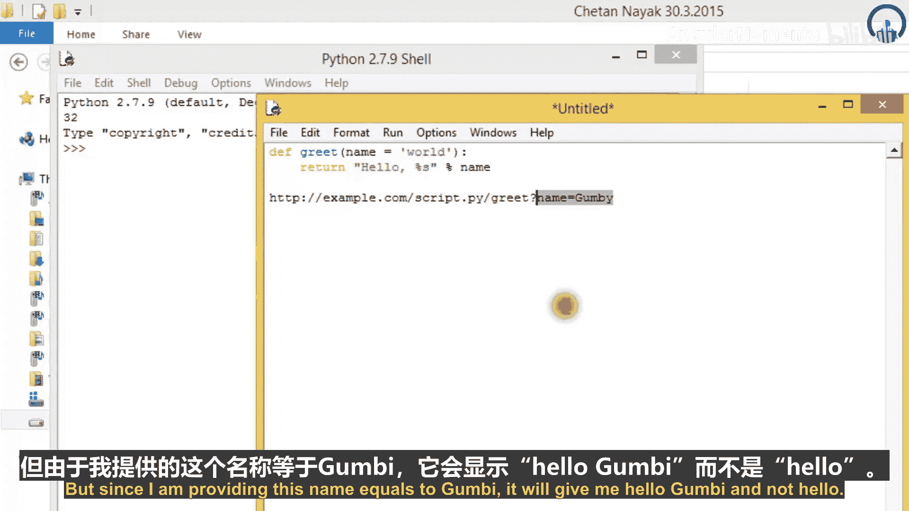
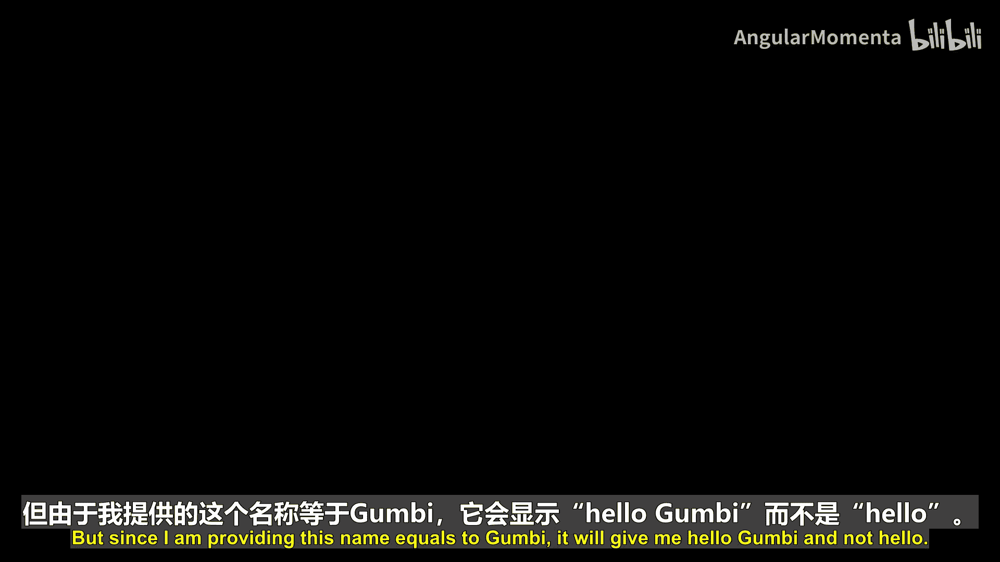

# 【EDUCBA】使用Python开发和部署Web应用程序  Developing and Deploying Web Applications with Pyt p07 04_01_01_CGI处理器与Apache配置 -BV1fGFoz6EpL_p7-

Welcome to the next tutorial in Python programming。 so we have learned a lot about CG。

 Let's take a step further。 Let's check about mod Python。 If you like Cgi。

 you probably love mod underscore Python。 It is just an extension for the Apache web server and you can get it from the mod underscore Python website。

 It makes a Python interpreter directly available as a part of Apache。

 which makes which makes a whole host as a different step possible at the core。

 it gives you the ability to write Apache handlers in Python as opposed to in C which is a norm。

 So the mod underscore Python handle framework gives you the access to rich API and covering Apache internals and many more。

 So in addition to the basic functionality。 However。

 it comes with several handlers that can make web development a more present task that is the CG handler which lets you run CG scripts using the mod underscore Python interpreter considerably spinninging of the execution is。

PSP handle as well， which lets you lets you mix HTMLML and Python code together to create an executable web page Isn't that good enough for you or let's say something more the Python server pages there is a publish handler which lets you call Python functions using URLls。

😊，So now you might wondering that this is a bit way over the head with the sc Python function just by using the URLls that's very too good。

 So in this section I'll focus on three standard handlers if you want to write your own custom handlers you can check the more underscored Python documentation So let's see how first we can go installed the remote underscored Python and getting it to work that is the most important part over here at soF now so that is a bit more difficult than doing so far as any other packages we have discovered if nothing else。

 you'd had to make it coop with Apache so if you can install the more underscored Python yourself you should either use some form of package manager system which install it automatically and run it or make sure that you know a bit about running and maintain apache observer server if you cannot then you first need to go and learn that and then come back to this tutorial if you are lucky of course you may have already have access to a machine where more underscored Python installed if you're uncertain just try and see if。

Iable to install it， unable to run it。 just keep this tutorial video you check go and check the Apache web server or get a bit of knowledge and then come back to this tutorial。

 It won't take more than two or three hours to go and get basic information about the Apache web server if you do not want to install it yourself however you can get the information you need in the more underscored Python documentation which is obviously available online or for download from their specific website as I will call it as more Python it's a as more underscore Python。

 but I will call just more Python the process is slightly different from depending whether you use Uniix server Windows if you are installing it on a linear system as in that you have already compile the Apache web server and you have the Apache source code available here so here are the highlights of compiling it installing the mod program more Python first download the more Python source code unpack the archive and enter the director then run the configured script of theon of the more Python sorry。

But then more pth， and you can just go and add this script we I configure。Space， hyphen， Hy， hyphen。

 APX S。Equals to forward slash user code slash。Local vote slash Apache。billlash A。

 And after we go and write this write this， make a note of any useful messages that you come across such as any messages about the load module。

 And once this configuration is done just compile everything by typing this in the terminal make and after that once everything has been compiled just go and make install and these three things will just go to andr install everything under your Linuxux or Uni distribution。

 If you are using windows， this is a bit tricky The binary version of the mod Python for Windows request you to have Python version 2。

3 you cannot use 2。4 you cannot use 3。4 anything like that So just download the mod Python installer from the Apache org and double click it the install straightforward and we take you through the steps。

 but before that you need to install Python 2。3 else you won you make it error in the end of the process that if you do not install the TclL or Tk with Python the installer tells you how to finish the install manually to do this just copy the。

More Python period PyD from the Pythons library side packages folder to the modules directly under your Apache root folder Let's see how we can go and configure everything configure your Apache assuming everything went well that I told you till now you know how to configure Apache to use more Python Find the Apache configuration file that is used for specific modules it is usually called httPd period con or Apache period co add that line that corresponds to your operating system if you're using Linuxux and you need to add this line to the con file something like。

L module。And be sure that you make no spelling mistakes in this as it won't run。Hi adult module。

 Python and the score module。Library。Execution。Mo underscore。I figure is so perfect。

 And if this is if you're using Le So just write。Unix scar。り it。And if you're using Windows。

Then this will probably your end line。 This will be written as。L。冇 you。还有。

Perfect so you may not see much of a difference except this to this thing over here。

 but that makes a lot of different so there might be slight variations in how to write this file。

 for example， the exact path to more do if this is not able to run just go and check the correct path for the more Python period so in your system and the correct version for Uni should have actually reported as a result of the running configure you won't need to run that but just make sure that this is there in the file if you have run this properly and you have not put any errors and probably you won't need to run this or copy this to your con file。

So now the Apache notes try to find the more Python。

 but it has no reason to use it that means we need to give it a reason when it needs to go and find when it needs the reason to go and check this specific line so to do that we must add lines to your Apache configuration either in some main configuration file or or in a file called as period access in the director where you have placed your web pages so I assume that you are using the period h access because that's why that's where they are most of the time otherwise you have to rather the director place or in your Windows or a Uni user。

Yeah。Now let's take a look as to how we can go and use a CGI handler。

This is the first handler that I will be teaching in this tutorial in the next tutorial I'll be teaching to the PSP and the publisher handle。

 so the CGA handler simulates the environment where our program runs in that we actually use CGI so we are really using mod Python to run program but we can still mostly write it as if we are using the CGI script using the CGI and CGI TV modules for example so the main reason for using the CGA handle as opposed to plain CGI is performance according to a simple test。

I called the simpleness in the more Python documentation。

 you can increase your performance by about one order of magnitude or if you understand math then you probably know what I'm talking about or even more the publisher is however much faster than this module and writing your own handle is much faster than that possibly triple the speed of the CGA handle if you want speed CGA handle is not your option if you're writing a new code though and wants mixture of functionality and flexibility and using one of the other solutions then this is a probably good idea by using the CGA handle。

Because the CGI handle doesn't really tap into the great potential of more Pyth。

 but it is the best used with the legacy code so anyway to get the CGI show on the road which is put in the following period HD H access file in the directory where we keep your CGI scripts and for de information you can just add the following lines such as。

原带兵。Let's say。Sa。Hand do。More in the score I， and you can type。开听。Ander。

This for item think to hear C。GI。Handle and for de bookinging， you can hold and type。I think。一哥。

And you should remove this directly when you are done with developing there no point in exposing your in of your program to the public until you are actually or being open source programming obvious so once you have set this six properly you should be able to run your CGI script like before in order to get this work you might need to give your script a period PY ending even if you access it using your URL ending in period CGI and more Python converts a CGI to a period P web when it looks for a file fulfillfil the request that's a reason so that's it for this tutorial and the next tutorial I'll be teaching you how we can go and use the PSP and the publisher publish modules to go and write a CGI scripts。

Just in case that you are unable to understand this properly or if this is a bit difficult for you to understand this of now the Google is your best bet that you can get more information on anything that you want and just one thing that I'd like to tell you in the end that no matter how much how many tutorials you look on you still have to work on your own create your own exams that it will be easier for you to go and process the examples not every tutorial will be the same and it will be easier for you to go and get some help from you within yourself so that you can go and all the tutorials get some information using Google to get more modules or a bit more easier way and by the time you read these tutorial that maybe some thing which have been again updated and some of the things that I'm reaching you right now may not work because they may may have been updated so you need to keep yourself up to date as to know how to work with each and every tutorial how to work with each and every module that's will do this tutorial in the next tutorial be you the PSP and publisher Welcom to the next tutorialython programming tutorial。

Itll be how we can go and use CGI handlers along with some exceptions so in this tutorial I'll be teaching you the PSP and when I say PSP just remember that it's not your PlayStation PSP and it's something different which I'll be teaching you right now and I'll be teaching you PSP as well as the publisher。

 the remaining two module。If you have used PhP， the hypertt B processoror PhP。

 which is originally known as personal homepage or Microsoft ASP。

 such as active Server page or JSP Java Ser page or something similar like that。

The concept underlying the PSP， which is known as Python server pages and this is not your PSP this is not your Photoshop or PlaySt that means your Python server pages。

 this should be familiar for you so PSP documents are a mix of HTML and Python code。

With the Python code enclosed with special purpose tags。

 any HM will be converted to call to the output function。

 setting Apache up to serve your PSP pages is as simple as putting putting a line in your HtT access file such as hand handle more Python or Python handle more Python but just remember this in mind while developing your PSP pages using the directive Python deeper on it can be used for you should not though keep it on when keep it on when the system is used for real because any error in a PSP page will result in an exception trace back including the source code being used the user later on so potentially let's say a hostile user see our source code offer program is something we should not be taken lightly because you do not want a program to be the source code program to be loan by someone which they can use later on and they can use it for any illegal purposes so。

If you publish your the code deliberately， other may find your security flaws and this can be definitely one of the strong sense is to open a source software development。

However， culating users glimpse your code through error messages is probably not useful and it is potentially a risk。

 so coming to a point there are two main sets of PSP tags。

 one set four statements that on one for expressions。

The value of expressions in the expression tags are directly put into the output document。

 so let's say let me show you something how a simple PSP code looks like。

It looks something like this。Thank you question。そ。Not good this gets flow over the weird now we need the XM。

个第一天。I can will be China。단 위요。三公的要给的害人。And I now avoid you the dark。那这个。嗯你所以要么这个。Let's say， hello。

But's do。Choice。As就。愛え。是。认为一个谁。And I'll need to close this paragraph body。Our other boy， sorry。

 Man this is for me because the previous boy。Yeah， now I need to close the exchange。

 that's the only thing that's spending that I need to close。

And just so that if you don't know how HTMLl page looks like or what HTML is。

 I'll let you know that everything and HTML has needs to have a HTMLl the ending guide so whenever you start something you need to end this with this forward flash icon so if you're writing ahead you need to close the head if you're writing title you need to close the title similarly goes for body paragraph and each and everything over here if you don't close it there will be errors so。

This is an expression of how a simple PSE looks like。

 which performs some code and then outputs some nano data as a part of web using an expression tag。

You can mix outputs as well statements and expressions in any way you like。

 you can write comments and comments are written in something over here like this。

 you need to put this to insert a comment。Decent and then hyphen， and this is。

And you write something like this， so this thing becomes a comment。This is the whole comment。

 this is how you write a comment when you're writing ESD pages。

This is really very little to past programming beyond these base you need to be aware of one issue though if a code in a statement that starts an intended block the block will persist the HTML being put inside the block ensure that can the simplest way I can tell is that you need to close the block to insert a comment else it won't work in general you may have used PhP or JSP or if you have used that you don't notice that PSP is more picky about new lines and indentations it is of course a feature ined Python itself that is a recent case is more concerned about new lines and indentations。

There are many， many other systems that somewhat resembled in model Python's PSP and even some are almost identical。

 the web development systems such as Z it has its own templateate language and it's somewhat identical to the Webware PSP system。

So you can go and visit the PannaSis web category also。

 or you can just go and a web search for Python template system that should point you towards several other interesting systems。

So but that's not what I'm here for right I'm here to teach you something which you don't know and all those things which are an extra you need to take care of that by yourself。

 we can calculate it as something such as just do your homework after you go and see tutorial。

 just go and do your homework of searching these things。So now coming to the next point。

 I'll teach you what the publisher is the publisher is where more Python really comes into on its own。

 itlip tonight Python programs that have a much， much more interesting environment than CGS script。

 and to use the publisher handler， you need to put a following line in your STD access file。

 which is add handler， mod Python period PV again Python handler， more Python publisher。

So I just leave this。You have to put these two things when you go and create this handle and you right with others for python。

Perd space for div， and the next one would be。他跟。And。我个。回転パードレシ。不水。So this is how it looks like。

 this is the that you need to enter over there。And yes Python will be a small program。

 So this will run any file with the ending in period P as a Python script using the publisher handle。

 And the first thing to know about this publisher is that it exposes functions to the web as it they documents So for example。

 let's say you have some X Y z named script which is located at xttp code let's say example do com slash script that means in example do com in this website you have xyz period Py name script and that contains call。

 let's say function which opens the URL let's say ABc do com then this the publisher will first run this function and then display whatever is return as a document is script to the user That means it will first run the let's say if there's a function it will first run the function。

Then it will display whatever there is in the exclusive website， inside the document to the user。

So and it's similar to the ordinary web documents， but the default document is called index over here and the specific name which is inside the function or such as the examples。

com or/ xyz。 P which is our script it will be called as a function by that name in other words it would be something with something like the following that I would something like this which would be sufficient to make the user publish your handle it does something like this in the document efficient handle request。

And那个。Return。The so it is something like this and the request object over here reflectss you access several pieces of information about the request receipt see as well as setting custom HGTP headers and like and like they consult the more python documentation。

So you can also write it in this way such as H index。

 I think over here return hello world you can also write in this way。

 but publisher over here it actually checks how many arguments are given to the function and they are called and what they are called and what supplies it can take can accept and it can deny but when you type in request it lets you access several pieces of information about the request received that is a difference between these two of them you can also do some sort of checking if you want to it's not necessarily portable across Python implementations。

 but if you' are sticking to see Python you can also use the inspect module to poke at let's say some corners of the function to see how many arguments they take and what the arguments are called。

You can give you a function more arguments and then request the object to。

 you can call in something like this， such as let's say define， read。

 and you can write name equals to world。And return。AndInstead of writing that youre just hello word。

 Alright， hello， comea listen S and over here again present。

you can also write it this way and note that the dispatcher over here it uses the name of arguments so that。

When there is no argument called request， you won't receive the request object。

And you can access this function and supply it with the argument using a URL such as let's say Sp code and example。

 co s xyz p read and push him off name is go to gumby so you can also do that but converting your pitch it will now contain the bitty hello gumbi and not hello word the reason being that previously I have mentioned over here it has name but since I gave it a name as gumbi it will over the function I'll just go and write it out and show it to you how will it look like if I go I try to access it sub something like this。

Example do co。Flash。Scrip一 slash。Great。Ma words to gumby if I go and write something like this El yes there will not be any space just to mention it's just my happy that's something I do so if you write something like this then it will give you something such as hello gumby and note that the default document is quite useful in the user doesn't supply any parameter doesn it means if I do not supply anything such as gumby over here it will simply go and state me hello world but since I am providing this name equals to gumy it will give me hello gumby and not hello。

