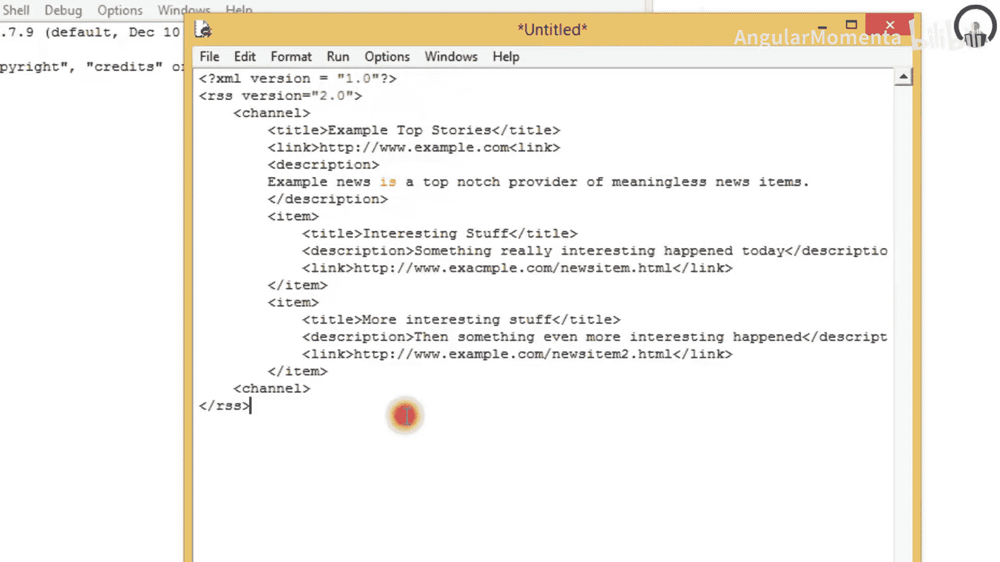
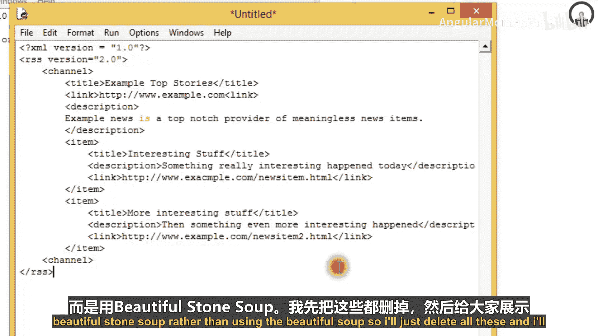
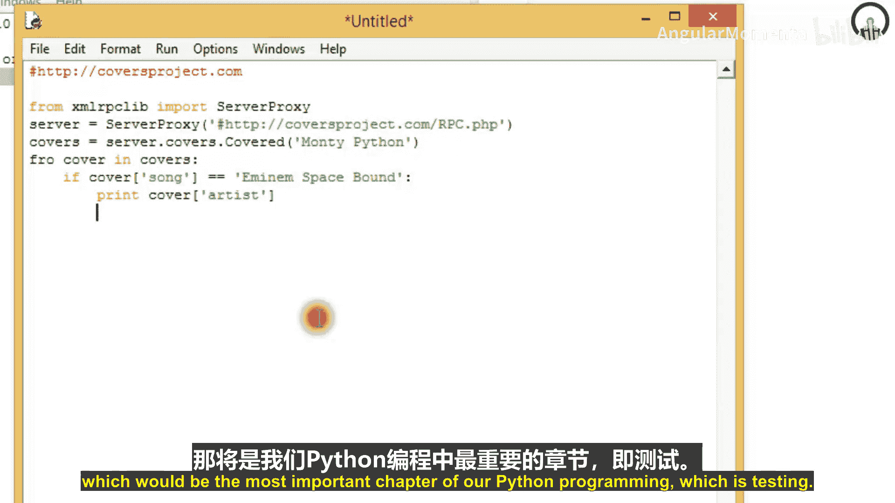

# 【EDUCBA】使用Python开发和部署Web应用程序  Developing and Deploying Web Applications with Pyt p08 04_02_01_带标识的RSS订阅源 -BV1fGFoz6EpL_p8-

We to the next tutorial in Tiytan programming in this tutorial， Ill be teaching you about the art。

The web services and the X RC， which is remote Pro protocol， which is also an external language。

Which we already encountered in the past， but I'll be teaching you all this in detail right now。

So I'll start with the web services， web services are just a bit like a computer friendly web pages。

They are based on standards and protocols that enable programs to exchange information across the network。

Usually with one program， decline client a service sequester asking for some information or service and the other program the service service provider。

 providing this information or service。Yeah， I know that it will be some like glaringly obvious stuff。

😊，It also seems to work very similar to the network programming that I have talked about in one of the chapters previously So Web services so since you are looking at this tutorial I'll be thinking that you we know what network programming is so web services often work on a highle abstract they use XD the web protocol as the underlying protocol and a top of this they use more content oriented protocols for example。

 let's say some X format to encode request and responses This means that a web server can be the platform for web services as a title of section indicates its web script let's say webcaping over here web script over here taken to a totally different level one could see that web service as a dynamic web page designed for computer rather than for event concept and these are standards for web services that go really really capturing all kinds of complexity but you can get along a lot when done。

simplicityimplicity as well section I'll discuss two important web service protocols start with the simplest one。

 which is Rs which you can will argue is so simple that it actually is not a web service protocol。

 but it is called something like that that's the reason and often I will show you XLL RpC which is a remote procedure control protocol and it is from the client side the server side is dead with more in one of the latest chapters of mine So theres several other standard similar not check out what for example let's say soap soAP which is in some sense similar to XLL rpC or we can be more clear we can call it as XLL rpC on steroids yeah that would be a better way for me to discard that because it's a bit more white concept than XL so is a bit more wide concept the XL which is almost similar to that So if you know what XL RpC。

It will be very easy for you to understand what so is and WSD is a format for describing the web service formula so a good web search such as the Google which is our best over here they honest help us in gathering more information about that coming on to our first important topic that they are A which stands for the rich site summary audio summary or simply simplest syndication is in its simplest form of format polying news items HML what makes analysis documents more of the survey that is simplistic statistic document。

Is that they are expected to be updated regularly or even in regularlyular sometimes。

 but they are meant to be updatedd。They may even be computed dynamically representing， for example。

 the most recent additions to a web blog or some of its kind。

 there are  plenty0 of RSS readers out there and because the RS format is so easy to do。

It's easy to find new applications for it， for example， some browsers such as Bopos。

 they will like you a bookmark and RS feed and will give you a dynamic sub menu with individual notes items such as forecasting or some rub files something like that So one slightly confusing part of the RSs feature is that version 0。

9 and 2。0 x now mainly called a simple really simple syndication which was also called as richite somebody now they is called as really simple syndication Rss which is the new short form for RsS and they are sort of compatible but they are completely incompatible with Rss 1。

0 So this might be a bit weird that 0。9 x and 2。0 and any version greater than that are almost similar but they are different to 1。

0 which is in the middle there are also other formats for sorts of news feeds and site synations such as the mode which is atMSs of now which is very much。

So the problem is that if you want to write a client program that handle speeds from several sites。

 you must be prepared to pass several different format。

 you may even have to pass exterior fragments on in the messages themselves in this section I use a tiny subset of rSS 2。

0 and I'll show you what an rSS file actually looks like so it is a bit linear documents so I just write it down。

嗯。Yeah。Yeah。Yeah。Yeah。Okay。What description would be let see。Reem。気し？本っと？わち？最て？こにこです。All right， yeah。

 that's what I think about。People who give our knew that's news supporters and all those steps。

Theres reason I have been that。Description。あ中？诶。T do。En title of year would be address in stuff。

it an interesting stuff if you know how to use it。抓回。才猜。Okay。

 title interesting stuff and the first title was example top stories after that description would be exampled and used as a top Do service provider。

meaningless new items and the description for that would be interesting again and again I need to give it。

Another description。And over here， I like let say。Something。210。Interesting。Todayで。

this remember that the only mistake that we can do the most important and the only mistake which even a lot of programmers do is。

Choosing these brackets if you don't do that。Then simply your eyes feeds， they were simply crash。

 that's the reason。W you give it a link at3P。对。S go。嗯。News item。You' your HL。Flash play。

That's perfect。I need close thisす。还点。嗯，对。And again， I need to give you the guidance。

I go and let's say the title would be。More interesting stuff。Let write anything you wish。Over here。

 it doesn't matter， Ill just make your a so that it will be easier for you when you go and write these things down in case just you forget something。

呃 close。ね。Its5 lets need to be reached by more。I know it's。And。Ss to TP let's sayww。天空。

We'll give the same check of getting an example of the long power s。News item2。P its DL。呃 close。

And I need to close the item。And need channel。Andm finally E SS。The artist is over here。

So this is how we open the analysis over here and this is how we end so the analysisis 2。

0 standard specifies a few mandatory elements and many optional ones can count on us to channel element having the technical link and description they can con you or more item element。

Wwhich at the middle least either a title or description if you're writing a program to deal with a specific feed。

 a good idea might be to simply find out which element it provides Another thing making the passing a bit challenging is the sad fact that even though artists is supposed to be valid Xl and therefore Institute path chances are that you will come across any rS speech if nothing else the news messages themselves may contain legalities and an escape ampers or something like that and they aren't really let's say any obvious artist modules for Python that will handle these difficulties least so you more or less back to street scraping again and luckily we have the beautiful soup which I taught of the tutorials previously which can deal with X as well as HTMLml and it will not even complain about a bit of stoppinginess on the part of artist feed sort the round up introduction to RSS is an example that will get your talk stories from the violent news。

😊，From thevi。com obviously and note that it uses the class beautiful stone soap rather than the beautiful So which is different to pass the A field and this class can deal with XM XML in gender while Beautful soup is targeted specifically at HTMLM so if you're looking to board and solve some Xm document。

Just go and use beautiful stone suit rather than beautiful suit to go ahead and rebug these applications。

And the program also demonstrates how you can use lab function。

Can send the Python module extract to make X on the screen very nicely。

 So that's it for this tutorial earlier and the extra tool I teaching you XML R PCC。

 that's a more passenger call and。let's say something more different which I will not actually go and let you know right now。

 that's it from the to the next tutorial in Python programming。

 So just before I go through the X r I'll just go and show you the example that I told you previously in the previous tutorial of the beautiful food stone soup rather than using the food soup So I'll just delete all these and Ill go and show you the example where I was telling you that I'll create a program I will go and wrap some functions around and use the text to make the text fit nicely on the screen the beautiful stone soup it will be something like this from。

😊。

Beautiful。So。明猪。入ルす。St。是。And then right from URL L IB。Inmport URL open。From text map。And that。

And after that， I need to write a new model equals to。SCTB。これ。

Wwwt let's say born the news from wireat。com， satellitewire。com// feed/ rSs2 perfectect。

Say I like soup equal hurt too。M this。Soup in the open。Gsses you are咯。マく？🎼Bre princes， princes。

Perfect no。For I think in。す？爱听。Print。Let's say， I don't。Here title to。🎼And here extreme。

 and its print。I need a dash， and this is a dash not land score just for some people multi by length。

And it would be。The length of the items are allowed to items dont when the item period title。

 I need to combine these things so title period。String。呃，不认。Yeah。And I had to put and。

 I had to use next lines。 I use。Backlashlash N I'm going need to join this join and need to wrap this wrap。

The items。Perfect item description string。And the data will be print。Bckt。医生。As。Blashlash and。歌声。

Item who you link to your extreme。Perfect， so this is how the answers field would look like。

 So coming on to the next tutorial I'll be teaching you the XmL rpC RpC stands for remote procedure call and Xml is language you've already encountered a few times by now the XL rRPC website it's a good source of information just in case you are you don't find sufficient information over here and the standard library module Xml rpC L module is used to connect RpC servers and simple Xml rpC server is a class just if you don't know and you can also write this class server which in letter tutorial I'll be teaching you how to write this class servers So the version of simple Xml rp class server that chips with the default Python 2。

2 previously it contained a serious plot in its handling on exception if you use that version then you won't probably be able to understand what I'm trying to tell you right now in the next tutorials but because they in fact won't be working correctly but if you're using。

Sa item2。52。7 3。4 everything will work perfectly and to show you how an easy XL RPC library is easy to use。

 I'll go and create an example that connects to RPC server and let's say random object such as XttP covers let's say Python do OG I'll go and write this name it's a database of let's say let's say over I'll just go and create let's say assume that we have a website which have the covers of all this long album so the name of that website would be XttP column and let's say the name would be covers project。

Do call this would be the name of our website and this is a database of covers of all the songs so just ignore this line I'll just comment it out because you I a point to know。

And so I'll I'll show you how an Excel RC version looks like， So it will be something like it from。X。

 M， L， R PCC Vi。こ。So。落先。And after that， I'll write server equals to。So。角先。During the season。

 I had to go and use the website's name， so I just copied it from over here and I will paste it over here。

The call and new slash party CP B， H B。Perfect， and I like coverss。

Equals to server period hours period。Coverboard and。嗯。Monty， let's say by。

 That's the name only person who created the not Bon and。For。这个。I was。第一。😊，Over。

So let me the color of the song is there。That means the product song is there。

 and let's say dream of our song would be， let's say。I mean， then。Space down。Say Fer random。

 if the cover of this song is there， then go and write print。Cover。あ thisす。Yeah， perfect。

 And since you go and write this down， the person who created the cover artist。

 they would be given out to you as soon as you run this from this covers project cover since you don't have this won't be able to run this over here because we don't have anything specific like this So that's the reason but this is how you can go and write this down so the server proxy object over here it looks like a normal object but with various methods you can call and in fact we can call one of its own methods aspir to send a request to a server which responds to the request and returns and answer so in a way you are calling the method covers covered on the cover itself so to be short here calling the method covers period cover on the server itself pit programming can be a bit easier than this and yes that's the best I can say because the more you go and read some stuff about this the more it will be easier for you to understand they also complicated examples which you can use to find different Excel RpC libraries。

And yes that's it for my end and so I'll just give a quick summary of what we have learned in this chapter。

 it would be screen scrapping CGI， more Python web services so that's it for this tutorial in the next tutorial which starting with the next chapter which would be the most important type chapter of our Python programming which is testing and yes。

 that's it for this tutorial having an I day。

