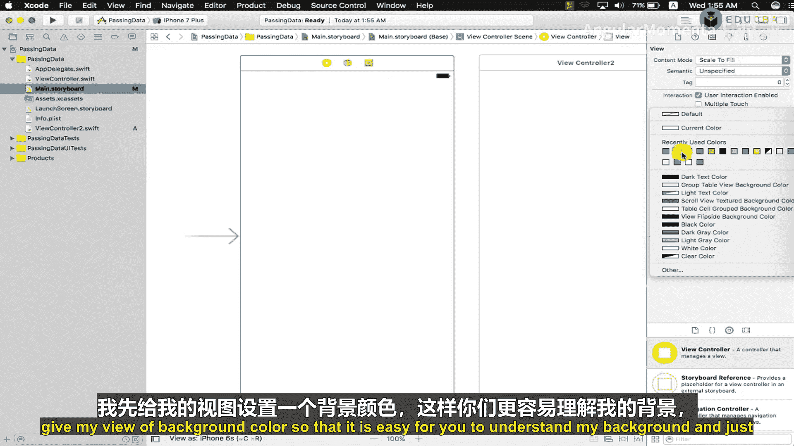
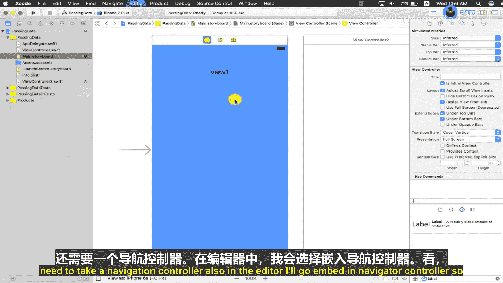
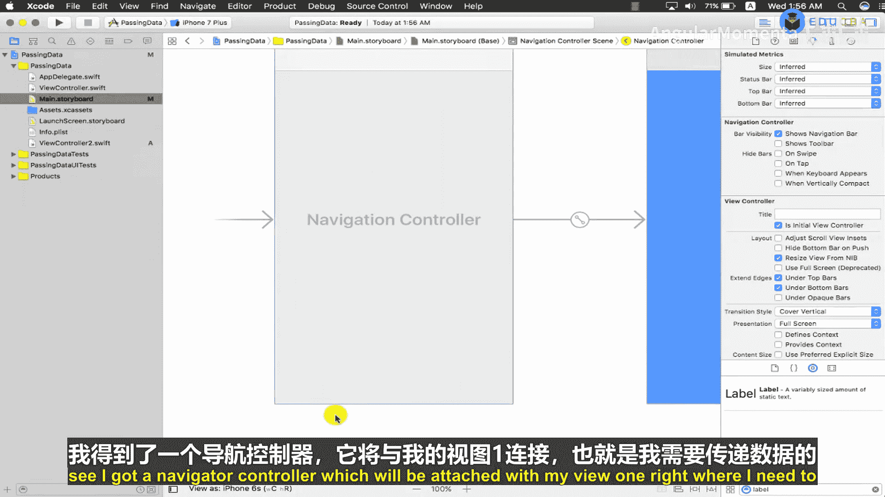
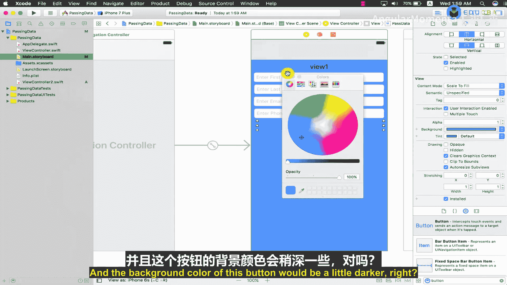
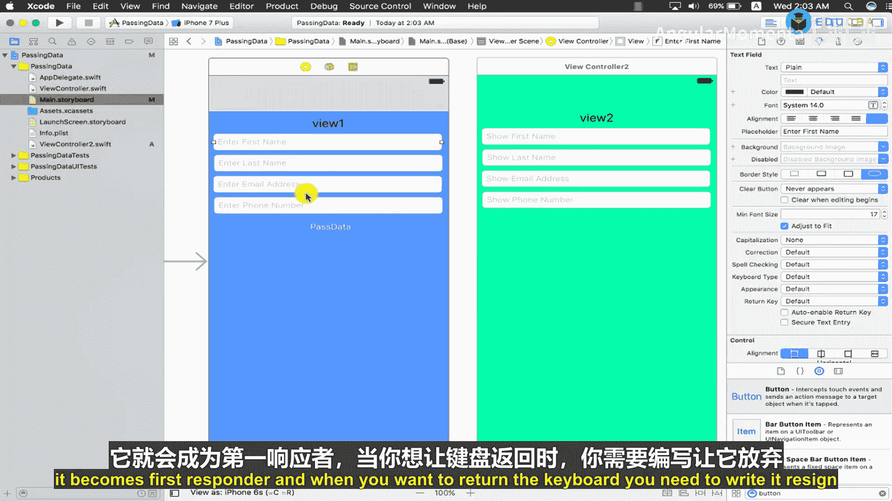
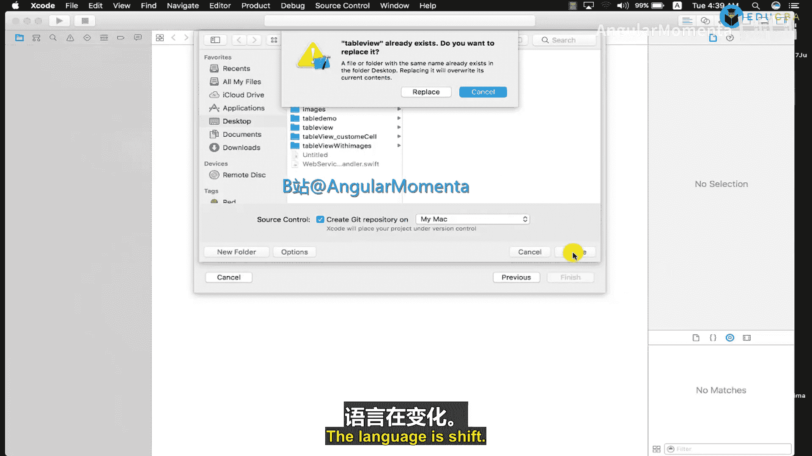
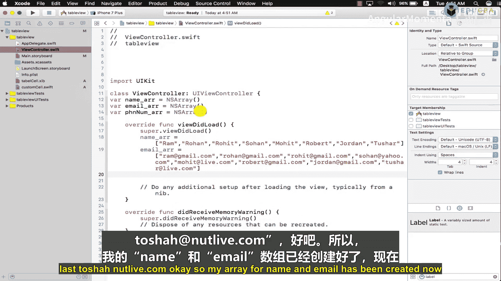

# 【EDUCBA】运用Swift核心特性进行中级iOS开发 ｜ Apply Intermediate iOS Development with Swift p01 01_01_01_iOS 10 视图控制器入门 -BV1RmFUzyEXJ_p1-

Hello， friends， a very warm Good morning to you all。 Today。

 I am going to give you a presentation on passing data between view controllers with the help of text field。

 and I'll also teach you how to set validations on each text right， so let's start the project。😔。

m good。Excode pro its basically a I D E that is its provide a integrated development environment for the software developing kit to develop the applications for iPhone and for Mac。

😔，And for watchkit， so I'll just name my project as passing data。😔，The language is shift。

As this is a single application， we have a view controller。😔，In my storyboard over here。

And the class， which will be responsible to handle events in this free controller is this free controller class。

😔，And this is my delegate， which will handle my application lifecycl， right。😔。

So as my today topic is passing data between two view controllers， right？

As I already have one view controller， so Ill take another view controller from my object library。

 I hope you are familiar with this term object library。😔。

I have given a brief description about what is object library， what is foundation class or not。

 So if you are not aware of this， you can see my previous tutorial in that Ive。😔。

Given description about all these things， right？So this is my second view right from my this view data will pass to this view head。

 so now I need to take a class also which will handle the events in this view controller。

 so Ill just go ahead and take a new file。😔，Which is which will be a cocoa touch。

 and I'll just re write this name as。😔，没度。😔，Right， and it is a surplus of。如 you跟了是。😔，Yeah。那就想 did。

So here I have successfully created a view2 view controller， okay。😔，I think。

The name is not in trouble format my Sir。😔，Let me just delete this and make a new controller so that you know。

You people who are watching this are not confused with this name。睡啊歌。Let'll just create an new class。

こ거系多。자 this I感 to。Ive just created successfully。Cl to en the events in my control。From here。

 this is my assistant inspector light。View and from the option and select view to write now in the story group ID Ill take this name as you2。

😔，Any name you can give。Just taken this name as you to。 So my two days。😔。

Preentation is based on passing data with the help of text field write。In my view， one。

This is my1 bed。 So here I'll drag some text fields。😔，Before that does this。

Give my view a background color。 so that。It is easy for you to understand。😔，唔白噶。That's true it is。

你老嚟。And from the object library， and just take a label。😔，And just like the of me mess。没啊。1820。

Yes increase the size of this label。冇见。And this the same day。😔，Now， I need some text fields。

 right before that。We need to pass data between these two control right。

We also need to navigate from this field。A view controller to write so for that we need to take a navigation controller also。

In the editor， Ill go embed in Navigator Control。😔。

So see， I got an navigator controller， which will be attached with my。😔。

你云者。From here I need to pass the data， so there I'll take four text fields。😔。

I tell you what is text field。嘅唔使。嗰逼。In。These are my four textex film。

There is one very beautiful property of text field， which is known as placeholder。Right。

 what placeholder does is it， it shows。The background text in the text field。

 So Im going to place folder and write。😔，And what's name C。There up beer。远征。😔，y念 ok。你你。唔得。因为。😔，连卓手机。

Eerate。😔，放明白。Today， I' also teach you how to set validations。

For each text field so that your text fields are not blank when passing data into another view。😔。

And secondly， I'll also teach you how to set validations for email address and how to call a numberpa keyboard for this phone Okay。

 now I need to take button。So that with the help of button then navigate help pass all this data。😔，2。

 my view controller2， okay， so button will help me basically to navigate from this view to another view。

😔，Take a button。Just increase the size。 and let's change the color of the background color of the button。

😔，First I剪 the name and dig it does。Rs data， okay。In the text color， I'll take it as white。😔。

And the background part of this button would be。Little darker， right， So yeah。

So this is my one same thing I need to design for view2 also。😔，And first。

 I'll change the background color。So here I go。My background and I just take the color as green。ok。

So instead of dragging all the objects from my object library， that will waste the time。

What I'll do is， I'll just copy。你 say老 god逼。😔，你 face this。Well just add， adjust the size。

 said just the location also。I hope you're understanding this okay。

So this is my will this my you do need咩 part。😔，For data potential in this view。

 I don't need this button right。😔，Just need to display。 So in this placeholder， elses right。

s false name。😔，原亮的。s last name。😔，Yeah。嗯这。s眠明嘢。Alright。Xiu。So phone。

So I think now you have understood what is the mode of my today's tutorial。

 my today's tutorial is like Ill write enter data all this text field and when I'll raise the pass data key。

Now the data will go in this text flow before moving ahead。

 a text will object like a text will displays an editable text area in your interface。😔。

So this it will generate a editable text area， this is the text area when whenever you press the text field。

 a keyboard will appear from down okay。So this is also feature。 So and one more thing， whenever you。

Press a text field and when you are writing something into a text field。

 it becomes the first responder。😔，O。And like anyone you want to return。

So you need to write a code like you need to resign that first respond。

 whatever text field name is right， so you need to write resign first responder of that text field。

And when you press or write anything， it become first responder and when you want to return the keyboard。

 you need to write resign， respond okay。

Hello friends， a very warm， Good morning to you all Today I am going to give a presentation on table view using custom cell。

😔，So this is my exc， just create a project， which will be a single application。😔，你 take this name is。

你没 view。The language is shift。

Sm me to replace as。Ma us desktop already has a folder interval table view。😔。

So this is a single application。 This is my app delegate class。

 which will control my application lifecycle， and this is my view controller。

 It is this class is there because this is a single application。

 So this is a view and this is a class of that view， right。😔，So。As my today's topic is table with。

 So I'll just。Drag a table view from my object library。 Object library is basically a part of Fo。

Basically of part of U I kit。😔，Whi is a part of Co touch， right。

 Coor touch provides us two native framework to develop application in Ios。

First framework is the foundation framework， which has number of classes like NS A and his diary。😔。

And string， and so on， and it provides U it， which provides us object library。😔，You know。

 which help us to develop beautiful UI for the applications。So， this is my customs。

This my prototype cell。You I give it I identify it itself。嗯。As to my today's topic is custom cell。

 So I'll just。Take a new empty interface so that here I can drag a table cell。😔，Right。

 this name is Ste， said。So this is my interface。😔，But from here I'll drag a table table Vi。

 so this is my table whistle。😔，The mo of my today's topic is that seat table view cell has three properties。

 right。When is it meet you。One is the detail text and one is text level。

 So with the help of this table view， the basic thing is that in this table view。

 we have only three things to display。 One is the image view。😔。

Then when is the text level and when is the details detailed text level where we can show data。

 but let's suppose if the user want more than that soon that case， we are taking question himself。

Okay， so this is my custom cell。😔，Many need to create a class， also for this custom cell。你这是 new发。

Go果 does class。是。In this class con， it is a sur of ir table we celebrate。😔，Make it next。

And I'll just create this， okay。So this is make。God， so here I go the storyboard。

We'll go into this X。😔，X I is basically it provides an interface okay。

 to drag objects from the object library。😔，咩。It helps to create beautiful joy。食饭蕉。Firstly。

 I'll give this name as I didn't sell。Said， and。Andmark this glasses custom cell。 Okay。

 so I think you're clear with this table cell is em built with this custom cell， right。😔。

So here I'll go now， as I want to show three data。😔，O行。This is my custom cell。

 This is my view control， okay。说。唔咩个力犀。😔，I'll take three labels。Firstly。

 I'll give background color so that you're not confused with it。M colour blue 오케。

And here I'll drag some les so that， you know。It's quite easy for you to understand。

 I'll just smell label。😔，Now also give a background color to this label so that even you are not confused。

😔，It's my level。你俾都嘅。This increase the size also of this table。😔，你就是这。😔，你嚟个。Firstly。

 let me increase the size。This is my second level， which Ill be used。😔，to display place 될。

This new method look read。Now， the next thing what I'll do is。I'll create the outlet of this label。

ok。So here I'll go and assist inspector。😔，See， when I click on this。

 it will show the class related to this。😔，Now I need to create the outlets， right？😔，睡要啦知。😔，Dolet。

你系几线。Take his name as name level。This shall take this as。Let's suppose。Email label， right。Yeah。

 I just take this name。Contact living。我 can just give this name。放你个嚟。😔。

I have successfully connected outlets for it。未喂。😔，Yout know what's wrong with my expert today。

So now I need to pass data on this。 I will create three array。We have your controller classmate。冇的。

Yeah。念。你。In。😔，你咩事。😔，Okay。你些。咩。😔，Yesops。咩放咩你。😔，唔好点你。系你 ok。原来你都巴是买料子。😔，So。😔，咩咩咧，你个度。😔，Yeah。果系。No系。上恨。😔。

我系。Do you a my friend name。😔，Okay， so I think this message is more than enough second in his email。😔。

点你咧需要。😔，Just take email of the respective name。😔，我咩。Gmail dot com， okay。嗯你。自mail do com。😔。

These are just ideas。 These are not real ideas。 I'm just taking it for of understanding， okay。想看你。😔。

M Mr叫主it。😔，知你落降。😔，唔去吃饭。😔，冇head at live dot com。我哋。盐辣干。😔，知的。知面啦。你拉是多少啊？😔，M live dot com。 Okay。

 so my array for name and email has been created now。

