# 【EDUCBA】运用Swift核心特性进行中级iOS开发 ｜ Apply Intermediate iOS Development with Swift p02 01_02_01_使用文本字段传递数据的关键要点 -BV1RmFUzyEXJ_p2-

Sot see one thing I need to tell you。See in object C or in shift。

 whatever it is it is object oriented programming language， right。

 So an object or why it is called object oriented programming language because object oriented programming language deals everything with object。

Lets suppose this is my class and I have created the object of this class。

 so this is the object so whatever data I need to access from this class。

I can do it the help of object， so that is the reason I created the object if you controller to cross so right。

你瞓咗啦。Dot I see， I see this areaey。N's created。If I would have taken a function also over and I would have called with the help of this object so that function would also have called。

😔，Okay， so yeah。系你你걸 do系。Wass your daddy。Okay。And near two results。Not navigation controller。不许。要跟嘴。

😔，This second， I need to take the。Object and bull any need to process。 So I think。

You have successfully understood like what I have done I have created firstly I have taken an array when I'll pass the。

 you know， when I'll pass this button。😔，What pause you down。

The action what will be performed over here is in my array all the text will data will be stored and here I have created the object of this view controller class and in the object with the help of object I have called this array。

This array， so when I， when I call this button， so my past data array will automatically be equal。

 or like my positive array data will be。Gone into this re area okay， and with。

As data is gone in this receiverary。With the help of navigation controller。

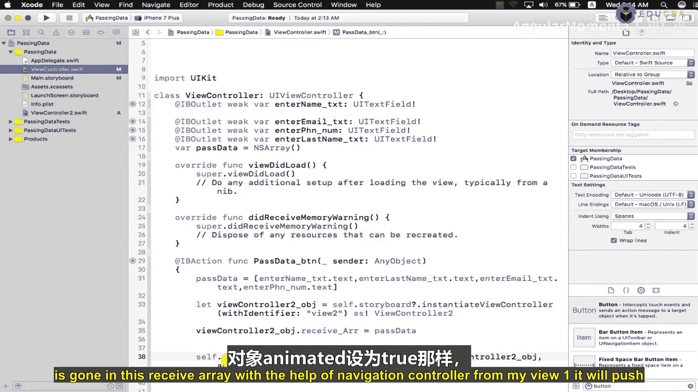

そ my。Vi 1， it will push my like from view 1 it will push to view2。😔。

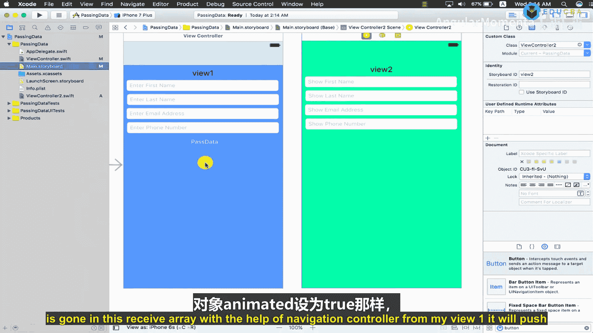

When I push your controller object animated tool okay。

 I hope this next thing you have understood as reancy。😔，As I don't， I do not have any data。

 so nothing will be possible then okay， only navigation part will be done。😔。

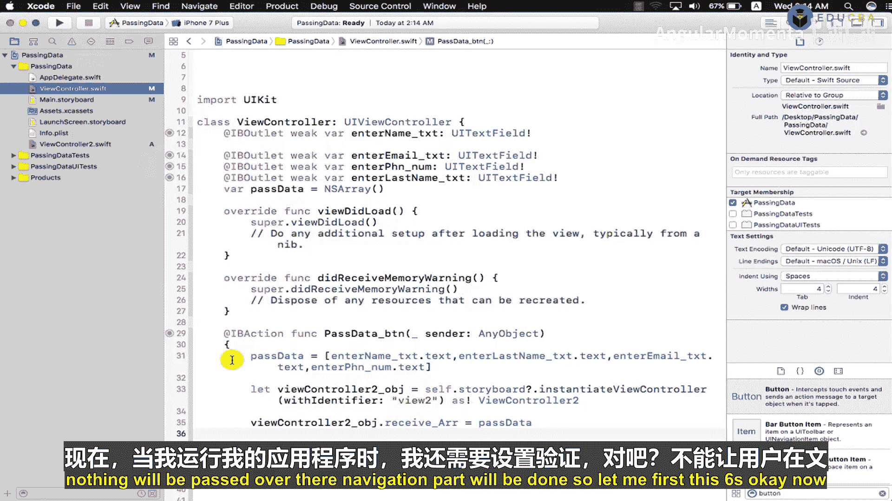

So， let me first。The success。Okay。

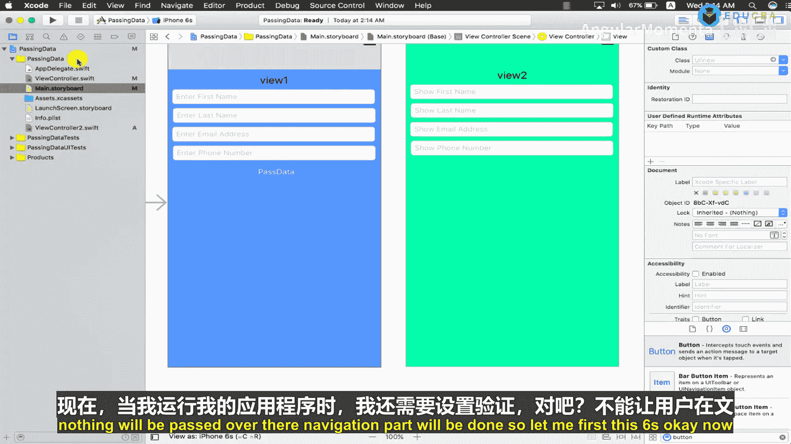

No。😔，Yeah， many。F系 application。I also need to set validations right that no user should send empty data in the text field to another text field so that validation we need to create one function。

 as you can say method。

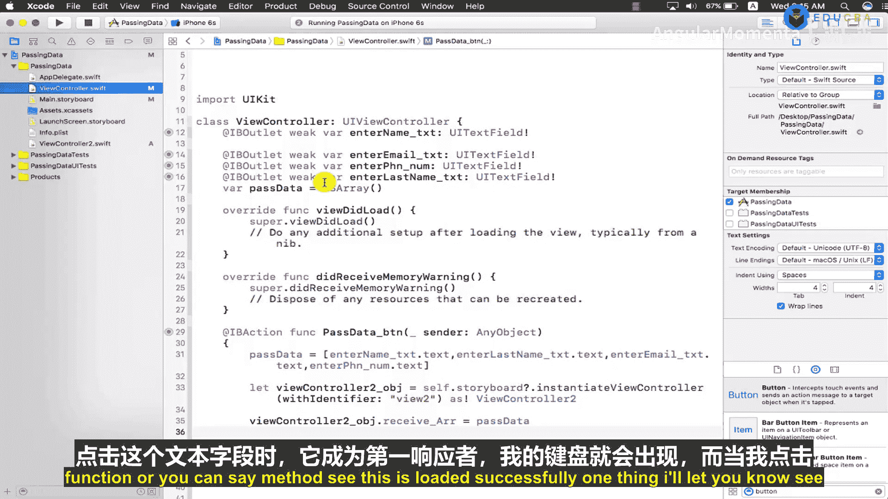

先。And this not successfully。One thing I'll let you know see when I pass on when I press on this。

Text field it becomes the first responder and my keyboard appears and when I press on this keyboard my keyboard is not disappearing right because I have not set my keyboard text field that has resigned first responder。

 So this is my thing right So to that。

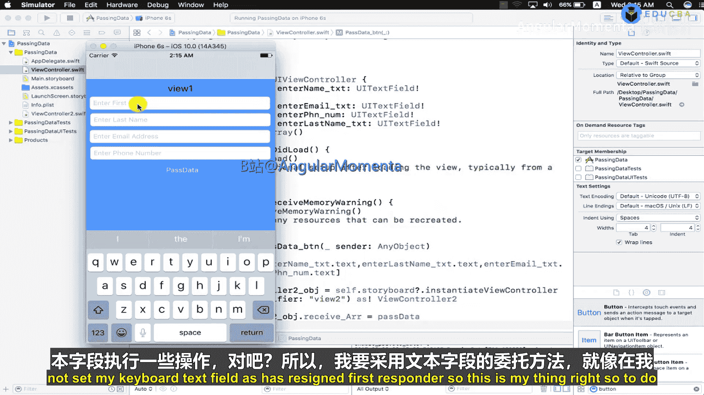

I this go here。First练。I need to perform something on text field， right。😔。

Here Ill take the delegate method of text field， but as in my previous tutorial in my table view。

 I have whatever things we need to perform， we have delegate and data source method so we have one method of text field。

I should return。 So I'll just go into the definition of this text wheel。Text bill should return。

 Okay， just go here。😔，Please copy me this method。Where and I just past my this。Open this Okay。

 now I need to self this text field also because I need to use delegate for this text field。

 So my text names are。有多线。I am telling my view controller that whatever delegate I am using I am using in this class。

行。And I'm using for this particular text view。The last name， no delegate。You to send。地面。And呢个地方之。You。

Now， I can successfully。You know， perform all the delegate method to this text field。

 So in this written I just write。嗯。No。Resign first responder， okay。In the last name。The evening that。

The then forpo and the glass。the phone。Learn understand wondernder。 And as this。

Wxi is asking a bullan return for this written。ok。So here it is I set the delegate of text field and whenever I want to return like whenever I want to。

😔，Return the keyboard， so。It will resign for， and the keyboard will disappear。Nexts。人ning j士。

He would appear that he would disappear。 This is because of this method。

You can also see Els write a break on this methodology andency。😔，To enter this method。

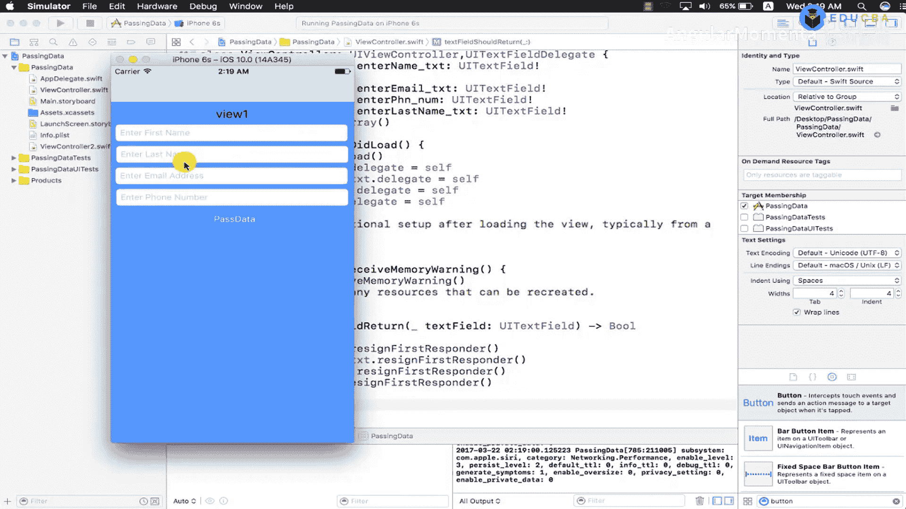

悲しね。So this is just for testing part。Let let you know about this in my further tutorials， okay。😔，So。

This was basically to show and hide keyboard。And one more thing we have。

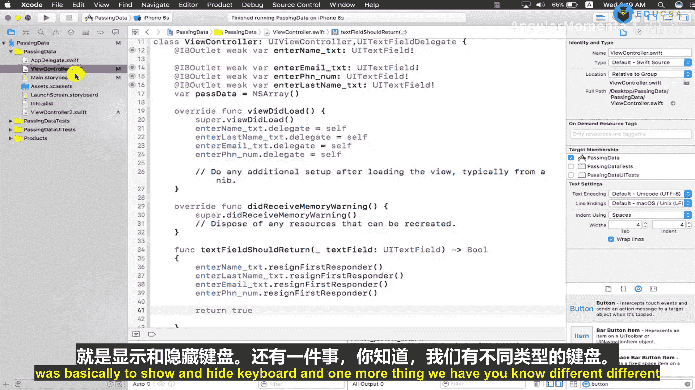

You know。Different， different types of keyboard。So going do the name。😔。

You are in the assistant inspector。😔，Yeah， Ill get a keyboard， keyboard time。😔，Okay。

 what this name is not default。 What's for email mail。The keyboard types should be of email， right。

 So email address。😔，嗯播放 number 。😔，The keyboard type should be off。放低。So let's see。

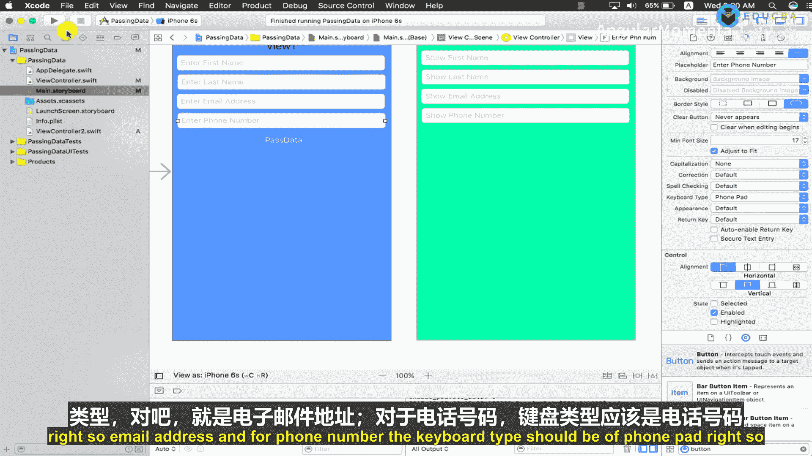

See， that has appeared working email。Looking word with at。At the rate has period and for form。

The phone number had has appeared。 Now， there is no written over here。😔。

Like there is no written button。So now how how can we like return this keyboard。

 I want to disappear this keyboard。是吧。There is。Gestures in I US， there are many taxile gestures。

But in my previous tutorial， I have taught you one gesture。

I a Sw gesture in my table view tutorial where I was just stripping the cell and I was deleting the cell。

 so in my this tutorial I also teach you about tab gesture。😔，So like how now this is。

 we are not able to like disappear the keyboard right。

 so while tapping on this view we will be successfully able to disappear the keyboard。

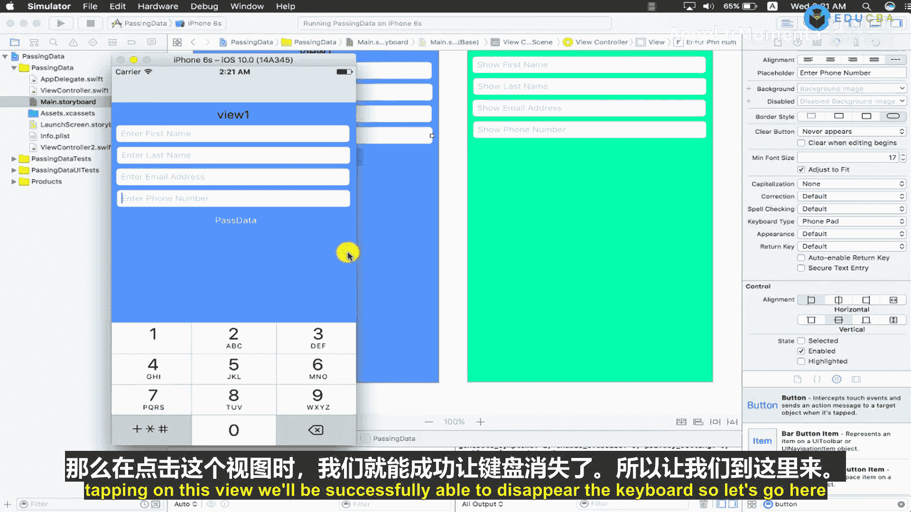

再嚟做啊。😔。

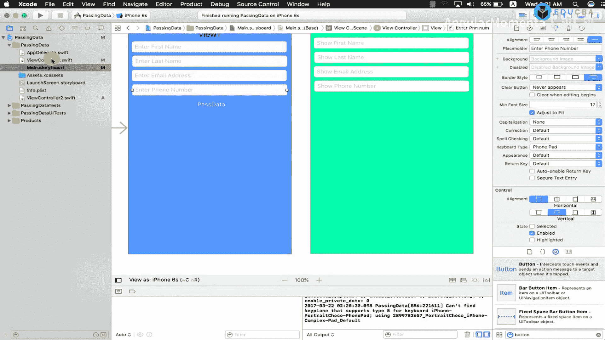

Yeah， Ill， in my view Lord， why I' am greeting。The object of tab sensor will load because this is the first function。

 which will be called after the view is loaded。Yeah net。Yeah。系只数唔识我 do。😔，喂。T just recognize right。

调只死林识。Not at target。T get with myself。Let's selectors。没。Its selected。

 and here it is asking me a method name。😔，So fresh。Read the last name。Last name。你瞓做咧。Notord。

Write my da method。Or I'll just create a method named did tap you。大个， okay。So here。

 I've created a method。So it do just give me a like。Has no method called it W。 Yeah， I just。记得啊。😔。

没得啦放心。你只四面。😔，This copy。Sps。No parametermeter no deep。In the third body and just write a simple put。😔。

熄六屌。😔，Not many eating。And this will be my true volume。好嘅事。The error is gone because first。

 the error was coming like view controller don't have。A function or a member called D view now。

 since Ive created a function on tip D view， the error is automaticallygon。😔，系啊。I also write a code。

 like self。What you。A gestureure。Andge organize it。Yes。My tab the。

 so now when my number pad keyboard will appear and when I press anywhere on the view。😔。

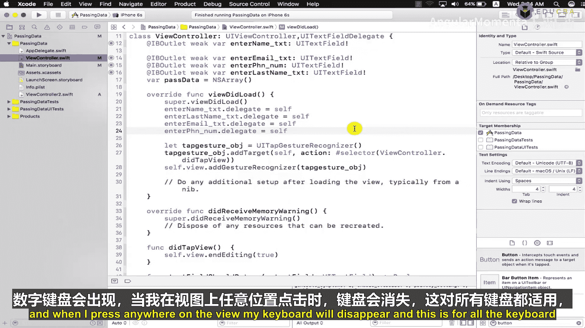

Makekey will will disappear。And this is for all looking for。This。是老母肺。

If disappear when I go to the image， will disappear when I go to the last name。😔，It disappears。Yeah。

 its a very simple to understand。😔。

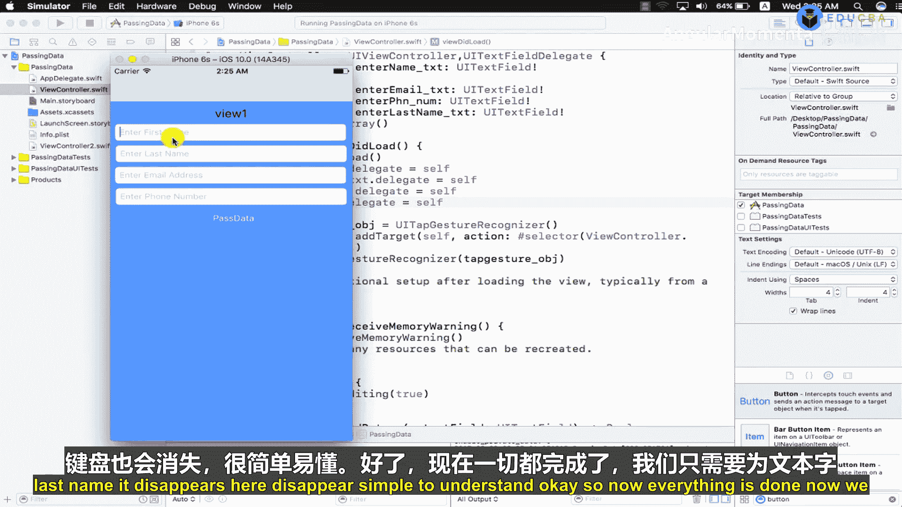

O。信溜。😔，Everything is done now we just need to create a validation part for the text so that no empty data is gone。

😔，你啊。通讯。你点。逆穿。😔，When你离 okay。Here I need to create some validations first I write F。😔，免得你。😔，Whattic。

个呢个多年。我。The last name no text。嗰啲本准你。来。The email do tag。可 for的。系。None work。如家你觉得你咧。

So here any dog close me in咩 condition。😔，嗯。聊娇。😔，Sp to age conditions。Now。

 since I have taken our operator， so what is the difference between our operator and operator you know？

😔，So in case of an operator， all the conditions should be true。你。

Let's suppose I have taken an an operator in case of this R operator。So in this end。

 in case of an operator， all the conditions should be true like all the text fields should be empty。

 then only it will show an alert。But in case of our operator， only one condition should be false。

 right only one condition should be true， so it will。😔，Enter into this method。

So youre I need to create alert， okay。😔，So since if all everything is empty。

 I need to create a lot also。 So this is right late。咩 a lot。你过嚟 do。你。Elect controller， okay。有人啦瞓咗。

你大啲。😔，你识。你唔出未结噶。冇几。T Ive taken us a lot。 And yeah， I need to pass message also。Message and。Un night。

Noello。😔，Next screen。铅你。嗯で。ok。no yeah I also dig up before stay。😔，Yeah呀嗯。The first style as。Yeah let。

😔，No。alert。ok。So。This have created。So now。Ill take the object of your alert controller。

You phrase alert lot。Not。😔，N actionction。This direction is just right。URL reduction。😔。

Yes I need to get。大灯。你 name。😔，オッケー？And。Here， I just need to take a style。This day should be。

De okay the stand is default。And you。😔，Take the handler。Let this explain you。😔，Everything。

 needs and every lane。😔，Action。你生活边位。😔，Re reduction。Right。永 like this。嚟 this and year。😔。

In and my bracket would close away。你想心嘢啊，你唔识。😔，I saying here alert controller does not have any number。

Before today。我这呢。😔，Okay， here I've created and。我点。Its not my words not add action。

Let's see what the is giving me。Med actionction。Ting me to create everything again。 So let's。

O this and do know right inside this。😔，Y nowadays and successfully。

Where I need to direct this opening base， okay。😔，So here I've created art successfully。 I'm sorry。

Let you do a little more time。😔，Because my like my intelligent window is not working properly today。

So， this is my。And。So。You I have created a lot successfully of if。Text will， not text。

Is it called empty， like nothing is there。 nothing is there。 So this a little little pop。😔。

I need to create else， but also。你清す。Yeah， I need to。😔，Write the validations for email， right。你只。

I need to make a condition。没。In这 evening年。t。佢啲。So this is the condition if it is not empty。😔。

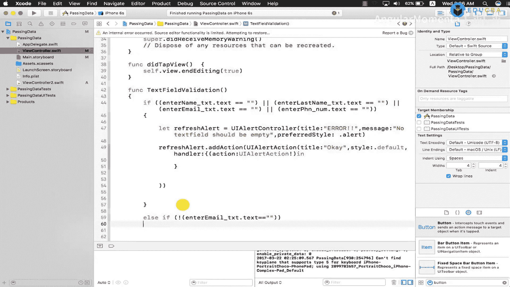