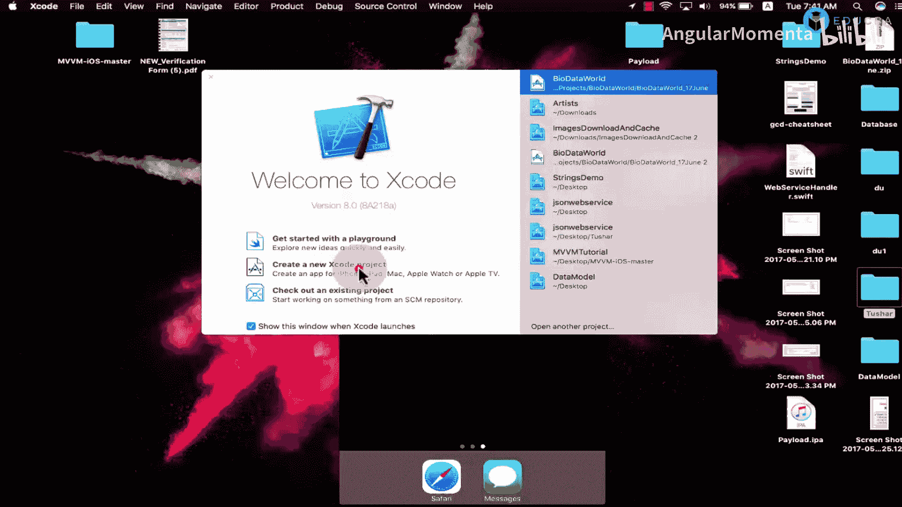
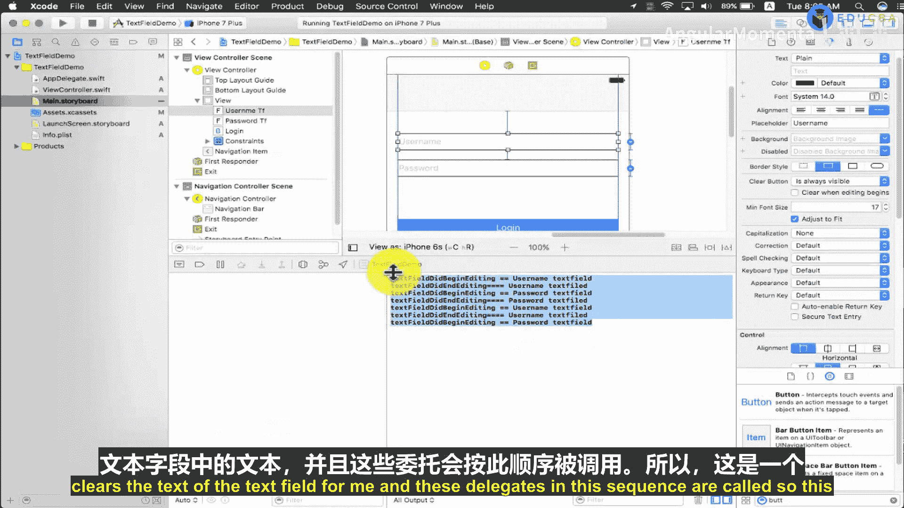

# 【EDUCBA】运用Swift核心特性进行中级iOS开发 ｜ Apply Intermediate iOS Development with Swift p03 01_03_01_文本字段控制器导论 -BV1RmFUzyEXJ_p3-

Hello friends， today we would be working on text fields I would be preparing a small demo on text fields in which we would be preparing two text fill entries along with a button。

To just represent a small login form we would be creating it so and heavy work and the evening we would take two text fields on a main view controller Now what actually a text field is text field is very basic control provided by export but a very important one it is basically used to take input from user。

And use those details entered by the user in our program or throughout the run of the applicationian or in any ways。

We feel like since export 8， we can implement autoizing along with autotolia。

 so I would be pre autotolia right now。Implementing auto layout on the second text wheel。

And after that， implementing。Oly out on my button。Changing the color of my button from white to some。

Particulars so that it is more visible。Next to white。Now。

 from here we can change the type of text field we want as per our Ui requirement。

 this is the rounded text fields these are rectangular ones。But with this shadow sort of。

And the third one being the rectangle， the exact rectangle， which you can see right now over here。

You can see the difference， very well。And the third one being the with the invisible border。

 so we can just simplyly do the implementation of border style as per our requirement。

I'm prefering for the rectangle one。So other very important properties of a text field being like the placeholder text。

What a placeholder text does， it is a basic text which is initially shown where the user has entered nothing into that text field。

It is basically to represent what our text will basically require。

Creating the outlets of my text fields so that I can access them in my controller class。

longong with that， I would also mention that following came Notation is a good method for implementing outlets so that it is quite easily understandable to any other developer who maybe be in case follows your code。

I am using Tf along with my text field name just to represent that yes。

 this is a text field a short form for Tf text field along with that。

 I would create an action of my button。Im preventing my alls to the text field。

What delegate basically does is it follows documents that yes。

 whatever the delegates of text field are they needs to be followed or they can be followed in our controller class I will be swift discussing you the delegates of a text field short。

 other important properties wing like player button。

We can just set it to appear while editing or appears unless editing is done or is always visible what the clear button does is whenever it is shown in the right corner and whenever we click on it what it does is it clears the text whichever is printed or written by the user in a text field another property timing clear when editing begins as soon as user for example if user has written certain thing on for example his name when user resigns the keyboard and again begins to enter to write something on this text field it will get clear off。

Like here， I will be compiling my program and showing you how it works。Like here， whenever I write。

 this is the button。What it does is it clears my text whatever is written and the placeholder text come back。

Now， what I was saying was when the text field begins editing again。So this text should clear off。

So as soon as I click on it again and type something。

 it won't get clear off right now why because I have not enabled this clear editing functionality right now。

To show you the difference here I enabled it， I will compile it again。And we can see the difference。

Now， again， I type test in it。Or any domain text。Test again and when I begin typing again over it。

 it gets cleared off and the same with this。Pa or text field。

 So these are the properties of text field， which we can implement。

Right now I'm disabling this function。Another important functional div minimum phone size。

 for example， what happens in at times we are running a program and。For example。

 iPhone 6 which is with a big greater bread greater screen size so at times sort happens like I write a long text than this so it won't get cut off up to for example for0 characters of 50 characters but same case in case of4s that text will get cut off because it's screen with this quite less as compared to iPhone 67 or others so to give the comparison between them what you can set as we can set the minimum font size and if the screen size reduces to4s for example so it would take the minimum font size and try not to cut off the text which is being typed in that text read other properties being like we can set the capitalization that the first word should begin with capital letter then correction auto correction enabling or disabling auto correction this is then spelling checking again if we are typing any particular word then checking the spelling of these are the properties which automatically。

The text will does for it if we set them to yes or when we enable them。

Another very important property being keyboard。Like when I set this keyboard， for example。

 to phone pack。And for this as well to phone pair。 Now right now， if we see the difference。

This is the alphabetic。Keyboard opening for us。你系点咁俾。By setting the keyboard type to phone pad。

 we can see the difference。What it will do is it would by default open a numeric keyboardvo for us。

And user will only be able to enter the numbers these are the basic case when we need to get like phone numbers or social security number or card numbers。

 so we prepare these type of keys。Then appearances。Dark or light。 we can pass per our preference。Now。

 what return key does is return key changes the text of our right corner button， this button。

 which is shown generally in the case of alphabetic。Gboard。I will show you this， now。系。

It is being returned right now， which is by default。And if you feel like having it。For example， next。

 we can also do that。Like this， you can see now the text has been changed of a right corner of it。

Now， auto auto enable return key。 What it does is when I press this return key， it would。

Hide the key for me。And this secure entry again a very important feature of a text field。

 what it does is for example at times we are taking some sort of secure input from the user we can enable this functionality and what it will do is it will mark the text which is being entered in those text field as dots。

For example， this so that it is not readable to anyone else only we know what we are typing in it。

Now， I will have to inherit from your text field delegates。

And what the basic Q text field delegates are。Just to show， I've written them on a text a。

The first one being text field should begin editing this is called as soon as we enter on the text field and it tells the compiler tells that the responder that yes。

 the text field is about to begin editing。And text field did begin editing it is called when when we have started typing it text in the text field。

Then text field field and editing when this this method is called when we press on the return key or the we have ended typing in the in the text field and the text field is about to hide is its keyboard and after the key is being hide this delegate scored that is text field did end editing。

At times we feel like yeah only eight characters or 10 characters needs to be shown in this text field or could be return in this text field then we make use of this method text field should clear it is generally used when we need to clear the data or whatever the input is being done in that text field we call the sal。

And text field should return it is generally called when the text field text field should return means it is supposed to hide the key at the end。

I love over here as what we can see。Text field should begin generatingrating。Did begin editing。

 should add editing， did add everything。Okay。Then should change characters in range should clear should return。

 and there are some other ass which we can we can make use of right now sticking to the very basic ones。

Along with this， I will show you the flow how these delegates work。

As this method returns a boolean value， so we are supposed to return to in this case。

And I would also let you know how to use these delegates。

What we generally do in this method is to make the return key functional。We resign a tax fee。

Ex me dark。我 is wonder。What this would do for me is like it would hide the keyboard。嗯。

It would resign the keyboard for me now further。Like to just let you know which method is being called for which text field I will also enter。

好。企到边到。The placeholder text。In my consultsort so that it is clear to us which for which text field the delegate is being called。

What I have done is I have written this line to show the placeholder text。

So that it is easier for us to come to know which delegate is being called of which text fee。

Bring the same with this， as well。啊咁喺拎噶嘛见然。Let's see what it gives up。

Like I and click on the first text field and it says text field did begin editing。

S call or username text suite。Okay， so for the first text field text field did begin editing is called after the text field did begin editing delegate for the very first text field that is the username text field is called。

When I click on the second text field， that is the password text suite， what it does is。

Its first call text field did end editing for username text field and then again calls text field did begin editing for the password text field。

And when I will click on this return button， text field should return this score for the password text field and then the text field can add editing the score。

Just embedding a navigation controller。Do my first to you。Mettting the constraints。请。

Marking the tax wheel as secure。Dab。This is being mail as secure text field。Like this。

And I enter certain name in this。 and then。Click on the password text field。I can very well see that。

The sex is being marked。And when I click on this button， it clears the text of the text field for me。

And these delegates in this sequence are called。

So， this was a very basic demo on text fields， how our text field works and further we would be discussing more on the outlets on the controls of exc in our upcoming lecture。

