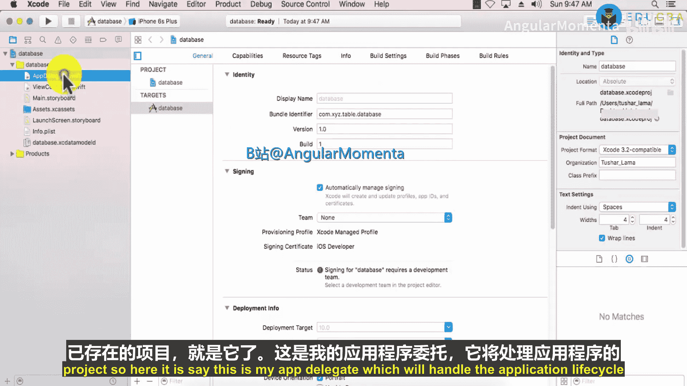
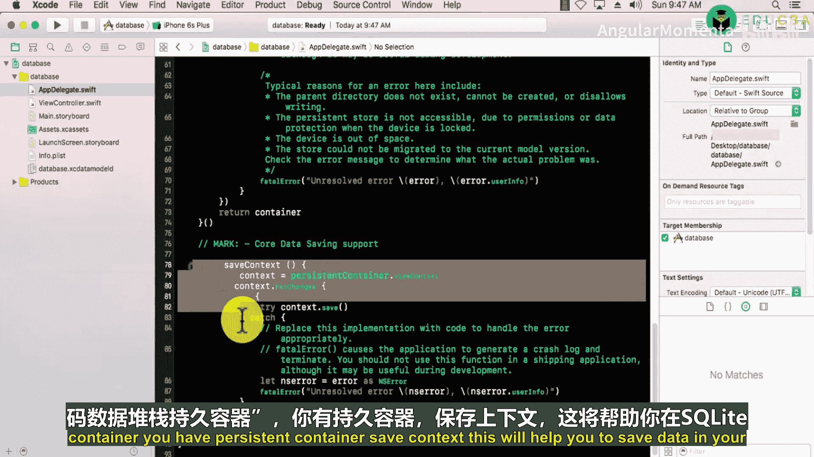
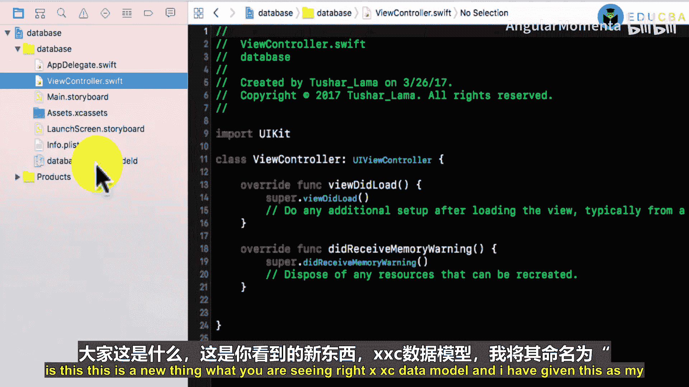
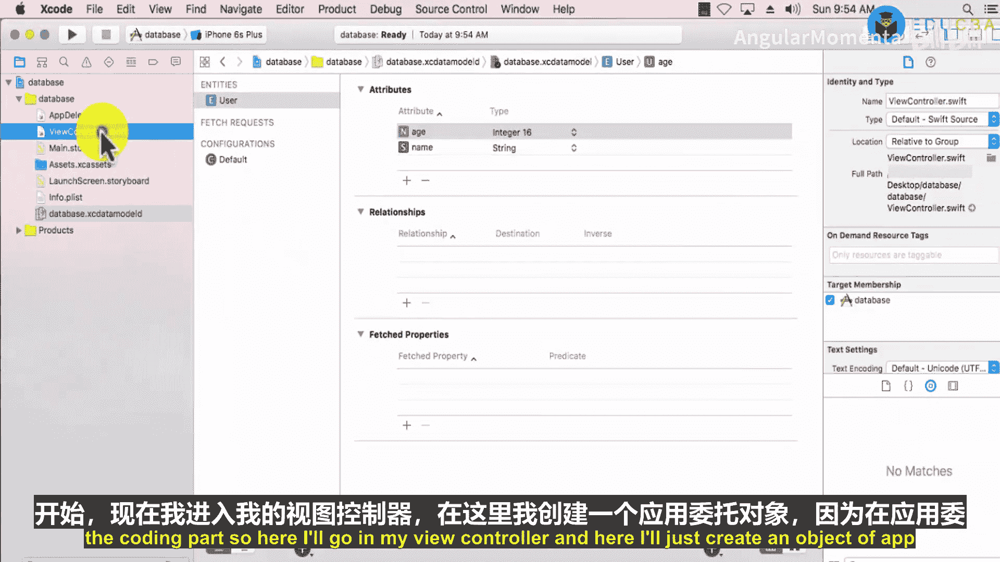
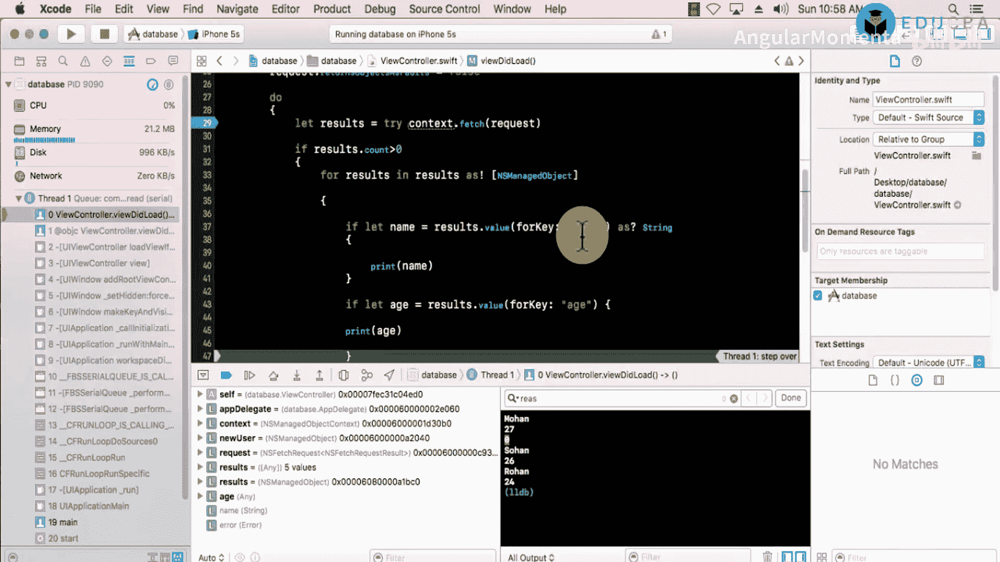

# 【EDUCBA】运用Swift核心特性进行中级iOS开发 ｜ Apply Intermediate iOS Development with Swift p04 02_01_01_Swift 3.0核心数据入门 -BV1RmFUzyEXJ_p4-

Hello， friends。 A very warm。 Good morning to you all。 Today。

 I'm going to give you a presentation on core data。 So let's start。Exhor。

Create a new export project from here。And single V application。

And my project name would be database and make sure that in here you just mark it to use code data in the application the language is swift okay。

It asking me to replace it with the already a Christian project。

 So here it is say this is my have delegate which will handle the application lifecycl right when you use core data you have a method to see the method name code data stack。

 persistent container， you have persistent container。

Save context。 This will help you to save data。

In your escalate database， and this is a persistent container。 Okay， so before starting。

Let me tell you what is this this is a new thing what you are seeing right X X data model。

 and I have given this as my name as database so this is the。

You know， U I for code data。And from here， you need to add an entity。

Entity name you can have just marketers。User， okay。

And I'll just successfully created an entity and from here I'll create two attributes one is name and you know。

 can take one as age。So， I。五。And the type I will give this to a string。And one more I'll take。

 I'll take a stage。And here Ill take as inte of 16 no age is greater than you know 16 I mean to say in length right so here Ive created an entity and here I have created two attributes for that entity。

Now， let me tell you what is entity。An entity works like a class， right。So in class。

 you have different different objects。Okay， so entity basically is your table。 you can say。

 I think you all are familiar with SQite right So entity works as a table and attributes。

 This attributes will store data into that table。 As I told you about entity entity is made up of three properties。

 one is attribute， This is attribute， one is relationship。

 I'll explain you about that and one is fetch property。 Now， what is attribute， right。

 I told you attribute， attributes serves the same function。 encoded entity as。

An instance variable does in the objective C class。 They both hold data。

 So name will also hold a data of string type。And even age will also hold it off integer type， right。

 And about next property relationship， a relationship defines the relationship between an entity。

 example， suppose I have created a person entity name like today I have created name as user。

 So let's suppose there is a entity name as person。Okay。

 so it has various attributes like the height of that person， the eye color， the hair color。

 So this is about relationship right and relationships are also many types like one to one relationship。

 many to one relationship， Okay， so these are all types of relationship。

And the last property is the fetch property。 The fetch property allows you to create a query that is like lets suppose you want to fetch something like you want to fetch the details of this like you want the data。

 so you will just request of fetch request。And from there， you can， you know， easily。

Access to all the data from core data。 Okay， so I hope these things are like clear to you till now。

 there is one more thing in core data that is manage object。 Okay。

 so like see basic example I'll give you before you know coding and everything see there is a class right let's suppose there is a class name a and you want to access all the data from that class。

 So how you will do you'll create an object of that class and with the help of that object。

 youll just access data from that class right So in and in case of entity manage object manage object works as an instance of of this entity Okay。

 so whatever data you need to save you used with the help of manage object Okay。

 and these manage object leaves in persist store and now what is persist store a persist store can take several different forms of data right。

 persistence store。Acs like a story like you can you know add escalite into it。

 you can add Xl data into it， but today my basic fund is to add escalite core data which is already embedded in it Okay and code data with the help of core data you can just you know add data into that escalate。

Because the advantage of using core data is that you dot have to write SQite commands and you statements。

 Co data already works with the object the objects to save data into the precision store by default a code data application implements a backing store as I told you as an SQite database stored in the applications document directory。

So core datata， basically。Does the functions of saving。

 retrieving and deleting data from that escalite Okay， so it is just like a wrapper。ok。

We won't directly work with a persistent store like the Sr database rather we will use something called as N manage object context。

The NS mass object context manages access to the persistent store and whatever changes we need in the persistent store we do with the help of managed object context。

 right。So lets start with the coding part， so here Ill go in my view controller。

And here I'll just create an object。Of app delegate because in app delegate we have this save context and you know persistent container so to access data from this as I already told you like to access data from the class you need to create the object of that class right so here Ill just write。

Have delegate。 That is。The name of the object， UI application。Not shitd。诶。Not delegate。As。

I have delegate。 Okay， so here I have successfully created the delegate。Now。

 as I told you about context it will you know help us to save and retrieve or whatever you know functions you need to perform on core data now you know you need to get an access to the persistent store right so here Ill create an object name context。

Okay， and here I write a delegate， which is this object what I have created。That。

Persistent container what is present in the delegate。Dot。小近迪。s。

There in my app delegate see the context to save， you know， is already been created Okay。

 so I am accessing this。系咪小瞓咧。With the help of app delegate objects。 So now we need to， you know。

 access the core data also。 So here I'll just。Import。好。过嚟打 ok。

So here the reason I am import this core data is that I need to get access。You know。

 of the methods and the whatever functions I need to get access from Disc code data framework。ok。

So now here with the help of context， I have just created an access to the core data Now I'll just create an entity object。

 I'll just name it as。You， okay。Yeah。And here Ns entity description C。然。

Insert new object where my entity name should be the same but I have taken over。It is user。

 I just copy。And here， I'll just paste it。 Okay， into where see it is asking。

 So Ill just like context。The object what I have created。 Okay。

 so this much thing I think you have understood your context is there from here。

 I am getting an access to save the data and your。New user I've created。And N。

An entity object is new user， right so now you need to save data into into core data， right。

So I will just write new user that is the object see it will write as manage object you need to save data and it right。

So， this is manage object so this new user is an object of managed object right。

 so every time you need to save data as I already you will be using managed object to save in the entity like this right so。

Useer dot。Set value。Yeah， I right。Let's suppose I'll take a name as。老肯。For key。He is name。

This key is very important， and it should be the same as what you have taken over， right。

So here I have just saved。I am just passing data that is Rohan。

 which is a string type into the attribute name with the help of manage object。You know。

 manage object So one more attribute I have created right that is our ph。Is that value。

And write a has 24。And you right age， okay。So， you know here you can just if you are using text field here you can just pass data of text field like whatever text field you have。

 let's suppose you have name text field name as name so name dot text Okay and here for key should be the same what you have taken Okay。

 so this match part is you have done now you just need to do have delegate。Not safe text。

 simple see to save the data， this data。You have function in have delegate。

 See here it is written coded a saving support。And here he'll just save the data， okay。So， let's。

Run and see。 My project is running。 It will take a little time cause。I just started my machine。

Is my simulator。Again， I need to rerun it just a minute。Again， I need to re it。

 export is working really， very slow。😔，Yeah。projectject。Nos at photograph grass。

I there the reason for it。An accepted type of value of attribute property is desired type as and is number given。

ok。Let me check。Os， yeah。 here， I need to pass an in teacher your value。 I have pass and string。

 Okay， fine。 So let's run and see you again。What does my expert say。fin， my data has been saved。Okay。

So。One would it has safe。嗯。Sohu and to twenty6。Again。

 I go it will go through this process and it will， you know。Call the save context method。

 And from here。你短信俾你打。喂迎。ok。yeah， it is。If you want to， you know。

 debug that if really its saving or no， I'll just， you know。

 add a break point over and I'll just it has。Mohan and Ill write is age 27 right so when it will go through all this process as u it load is the first function which is called whenever view view is loaded and after that it will call this method so I have just added a break point over there so whenever this method will be called that method will be called no。

There they have delegate， it will go directly to the breakpoint。我。See。

 it came to the safe context method of a delegate。Yeah I just go step by step， see。

It went into the save do。Save context or save okay。Cach， there is no error。 and my did I say， okay。

So now， as I have saved three data， Rohan Mohan and so on， right， So I need to search and see that。

I is really the data being saved okay， so lets write a fetch request。Since now I need to fetch。

 so I won't add this。I'll just make a face request， let。Request equal to NS fetch request， okay。

Take thisす。Yes。And it。That's it great。Yeah。Yes。Yeah。不谢。O。点咩心。Ill just remove this dessert。我惊屎啊，你死。So。

 this is getting me。To reference to generate。 Okay， fine。Let's wait。 I' clear。Simpath fit great。Next。

 that' surprise。And to the name， when did the name is。You are right。 what I have said oh。点你。

Excode data model right。 So here it is。It is again， asking me some generic parameter result。

 I could not be interfere。 Okay， just a minute。So it is asking me generic parameter result I could not。

Okay， this is the latest version of Sw。 So let me try another。Okay。Request it will。And is face Chris。

让你。And as fetch sequence result。Which will be equal to n S。发 great。And inside here， right。And diddy。

My end啲 name。It is equal to user， right。Again， do not match any available over road entity name。

你咩食叫大见。Argument label entity T T name do not match any available。系。说了。This is my， you know。

 face request as。I was I was using the fetch request for shift 22。0。

 but I am using shift 3 that is the latest version of shift for that is the reason I was like finding little difficulties but yeah I overcomed it okay so now from here I enter a request。

Start。Return object as fault。你嗰多发。Okay， bulling value。 Let's， you know。

And now just fetch all the objects。 So here I'll make a do and catch。Hello。😔，唔嘢啦，你。诶好。

If this goes well， so it won't enter catch， catch his life。Okay。是。Hello。好ello。Her here。Okay。

 so here my do。 I just I let。Ress。Equal to try。Context， which Ive created， not fetch。

That's request request， right， So this is there。Yeah， right， if。My result。

What will come in the area format dot count。greaterter than 0。So I did on inside this。

 and I read four results。嗯。😊，人。As。系呢。Manage object， right。Then again， inside this4。

 I'll create a condition if let。你。Equal to result。你 time呢个人接。We need to change the results。Okay。

 I've taken similars name。诶。😊，think我 do。女信。那。Valally4 key。 And the key was。嗯 ok下。The dream。

Well go inside this， and it is a print。No， if forgot forgot to down gossip it， okay。对。Let edge。

Eport results。Not value for key。8。Iside this girlfriend friend。P。Yeah。食 me check玩。

We clean it once again。Right print。 okay， so this is my fresh request。 Now， let's see。Yeah。

 I said now this is of no use as here I've taken my entity name。 So here I'll just break point。

In just。I hope things are getting clear。Okay， because this is the latest shift。

 So as the code for fetch， what I was doing was doing for shift 2。0。As this is the latest language。

 So， you know， there is some changes。So what I tried and just got implemented。

And let's see if my fetch request works successfully。The it will come inside this breakpoint。とレです。

Said， Add。5 values we have in this area， okay。Safe count dot 0。 Okay， here。When inside this。

First name was Mohan， right， see。It has successfully fetched age 27， right。

So now it will go five times inside this。Yeah。傻han。He's 26。老嗨。

It's 24 right so I think this0 by mistakenly have added somewhere or okay。

 so this was all about you know， fresh request， you know， while saving the data。

Maybe I was getting an error to convert that into you know n number so because of that I think it has saved the value is 0 no no issues as I have taught you how to you know store data into code data and fetch data easily from code data okay so this is my code and。

Thank you so much for watching this tutorial。 And in my next tutorial。

 I'll show you how to delete data from core data。 Okay， fine， thank you so much。 Have a good day。😊。

