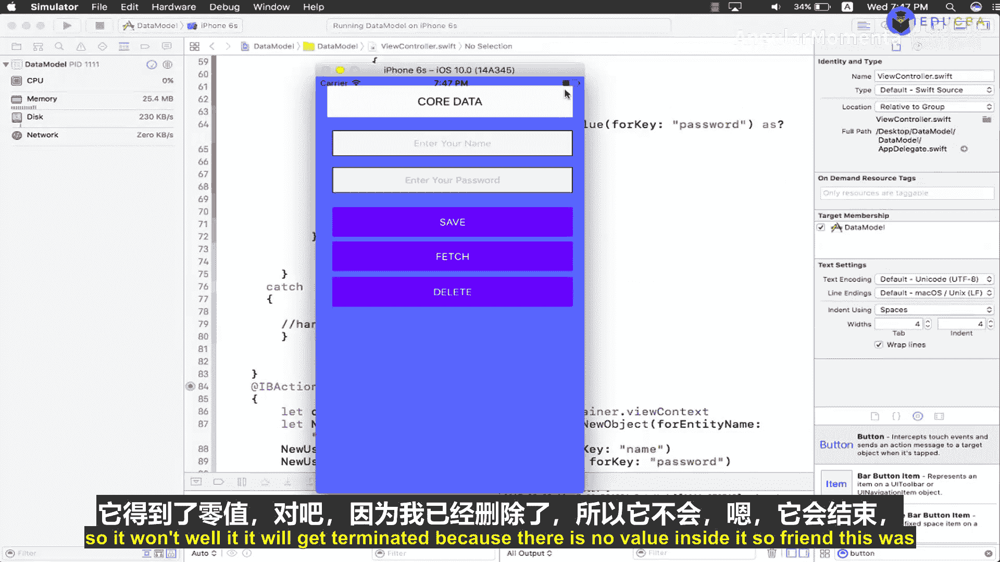
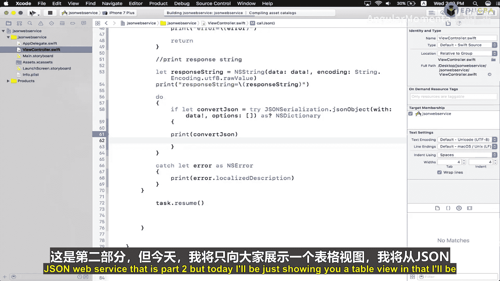
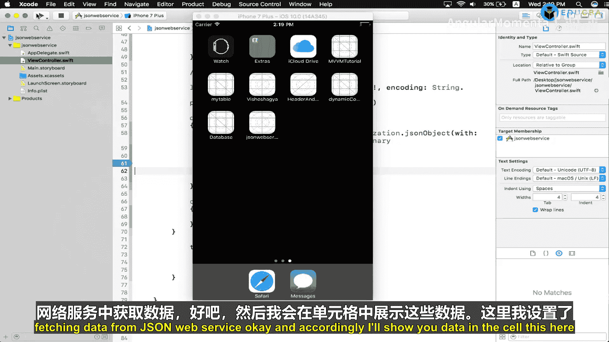
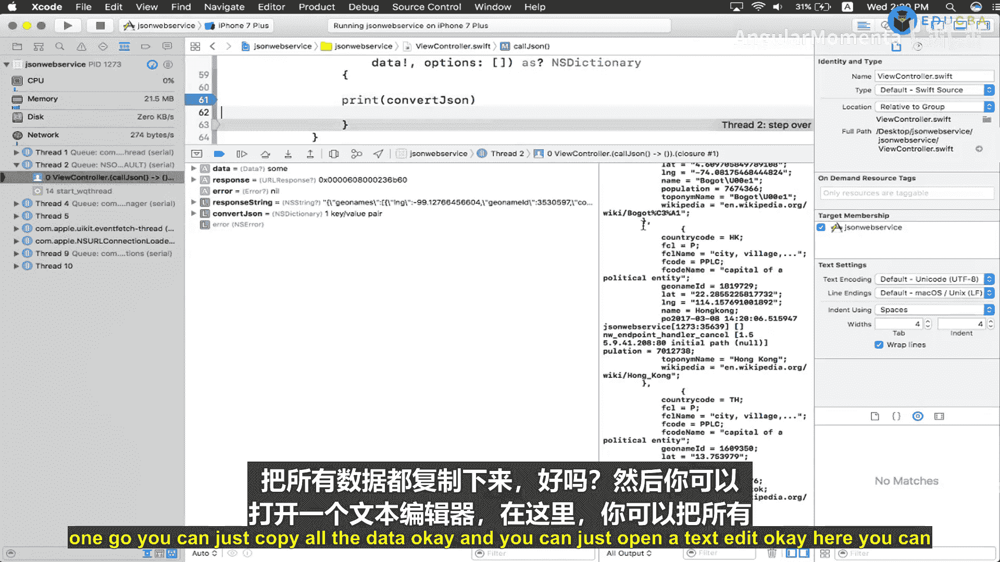
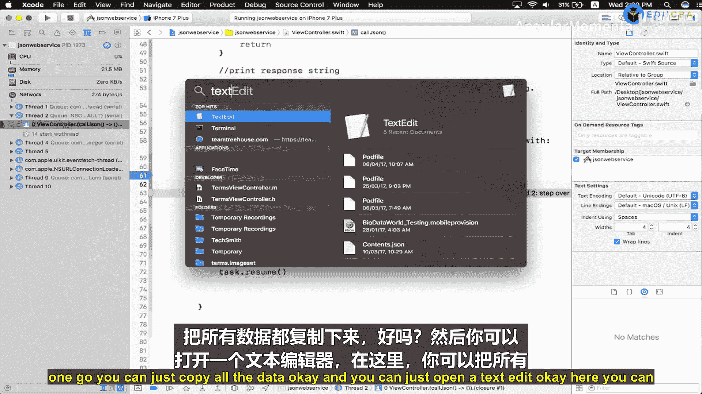
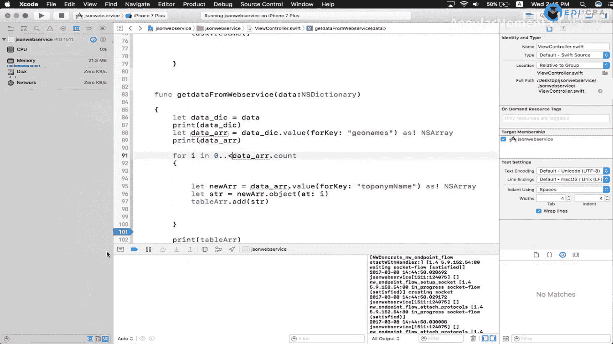

# 【EDUCBA】运用Swift核心特性进行中级iOS开发 ｜ Apply Intermediate iOS Development with Swift p05 02_02_01_获取请求 -BV1RmFUzyEXJ_p5-

I need to create a context， again。First， I will create a fetch request。

Let fetch request equal to N S。F request， sorry。M' F request。This would be an face request result。

 right。And here it would ask me an entity name。So。念。So my entity name is user。

So I have set it as user， okay。And here I'll create a context again。If his name is fit。Thats context。

 okay。诶。I delegate that。Persistent content or view context。 Okay， so here I created a context。

And create if condition if。你。Resultves。Equal to try。Try fetch context。Dot fetch。Okay。

 now what do you want to fetch， it would be a fetch request， right。At request。Now， again。

 it would go into this if condition。Ford。What object in。Objective results。

This result would have taken。Should again go into this。So I red F context。Has context and。

Just a minute。So instead of this statement， Ill just would like to edit it。

 Sorry for the inconvenient。I would like to fetch the request to other way。

Using the fetch written object as fault， you know。So， did have。Gated a fetch request。

And I've created a context， right， So now I would like to create a。Paic wish， not。

Return object as far as。Fse。ok。And what is this？你 is啊。冇练完了。That indicates。Wether。到合即。你食。放飞切。嗯。

Fch grass。A you fault。Okay， this is a boolean value that indicates whether the object results from fetch fall。

 so instead of that if try method I would like to write a two。To catch method because， you know。

 they are using a feature request。 So it might。Need an error catching method also。 So I like do。你。

Results。Nical to try。先imple仔嗯。F context。This can do。Fch。Fch and there would be， know， fetch request。

ok。Again， you go into this， right if。Resultve what you are fetching。Not count。Is greater than 0。

Let again， go into this condition。And， you know， for。Objection results。As I know。

 manage object manage object， right。诶呢。你熟唔识。ok。I it would go into this condition。And it if。那一人你。念。

你龟嘟。Object taught value for key。His name， right。B dream。ok。If this is the condition。

 then I want to print。念 ok。Simple to understand。And right if。诶。Password， equal to。Object god。

Very for机。你。Aword。Yes。Stg。唔你。B。Lastward， okay。有。Ascusing。Herarrow throws from here are not handle。

 So， you know， I need to create a catch also。不ge。Just clean this。ok。I just let and see。

Was working or not， I just you had a break over air。A a break point inside this。

This is as this as a fish in the sea。你你低。So from here， I just did it all this。

And just go fetch request context。Result count。You know， three values， right。So yeah。

 I just delete this。儿歌。See first， the name I to share second password。

Then it would come to the shore one。八0 one。do okay， so you have successfully fetch all the data。哦。

 now I just。Show you how to delete。So it's just like fetch。 So here I'll just copy this。

First to delete also， you need to fetch right this right here。这咁。你 don So you here let to go。

Paace contains a right F from here， I need to write that condition what I wrote in the。

Weult equal to try。Try fetch context。Dot， you know， fetch again， you know， fetch request， right。

 fetch request and simple。 I'll just create a， you know。Condition inside this。系，你。我。

Objects in reserve。Os。Fch can tick。Do near delete。What to do with this object。你系你咩咧？Object， right。

And it shouldn't be enough。怎年。上边。I just had a break point。Let me run and see。

You have three data in it， right。So now when I press to delete， it will go inside this。It will fetch。

So you got three values， three times the loop will go one。Do。四诶。Sitmen got terminated。Now。

 since all the data is deleted from core data。You know。

 you can just run it again and you can just fetch and see you won't get any data from core data。

 right。你系个废。Add the brake point， it will just fetch。She result， youll get meal。Getting three values。

 Let's see。What is those three。Okay， you're getting this orders。 Okay， fine， no problem。

This is because after you are deleting you are not saving the data again， so that is the reason。

So I this right here。Okay。Delete and then and。A delegate dot。Safe context。 Okay， so after deleting。

 I'm just saving all the data。They lead。Okay， now I've saved the context。Now let's， you know。

 fetch and see have deleted and save the context right before that I was not saving。

 so let's click on fetch。你啊。Went into the entity， found the result， and it got0 value right。

 as have deleted。So I don't get it。It will get terminated because there is nowhere inside it。 so。

 friend。

This was my tu tutorial tell about， you know。C data， how to add and fetch data。

 I've already shown you。 but today， I wanted to teach you like how to delete it， but I。You know what。

Forward to write， save the context after deleting the context。 so so in future。

 whenever you delete the context， make sure that you are saving the context again。So that， you know。

 no data will remain in that context， right， So thank you so much for watching this tutorial。

Hello friends， very， Good afternoon to you all Today I'm going to give you a presentation on Jason Web service that is part2 today I'll be just showing you a table view in that L be fetching data from Jason Web service。

 okay and。

Accordingly， I show you data in the cell。This year I got a breakpoint。 Okay。

 I added a breakpoint and see。Here I have all the data entrygo。

 so today my basic tutorial is that Ill be taking the top toppingome names that is Mexico City Elch。

 Beijing Dhaka， I fetch all these names from this dictionary and you know I'll show these names in the table with okay so let's start with that。

First， before starting， I'll tell you like whenever you hit a web service。

You get data from it right so every time it is not possible you to hit the web service and get the data right。

In a one go， you can just copy all that data， okay。

And you can just。

Open a text edit。Okay， here we can just paste all the data so that， you know， accordingly。

 you can code and work because every time it is not possible you to hit the web service again and again。

 right？So， here I had。Okay， so now here I'll be creating a method。That data my name。放声。Get。Get data。

그럼 웹쌀 왜었게。And。Int data。And written type would be。ok。

Here I have successfully created a block and here once I receive the Json data。

 help call this method cell dot。There I send the data。 and here I'll pass this。Converation okay。

 this method as a parameter of type stationary and here in my web service when when I am fetching the day I am getting。

Data in the form dictionary C I have mentioned， so that is the reason I have created a method with a parameter of dictionary type okay。

So now here my text edit will help me。😔，Firstly。I need to create a。Variable， right， Al write late。

Red data。 It's in the form additionalary right red data。Deck is equal to data。 Okay。

 first time taking this data into this variable， okay。Yes， I took the data dig。Okay。

 because it is in the phone dictionary。 So I have taken this very。Next。Again。

 Ill take the help of tax edit。Now， this dictionary is inside this。 Okay， now I need to fetch this G。

 which is in the form of。Adddie。In my first tutorial。

 I told you like in Jason we have two types of like values， one will be in the disal form。

 one will be in the error form。So the data in this Jason is first in the additional form than the geoname。

 which has a data Ar form right， so here I'll create one more array form。只你累。Solect。The array。

 you can take any name equal to。Data， deck。ok。Dot diary is always valid for keyright。Vally for three。

And yet the。He is what。G name， right， I just copy。And just be。Okay， I've just finished your name。

Which would be the former。Arry。Taken the G， which is in the form of a， okay。

 now what I need to do is just add a break point。Just print and show you first。嗯，不。This instead。This。

 okay， I can copy。This。嗯对 okay。Here I have called the method， this method， Now that's run see。四。

This came here inside the method。No any。In a call， when I just。Move forward。

 It go inside this method C。you got。でです。Data what I have sent from your dictionary into this method。

 see have printed the data now。When I move forward。All the data。Inside the， you know， geoname。

your name。So it is like not possible to get。All the data is like。In all the format， like。

You want all the data separately because now I what I want to do is I want to show this data in the form of areas so that I。

The error so that I can load that error into my table view and I can show all the data right for that Ill just you know。

Take a for look。Yeah。Okay， read4。I， that is well well in。0 like start from 0。Dat， dot。Reterdent。

Daary。哪儿。嗯。ok。Now， it will go inside this loop。I'll just take let。New as a equal to。你 know data的。你系咧？

I'm just taking error inside this okay， later error。哪儿。Value4 key。Okay。

 now what I want from inside this is。I want this name topping on。 I'll just copy this right， okay。

And I'll just make this。Yes。Right。So here I'll get all the seanal print。Pent。女的。

Expected a start body for each loop have just created just run。So here Im getting expected。

To start body for each loop， it is because I have given a space of a okay it will go Now I just add a break point。

remote this big。闹历史。It went inside this and it got pastted。No， the mean。AndAccording aware。

 it went inside this。Okay， I took the new area。Just printing the newsy。

 I' am getting all the city name。Mexico City， Beijing， Dakaooul， Jakarta， Tokyo， D。

Hong Kong bankruptcyang from here， Im getting all the city name。Sbijing， Dka， Soul， Jakarta。

 Toqueo and allright。 So now what I do want to do is I want to add this string separately into array so that。

 you know， I want to load that error into my table you right， So it will be a simple logic here。

Ill just remove this scroll do let string， Okay， short formating let string equal to new array。

Objected index， by。Okay， what is the meaning of this is I have taken this array okay。

 so when my count will be0 okay， so my zero string this is Mexico City will come into this string so now what I want to do is I will create a array what I have created earlier okay。

Table array have created okay， it will be mutable。Taking a simple。

Nomable array is because I want to add data into array in nonmable， I could not do so。就有来嚟。点样下啲。

M of and do be。ok。我。屌不来你到。srry。😔，What this。好嘅。So now， when it will come out of the loopre。Fine。

 easy to understand。again and this。Let dont man see this。Now， I won't add any breakboard。

It will directly come over because I have added a break point over。Just loading the J Web service。

It's taking a little time。

