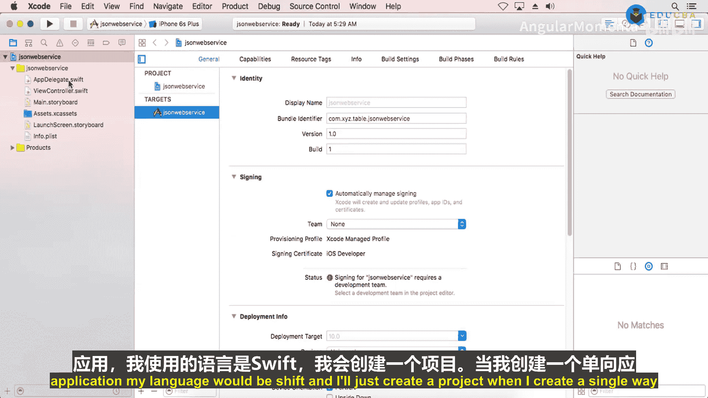
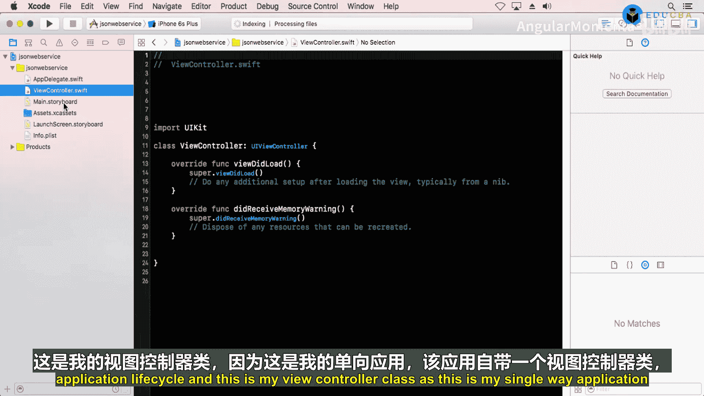
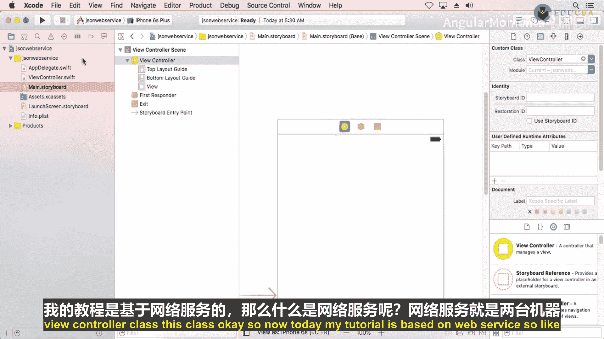
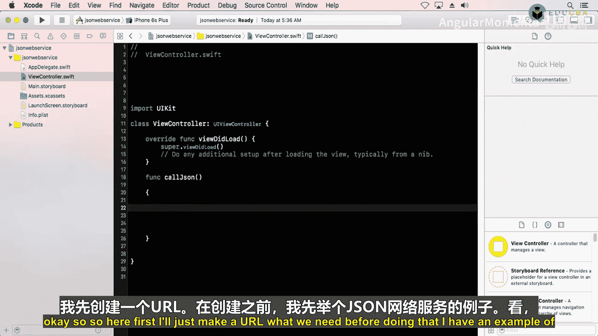
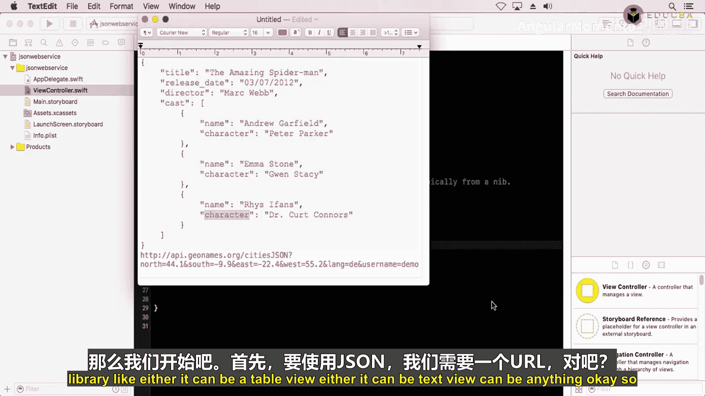
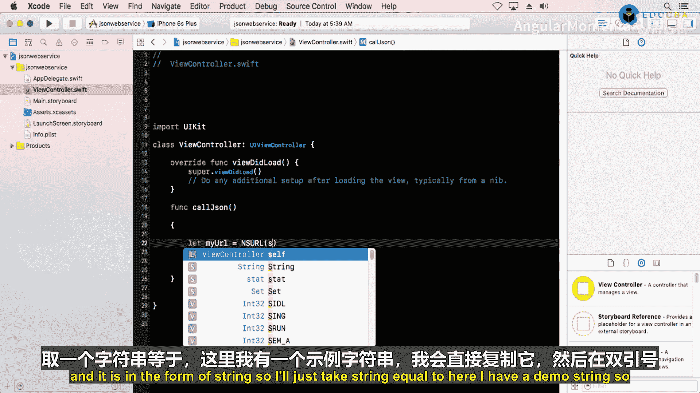
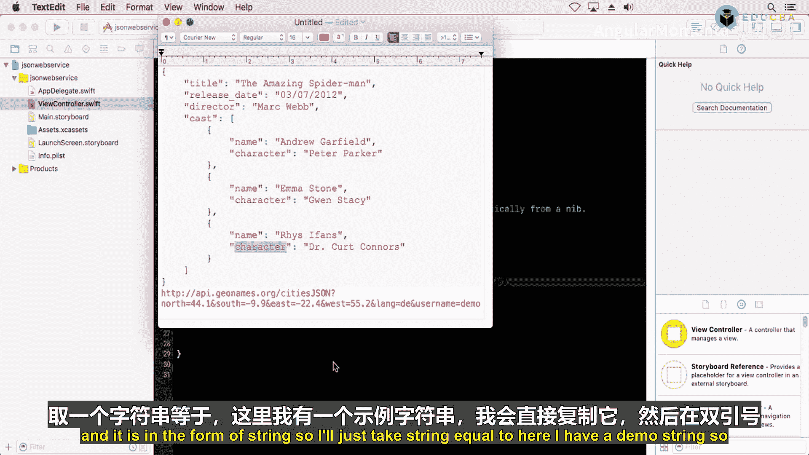
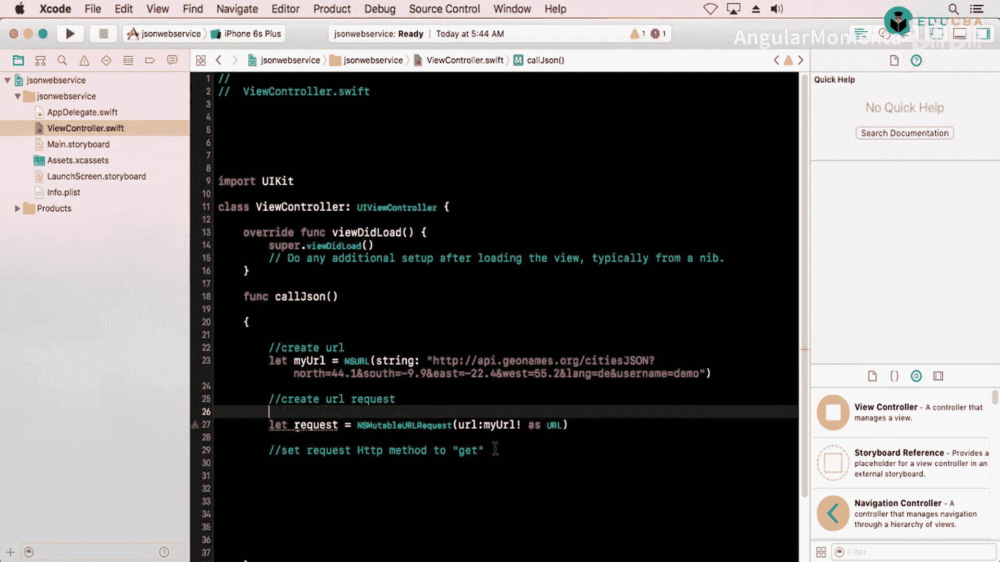

# 【EDUCBA】运用Swift核心特性进行中级iOS开发 ｜ Apply Intermediate iOS Development with Swift p06 02_03_01_在表格视图中展示JSON数据（续） -BV1RmFUzyEXJ_p6-

嗯 run it again。Then the connection actually started。Already。Let me check。

 and just add a break point over。Here it is because of the low connection that my Json web service is not getting hit。

😔，诶。I'm sorry for that。Let's run and see the simulator。Let's wait for it。Toren running Jason。

Of services。 So I hope till here you have understood now what I'll do is and firstly。

 when I get the it。And do。Now。I've taken this area， right。 Now。

 what I'll do is I'll take a table view。Because was denied。Let's see this time。

 I hope successfully I'll get the data I。Un I got the data successfully。

 it was because of my known low network that it was not going。Okay， so now when I see this I see。

 I got successfully。Or1，2，3，4，5，6，7，8，9，10。 Okay， so now。Do it a little fast。 Here I'll go。

Just create a tables screen from object library。Just add the o out for it。My previous tutorial。

I taught you how to add auto layout， right Did。这玲。我哋个度。Vertical bottom， right。And just add。

 make the constant 0。The last for the bottom。ok嘅。所啊。😔，Successfully。

Drag and drop a table view from object library。Just setting the constraint so that， you know。

 whatever size device you run on simulator。It won't have any size issue。Okay。

 now I'll take a prototype cell。你叫阿声你。Let's take identify a cell。Okay。Now， I need to set though。

Delegate。And data source right， and I'll just call my table with delegate。😔，你到时讲吗？😔，Dehi it， right。

We need to create the outlet of this table view。Take the name as my table。

Here has just created the out of table view nowll just go and just code。

Yeah firstly in my video load address， right。My table not delegate。Pter sell。My table do。你得收是个啲身。

We controller that whatever delegate and data source method I'll be using。

 I'll be using for this table be O。嗯。Yeah。I will be taking two protocol methods of table view required that is number of rows in section and sulfur road index for right。

Here I go the numbers of rows in section right here I' just written that array in which Ive added the data。

啥也太热。Triten typeap is right written。诶你。north go。Okay， and you had。Selfur right index here。

 I just create a。你分四六嘅。Yeah喂。Sell equal to table view。Pro decusable with the identifier。 Okay。

 the identifier would be。And I' have taken that in name cell， okay， and here are the red cell。

It has a property of text label。Equal to the area， vegetable stable area。咁 sorry啲。

Not objectiveed index。Index part。No true， okay。Then okay。And here I'll just write one quote yes。

有럴 data的 okay。So， what Ive created。Ne。Okay， have。落山水。😔，Thats because of this space issue。Okay。

 you know。Fch fetch a Web service data， every。Gder 메teoa。

With the method as a parameter type of energy dictionary， okay。

 so I am just passing this dictionary the data what I am getting into this method and from the method whatever whatever specific keys or whatever data I want to fetch I。

Using first have you know created a key then from the loop I have just removed some data what I wanted Ive added into my area。

 which Ill be showing into a table view right so。I'll just run and see。Remove all the break one。

 okay。My table view is getting reloaded。四。Successfully， I got all the data。我 friends。

So my today's tutorial was based on how to display。

A single data from web service that is Jason web service and showing to table view in my next tutorial I'll be just fetching images from the web service and showing into the you know collection view Okay。

 thank you so much for watching this video。Have a good day。Hello， friends， very warm。

 Good morning to you all today I'm going to give you a presentation on how to use web services like what is web services and I'll be teaching you about Jason Web services today。

 Like， there are two kind of web services。 One is Jason and one is examined since Jason Web service is like easy to use So nowadays there is a trend of using Jason Web services and like how to fetch data with the help of Jason Web services Okay。

 so let's create Ex project。Single way application and write the name as Jason Web service。ok。😊，嗯。

Create a single application。 My language would be sure。诶。And just read。

A project when I create a single application， I have a app class。

 it will always be there with me and which will handle my application lifecycl and this is my view controller class as this is my single web application。

 the app app comes with a view controller class and there is a storyboard which is embedded with a。

Vi control class， this class。 Okay， so now today my tutorial is based on web service。

 So like what is web service。

Web service is communication between。Do machine。Over the Internet right we can fetch data。

 we can post data and web service and we can get data from web service right so my twos tutorial would be how to you know get data from web services okay。

In today's world， everything is dynamic， right like。The apps， the mobile application。

 which is there it is not static。 Now， the difference between static a dynamic is that static means everything is like you can see。

In one go like in the app， we do not use any kind of internet。

 the apps which use internet are using some kind of web services like take example of Facebook。

 Facebook is like using internet right so whenever we log in we are posting some data to the Facebook server and when we logged into that server。

 we get all the data of the registered user like you have created account in Facebook so whenever you log into that Facebook so from your machine from your mobile you are sending a request to the Facebook server like you are posting two things like your email I and your password okay so that you're posting to the Facebook web service and from there youre getting the data everything okay so this is the basic fund of web services but today my tutorial is based on Jason Web services So Jason stands for jascript objectject notation why these days we are using Jason Web service。

Says is that it is a very lightweight Web services。 Okay， and it is text based。

 like easy to understand， easy to fetch data from it。你。We use XL web series also。

 but we use J web series frequently because the data are in the form of two type1 is diary and one is array。

In J web service， okay in Xl web service， the data are in the form of tag form。

 so like it is a little difficult to you know fetch data from Xl web services。

And Jason Web Services is easy to understand whenever we post a string from the J Web services。

 you know its easy to read and it's easy to fetch okay and you know one thing about web services that you can just the whatever link you have you can just copy it and you can just paste on your Google you you know get all the data of the web services and accordingly you can past the web service okay so to use Jason Web service will use URL session like NS URLl session okay today。

Earlier we used to use NS URLl connection， but the difference the difference between N URLl session and NS URLl connection is that NS URLl session is designed around the assumption that you will have a lot of requests that need similar configuration okay。

And， you know， makes it makes life much easier because， you know。

 similar con configuration is there secondly。And URL session also provides supports for background downloads。

 which。NS URLl connection does not okay， which makes it possible to continue downloading resource when the app is in running like the app is in background state Okay N URLl session also provides grouping of related requests making it easy to cancel all the requests associated with a particular over。

In NS URL connection， we need to you know add request on request request， but in N URL session。

 we can add directly all the request in Mongo。So like this is the advantage of using N URLl connection。

Secondly， from x code。Like the latest X codes are using in URL session。 So let's start。 let's code。

So we just remove this。嗯。有咩个放心。And name this is Jason， called Jason。Okay。

 we do not need any kind of parameter in it。 We do do not need any kind of rhythm type， okay。so。

So here， first， I'll just make a URL what we need before doing that， have an example of Jason。

Web service C menu adjacent web service is in this format。

Whenever you hit a U you will get this format title release data director cast okay so now like I as earlier I told you like JMF services are in two form one is diary and moneys array so like how you will come to know like whether the data coming to use in the form ofdisciplinaryary or array so see when using diary we use this kind of brackets right and when you use array so you use this kind of brackets like。

See， whenever we declare an area or， So we do like this， declare area。你こ都。And let's add it， right。

 answered。Okay like this I give and whenever I need to put a data into the array what I do is like this and you know inside this bracket I put all the data in array so if the data is in the form of diary youll get this kind of bracket and if the data is in the form of array you get this kind of bracket right so like this Jason web services is providing data in the form of diary right because this bracket is there so initially whenever you like you get data first you see either it is in the form of diary or array when it is in the form so like you know this is in the form of diary so you'll make a dictionary and you'll add the data。

啊。Of this， whatever you have fetch after that， accordingly， like you need to remove。

Like name character， name character so by this you can just fetch data I'll teach you how to pass data from Jason my today's tutorial is just to you know just to get data from Jason in my second tutorial I'll just get data from Jason and I'll also show you how to you know show the data on the object library like either it can be a table view either it can be text。

Can me anything。 Okay， so let's start first to use Jason， we need a URL， right， I'll just write。

 let my URL difficult to。

N S U， and it is in the form of string。So just take string equal to。

y系。

系de。String， well just copy it and。Andside double pose as just page this。 Okay。

 so I have just set a URL and now getting an error of argument leveling do not match any available on it is because I have not given space over here。

 Okay， I have set the URL over here。So and just， you know。咁样跌到去啊使。Create URL。 Okay， okay。

 I've created a URL。 Now I need to add a request also for this URL。 So does I create。

You are it request， okay。And guess said let request。This would be cool too， you know。

An smable URL request。你呢。明咩。You are the request okay唔 say this。We have you added。Okay。

 which would be the string。你 is。咪啊 it。We to define oil。你以啊咧 s。唔系 ok。So what Ive done。

 I have just created a URL。 It didn't be empty。As this。I just took a URL。

 I've just created a request for this URL。冇。And this水 said。那。S j边咩。To get。屌了未。

This tutorial is based on getting data from this URL right。 So here I have request。 Sorry。

 not returns request。O。

