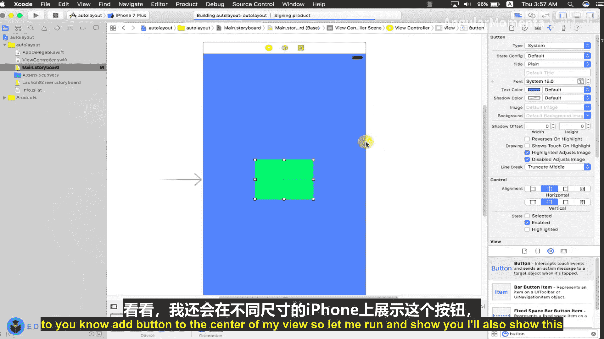
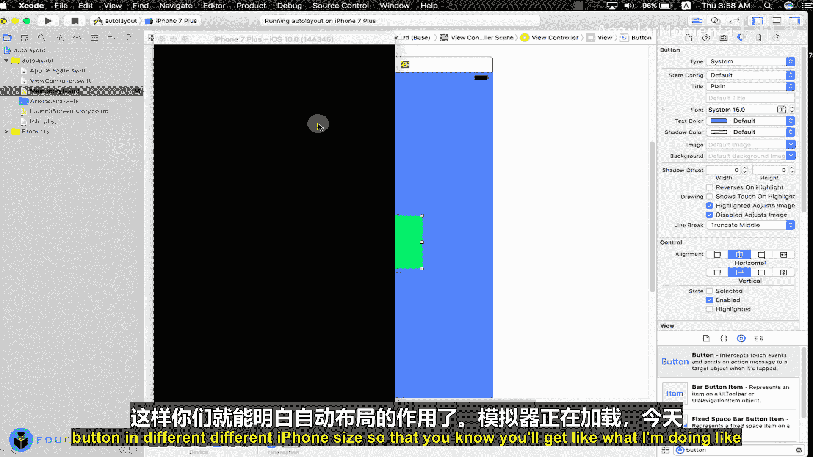
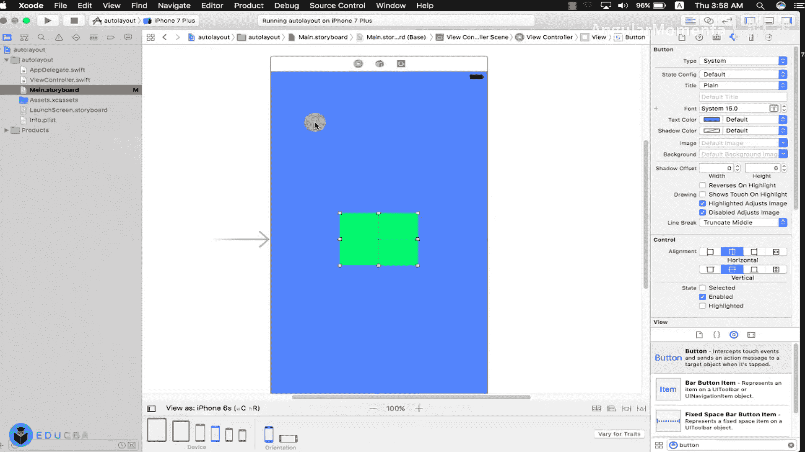
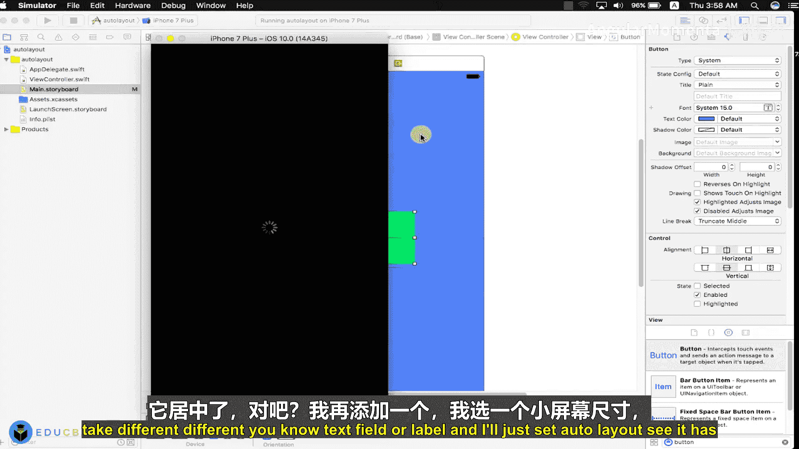
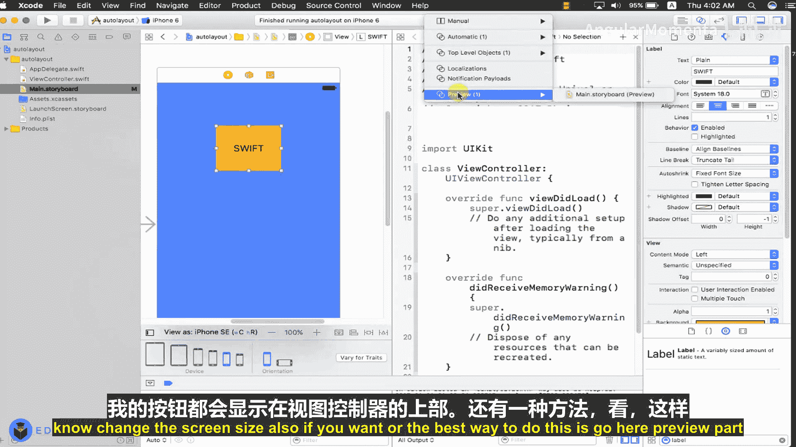
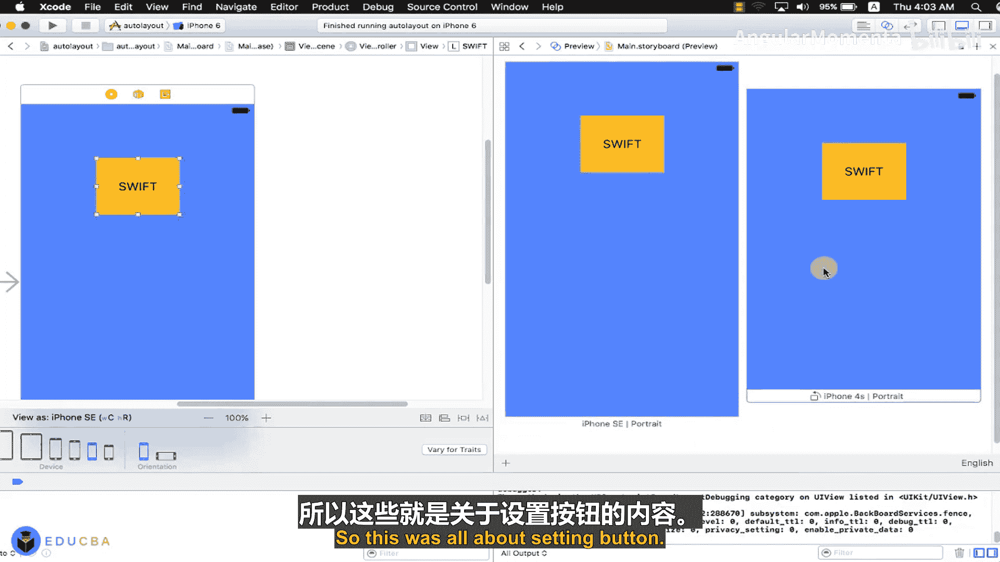
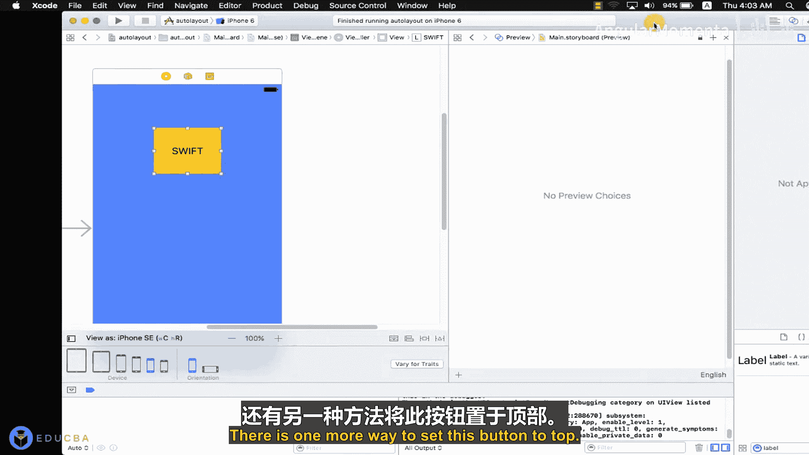
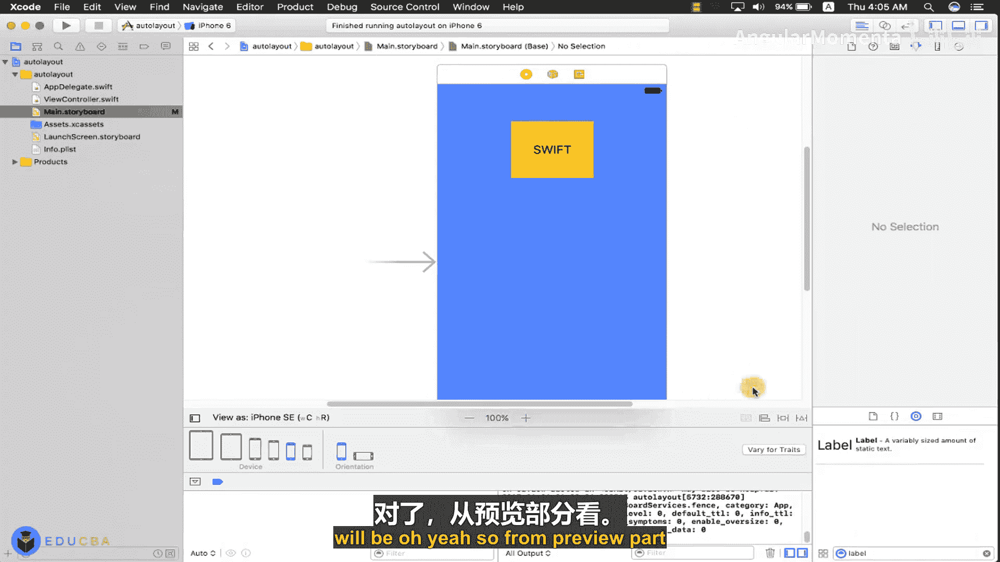

# 【EDUCBA】运用Swift核心特性进行中级iOS开发 ｜ Apply Intermediate iOS Development with Swift p07 03_01_01_自动布局 -BV1RmFUzyEXJ_p7-

Hello， friends， well mob， Good evening to you all Today。

 I'm going to give you a presentation on Co data part 2。In the first part of code data。

 I've taught you how to save data in data and how to fetch data from code data today I'll be teaching you how to delete all the objects from the core data right so let's start with our project。

Excort。Create new Ex project single way application。And name this as。你得么的。Okay。

 the language is shift and I have marked it。You scored it， okay。

So the difference you will see when you mark this as code data here in the app delegate file which will handle the application lifecycle。

 you will get few code part like code data saving support so this method will help to save data for core data okay is the context and one more thing you'll get the X data model。

Okay， so this is the file which contains our data model within x code code data lets us design a data model。

You know visually without writing code or stores the data model in export data model here。Okay。

 so from here you need to add an entity， let's suppose I took an entity and I took the name as user。

 okay， so I also make two attributes of the user。P big。念。Which will be in the string format and。诶的。

八sword。This will be also in string format， okay。So I have successfully created an entity and I have created an attribute。

 okay。An entity， this is the entity。 and entity refers to the description of an object。 Okay。

 and minus object refers to the actual。In a concrete instance of that entity so we can I can give you an example like this entity will be like in class which will has certain properties and will store data and to access this class we have a manage object okay so manage object will work as an entity of this class and to get data from this class you know whatever you need to do function with this class you need to take help of manage object Okay。

 so I hope about entity and manage object。Is clear an entity about entity few things more I want to tell you in my first tutorial I have given you description。

 but I want to tell you more about it En also has three properties right first is attribute this attribute what second is relationship and third is fetch property。

This attribute attribute serves the same functions in core data entity this attribute will serve the same function in core data entity as an instance variable does in objective C they both hold data so you know this attribute Im making so here in name section also I need to add data when I save certain thing and in password section also okay so and the second thing was relation so the relationship defines the relationship between the entity example to create as I suppose I am creating a user。

Entity I might start first by defining few attributes such as I have taken username user password so it can be one to one relation。

 one to many relation Okay and the 13 fetch property I have given you a demo fetch property like。

How to fetch data from code data Okay about fetch property fetch property allows you to create a fetch query。

 you know that is evaluated at at fetch time Ill explain you more in detail when I'll code okay。

 so every time you need to save data。You will be using Man object to save data as I already told you Man object will work as an instance of the entity。

 okay。And there is thing in code data that is persistentence store。So。

 the manage object what what will work as the instance of the entity。Sttores in the persistent store。

ok。😊，By default， a core data application implements a backing store as SQite database stored in the application document directory。

 even though your data is stored in SQite core data framework。

Does all the task of saving retrieving deleting data one more there is one more thing about corereta there is context also the context itself here this context。

Okay， the context manages access to persistent store and whatever changes you need in the persistent store we do with the help of context okay。

 so I hope。About now， theoretically， you know， like now how things will。

Function right so before starting with coding part will just create Ui I have， you know。

 I'll use auto layout in this because I have already given demo about auto layout so yeah。

Take the size as 6 S。I'll change the background color to blue。读机。I'll take a label from here。

Just jack。Yeah。And just increase the size of the label。Here来 this。Made it white， okay。And。

Just give heading and score it Ill change the alignment to of level to center so here and Ill set the you know。

 autolo constraint so。你 press。李啲。Do particular margin。Nos。Vicle spacing to top layout。

Trailing space to container margin。rightight。咩。Okay， from here， I'll go and will update Con so this。

ok。So。There I make take to text file。One，2， you enter the password and second to enter the name。

Ill change the border style too。Rectangle。ok。ITake one。Just copy and paste it over。😔。

There is one property of texture placeholder here I right。And that。Yeah。嗯。Okay。

 and change the alignment to center。And one more proper。Place all the property， enter。Yeah。

Past forward。 Okay， it came to center， but I just changed the spelling。ok。Now I'll take three button。

Want to save。One to fetch one to delete okay。Because if I only delete。

 you won' know like data saving or not。Of， I have not set the hotel layout， so。

The verticals spacing between these two。Readading space。Reling。Like I hate it。Add can， okay。Here。

A vertical spacing I want I want leading trailing， I want equal weight， equal height。😔，So。Okay。

 for label for text field， I'll change the background color。

 you can add background image also to the text field。And just go out。Oh yeah。

The steak is white as white colors。有 year I go。Okay。

 you can change the color accordingly whatever color you want， you can make beautiful UI of it。Now。

 I want to add button。 Okay， so here I go。 already in blue color， so。First。

 Ill change the colour of button to， you know。Read。Let's just stick to dark blue。要来个。你等电视。

Text colour white said now it is looking little better。The coffee fish fish。咩嘢。

I also need to set the auto layout for this right， I need to change the name。

It will set the heart out。😔，Firstly save second would be fetch。Third would we delete， right。

I'll create different action for every button， Don't worry。Right， so now my work is to create the。

 you know， outlet。We be knowing what is out late， right。如 go i like。Name text file outlet created。

So it takes you okay。对。Clre it out Let now I need to， you know， add the。But an action。你个系个 here。

All right， action。笑 o。累啊。😔，Ps the control and go here from connection and change to action。😔，系你。

fetchch okay。你如个。Yeah， I just write。 A read。Okay， I've created reaction。So now， you know。Hello。

 friends。 a very warm。 Good morning to you all。 Today。

 I'm going to give you a presentation on auto layout。 so let's create a。Export project。

Create new project， single application。Whatli language shift。And I' have just created this。 okay。

 and this map delegate class， which will handle my application lifecycl。

 So today we don't have to do anything with the coding part。 we just have to do what with the。

Vi part， so。Before starting， I will just give you a you know definition about auto layout auto layout is nothing。

 but it is just a constant based layout system。You know。

 it allows the developer to create an adaptive UI。Let's suppose I want to make a button。

To my view controller， like I want to set the button to center like if I open the application to 7 s or to 766 s66 plus any any of the iPhone so my button should come into the center。

Right， so what autoout provides us feature is that Oout has different different constraints。

Like whenever we set those constraints so with that help of constraints， you know。

 our view controller adapts to that that constraints and the button comes into the center and you know it will give you a beautiful UI where you can say it will help us to show things into the desired position as we all know that we have screen size in the two type of screen size one is the portrait mode from here C I show。

This is the portrait mode， right？This orientation， we have two type of orientation。

 this is portrait and this is。Landscape orientation。

 So today we'll be working on portrait orientation like how to set you know not only how to portrait orientation。

And the constraints， what will set like constraints， you know。

 expresses rules for the layout of the button。Like today。

 we are going to take a button in the interface。So let's suppose I want to take a button over here so before what a developer had to do was to you know code everything like programmatically we need to do according to the screen size。

 but after auto layout has come， you know， it has。Made the work of developer easy。

 So let's not waste time and you know。Take a button。Now let's see this is a button right。嗯。Firstshly。

 this。And then this。Take the color。Background curl set of this button is green。Okay， so。Now。

 you know， I need to set this button in the center so that every view。Like。

 if I open simulator for 7，6，5。Whatever， you know iPhone we have。

 I want to see this button the center， so I'll set two con。In this first， the constant would be。

 So what will happen that。This， the button will stand in the vertical。

where and will be in the center and you know center horizontal so now whenever like whenever I open my simulator for a different different size my button would pin center and one more issue would be that the size of the button so I need to fix the size also of the button so I'll just write height should be the same for all view and width should be the same for all view so you know so this is。

Few steps would which would help me to you know add button to the center of my view。

 So let me run and show you。

I'll also show this button in different， different iPhone size so that， you know。

 you'll get like what I'm doing like with the Oio thing。

So。Deloading my simulator。And today， I'll also teach you like。I'll take different different。

 you know， text field or label， and I'll just set auto alertery。

It has come to the center， right， so I'll take another。I'll take a small Ill screen size of 5。So。

When I。And firstly， it will you know load my simulator in secondly。

From here also you can see here via iPhone 4， see when I change the layout to iPhone 4。

 it is in center。See， I have not changed anything when I take to iPhone 5。And the size class。

 one more important thing in auto alert， there is size class for everything in Xcode。

 we have this kind of you know structure which is helping us just。试。When I minimize the size。

 you see it is always in the center。Okay， then one more， if you want， we can take six。

And if you just run and see。Welcome the center。 So what O basically did was you know。

 it shortened my code firstly。And it helped me to show the you know。

 object from the object library in the desired position， whatever I want。So I did not do any coding。

 It is just。Very simple。See。没 say。Decrease the size， also， see。It will come to the center。😔，Okay。

 so this was about a single button what I wanted to show in the center， right？Now。😔，He just did this。

Now。😔，I want to show that one button should be。😔，OhWell in the top。ok。So instead of taking button。

 let's take a label so that you are familiar with everything。

 Ill just increase the size of label from as inspector you can you know from here also you can dynamic teach that。

 but as from here it is easy I am doing it。From the view controller itself。L height theax。

I set the backgroundground as orange， okay， okay。😔，Let's text， also。Sft okay。

 and just take it to the center。😔，What I want is I want the button。Should， you know。

 show here on this part， the upper of the view。 So we'll set for constant firstly， will set。

Verticals spacing to top layout， so this constantstrain help us to hold the object to top layout right and one more is leading space to container margin。

And one more is trading space to enter margin。So， you know。

 leading space help us to keep the things to left hand side attached to the left hand side So when I put set this label outlet to leading。

To this view controller。 So it will always hold my button。

To left of the view controller and you know， I want to set it。To write， also， so。And just。

Put a trailing space to container。 Okay， so this I did。 and from here。

 I want the same size so I rest right height。And read， okay， I've just said this。Now， see。

 every time I run my quote， my button would be on。You know， upper part of the view controller。

There is one more way see。This it is， okay。You can you change the screen size， also， if you want。

Or the best way to do this is Goya。Review parties there from here。 you can just。

Pive you whatever you want。See portrait， okay， from here。I write forestest see。My forest。

 it would look like this。In my。Success， it is。It would look like this， okay。

 so this was all about you know setting button， there is one more way to set this button to top。

 there is one more way。

So first， so now I want to clear the constraints also。😔，So I'll just place this。And， you know。

 I'll go to this part， this is called the issue part。I'll go here， I'll just do clear constant right。

So now this。The second way is that I brought it to the center as I taught you。

 center vertical and center horizontal。It will stand in the center part。

 Ill I'll just fix the height and width and I'll just add constant right， so this is center。

So now I want to see this year。Just drag the button。And see it will show some issues。

 so go to the issue section。And you know this。You know。

 this selected view under selected view sections is right update constrain。

 so you know your button will be oh so from preview part。

