# 【EDUCBA】运用Swift核心特性进行中级iOS开发 ｜ Apply Intermediate iOS Development with Swift p08 03_02_01_适用于纵向布局的自动布局 -BV1RmFUzyEXJ_p8-

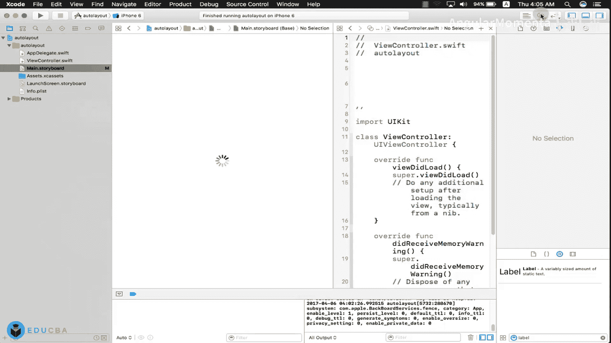

You go here， go Preview， see。😔，A button would always be away your only。See the forest the forests。

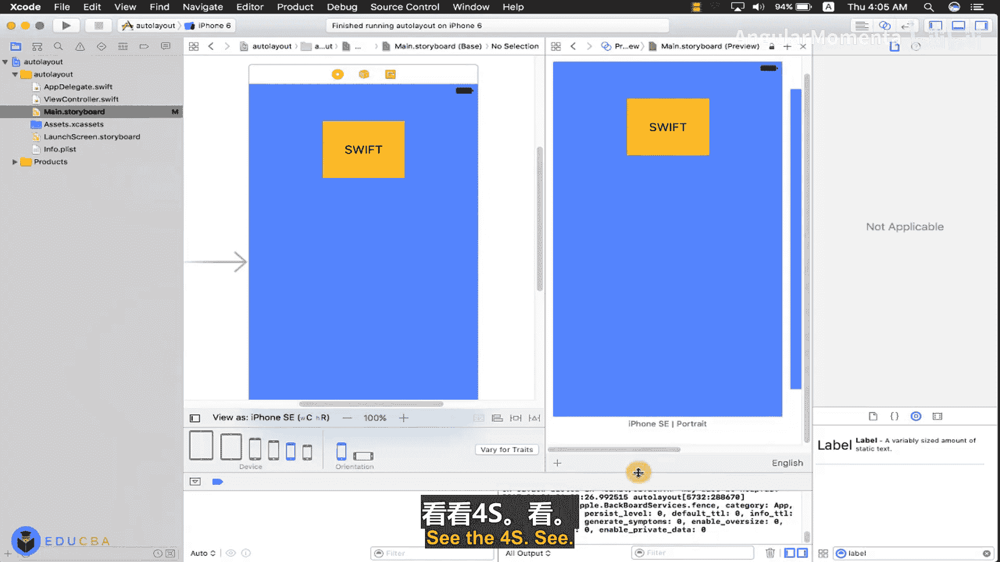

C。For us， you delete this。Delete this。She success。You see， it will be over and okay。

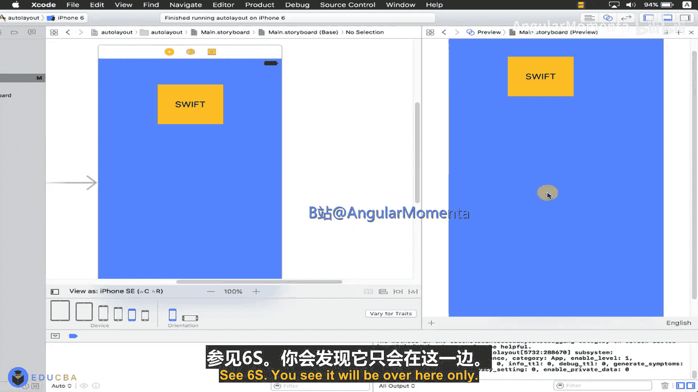

So this is the way you set auto layout out。

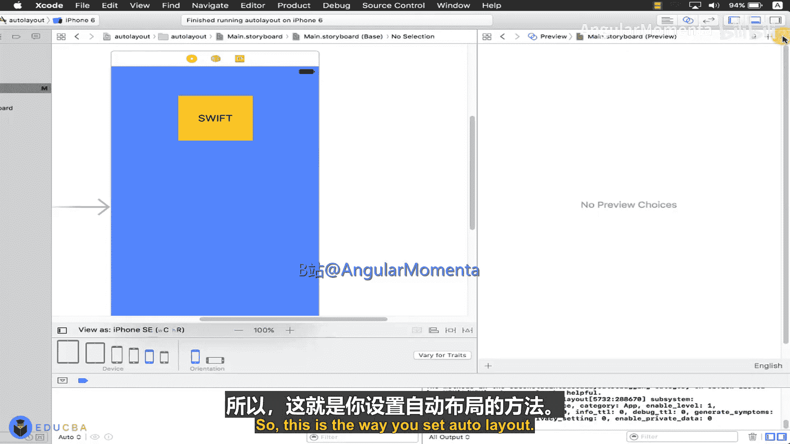

Now， let's suppose you have。More than one。AndLet's suppose you have a label。You have a text field。ok。

So I' just delete this。That是不是 I take a image you。Sa da made youvari。ok。This is my image view。😔。

We'll take a text field。And just copy。Bishte， best， best。ok。所以还来。Took the， I have taken one，2，3，4，5。

5 text field。😔，And1 is。I'll be taking one button。Okay。

 I'll change the background color of the button。I set the background color is orange， okay。

And change that text color to you know， black from the property section。

 you can just do everything Now you need to， you know。I want to add image also。

 so first let me go to the desktop。😔，咁 yeah如果。At fights。And just， let's see。 Okay， I have。Iages。Okay。

 I have this image of class of plan as I click classlash of plan， so I have searched downloaded。

Just to add my images， no。I just add this image。每一面具还在下的些面具。Okay。

 so here I' have just added my image。😔，Now， what I need to do is I need to set utterly out for all this thing。

 right？So。First would be， you know， I need to set my image view to my top layout， right。

Cildite vertical spacing to top layout。Leading space to container as I want to set it from the left also。

And。咁 that right？Just had this height and width。Static， okay。有。No。😔，I need to set my， you know。

What allowed for this text field so。I'll just what I do is I'll first you know。

 set vertical spacing between these two。😔，and。Either you can set leading space to container。Okay。

 or you can set。Traing space to this。Image you show that， you know， since my text field。

Wdt and your image view with it same。So。In this condition， so I can set it to you know。

 reading and training of this。But you know， for a good thing。

 I'll just set it to containers glding and container steering okay。So this I did。

And now I need to set within this， this is vertical。Again， Jing。And again， leading and trailing。😔。

Again， vertical。Again， leading。arange椎啲。Again， vertical。You're not leading。Andreling。

Same thing again， vertical。See auto out how easy it is if you understand and trading right。

 so youve got now you need to set for button also vertical again。And needing。

In trading space to container margin right。 So now the ga when， you know， these are also。You know。

 you need to set a constant gap so this is the cons you need to click on this。do过啊。😔。

Just said this I stand。Okay， again。The vertical spacing， this constant name is vertical spacing。

 right， so click on vertical spacing and just。Right then， so it will set， you know。

 when we after setting this。It's constant， It will be， you know， nice to see。你点。

But I'll set a little， you know， I set to 30。😔，Okay， there the。

Hight end width constant of this button， okay。So let's run and see so before running。😔。

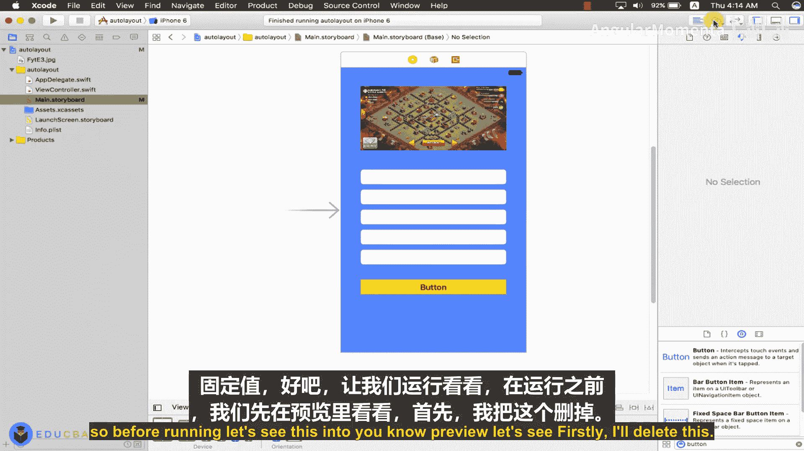

Let's see this into。Review。似。😔，Firstly， I'll delete this。 Ill show you from 4。😔。

Seeing my forehead it would look like this。Right。In my。6 plusy， it would look like this。Right。

So what we can do more in this。Let's run into 5 and C。😔，So， you know。

 one more thing is like now in this part I've taken leading space to container right。

 so if you want that you know all or this left part should be in one line， you can just do trading。

Trading to this leading sea。

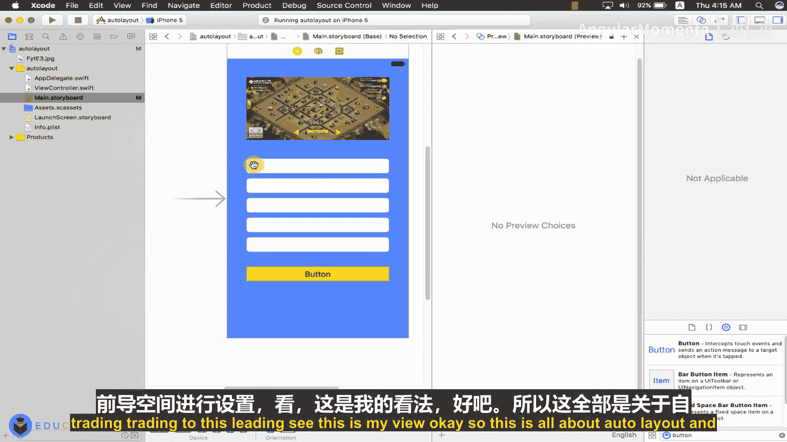

This is my view。ok。

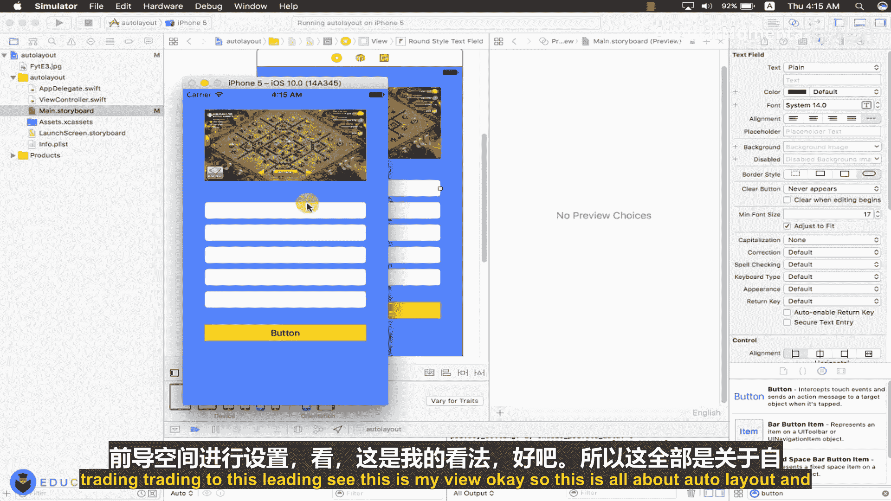

So this is all about auto layout and from here also you can do leading leading to everything。

And you get。I think now one more thing you can do is if you want to set the button to bottom。Since。

 you know， you have vertical spacing to top left。You have a， you know。

See vertical spacing to bottom down so what will happen every time you open a view。

And delete this vertical spacing between this firstly and clear。I'll go into the issue part。

 and I'll just。Clear con for selected view Now， what I want is I want the button shoot， you know。😔。

Fix to bottom， always。This。Bottom leading。决定。I and Ill set my weight。Okay。Now， see the changes。

YouSe the vertical also between this。 So in the preview part， if I go。😔，Again， it is not showing。😔。

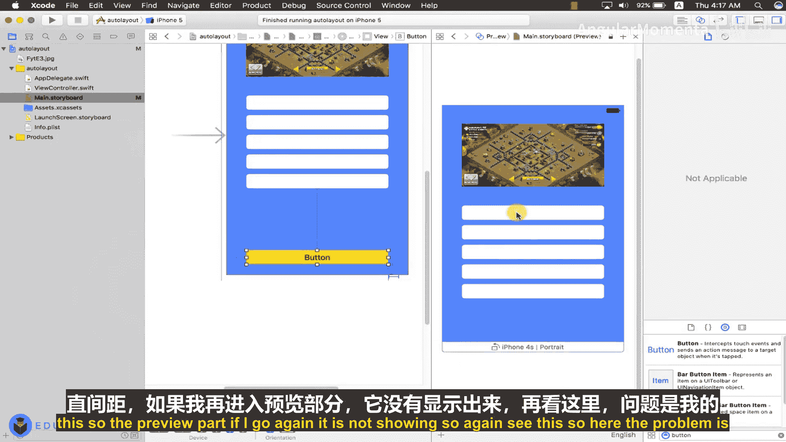

So。Again， see this。So here the problem is that my button。😔，Instead of， you know。

 have set it to bottom now is not coming， right。😔，So。I just need to shift the position of the button。

😔，A little awkward because I'm， you know。Doing this。

In a larger view like I am not doing this for forest， so that is the reason I am facing that problem。

 No， no issue I just go。😔，And this update constrain。 And from here。And add the device as for as。

 And you know， you can see the button over。😔，一发一 shift。😔，I it等 more。So you get the button over here。

😔，No， you can just change from your dynamically。😔，And from here， you can see。😔，ok。So。

When I update constant， it will come to the bottom。😔。

What is my basic motto of today's tutorial is like， you know。To tell you about what is leading a。

What is trailing， What is vertical constraint and what is like vertical to top spacing means like you need to set the。

You know， Ui to top of the view， I exit to to the top and vertical to bottom。😔。

Means you need to set it from the bottom right in my further tutorials I teach you。

How do you know according to this screen size you can change let's suppose I am running into simulator 4 so when I run on4 my button size should my height should decrease to 20 and when I run to 5 my height should increase to 40。

In my next tutorial， I'll teach you all that thing。

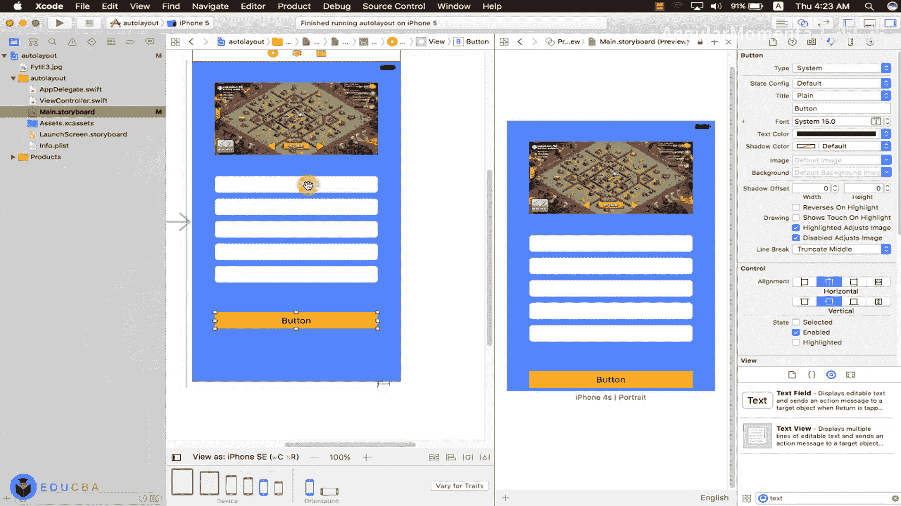

Hello， friends。 A very warm。 Good afternoon to all of you today。

 I'm going to give you a presentation on auto layout Earl I give you a presentation on simple auto layout。

 I told you what is auto layout。 and how is it useful for developers in order to set the。View size。

 according to the iPhones。 So today， I'll be teaching you how to dynamicries。

Said the constraints of the objects。 right， So let's start with O health。Next code。

 I'll be creating a new project。Singly re application。靓仔。你阿咩。I James， okay， so。

The language would be shift， devices， iPhone， and next。So here， I've created an hotel layout。组职。

This is my application lifecycle file， which will handle it。And this is my view controller。

It has a few control also here okay so let's start with see my today's tutorial is like auto layout but I'll be setting constraints dynamically right dynamically I mean to say according to the screen size lets suppose I have chose iPhone 5。

And I I am setting a button on view controller Okay， here I' am setting a button。

 so I need to you know， change the height of that button according to the iPhone size right let's suppose five so the height of iPhone。

5 is different，6 is different，6 S is different，6 S plus is different，7 is different。

 right so before starting。To set auto loud， let first， you know， get all the screen heights。

So that we get a very easy way to set the constant by simply using the effects condition。

 we can just write that if screen size or screened with is equal equal to this and and screen size is equal equal to this so I need to set the button height to this much or else if the screen size is this the button size should be different right so let start with that。

傻啊。I'll be just writing few codes as my viewed load is the method that is first call。

 so let's first take all the screen sizes let let screen size。你걸 do。You ice cream。Okay。

 you ice cream dot mean。Main screen dot bounds， okay。So here I'll get。 So first， I'll。

Pri this you cream。And like screen size， equal equis， comma， screen size， okay。And you。He的。

With all I this like。Screen with。ok， screen with I late。The screen size。Has a property in it， okay。

So you a print。Animous lawyer Miss Billy， okay。You L screen with I see。Screen weight equal， equal to。

嗯 ok。你。电系。你该 do。卷世。not系。所。唔喺。ok。你算系佢嘅嘢 and put得 great point。嗯。Let's start with iPhone 5 height。嗯喂。

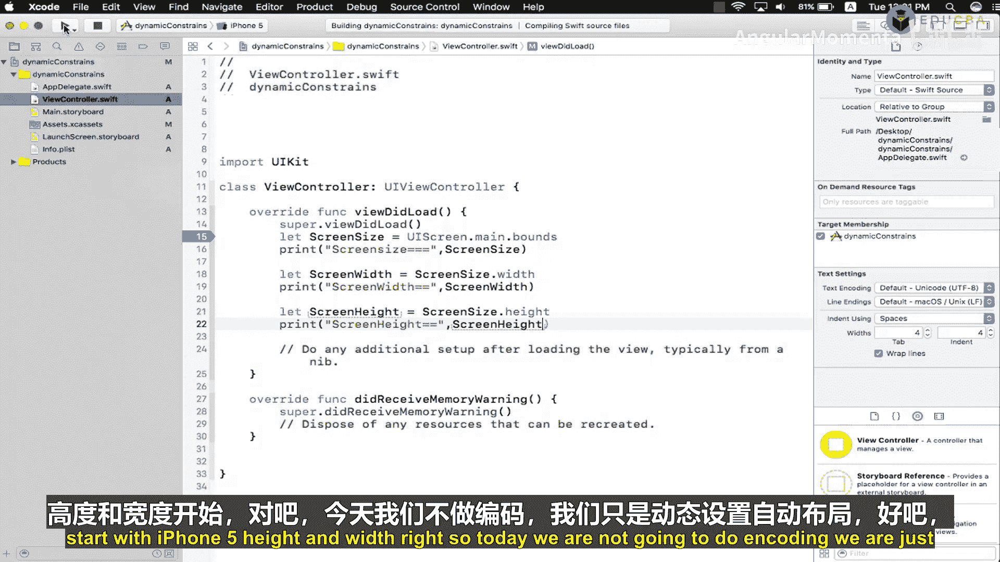

So today， we are not going to do encoding。 here just， you know， going to set auto layout dynamically。

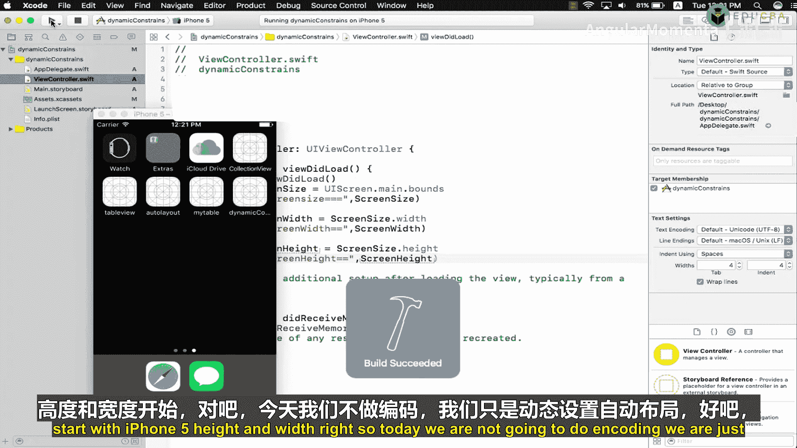

做嘢。We got the great point。 You will delete this。😔，The screen size。 see， we got 320。 this is x， y。

Wed and height。So when I print the width， I got 3 to 80， right。In。When I print the height， I got 568。

Let's do one thing。There， let's comment。喜欢肺。开 s。系机。原系你。Screen。你。Equals2 how much 3，20。0。And。Screen。

hi it will do yeah。F 68。0， okay。So you got the height for five and five as both has the same height right now it will take for six。

Again， it will come into my mut load method and I can help get the height So， you know。

 you can take the screen height by this way， you just need to create a stance of U screen mean not bound to that。

 you know， it will go into the。你啲 lo。前日见。你 just see。See， I got 375 into 66，7，375 would be my bid。

And 67 would be my height。So for iPhone 6 and 6 S。Everything would be same。喂。So again。

 I just coming here。系。IPhone 6。And6 S。唔你。Screen width equal to 3，75。还屋。Thanks。Screen。

Height equal to 667。0 Okay， so I got the screen height for6 S。6，6， S，5，5 S。 Okay， now it is。6 plus。

6 plus。7 S plus。Has the same height of。系咯。It's， I think， around 7，3，6。Okay， so let's see。

It goes into this method。And see， I got the height for6 plus， right， it is。4，14。ok。So， this is for。

6 plus。6 plus and 6 S plus height would be the same。So I just great啊。喜欢。6 plus。嗯。IPhone 6 s plus。

just讲咩？Screen。With。Equals2。1，1，4。0。Sreeen。height equal to。seven， thirty six。Po0， okay。

 so I got the height of 5，5 S，6，6 S，6 plus6 S plus， okay。Now， I want the height for iPhone 7。

As this go here。你先你先听。So， you know， this is a very easy process。

To get the screen height and just comment it and here we'll put some conditions will you know set outlet of the constraintss。

And we just。Re the good。he we got the head of iPhonephone。This is X， Y width height， so。阿水。

iphone  seven。Screen with equal to。3，7，5。0。Screen height， equal to。667。0。ok。And iPhone 7 S。

7 S height is the same。Of。So here you can just write。7 s。Yes okay。So if you want to confirm。

 you can just go away。Change the device in the simulator section and just run and see the code。

Aut layout is very beautiful feature introduced by Apple。

There is no need to create X I for different， different， you know。啊 iphone 七。

There is no need to create two storyboard， you know， in one storyboard， everything is possible。😔。

I just go out。We got 414，76， which is the height of same， okay。

So this was all about the screen height right I have just taken all the screen height。Now。

 let's go to the storyboard and do our hotel work。

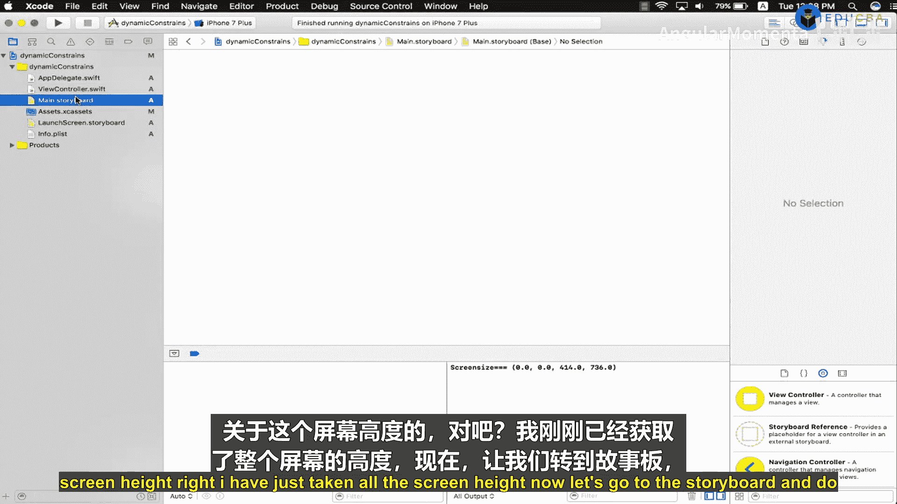