# 【EDUCBA】运用Swift核心特性进行中级iOS开发 ｜ Apply Intermediate iOS Development with Swift p09 03_03_01_ib 动作函数 -BV1RmFUzyEXJ_p9-

This is说。Delete。This is for。Fch， and this action is wrong。Save okay， yeah are in both code data。ok。

You made now here and go。First， I'll create， you know。Now delegate object。本net。Im delegate， equal to。

Your application dot shared dot。Your delegate。你。I really good， okay。Okay。

 now here I also take context。ok。And in my view Lord。I can text equal to。Now delegate。Nord。

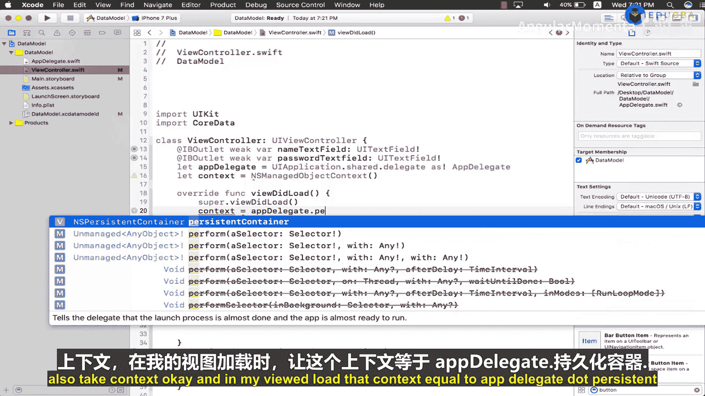

Persistent container。Not you context， okay。你谢续 do it o。It is asking， it was deprecated。So。No。

 is should with this。And right here。Yeah， Ill just directly write。你。Conunts equal to have delegate。

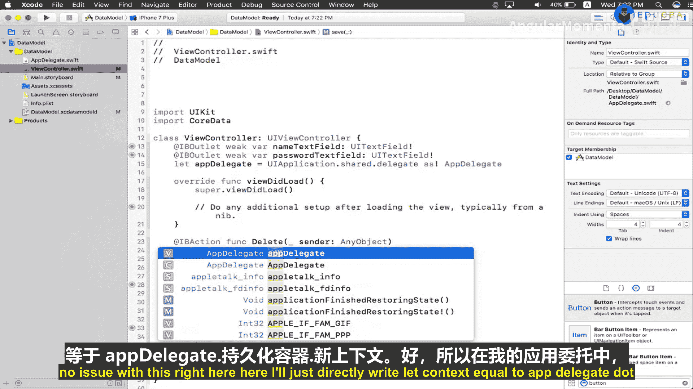

Notd。Pistion container dot view context， Okay， so in my everyday gate we have this context right。

 this will help me to you know， interact with the precisionence store。

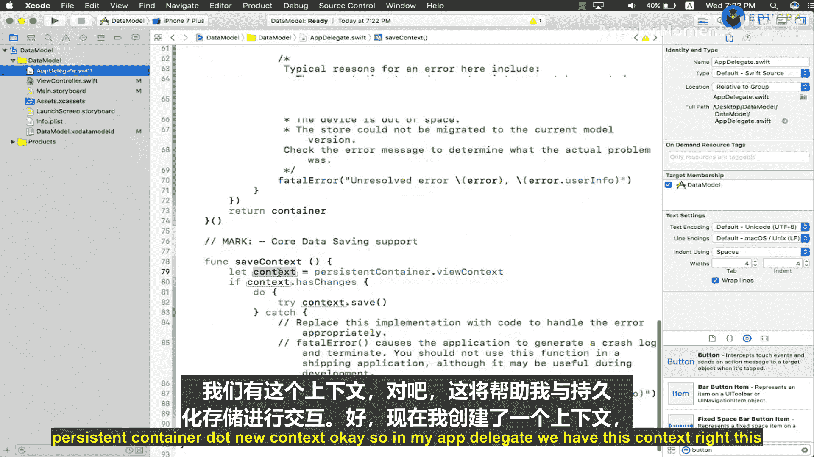

ok。So here American text and now here I need to make an you know entity so I can make late。

New userer。Name entity， A N entityD description。Not insert， See insert new object。Your entity name。

So your entity name would be。Use are right here you have created。ok。实的些人 did啲咧。

You user in is a context。in迪。Or I created it okay。So， I hope like。我你惊片啊。😔，lo嘅电影。Yes。It ask， okay。

 made no worries。 Okay， there will be there。 Okay， so new user now in this entry， you need to。

 you know， add data。 So new user。Not set value。Sa， where would be。What is your text field name？

Name text field， dot text。Worky， what is the key name。First key name is name。 Okay。

 name and password。No right name。Second value of text new user。Not set value。As for do text。筷子。ok。

And。你个。I delegate do。Save context， okay。After saving， I want my text will should go blank。So。

 my text name name。Exha dot text。Equal do Ill make it blank。Ask for text dot tax。你过嚟多唔靓。Okay。

 so you have created my save function， okay。

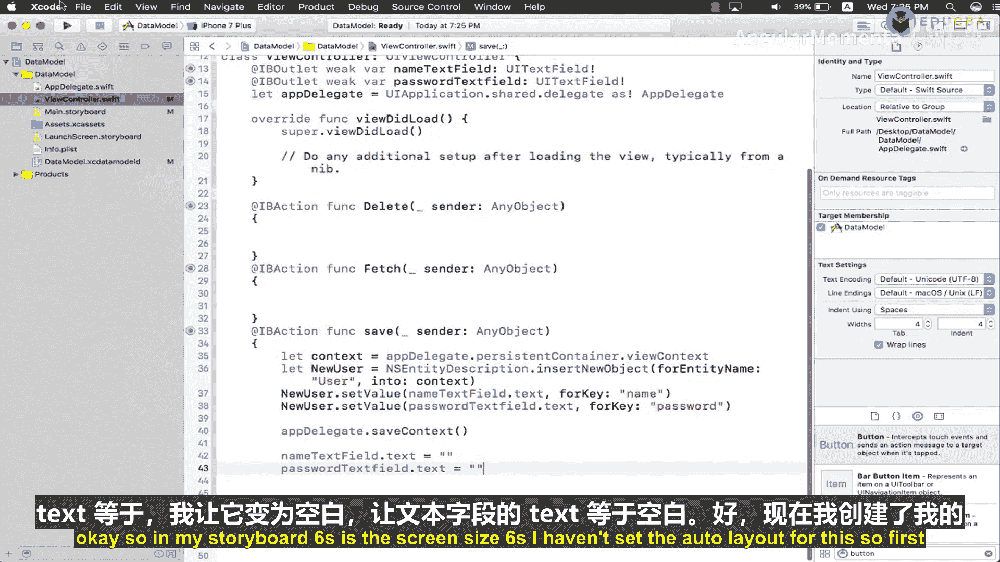

So。In my storyboard。6 is the screen size。6 s。Avan said the o for this。So first。

 let me set the auto layout。Yes likeで。ok。So as I said， vertical spacing。李ing决定。唔见。Add question。

Sa set it high dynamically heightened width。Okay， to know this。Spspec control。

Vertical leading trading now equal heightened equal with it with this。冇机。听儿歌。i见 this m天。

Whatti your leading。Ting co be equal height at constant。Let's try and see the you first。

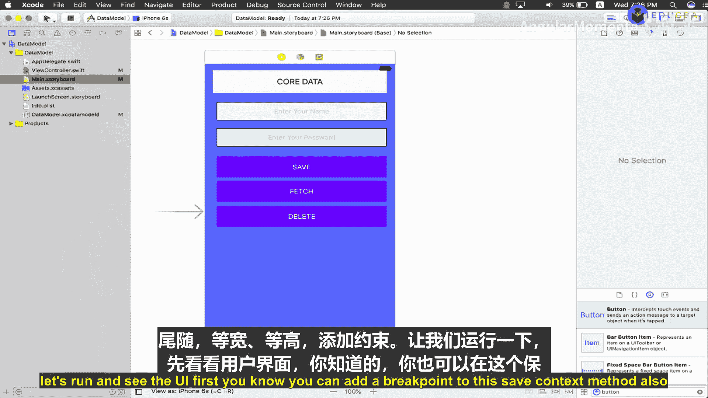

You know， you can add a break point to this save context method also you can see this in have delegate。

 whether it's going or not from here， I have called this method right。

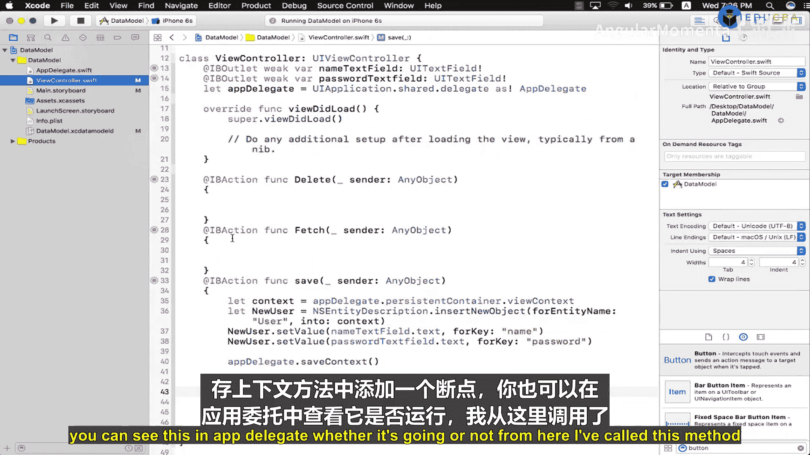

切你我过嚟啦。

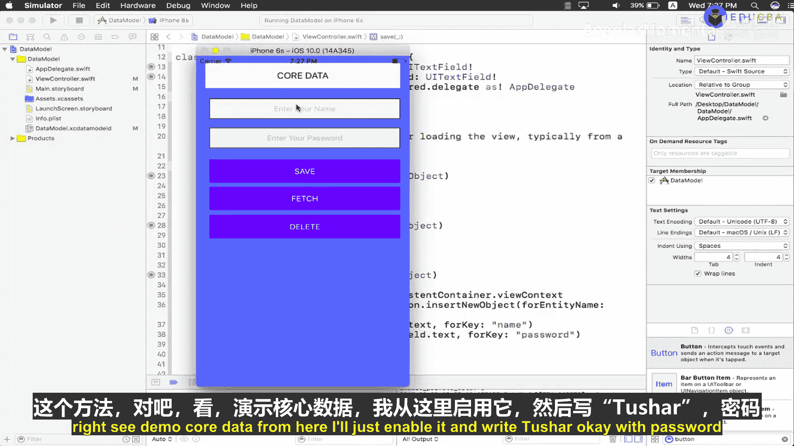

I mean， I just enabled it。

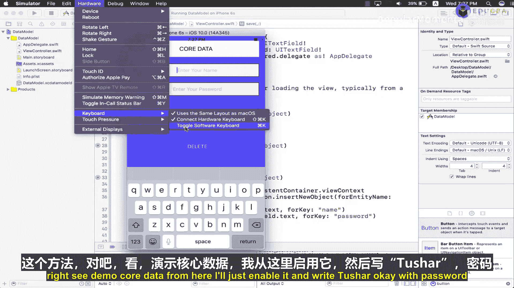

And right。De okay。你 password swear。okay， so when I press the save button。

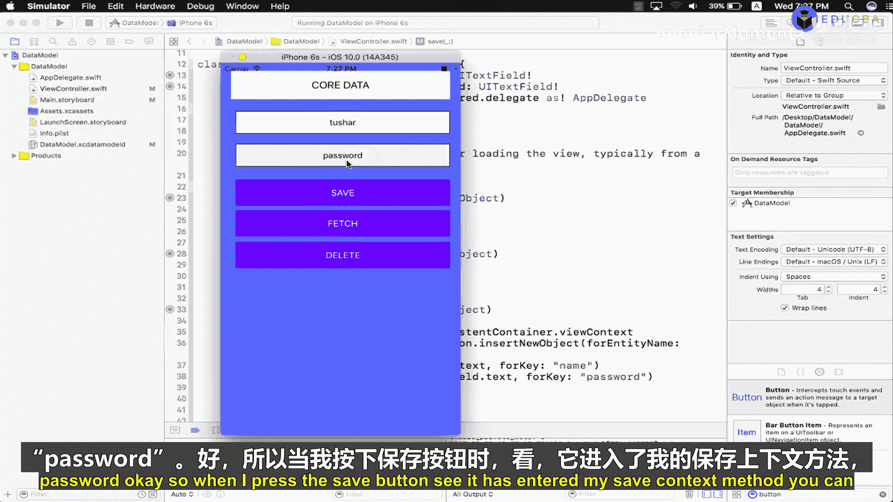

See it has entered my save context method can see this save method as called now it is going to context save。

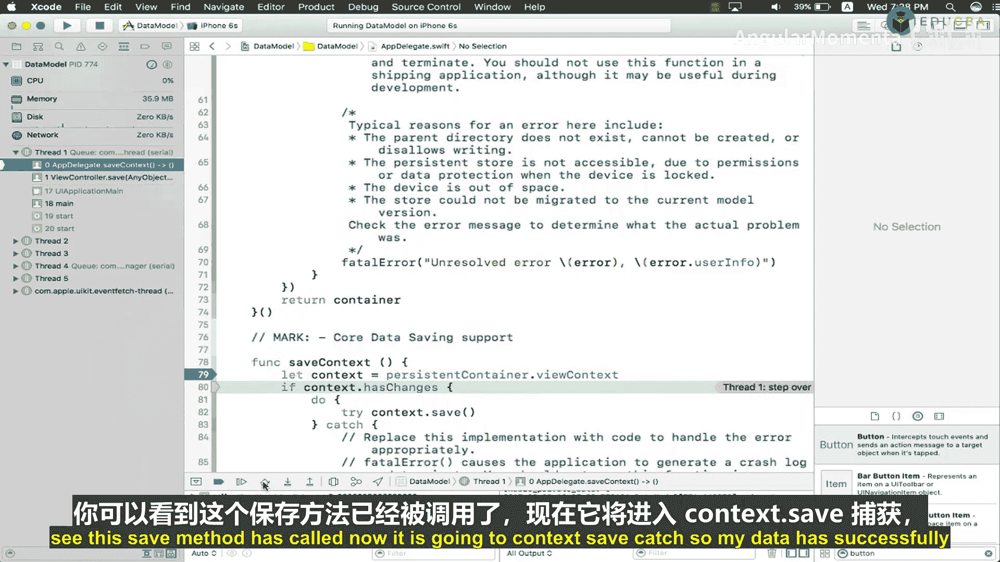

Catch， so my data is successfully saved。

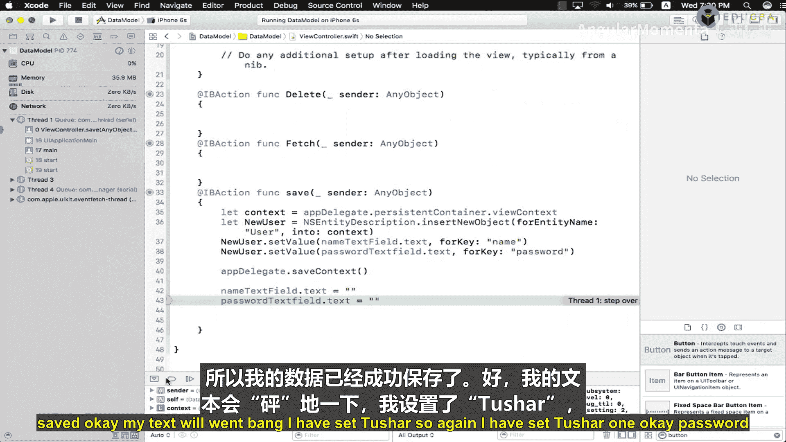

Okay， my text will went bank Ive。Said the sharp。So again， I said to share。还手机。把说的话。Save， it got safe。

嚟杯水给你咯。Save data。所日。

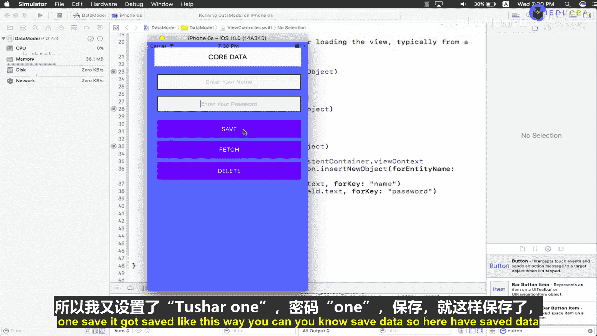

Have saved data successfully。 Okay， so now you need to work on the fetch request。 So here again。

 I'll go。

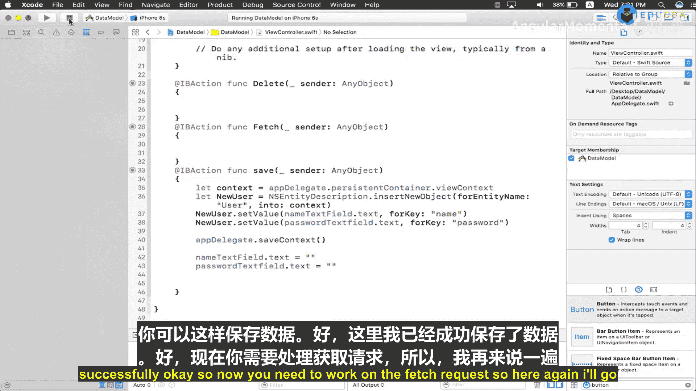

Yeah， let's take the smallest view。 Let's suppose 5， because we have。5。冇嘅。V have 5。

 let's take the background color also to blue。

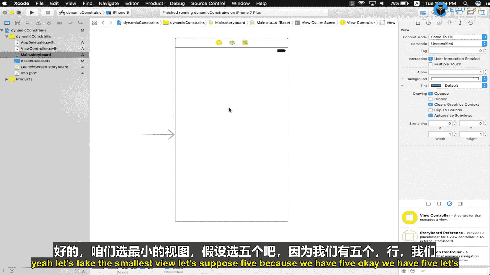

ok。Now， let's take some label。Now， listen carefully and watch very carefully if you have pen。

 you can note down things。ok。First， let me take， you know， I'll take three labels。

I'll take four levels， okay。And set the background color of the label。Let's suppose white， okay。

 let's change the name also， I'll make the alignment to center。😔，And just enter。 Okay。

 so here I have a label。Okay， so this is my level one and。From here， as show the size inspector。

My level height is you know， 48。So I'll just change it to 50 and just round it off。Ok。

This is my label height to 50。Ill just copy this label。Spf。嗯。is。O cting file labels。O， so。

There it is， And there's enough fix。Everybody in same line。Fine， okay。

 so here I have set the label now I need to set utterly out。So basic for hotel layouts would be。

First， laptop。Verticles facing to top layout to top of the container。Then from here。

 leading space to container margin， okay。Any here。Zing。3。And this is a foright。

See the contrain is satisfied right you want to see in DL。And make this background a little light。

 right。よしていいですオッケー。So I set vertical spacing to top layout leading space to container margin。

 trailing space to container margin has set the height。I'll set the width also of the layer。

 I want the weight fix like to this one， okay。So now what I'll do is I'll just go here。

 he'll set vertical spacing between two okay。And Ill not said leading to， you know， container。

 I said， leading to。This button itself and I also said trailing to this button itself and one more important thing here。

And set the height。To equal height of this button。 Okay， and I set the width also。

Equal I I am sorry I have said equal with L said equal height also okay。

So these two label I have created and the constraints are also satisfied Ill just change the name is my label to。

It my label 3， okay。My neighbor4。This is my label5， okay。

 so for first to have set what I have did I have set first I have set leading space to container margin then。

Traing to container margin then vertical to top layer okay so for this why I have not set leading to container margin trading to container margin。

 the reason is that I want this label should come just below of I want label 2 to come just below of level 1。

The left side of the label2 should be just below the left side of level1。

 so that is the reason I have set leading。To leading of label 2 to level 1 and from here I am setting leading a trailing of label 2 to label 1 Okay。

 the same thing Ill do here what I'll do is Ill just first。L set， vertical spec。Leading， trailing。

 equal height， equal width， okay。At constiency con are satisfied。

 so I have said vertical spacing between label 3 and label 2， right？

Then what I did said the trailing of level 3。To never do。

And leading of level 3 to level 2 so that you know， when label 2 and label are in alignment。

So label3 and label 2 also will be an alignment。 See， it's a general logic when I'm setting label to。

To constrain to level 1 like am setting labels tools constrain to level 1。Like I am setting see。

 I am setting the height of I said。I said that level2 height should be equal to level 1。So whenever。

 so I said equal with。An equal height I have said， so whenever I change anything to label 1。

 the label 2 would be affected since label 2 is connected with label 1。

Now since label 3 is also connected with label 2， so whatever changes Ill do to label 1 it will affect to label to a label 3。

 same thing Ill do over here I'll set equal height and equal width to label 3 of label4 because whenever I need to do changes I will do changes to only label 1 so that you know all changes will be affected over here so what this this will give me a benefit of you know it will short my coding part。

The logic is same for everything， but you know， it will。Reduce the coding。

And since I want that my all label should be of same height and same weight。So， I've just done that。

So logically， you know， it sounds good also。So， that is the reason。So， Ive said。Now， same thing to。

 you know， label 4。E set vertical of level 4 to level 3 l set level 4 is leading to level 3 l set level。

F trailing to level 3。Okay， I'll set equal width， equal height。I just add constanttrain， Okay。

 so this is done。声等于6于多少少？Set vertical of level 5，2 level 4。立哩追哩。Equal weight， Eal height。

At constant， okay。So now what I have to do is I just have to create a outlet of level 1。

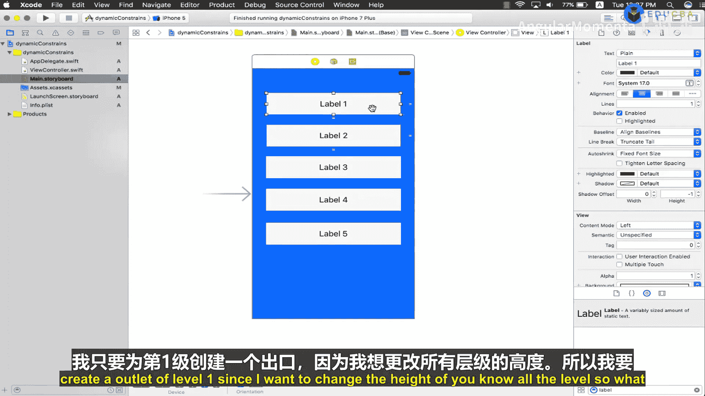

Since I want to change the height of， you know， all the label。

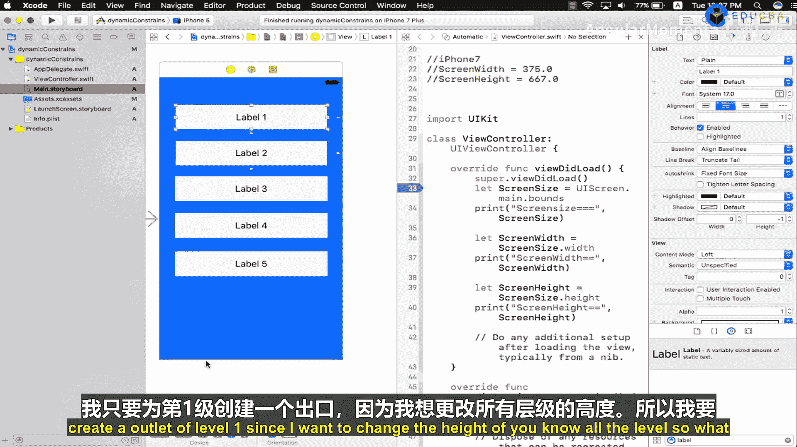

So what I'll do， I'll just go here。Andez。So the height。Yeah， Ill go in my。Great outlet。Okay。那是。And这。

Name this outlet name as common height。佢我 eleven ok。See， my height is changed。我 this also。诶，你。

We've created the heightened width。ok。Since。See now I want to set out the button height for iPhone 5 right so see the height of iPhone 5 is 320。

ok。Dsten carefully， the height is 3 to0。Okay， so when。

The screen will come its width would be 3 to 20 right its width would be 3 to 20 and its height would be 568 right so now you see when iPhone 5 will open。

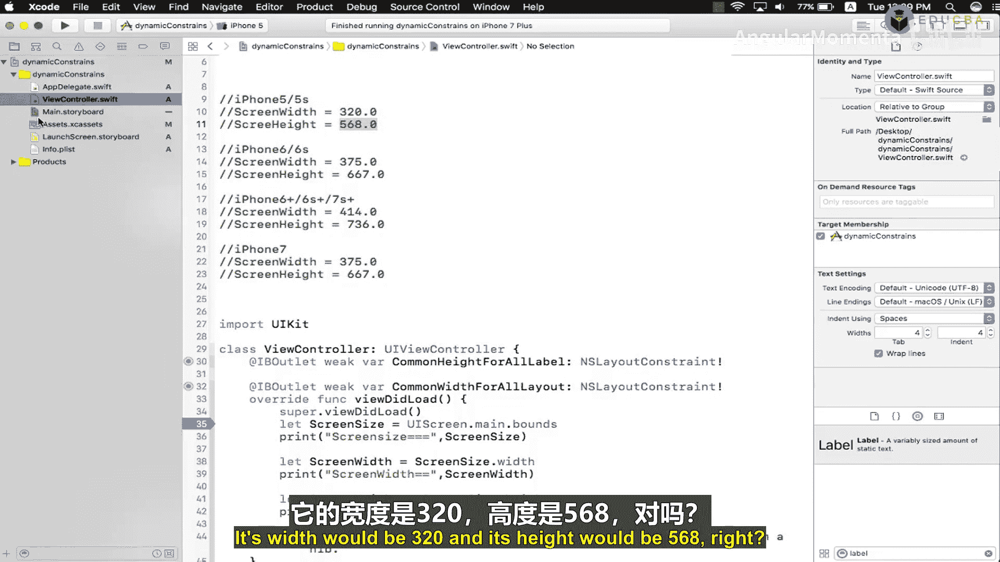

1，2，3，4，5。 So it's labeled not button。 Okay，5。 and since you have taken。

The height of each level is 50。Okay， so5 into50 is how much 250。

 so what you do is you just decrease the height。5，68 minus。2，50， right， it would be around。

The remaining height would be 318， right？Now you have also said verticaltiular spacing between。

 you know。

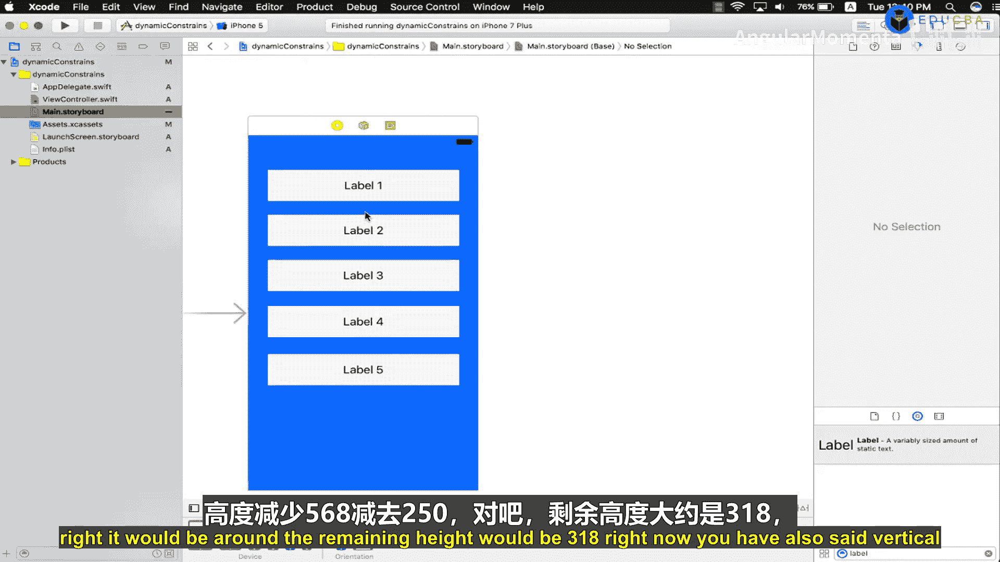

Vartics spacing between level 1 and level 2。So you need to keep that vertical spacing also same for all the label。

M is leading。This is vertical to talk， this is。This is leading。 This is trailing。 This is height。

Zueling。😔，Let stop， okay， now see。你是的。If I make it to 15。It height will change right。

 so I'll just do I'll make it to 20， okay。Everybody's vertical spacing will keep constant， so。

Here you go。 Change this to。20。I again I go here。T节 change to 20。Last， it's 27 and。Okay。

 so since I have five button， so 5 into 5 50 height is 50， 50 into 5 is 250 now。

This height is 250 right， but I have also added vertical constant 2020，2022，1，2，3，4， right1。Do。3，4。

So 20 to 4 is 80， you can minus that 80 also from 318。So， you'll get around。2，38 height。

 So it's still remaining， right， So what you can do is now you can change the bottom height from 50。

2， let's suppose you make it 60 or 65。 Okay， so now let's write a condition over a。

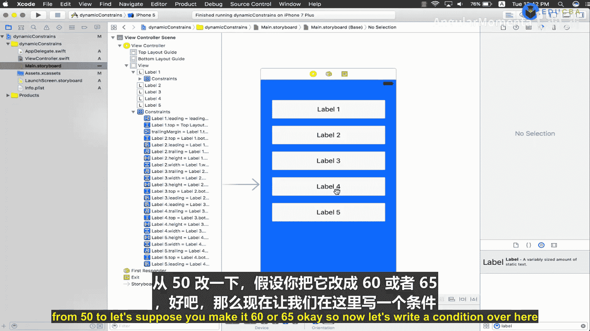

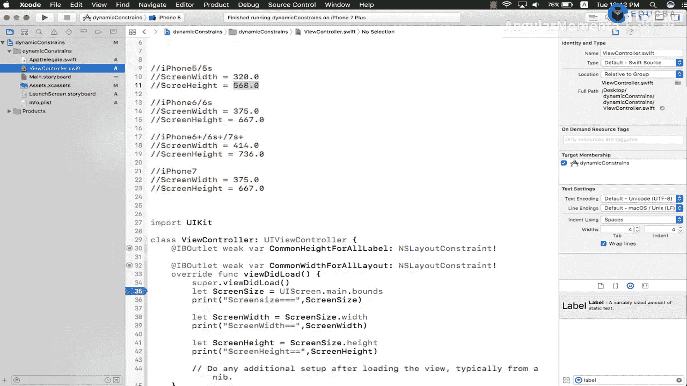

我。I remember。Let's create a function。Function name would be hard to layout out。

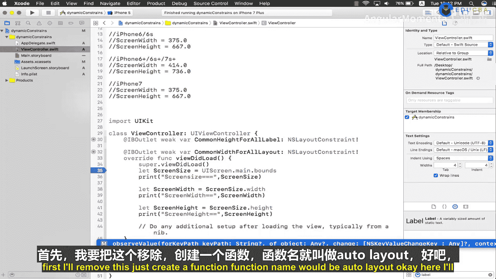

ok。Yeah， Ill just you know。Like this。你我啊。ok。Youre a light condition， if。Screen with what we have。

Equal equal  to for 5 is how much。For5 is 32 t into 5，68， right。3 twenty point0。And。Screen height。

你会 do。5，68。放死佬。想醒。咩。Common button height for all label dot constant。The height Ill take 60。Okay。

 I'm not changing the width， just showing you one condition then will set for all， okay。So okay。

 not 60， I'll change it to 70。😔，Just run and see。 and you will see that difference。

So this is the beautiful feature of iPhone now there won't be any changes in the button。

Ca I have not called this method in my w load。But let it run， let's see what layout also。

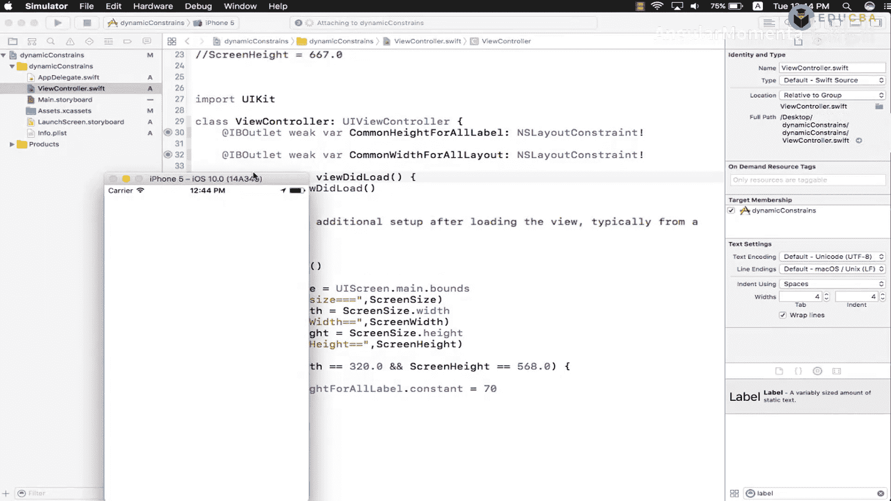

是。It does咁。

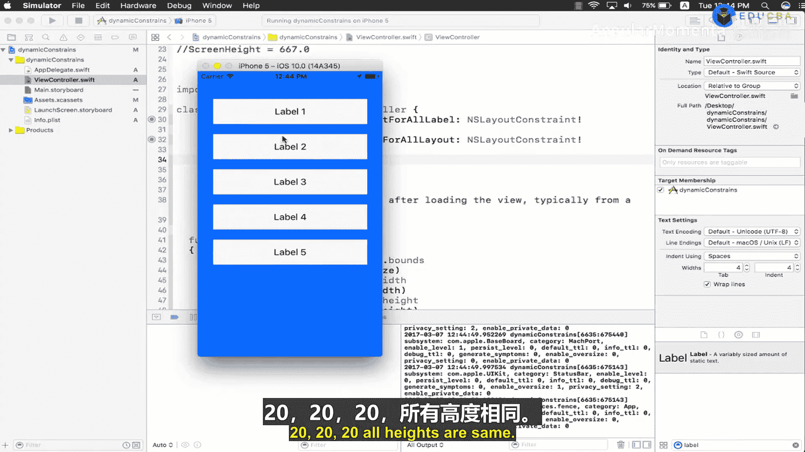

20，20，20， all heights are same。 Everything is same， okay。Now， hear what I do。

 Here I'll call this method。

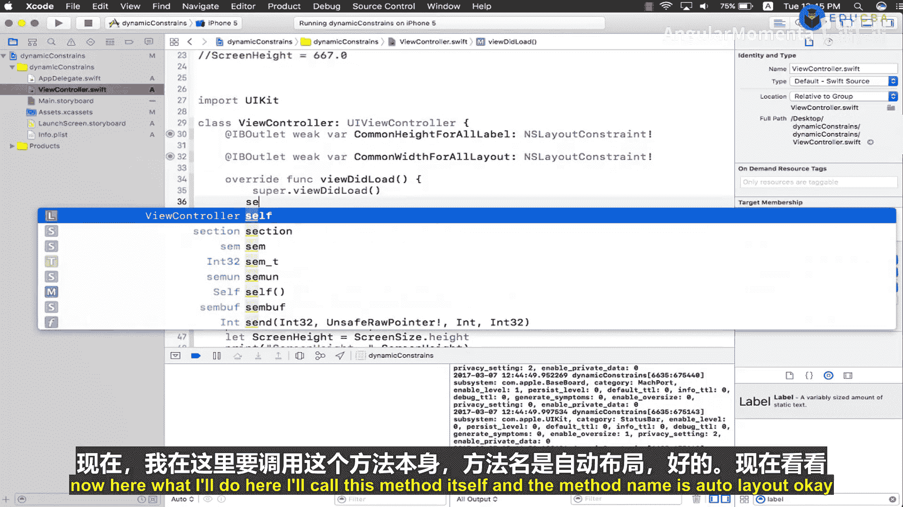

Itself， and the method name is Otoo， okay。Nowll see the changes in button。Similarly。

 you can take an image with see the heightus changed。Yeah if快 you then。

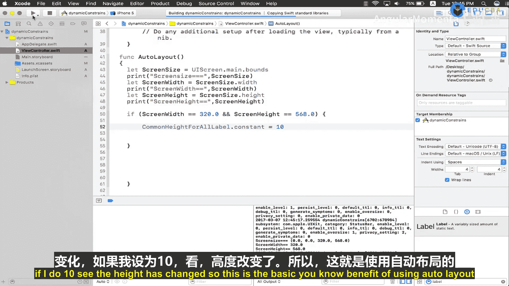

屎。😊，The height has changed。

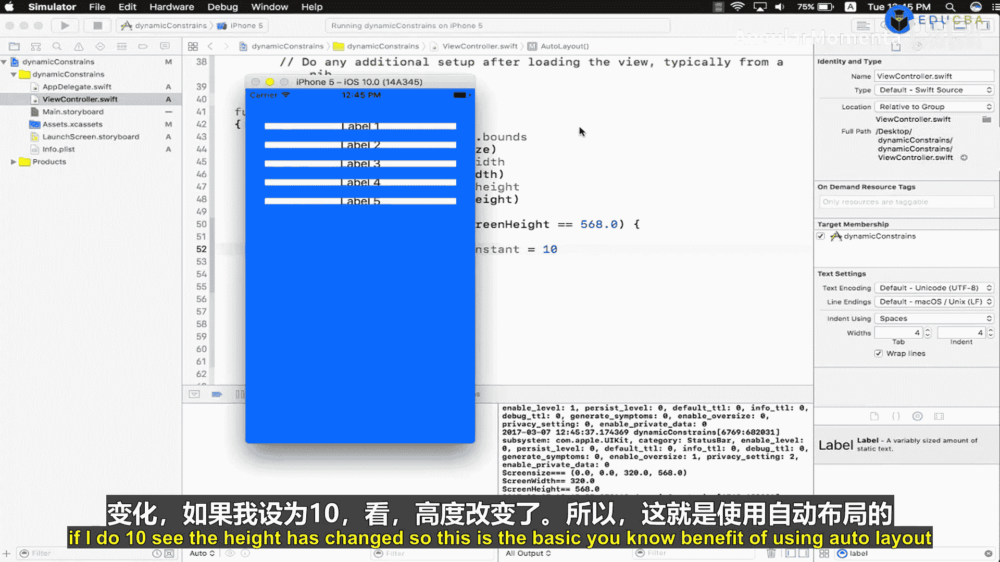

So this is the basic， you know。Benefit of using auto layout like you can just change with one constant。

Now， see， the benefit of taking equal height and equal width for all was the act。

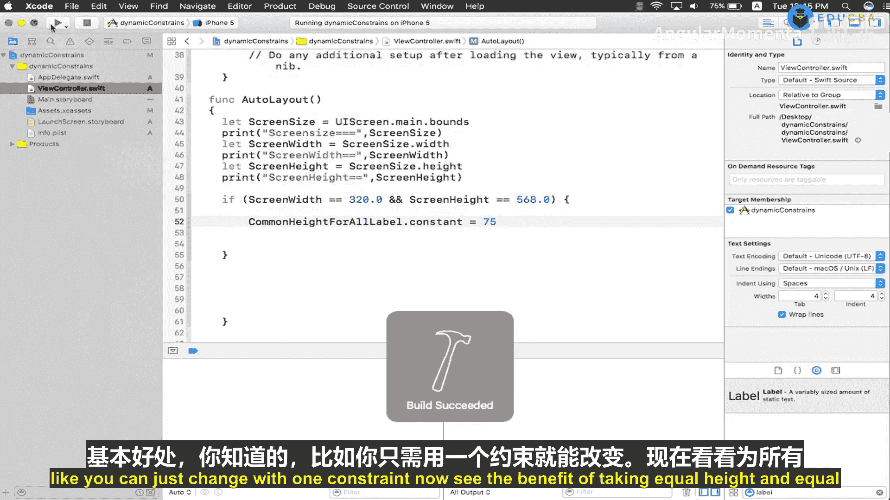

Now I need to， you know， create outlet of only this level， right？This level， right。

So if I needed different different height for all the labels then I need to create constant。

 but since I am just giving you a demo like how to use auto layout and it it constant so I just you know took one。

height for all the button and you know， I set equal height equal width for all and by this way。

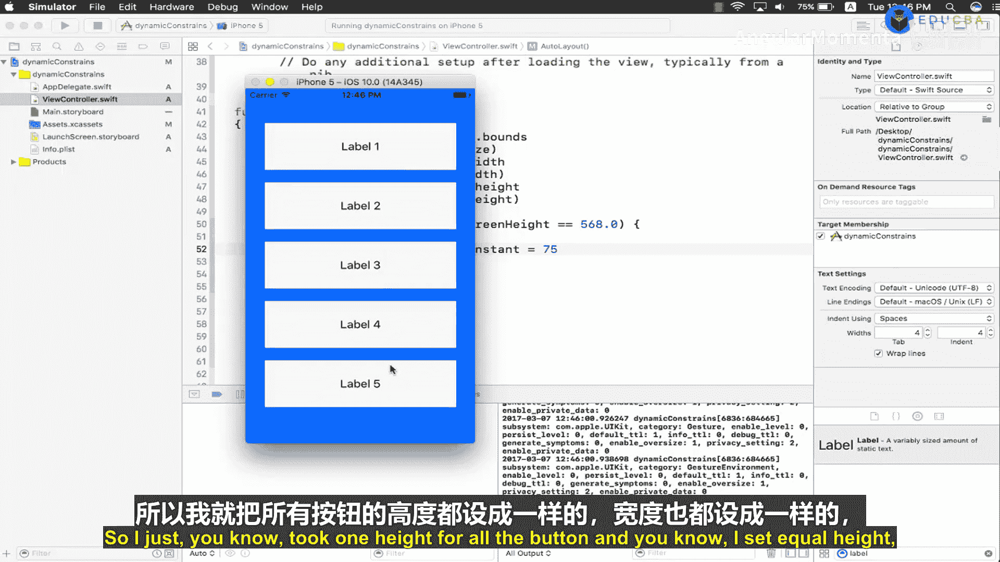

Whether you can also do one thing， You can also， you not change。You can。

Add image view you can add a button， you can， you know， do creative things。

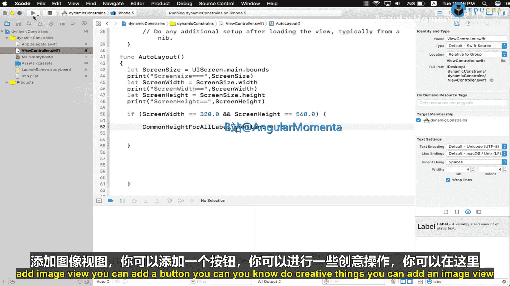

You can add a image view over here。You can add button， you can， you know， you can add label。

 text field， whatever you can do。Like whatever creative things is coming to your mind， just do that。

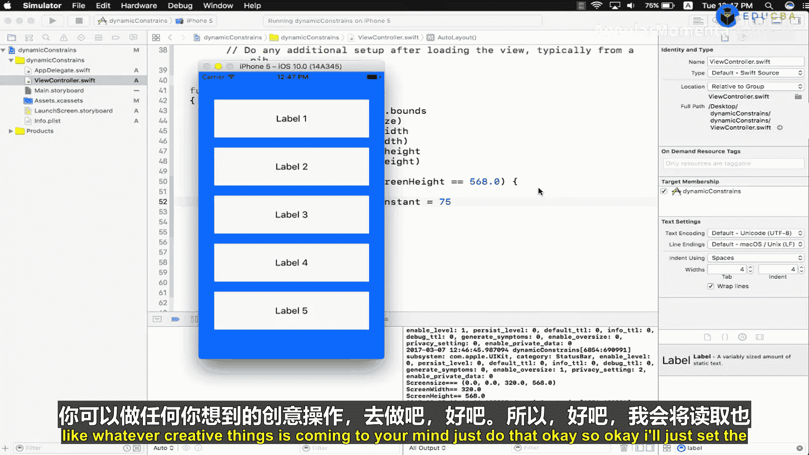

ok， so。Okay， I'll just said the。We are common red。N Cons。It's 3 to 20 right， I'll just change it 200。

Let's see what it。

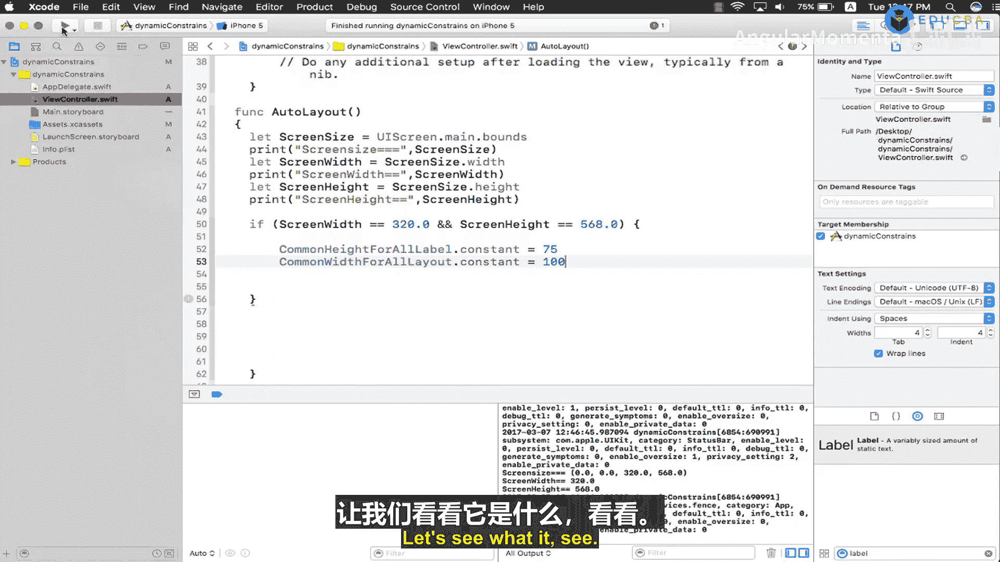

he。It has decreased。Right， so。

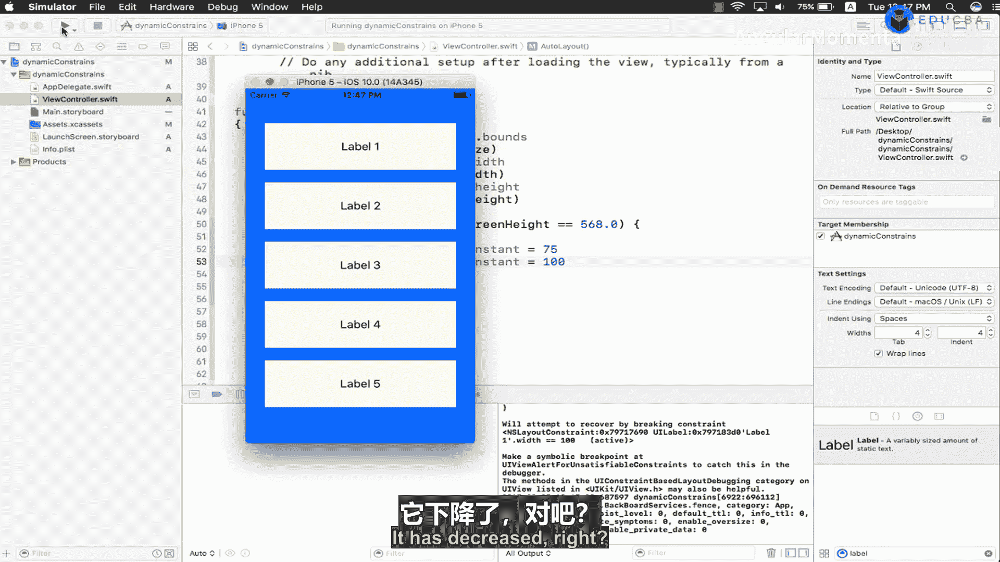

I'll now write condition for all。This is for committee。IPhone 5，5 S。我听 x。f。

Let's copy this whole thing。Okay， the screen size now I would like to take。3，7，5，6，6，7。睇上啲肺。

6 six seven six， six， seven point。你咯。正只睇度。😔，5y。Okay， now I will add you do3。嘢点啦。

You can see their difference。And iphone。食食食。嗯s。fies o。I I'll take this same condition。o sorry。

s coffee，诶。You，6 success S now or this。IPhone 6 plus 6 S plus 7 S plus。挂飞。Comment。你喺我。Weade is 4，14。

7，36， right？有。4，14。7，36。一力点。喂。你个 fit你。Yes。靓女。系。三听。你问断。Decided for 6 plus 6 S plus 7 s。

 the last is iPhone 7。It is 3，75，6，6，7。你 sound啲肺。哦。See the iPhone 7 height is same of， you know。

Iphone 6。So instead of this condition。What I is， I will just write else。

Button height if it will never go into this condition because。You know， until unless yes。Okay。

 I have called this method dear。So when it will go to 5，5s， my level high。

Will be 75 and when it will enter 6，6 7， it would be 30 and accordingly okay。有呢。First and，2，6。

Come to 6， it it should show the height of 30， right？I advise you to always， you know。

 set the width to constant。Because know the height， you can change。

 but if you set the width to constant， it would be easy to set auto for you I'm running six。四。

Change the I to 30。Okay6， I， I'll just change it。To six S answer。Because the screen sizes are same。

 the label side will always be high with a T。So see the changes。

It will take time because I'm just changing the s simulators， you know。

 from6 to 7 then from  five to 6， so that is the reason it will take a little time。

 So just have patience and so by this way， you can just see。

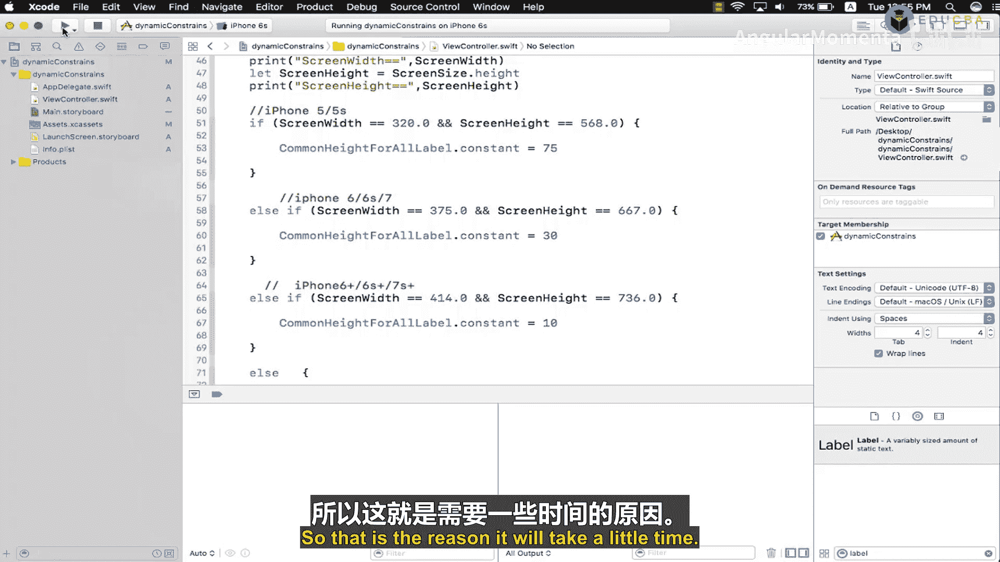

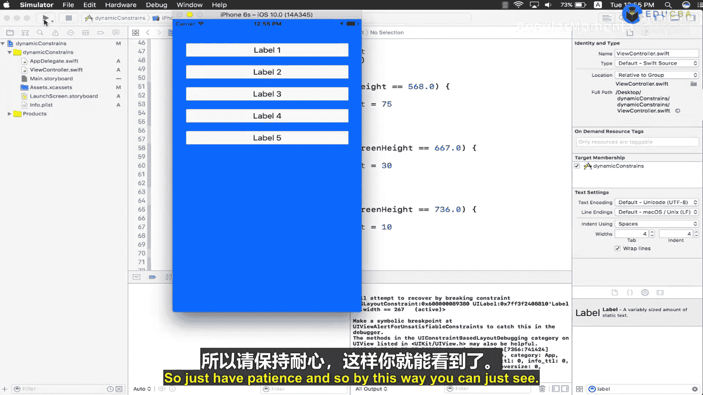

Now I'll just change the size to 7。The heart will come the same。Really， you can just。

Tried 5 on6 plus and 6 S plus。 So I hope this tutorial was fruitful。

Because here we are setting auto layout， but we are setting dynamically。So you know。

 when you are working on applications and when you want to change the see 30， okay。

 so if I change here to next was 100。And you' are working on application on your or you're working on any like custom application。

 so you can just use these features of hotel layout you know。

 to make a beautiful UI and to shorten your code also。

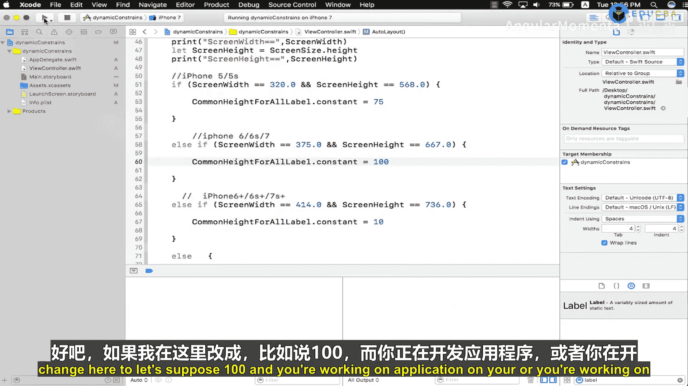

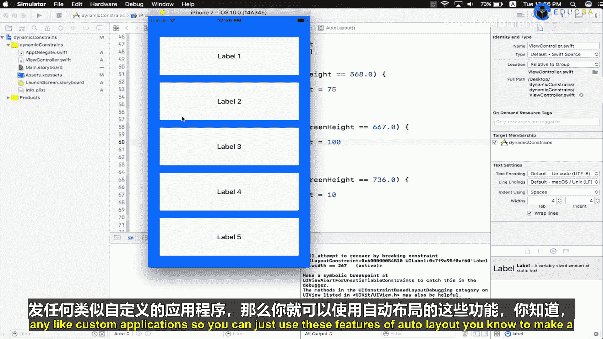

So， thank you so much。For listening this tutorial， thank you so much for watching this tutorial。

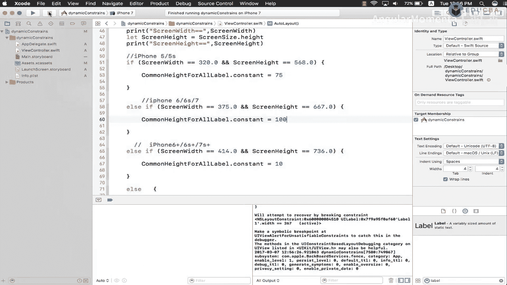