# 【EDUCBA】运用Swift核心特性进行中级iOS开发 ｜ Apply Intermediate iOS Development with Swift p10 04_01_01_表格视图单元格中的集合视图简介 -BV1RmFUzyEXJ_p10-

Hello friends， very warm。 Good morning to you all Today I'm going to give you a presentation on combination of collection view on table view right I'll be showing how to display a collection view inside a table Vi as in my previous tutorial I have already taught you like how to work with table view and collection view so today I' am going to give you a combination of both so that you know you are familiar with both the things。

Let's start。Smack for。最近要裤式。Let just give this name as combination。O。Can Ill just create。

Language of chosen。

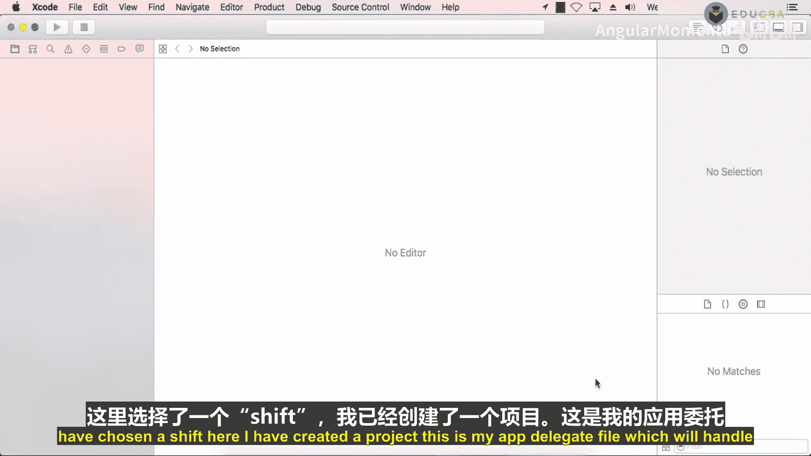

原来 did project。This is my delegate file， which would handle my application life cycle。

 and this is my view controller。So let's not his time。 And， you know， start。

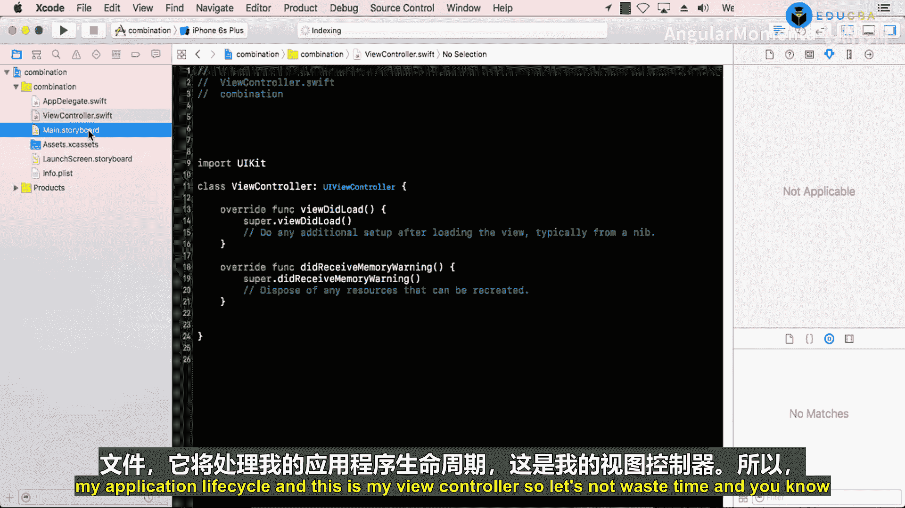

I just take it as 5。And as we are working with table view today。 So from the object library。

 I'll just take a table view。Mor Joway。你跟咗咧。I'll just adjust the size of table view。 I mean。

 I'll just stress the size of the table view。So that unit covers the whole view。And from here I just。

Said the olo leading space to container， trailing vertical to top and vertical space to bottom。

And yeah， Ive set the o out。I just add a fruit cap cell。睡大点啊。系再。I took the size as。行着 ok。

唱咪 I just give this。S sell identify a cell。喂 just my business。屌样食六机。Since now， I want to， you know。

 add collection we sell over table we sell。 I'll just。这姐。fe send you said。In my object library。

 and I'll just drag it over our table， we said。你屎啊。Se the collection表。

I this it the size of my collection view。冇机。So this is咩 collection view。ok so。no。

I'll just give identifier。 also。 I'll just write。Collection cell， Okay， you。

 I hope you know what is identifier of the said。 Okay， if you don't know。

 you just see my previous tutorial on collection view and table view， you'd come to know。

 And in my collection view cell。And this add image。ok。So I added the image of our collection within。

好嘅。So now I'll set the delegate for table view。Data source。系。Niggate， okay。

 I'll create an outlet of table view。你做个啊。From here， this great outlet name this is my table。

Have successfully created the outlet for table view。Now。I'll just take one more new file。

Which will be a subclass of joy。你分女线。Okay， and this name is says。你本食六机。

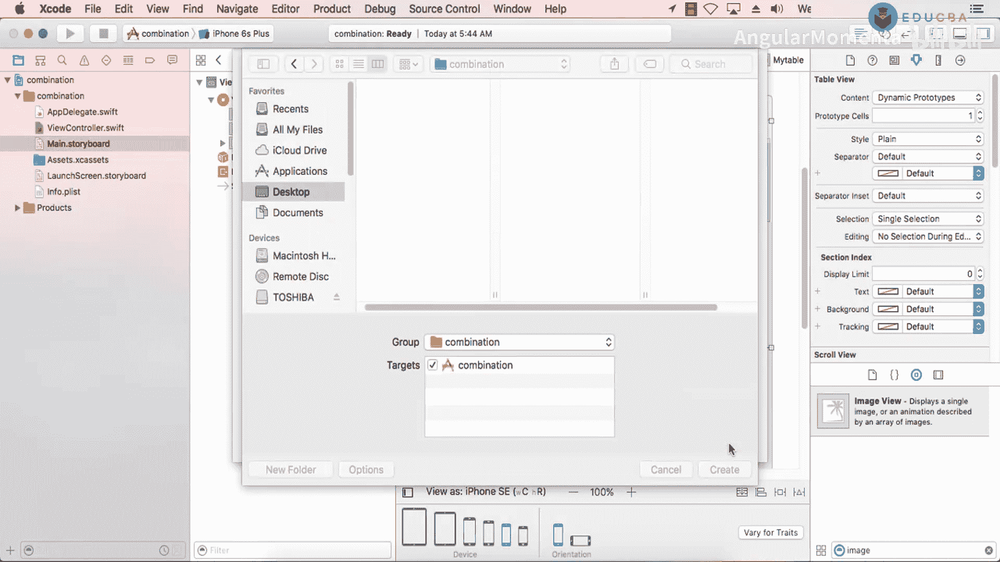

So this I've created successfully in my story， but I'll go。

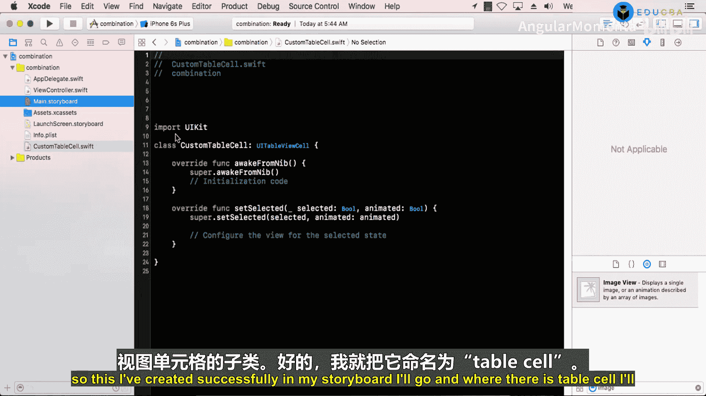

And where they stable cell。I'll just give that。 he will sell classes。Custom says okay。

 and now I need to create the outlet also since Ive created a collection view on top of table view。

 So I'll create outlet of collection view。

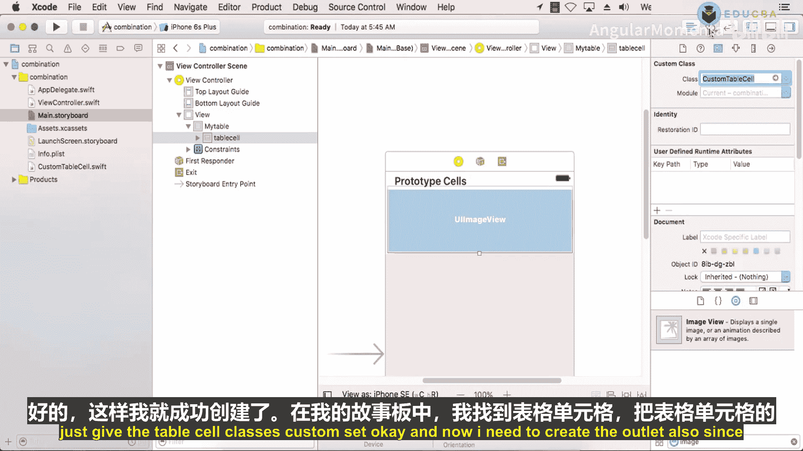

Do I you know。tableable view。系个啊。😔，Will askmate， it will give me two options since I want to make you know。

 outlet of fact view， so which is on。They will right so。Taken acus tail old yourself。

 Im not taken acus to yourself。 I've taken acus。Class， which is the supply of table。 Okay。

 so here I'll go and my collection view。

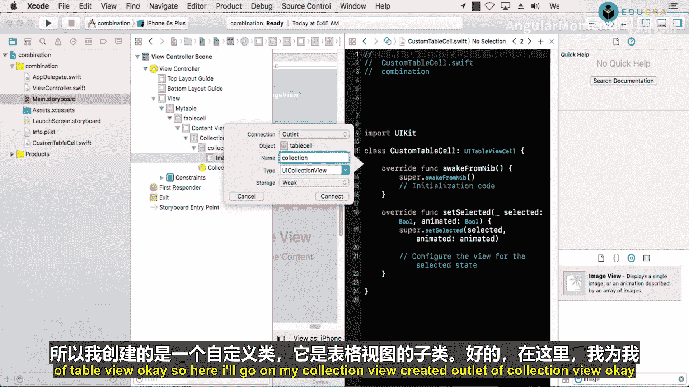

G it out。 let me okay。Successfully。So here what I did I taken a view see it' is like a hierarchy right。

 I have taken a view on top of you have taken a table view and the outlet of table we have created in this view right view controller。

Okay， and Ive have taken collection view on table Vi。 So here I've taken new。

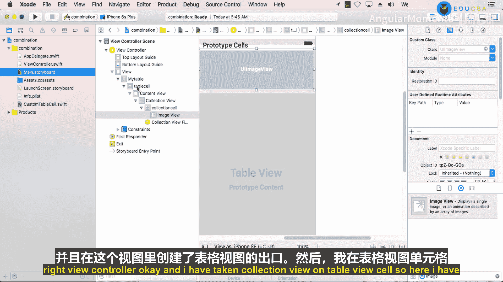

Pile which is a subclassus of table Vi and since the collection view is on table Vi I've created a outlet of collection view okay。

 so now I need some images also to show on the collection view。잘자주 해요。And go add files to， you know。

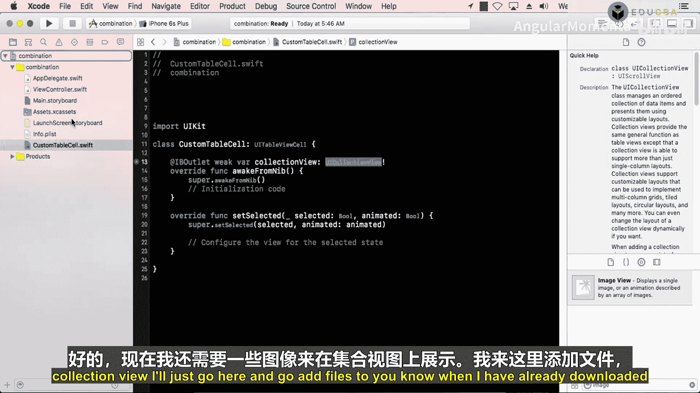

When I have already downloaded some flags。

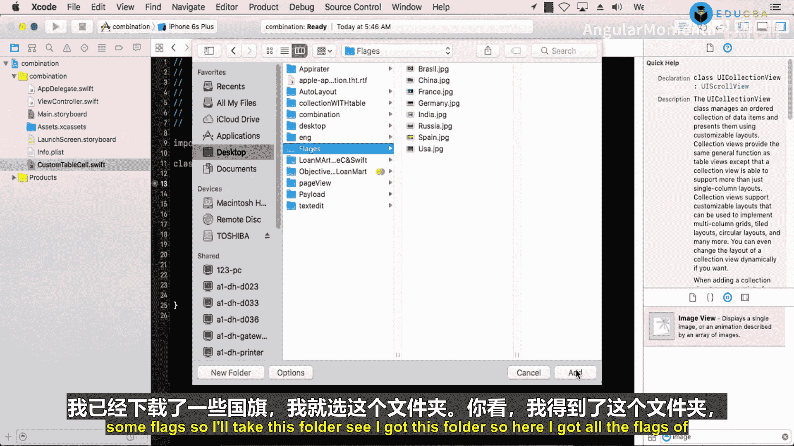

So I'll take this folder。 Here。 I got this folder。 So here I got all the flags of different different countries。

 right， so。In my table。Clf class helps just create an array。He mean his name do。You know。

 I order to take the same name， what is there in the flag。😔，Lastest one is Brazil， Lord GG。Right。再见你。

洗a多次几钱。France do Gpg。4 is Germany or JPG。This is India。没事啊。电脑自飞 c。In the last days。US a dot。你这边是睡。

So I hope I have taken all the images Brazil。在ina。France， Germany， India， Russia， Spain and US UK。

So now， since I am working on table view and I need to implement some。You know。

 some functionality of collection。 you write。 So you want I just add。Re collection view。

Delegate and data source。ex声片。He that our okay。So。Yeah， yeah。Collection me matter。So。

Number of items in section。Okay， where does this written。My image every name。我动。ok。And。Yeah。

 and just create。Item at index path。Methd。Self item at index birth。你靓。Greated。in terms of。Collection。

You said。我度。Collection view dot Tq reusable。With identifier have given us。Ection cell。

 which will be in stream form so。Taking this a double course original index box。As。😊。

Election will okay， so I also had to you gear down。Some glass of collection we said。最啊你歌。

This new friend。

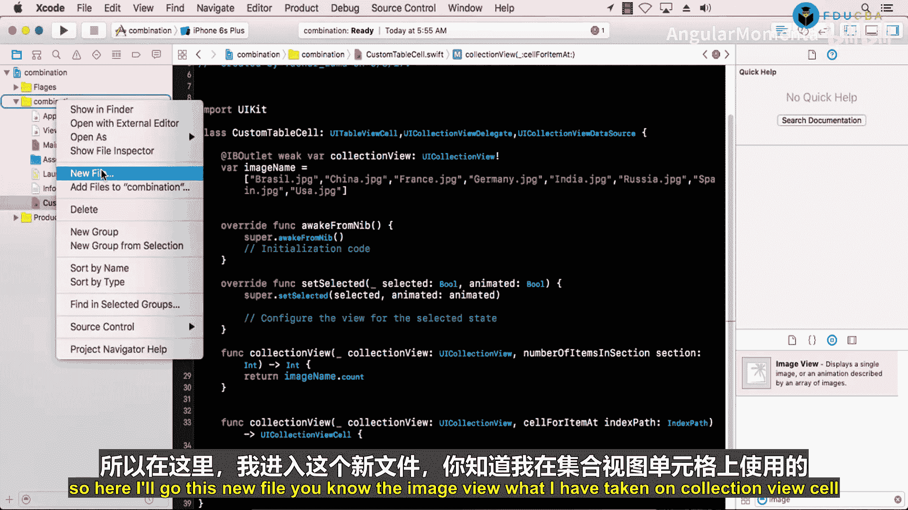

You know， the image be what I have taken on collection user。

 so I need to access that image with two h well is， right。eexenq。你出啲嘢啊。Rection we said， okay。

 so Ive created。Okay， so I go into my main story board。this collection表。ok。

So in this collection we sell， I'll just write this name collection we said。ok。

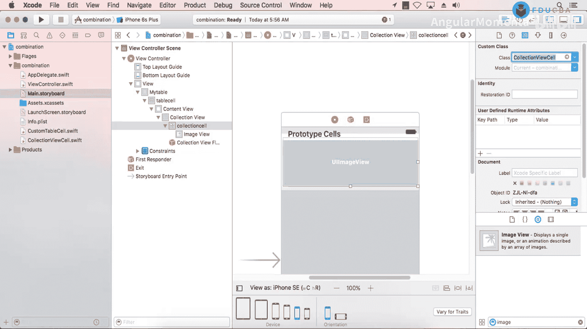

And here I'll go。 It will take time to load。

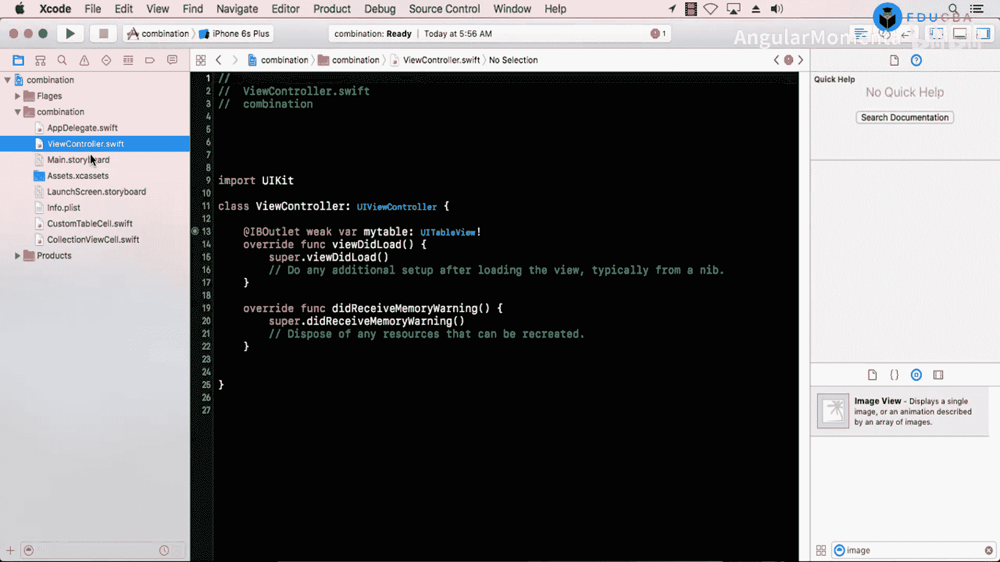

O。你啊你个。你 choose。y。Test still not coming， but no worries。Okay， you got this。你 did it out did this。

你咩意思？Okay， so you have created this image we've outlet on。Collection whistle。

 because image is added onto to collection Vi。 right。 So I've created this。

 Now I'll go to my custom table cell here， where I was coding。

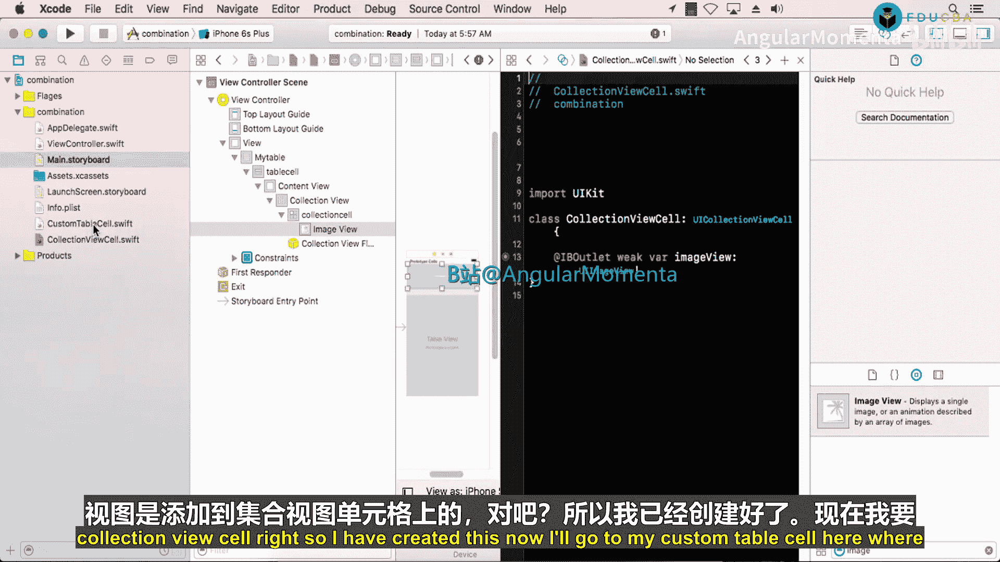

Here， firstly， I'll mention here。Election view， dot。Deeleate。For to。

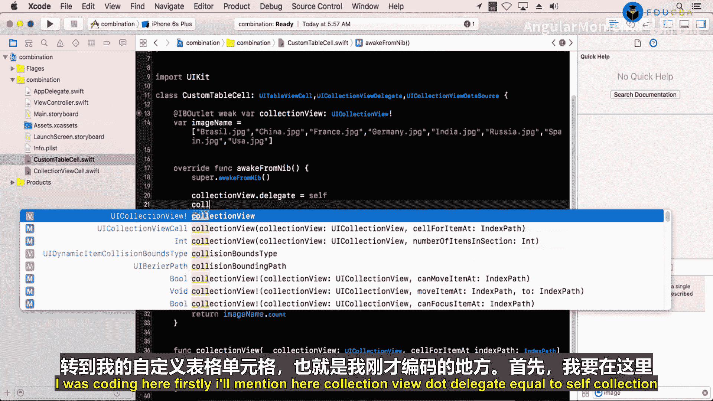

Election view dot data source equal to， right。我 you来歌。And你。Eection sale。喜걸 do。

Eection view dot take reusable with identifiers。Identifier and see。Index bo。嗯。eleelection re， okay。

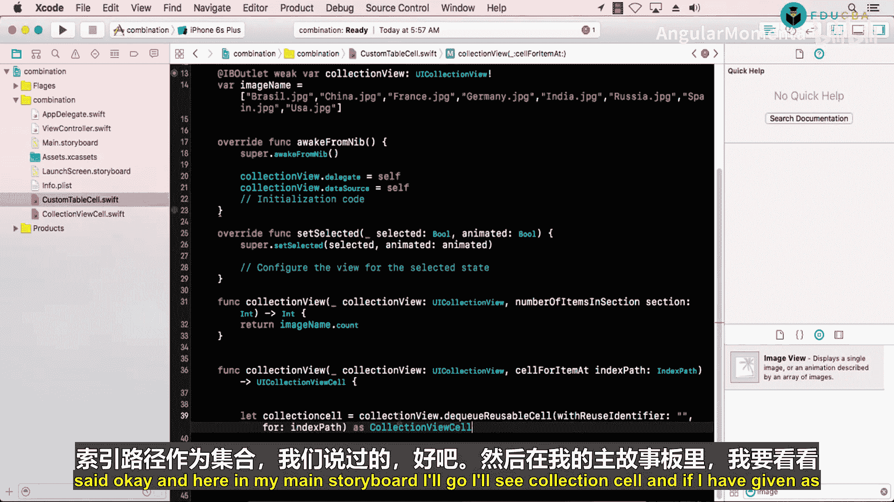

And here my main story I'll go I see collection cell。Identified have given his collection said。

So I'll go to my custom table here。 Just take this as。

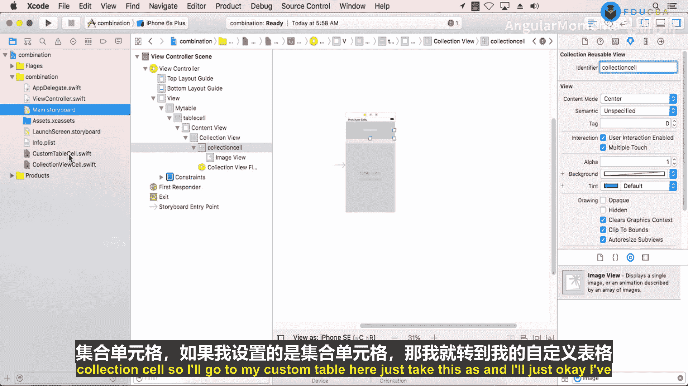

And I this。Okay， Ive created cell。Collection cell， dot。Vcential dot。电尾珠。Not in his referred to。

You are in it。你啲。name。As you know。Give me his name。Your name name and。Inside this。Inex part not say。

For every index part dot row， the image will be taken。

 And since it is asking these method of written type of collection yourself said。

 So'll just return the cell what Ive created above。

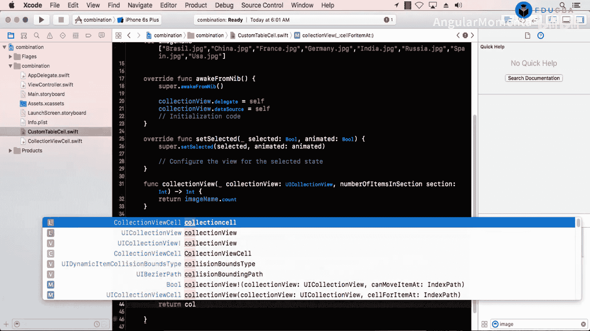

election胜 ok。So I hope this much you understood like you have created collection view sell over table view right so whatever functionality you need to perform one collection you shall will be working inside table View class right。

 so the same thing I've done I've taken an image area。Okay， I have said the collection will delegate。

 I have taken collection view。You know methods， De data source method。

Whi is number of item section where I have written the image name this and the last year cell for item at index where have created a cell。

Collection sale year was the images in the image， right。

So and in my collection Vi I have just created outlet of image view so that I can access this image view inside this。

Okay， now here I need to perform。Methd for table view。都嘢嘢靓睇叫佢。Table is P I table with delegate。

Here table view data sources today， we are only using with。You know， delegate， so。原来 go系 like。

My table dot delegate he to self。My table。The data source equals the self。Okay。

 so we have two important protocol of table view1 is。Number of frozenn sections are for index spot。

So just系。even。Number4 section where I just written one。Re知。你。第even。Sefur index5 right。

Se for the next part here。 I just create a set。系。Table set， equal to。W dot Dusable。With identify。

 identify name。 I'll just let you know。ex八。Yes。Custom this as custom table set right。

Custom table sell。

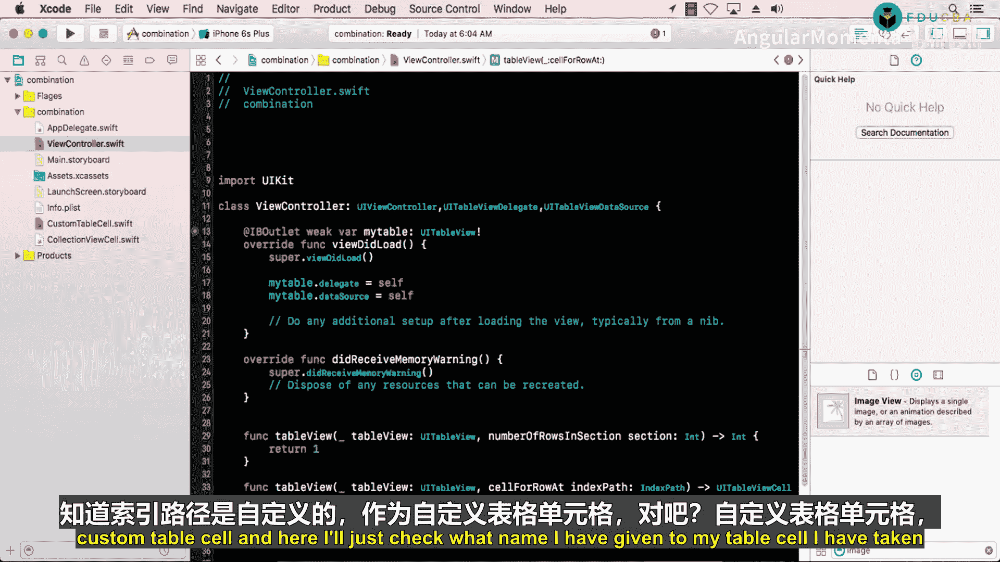

And you靓 this。Save what name I have given。My table set， Ive taken this idifier。

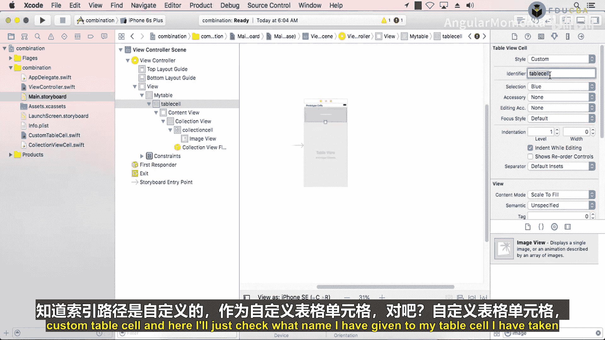

Okay， and let's go here。this market几多啊。ok。😊，And this letter written。屌。车嘅。ask me。你灯对声 ok。你问我咪睇。

To show the height of you we can change the height of the table。

 But since I have taken it dynamically。Okay， and next's three words so。

So I think I have completed all the coding parts。 So let's run and see。

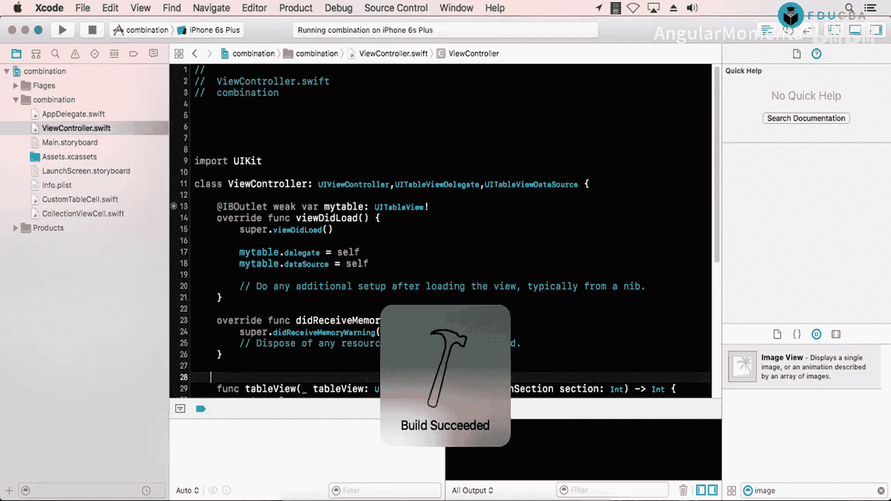