# 【EDUCBA】运用Swift核心特性进行中级iOS开发 ｜ Apply Intermediate iOS Development with Swift p11 04_02_01_数据源 -BV1RmFUzyEXJ_p11-

Attaing， see， So I got only one。Collection we。 So I'll see。 it's scrolling。But， you know。

And this is vertical scrolling。

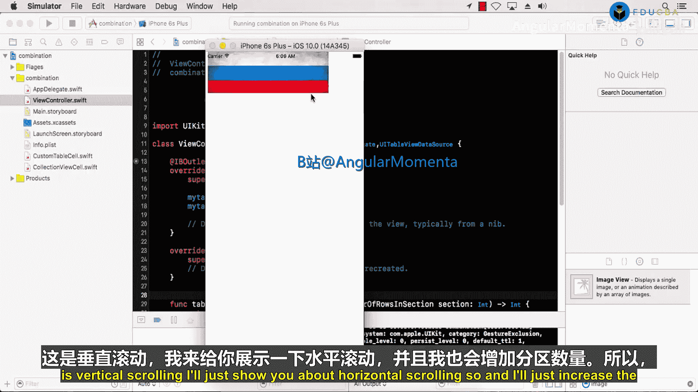

I'll just show you about horizontal valley。 So， and I'll just increase the section also。

So in my view controller， I just write number of section。Yeah I just written5。 I want 5 section。

 So I've created five section。

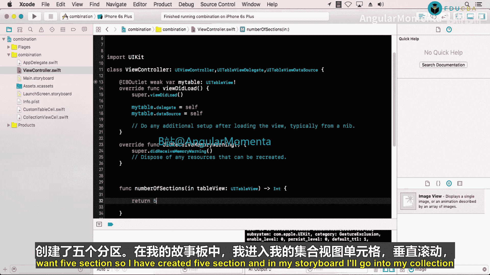

And in my story vote， I'll go into my collection view。Scroll vertical。 I'll just scroll horizontal。

 okay。

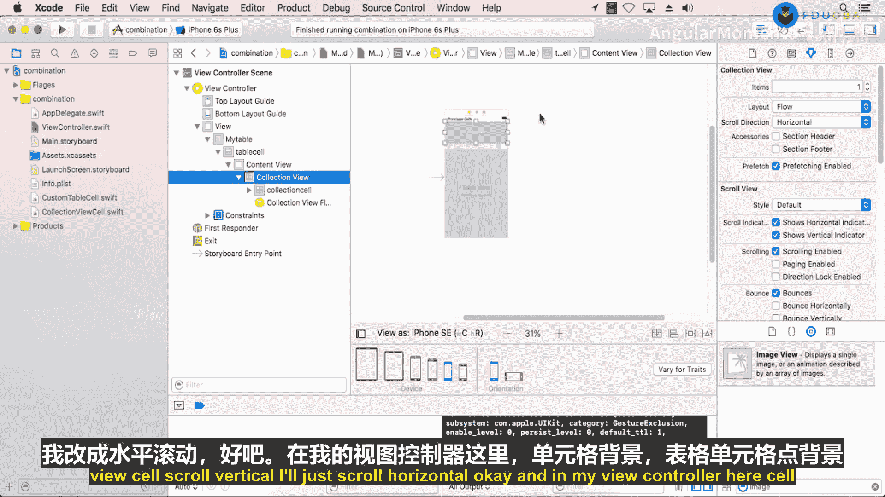

And。In my view controller your cell background。

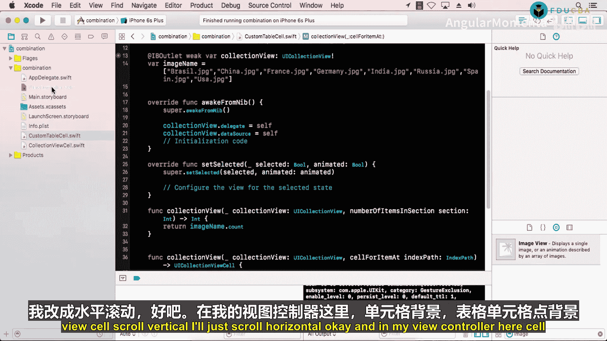

It was sell do background color。咩度。

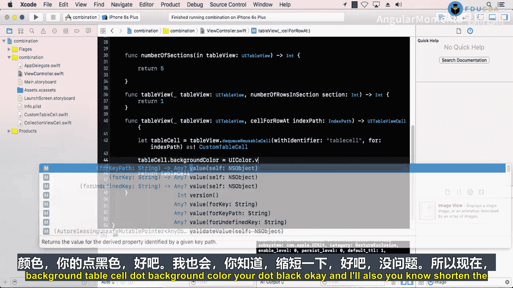

Back， okay。And Ill show you know。真的啊。hel杰 friend。So now let's run and see。

Whether it's working or not， I hope everything is working fine。Now， Ive increased the。

Section also so that you can see multiple images and you can scroll upward downward in the table view。

It's running as simulator。先。See now you can scroll everything。The background is coming。

 a little black in color。Ma clear the size and againfe。F and see anything would define。

 So my today's tutorial was basically about how to combine both collection view on table。 we said。

 I hope everything was fine。 and you know， it was easy to understand。O。Yes， you见。

Stress the size so you can， you know， use auto layout and you can just set and see。

Sinceins I've created， you know，5 section 1，2，3，4，5， if I increase it。

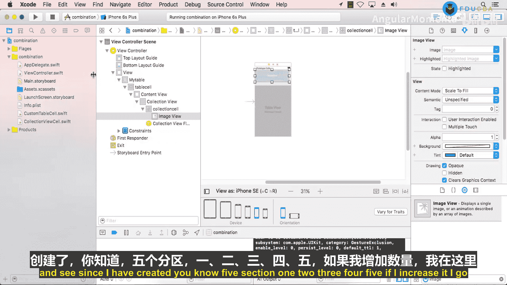

系过位啊。I write9 section。 I want。So I will get everything into。I'll get9 section。You know。

 table will be full。ok。

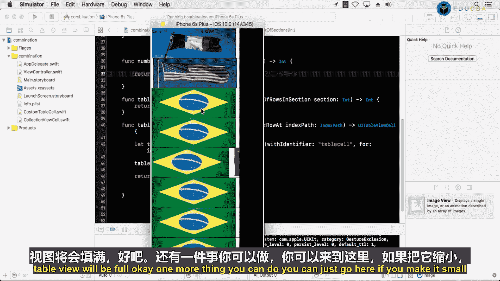

I more听 you can do you can to school here。If you make it small， let's see。

That's great for it to see the output。ok k。So you get the image smaller size。嘅云我听唔见到。

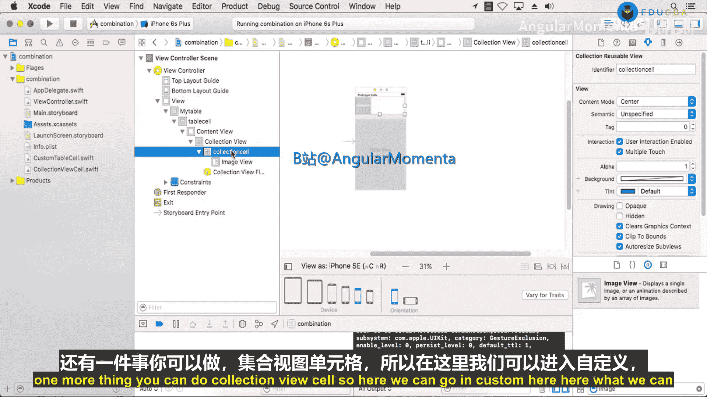

佢历声 music息。系啊你近歌。En该 staying here。Yeah what you can do is。你声一识 lot。买 do。你系个得度。Back now let。你揿咩啊？ok。

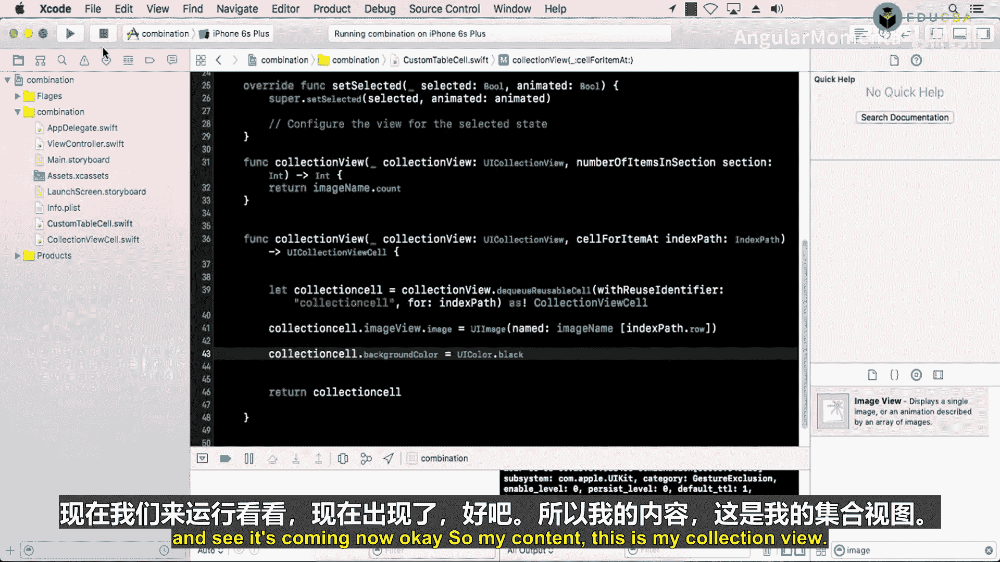

收。你 can this my collection you。Okay， so this was all about displaying。

Collection view on top of table view。I hope this tutorial was fruitful to you。Okay。

 so before leaving from this tutorial， I'll just teach you also how to add auto layout so that everything would work fine。

 So you know， collection view is on tables views collection view is on tables right。

 so I'll just add。You know， auto layout like leading space to table trading top and bottom， okay。

Just added collection view with table we shall write and image is on top of collection view， right。

 so I just go here。Needing trailing top and bottom as is added constrain right。

 Now let's run and see you will see the changes。 it will look more clean and neat okay。Okay。

 so this is my say now it's looking more neat and clean， okay。You can you scroll up， burn down。😔。

或者风扇。So friends， my today's tutorial was all about this。Before leaving， I'll just give a shot。

You know， like what I did。 I have just created a。I have just taken a view controller on top of that view controller I've taken a table view which is a surplus of scroll view on table where I have created one cell because I need to you know move up and down and I need to show some data on that cell but。

This time I need to show some data on that cell using a collection view right so I have taken see this is a hierarchy right on view on top of that view I have taken my tables and inside this table I have a cell on the cell I have taken a collection view okay and collection view also has a cell and on that collection view cell I have taken an image view right so in the image view I have done everything so here is my view controller in my view controller I have just create。

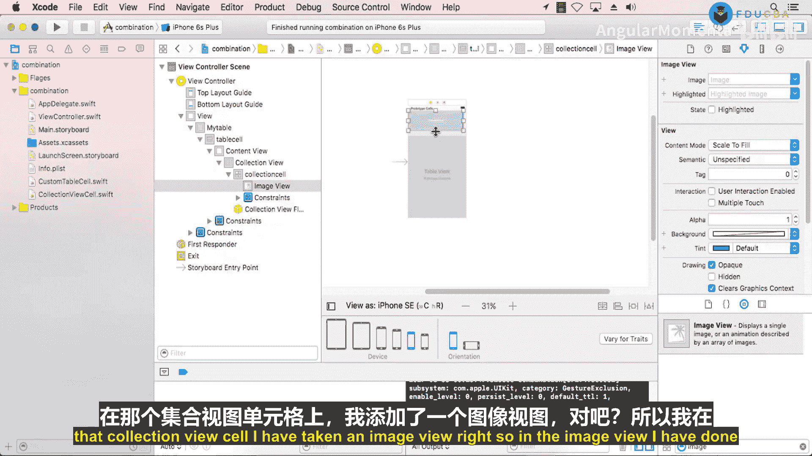

T like the protocol method of table view like number of rows in sections cell for index path。 Okay。

 here Ive marked the table view I have done it to sell。

And in my custom table view I need to perform function on collection view so Ive created an outlet of collection view。

 outlet is nothing but IB stands for interface builder and it provides interface on the storyboard object like it provides a interface on the view controller for any of the object from the object library and with that name we can access all those object Ive taken image array where Ive set all the images from the image folder and here Ive set the delegate of collection view and this is the protocol method of collection view at itself for item index here Ive created a collection view cell。

We have taken the identifier， and I access the image view from this collection， view said。

Where Ive created outlet， okay。I said the background color。

 and I have set the written collection cell because this method is asking a written type of collection yourself。

 So I have just written it。So this was all about my today tutorial。 I hope you have enjoyed it， okay。

Thank you so much for listening。And watching this tutorial， if you have any queries， just， you know。

 come in。And。If you want any new tutorial， just come in。

 I'll just work on it and give you a new tutorial。 Okay， thank you so much。 have a good day。 Hello。

 friends， very warm。 Good morning to you all today。

 I'm going to give you a presentation on your image speaker controller and know how to add a image。😊。

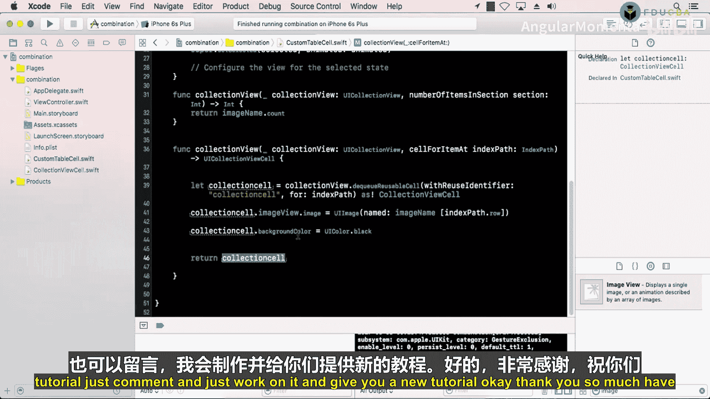

The image from you。You know， photo library。ok。This are my tools， okay。Will I create a export project。

系咩 best。我食你嘅。好的。And this market next。请 you me a vacation。老年小咧。Okay， does busy good。

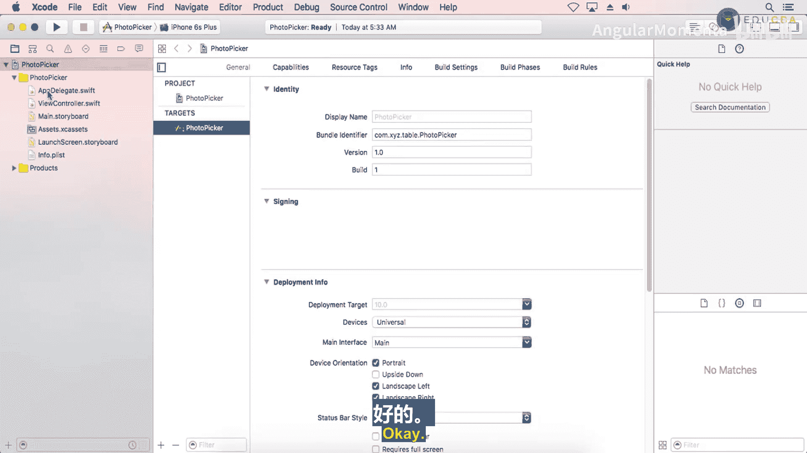

It should under my application lifecycl and this my controller where where I go。

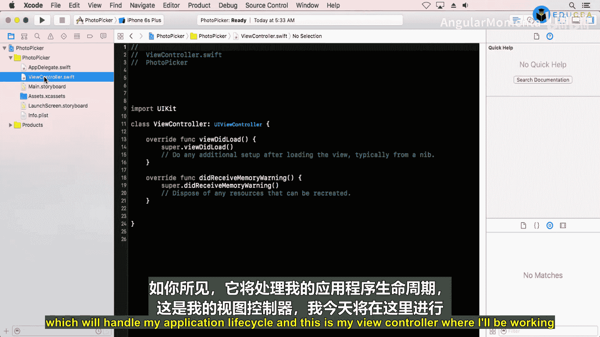

In the main store would have a new controller， right。点解成读诗。Let's change the screen says。个肥。

Yeah me to you got one to show咩 speak。咩知咁到食咖肺。This is Jack。Now。

 I' just give a good size of this image。到咩啊，系睇觉得了。呢边这边。Oh。ok。

This is saying because the fourth question is not satisfied。

 the fourth question sacrificeifies the help of Britain。ok。去细一。你食大咯。唔lo。暂停啊。Sa。开。我咗你水。好。诶放得。你得 as先。

你石到对你有退书。我你。你边几点。华灯。the question does。in this喺bri。Im from here。 I listening of costume。

你如果系 just食嘅 you。And a great question of one this。开大 one six week。好，有你先写诶。

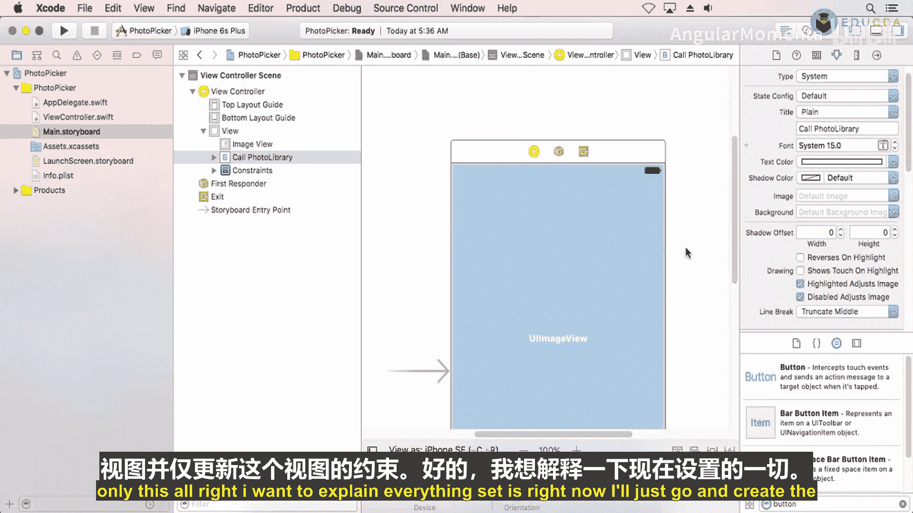

Now， I'll just go and create the outlets。咁要嚟个 as仔。系咪。唔主。ok。Let just give action of the button。

Connection and whether action。Just name this， but an action is。我过啦佢。

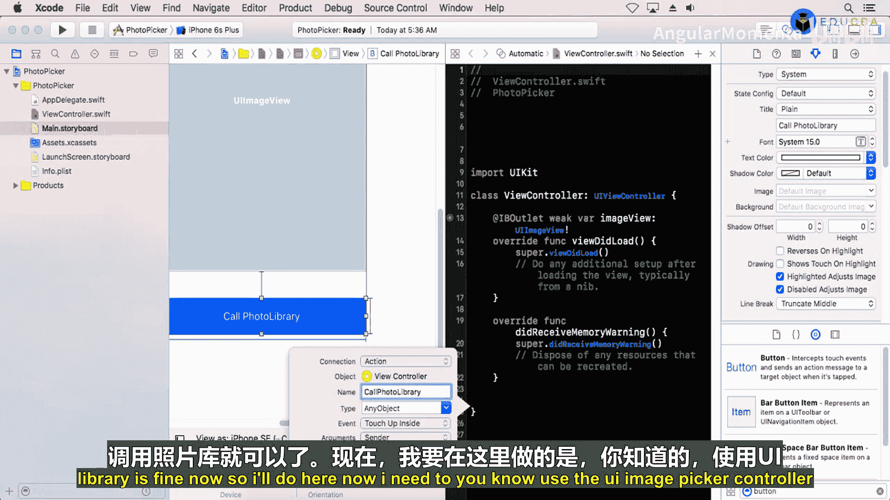

好嘅。So everythings fine now。

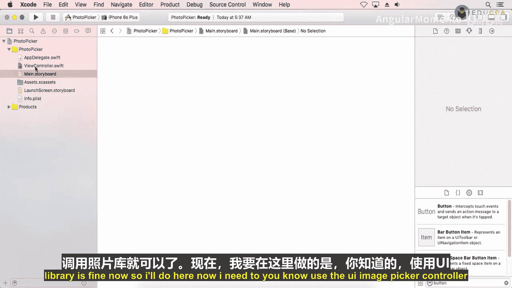

系点样。No， I need do know。Use the UI image speaker controller delegate also since Im working on speaker controller。

 So I need some method， you know， some functions to help me out to get the photo from the photo library right So Ill be just using UI。

咩。people。And since it will you help me too， I want to like navigate also like from my view to the photo library。

 so Ill be using UI navigation controller De。Okay。So now ask me some required also。So firstly。

 I just bought my rude load。And now， I need to get a instance of。I need to create an instance of。

This， because。You need to be right。 So just。唔语。Did I do佢你就货 like佢佢 do。You are your speaker瞓咗咧。

ok and yeah and do I think need to。啊明你姐。嗯。你哋个十嘅果色几点。It has me shape。

My this speaker controller that okay， I need to just stick control。I don't have to do the good。

你哋嘢几咁我 here。Oh。啱啲咯。And I just need like。明你嘅我经。温志云点样处。明该一打。Deig for delegate do things就。

Youage speaker controller， annual。原你身份觉。So anyway， you do need because control。

You need to I do navigation controller also。That said。

Now we give some action to the button since weve implemented the delegate also。So I my button action。

 Ill just take the image speaker。嗰真。APro of allow editing。

 And it is it has a different type of you know bulloleying。

 So I just like was I don't want to you know say anything。You may speak again。But， you know。

 it has a source type。And for。It has good type of source like when is the camera。

In which when I click on the button， you can access the camera。

 but since we are working on Samulator， we don't have device to you know your practical research and the equipment on that so we just give a source type of photo library。

 right？So it's enough， right？And here I the slide present。你咩。Animated would be true。

And咁 present with me你。Okay。

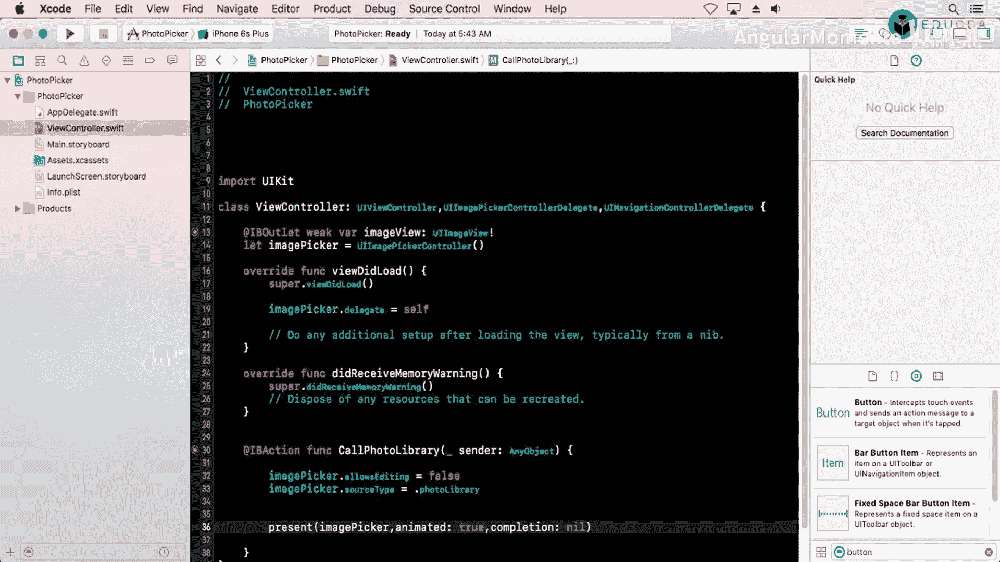