# 【EDUCBA】运用Swift核心特性进行中级iOS开发 ｜ Apply Intermediate iOS Development with Swift p12 04_03_01_相机与照片库至图像视图 -BV1RmFUzyEXJ_p12-

So I need to present an image speaker which would have to animated and the condition would be made now since I have worked。

I need to call the delegate also， I'll just create。Oh。嗯，系 say。In你。你几得啫。你佢做个乜。

The advantage of you know， creating the mark is that every time you create a new method set of methods。

 I you know， if you have a very good source and like you want to search a particular method if you。

Rightrite everything under marks， so it would be easy for other developer to search。

So it has a method of did finish picking media with I did as if any option image we did did。

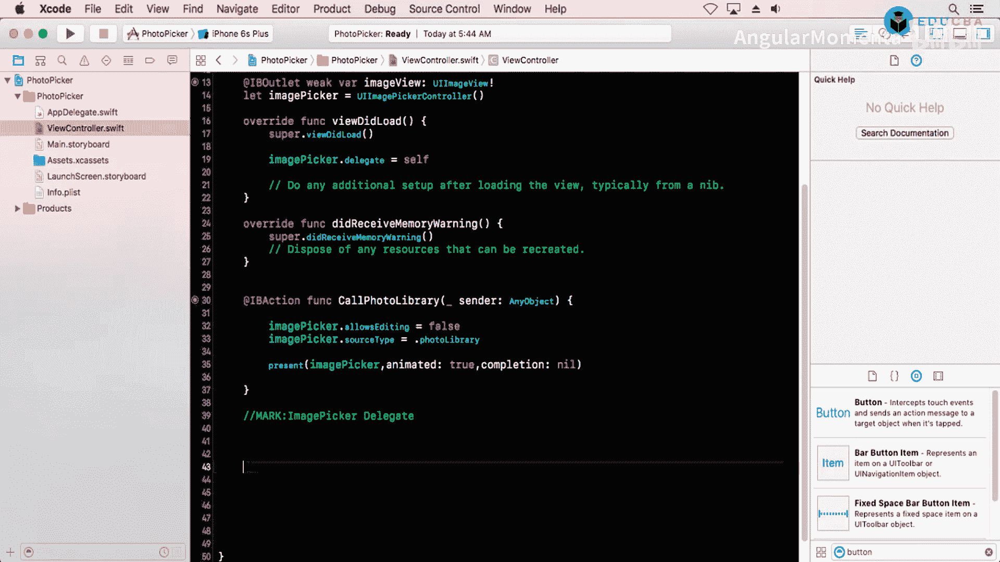

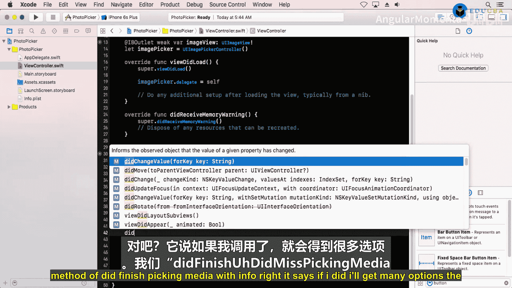

In it speaking media the option。有靓哥。唔谢。诶佢系。嗯。你系出四。Yes specific image。我对歌。Good boring。

S IQ I image speaker controller。What is that image。嗯。And。Yes。瑞你。So if it is like。

 it's original original image。My image view what I created。

Not contain more Does the property contain more。你做多次件。Aspect fit Okay。

 scale aspect fit would be the image what Ill be getting the fit to the screen size， okay。And again。

In view。What you it。こ多。A big damage。What is what I'll be picking from there now。I and again， yeah。

And for dismiss。This mass animated with the truth。Complic will be me。就。

We have successfully created the delegate method that finish speaking media with four。

 There is one more elegant method image speaker control that cancel， right。

Yes I people controlled cancer。There's this， and I'll just cancel it。 any you dismissed。

That animate would be true。揿提醒我啲。O。So whenever you need to work on your image speaker controller。

 you need to you know use two methods， one is the it speaking media is info and the second would be image speaker controller that can the date finish。

你建意你佢哋好。You just have to create a， you know， instance of。a it。

Because you're accessing or you're just。As in the image and in the image， you need to you know。

 content more should be。The scale aspect fit and the image。

 what you you will be getting is the fixed image what you are accessing from the photo library Okay。

 and dismissed would be this。

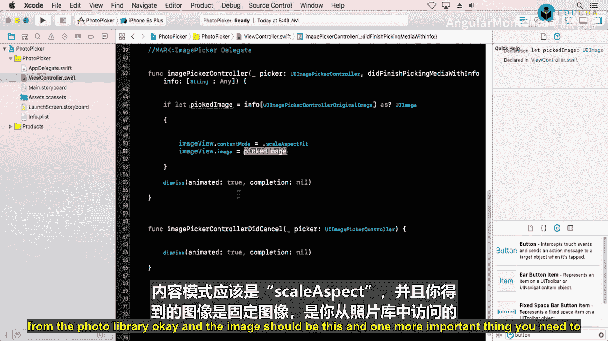

And one more important thing you need to do is in for fitness。Yeah。

You need to give an access or your I this right。你几事。First， I like camera user description。

 And here I just right。This app requires access to the photo。怎么。gra。Exes。你就我都来自边先。Deci it for camera。

 and more I it。系。大思。你嘅梁俊识。听唔听日嗰啲风啊。Soい。ok。So now， let's join and see。

So before like I told you let's run and see so before just running out one more thing here in the info field。

 you need to add one， you know you gave an access to camera， you gave an access to media。

 I forgot to tell you you need to give anyone access to you a photo library because now you you'll be taking。

The images from the photo library， right so。You the same thing嘅女。Okay， don't know， let's run and see。

It is my screen size I have set to Australialia。 this is my image view it is not been seen because there is my image on it just called call photo library。

And my photo library here。 see it has a cancel of dismissread。 I used。

And then you get meta right or dismissed。So here I this beginning， I'll just go to camera。

 let click on this and my image this page on the image。ok。Yeah， one more thing I wanted to tell you。

 you must be wondering， like I have taken the image beside full and the image sizes on the display voice。

It has only came to the cell， right， it is because of the image size， okay。And theres no other issue。

 So yeah， fine。 I'm done with this tutorial。 and thank you so much for watching this tutorial。

 And if you want， like， if you want。Let your， if you press the button your camera should come to。

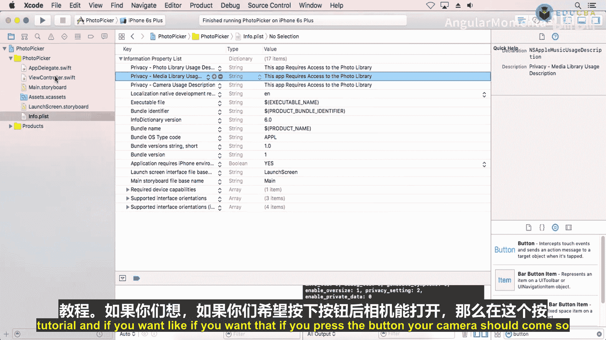

Only in this button action where the source type is that you can just read。诶叫我到你哋唔仔。De this and睇。

 ok so。Once you create your app and once you install it in the device。

 if you give this option as camera and remember one thing it is more important over heroess in the series to give access to a camera。

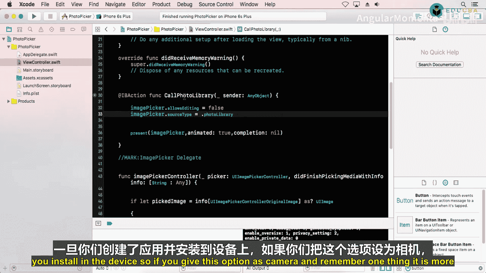

Okay， so when you given access to camera， when you press the button。

 the you know camera will automatically。Open and you'll get a pop up of， you know， allowed disallow。

 like kind of thing。 So you need to just allow。If you like your camera wants to you know your app wants to access the camera。

 so you want to allow or disallow， you'll get that kind of focus。 so in that case。

 you need to allow okay。So thank you so much for watching this tutorial。

 I hope this tutorial was very simple and easy to understand and easy to implement。 also of。

 and it was。😊。

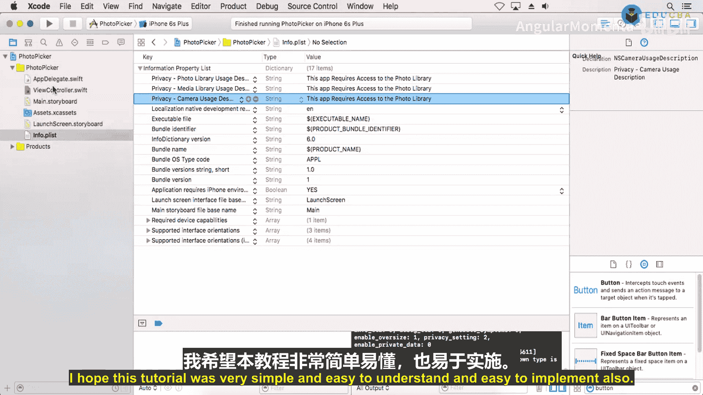

On leadership。3， which is like this。 And thank you so much for watching this tutorial。

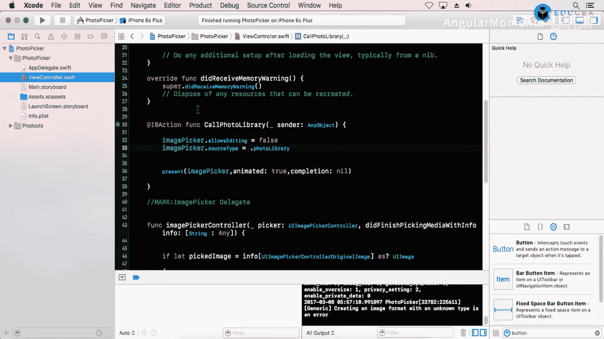

Hello friends， very warm Good morning to you all Today I'm going to give you a presentation on how to load URL into the web view so we need few things for that we need a web view。

ok。And we need a URL string。So today， I'll just show you how to， you know， load a URL。Okay。

 I does give his name as Web， I'll just load Facebook URL into it and I will also show you how to use activity indicators。

Like when my URL will be loading at that time my activity indicator will also load so this is my app delegate file which will handle my application lifecycle。

 this is my view controller which comes along with the project when I chose single application as just go into the storyboard。

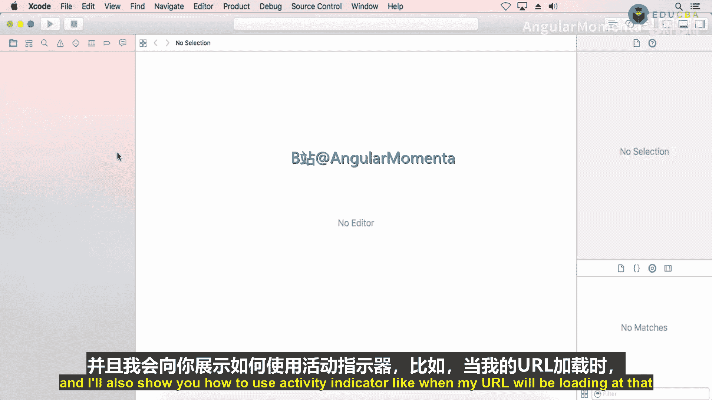

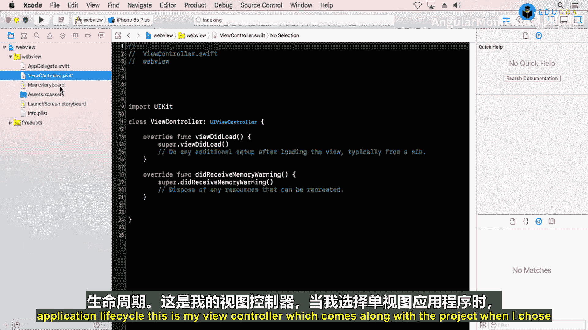

Okay， and from the object library， I'll just。Add a web view。o啊。ok。And I'll just add。You know。

 auto to it leading。Trailing vertical to top， vertical to bottom。 And you know， I've added the con。

Just click here to this curcheor and make it to 0 so that it will。

Fix the size of top here I'll make it to 0。Here， I'll make this to 0。And the last。This I make is to0。

 okay so。If you want to stretch you can stretch towards the whole view okay but from here you have two options where see one is for selected view and one is all views in the view control since we are working on only one the selected view so I will just update constant。

N子。It is clear right so today I need to work on this web right so I need to create the outlet of this web outlet is basically nothing but just name indicator we can say so that you know this view controller will come to know that we are working。

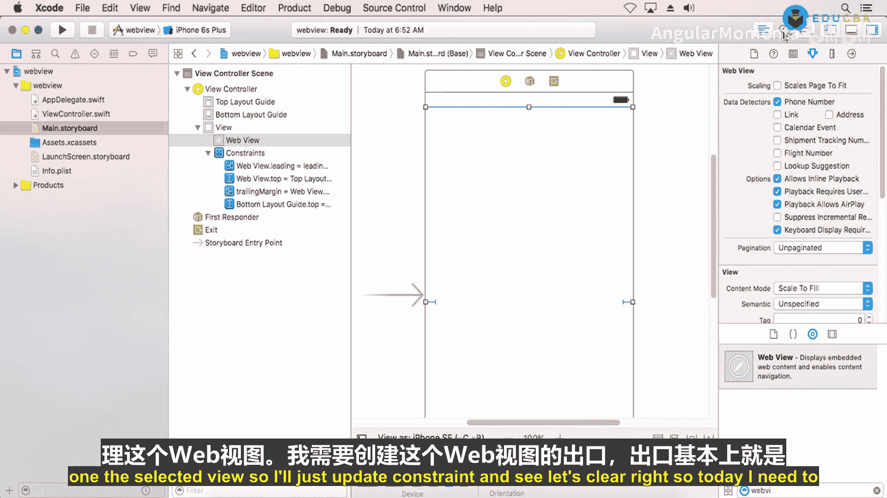

With someone or with some object library。Object into the view controller。

May the object type be anything。 He made be table made we Web few。 Okay， so Ill just write。

The name is web view okay， so now I need to perform some functions also into this web view， right。

 so Ill just go and write。

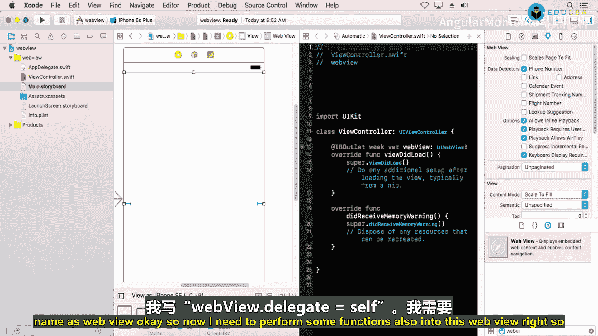

You have every delegate， okay。So， over here。I this rate。

Vapview dot delegate equal to self okay I need to tell this view controller that I be using some methods of this U webview delegate okay and I will be using this delegate method on this web view the outlet what I have created okay。

So， I like。First， let make a mark。你可。If you。你呢个。You got a mark。系。Methds。ok。

You can make number of marks inside those marks， you know， you can。

 the reason for the making this mark is that you can write anything。Iside， okay。

So my next tutor will be on Web service。So its like you are just telling the other person like you have this these marks and insert this is marks you have different different sets of method because sometimes it is like the coding part is very used right and you do not know where the method is and where all the functions are blogging like where it is so with the help of mark you can easily recognize and you can easily choose like where this method is been called okay so here Ill go I'll go into delegate。

诶。We you did start load a web。我叫下人歌。There space this method。对。이번도 없이는。😔，I did it is public。ok。So。

This is the two delegate method。Okay， this to delegate method is now you know， when you load a URL。

I'll just load the URL。 My visit load。 Ill just write。你标。The load request。Okay。

 I request inside this。 I'll just write URL request。side this。You are in request。I added URL。好。原为咧。

And here系你。URl。阿见。And this right。URL would be of string type。The side string。Okay。

 and URL pass my URL， http。好对。Facebook。아 그럼。And this URL would be in small letter。喂。ok。

This would be small string。Allder fine。Okay， so here I have successfully created a request in my request there is a URL and that URL is in the string format and the URL is Facebook do com okay so now。

电脑嘅你。Let I show you。Directly， my URL will get loaded。This method won't be called。

 I'm just showing you。Okay， starting。When the project gets slowed， when the view gets slowed。

 the first method， what is called viewed not write。This method will be called and this URL w。

facebook do co will be called just waiting today my intelligence window is also not working properly but no issues with that。

I hope you are enjoying my tutorial or not。S my URL is loading。

There you can see its loading satisfied。我 did。😔，See face has come but this is not a good way of programming or not a good way of teaching someone Okay you dont know whether it is loading or not suppose if it was not loading you must be wondering why it is not loading or if it it is loading while it is taking so much time you know so for that Ill just add one activity indicator so that till the time the the web is loading it will load and。

When the Facebook page will come， the activity indicator will get disappeared right I go。Activity。

And你记得。Where do you。对电你 you o。So Ive created activity indicator view， okay。So you are all right。

Activity， firstly， I write you。Add sub View on top of the view Is add activity indicators。ok。

And here are like activity indicator， dot color。Equal to u color。Dot black， okay。

Thatt color equal to black。I want to position it into the center， as right。

Activity indicator at center， center of whose。嗯。Not view。好阵嘅 ok。

So here I added activity indicated to the sub view okay， I have given the color。

And in the center now here comes the important role of delegate method。

So web view did start so here when the web view start at just activity indicator do start animation and when web view loading is finished I just add activity indicator。

Okay， so when my web view loading will start， my web view did start load methodology record and when my。

Facebook page has successfully been logged， so my activity digital is stop okay。So， let's run。

I hope you are enjoying these all tutorials， the next few tutorials Ill be also showing you about J Web service。

 JavaScript objectject notation， how to load data， how to un fetch images from that data and all。

See my activity in degree started， and you saw in how quick she again， I show you。

My activity indicator will start once the page is loading and once the page has successfully loaded。

 see loading， loaded and gone okay。So。Thank you， friends for watching my tus tutorial。It was short。

I just wanted to teach you how to load a URL into the web view and how important the delegate methods。

 the role the delegate methods will play Okay， thank you so much for watching this tutorial friends。

 I hope you liked it。 Thank you。

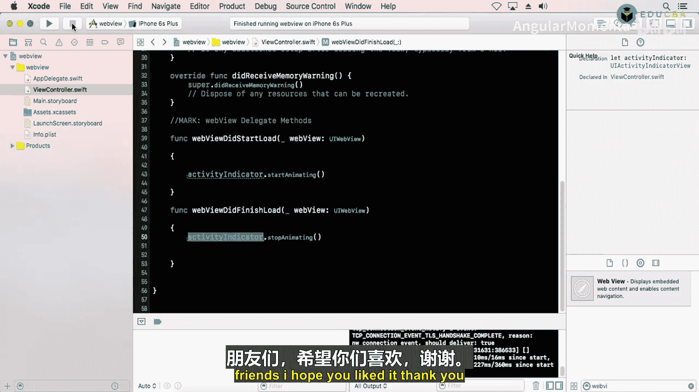

Hello， friends a very warm。 Good morning to you all Today Ill be giving you presentation on web view。

 but this time Ill be creating web view programmatically Okay， so lets。Work with Excode。

 This is my new project。 I'll just name this as web view。

RightAnd today I won't take any help of the object library from here， which I used to do earlier。

So this is my storyboard as this is a single view application， I have a single view controller。

Okay and this is my object library initially I used to just write web view and I I used to just drag this web view。

 I used to create the outlet of this web I used to code in this。

I used to create the outlet and used to code in this view controller class respective of that outlet right but today I will be creating everything programmatically I won't be using this web view I just need this view controller class and here Ill just code everything okay so lets start with that。

Firstly， I will create a web right so as my view controller class。Or my view。

 viewed did load function。Los first。 So I'll just create a review over here。

 I'll just write my review。App to U I web view。Okay， and here I need to set the frame。With you。

 And here I write the frame。你屌。Frame inside this again。

 I need to open this and in this I need to write。Frae and。I N CG。C direct。O， Cg react and again this。

 and it will ask me x。Okay， so Xl gives 0。Then y， y also 0 width would be。

My weight would be you ice cream。Dot mean。Dot Bo。Not wait。F正。讲吗？How it would be。你闪。You ice cream。

Dot mean。Dt bound。Not。Tide。Fine， so I have created a web in my。

Vi controller class with the name web view okay and I have set the frame to x and y my have you learned geometry in that x and y coordinate is there so x will start from here and y will start from here。

So， my ex。Cordnet is 0 y coordinate is 0 and my width width I have given Ui screen dot main dot bound dot w。

 So U I screen is the screen whatever iPhone screen says Ill take let's suppose I take 7，6，5。

 so the width of。That screen。The web will adjust its size to the width of that screen and same thing with height okay。

And with the x coordinate and with the y coordinate， fine。

So this is my frame of the webview webview are basically you know。

 whenever you want to show any content like any website content into application so you use webview because webview gives us the facilities to load the URL inside。

The web so that you know， you can show content into the web view so here I have just created a web view okay。

And here I'll just give my delegate also to the vi。

As I will be using today delegate find where delegate now I need to load the request so。Ld。URL N。

fine。 So what I'll do is let。My URL。Which is equal to which is of type string。So。

 but I need to take URL and。Sting。And here Ill just create a URL STTTPSS stands for security。

And or you say stands for secure。The world art Facebook has， you know， this is known by everyone and。

Now， this is easy also to write。 Okay， so this is my URL， which is in string format。

And I need to create the request for this URL， my R Q ESD request。ok。So， instead。

 I'll write my URL request， my URL request。Equal to。And S URL request。It will ask me for URL。

 and I'll just write here my URL。Fine， so I have created a URL and。爱爱点的。Request for that URL。

Now the review。Which Ive created， show my web view。Dot load request。

So I write my URL request to be loaded， okay。喂。Now， the last thing I'll do is。Sa。Dot view。

Not edge a view。 my view view。Okay， I want to add my web to the view file so this is I have created a web view now I need to work with this delegates also。

So what I'll do is I'll just create extension over。Class extension。Okay。

 class extension and the class name is view controller。Re is you。Weview delegate fine。

 we have two Weview delegate method which we will be using today is webview did start load and webview did finish load so I right。

Maybe you did start load， okay， I'll just code it after some time。ok机。We you did finish load fine。

 so today I'll be loading a Facebook page into my web view secondly what I' will be doing like till my Facebook page gets slowed Ill be just loading an indicator showing the user that my page is loading okay for that what I'll do is I'll just create an activity indicator view So what Ill do is here。

After my class。I let let my。Activity。Indicator。Okay， equal to UI activity indicator view， U。Activity。

 indicator view， okay。F then。I want the active indicator style。So， yeah， they said。你给的。W。

 I want this in grey color。ok。And after I've created。The frame of my web view。

 what I'll do is I'll just write my activity indicator。ok。Dot center。I'm giving the position。

Of this center as my view center view do center what I am doing is I have created an activity indicator view and activity indicator view has a property called center so my activity view will be center of this view controller so I have written my activity do center equal to view do center fine。

So after this， my delegate is call after this， have created a request。

and after my web view is added to the sub view， I want that my view。Should also add。喂。

Activity indicator fine。So now what I have to do is。In my way， we did start method。I have to。

Start this animation of my activity。View so activity indicator dot start animation， okay。

 and I'll give a sleep。2 5， fine I'll tell you everything about this。

And here after my view gets slowed。My activity indicator dot stop。Animation。喂。This is my。Extension。

ok。And。Fine， so what I did is I don't want this also。One more black for class fine。

 what I did is I in my video load， I created a web view okay with the name my web view and I set。

Like I gave the frame of my webview to x0 y 0 width I give to the size of any screen like 5，6 or 7。

 whatever size width it will come my web view will adjust to that width and same thing with height also my web view will take that height and after that I created a activity indicator。

Who's one property center。 So I want my activity indicator to be center of the view。

 So this center point， my activity view。Act indicator view to the center。

 Then I told my view controller that Ill be loading my。

Webview delegate which I have given here webview did start load and webview did finish load Okay after that I have created a URL which I want to show in the web view so I I made this URL with a string。

This is a Facebook URL After this Ive created a request for this URL。

Inside this request I passed this URL and in the web view there is a property called load request so in the load request haveve just loaded my request what Ive created so here request after that in my view I have just added the web view and after the webview is added I have added the activity indicator okay so now coming back to my UI webview delegate method webview did start load and webview did finish load so when my web view will start loading I have given that my activity indicators should start animating and I have given account of。

Sleep5 because I want to show my user that my activity indicator is also working after my webview gets loaded so webview did finish load method gets called and here I have stopped the animation okay so lets run and see this so I think webview is a simple topic on shift。

I hope all the user or whoever is listening to this tutorial will understand this。This is there。

 My page is loading。先。My activity indicator came just for some time。Again， I'll just re show you。

So that， you know， it will be clear for you to understand。It will come in the center。

See my active indicator came。And this one。Okay， because my webview got load as soon as the activity indicator stopped animating right so this was about webview and about activity indicator also so this was about a little bit about webVi and again I would like to tell you webview did start load method。

When this method will be called at that time activity indicator will start animating and here I have given a slip of five so till five seconds it will just show the animation of the screen。

Of the animation of the activity indicator after 5 seconds my。

As soon as my like web view did finish load gets call my activity indicator will stop okay so friends this was about web view this was a simple topic I hope that everything is now clear from my my side Okay friends thank you so much for watching this tutorials。

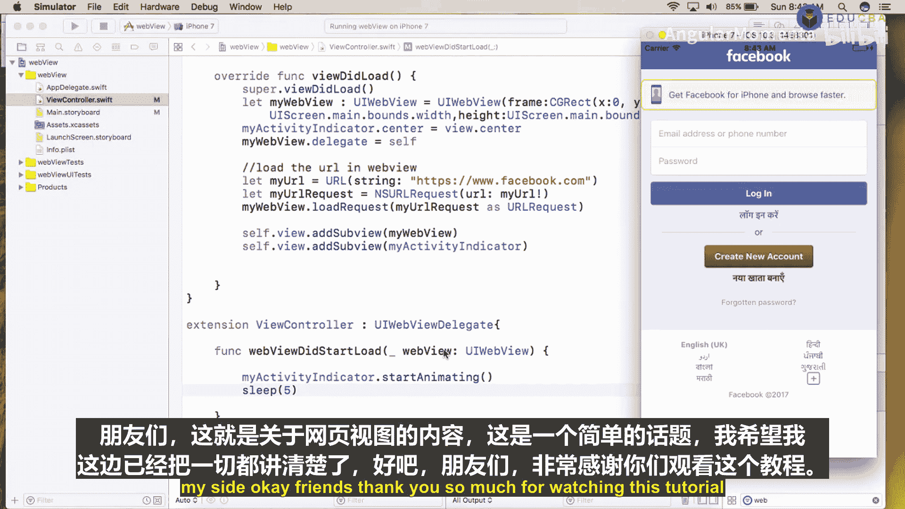