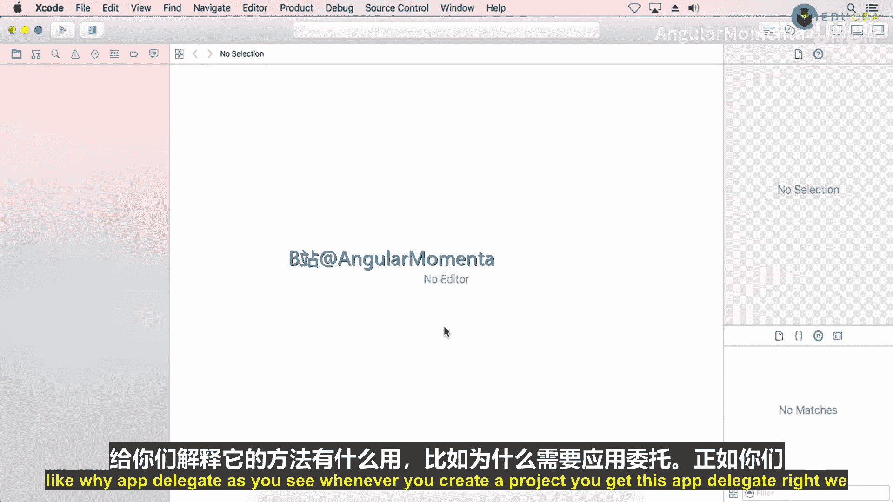
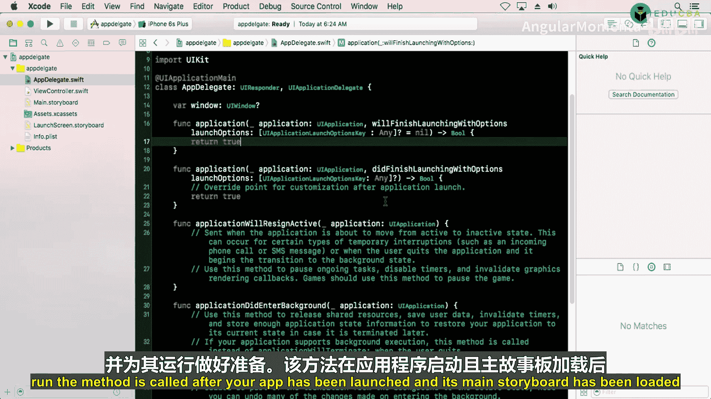
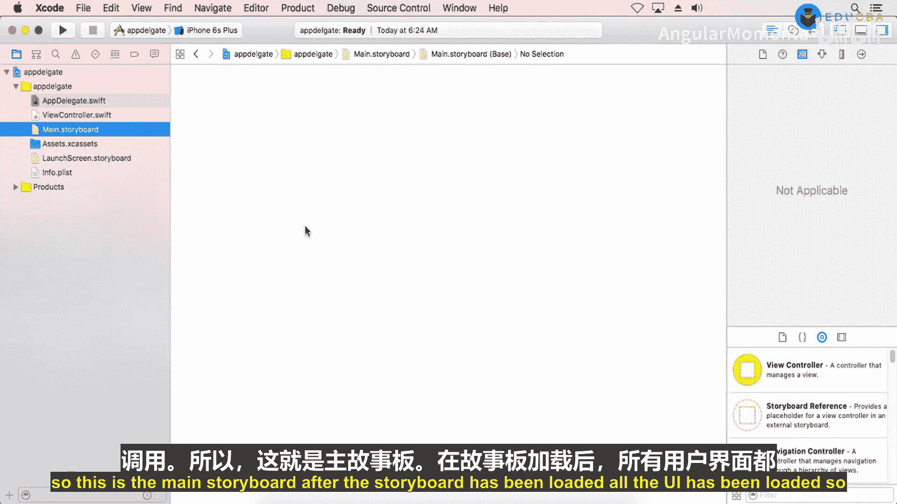
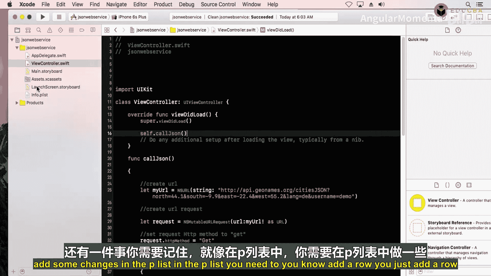
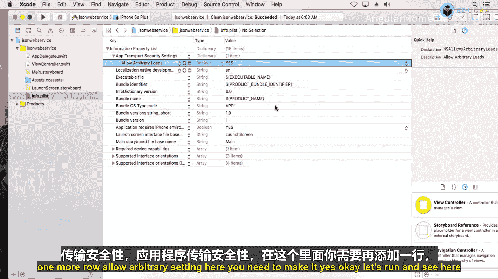
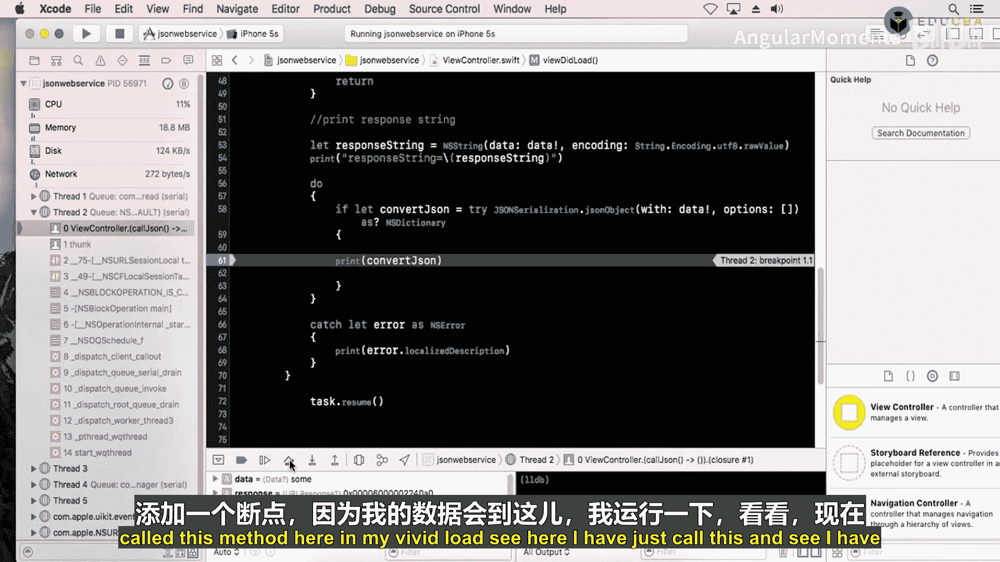
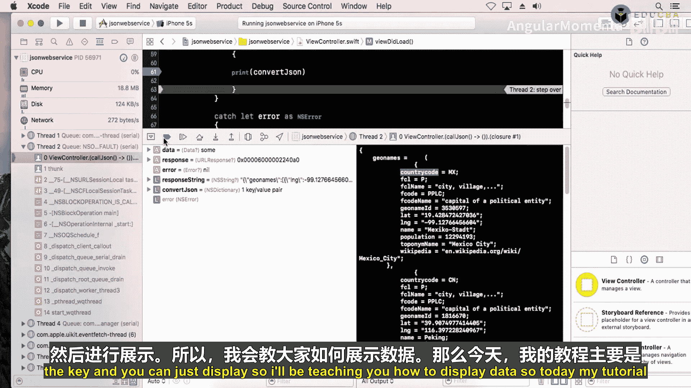
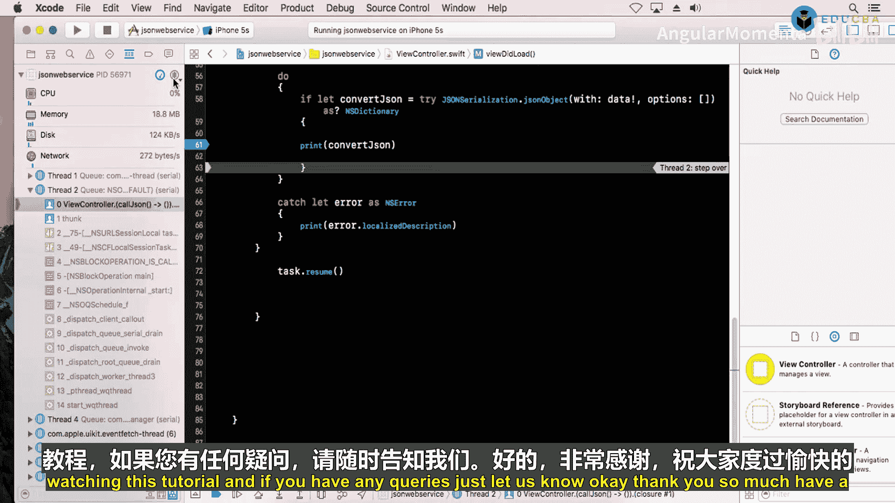

# 【EDUCBA】运用Swift核心特性进行中级iOS开发 ｜ Apply Intermediate iOS Development with Swift p13 05_01_01_iOS 10 应用委托介绍 -BV1RmFUzyEXJ_p13-

Hello friends， my tutorial's tutorial will be on app delegate like what is app delegate in every tutorial I tell you like app delegate will handle the application life cycle。

 So today I would like to give you a brief introduction about app delegate so。Let's create a project。

 We won't code anything。i just。诶 been做。I just explain you like， what are the use of its methods like。

喂。

A delegate as you see whenever you create a project you get this have delegate right。

 we have different different methods like we have definition finisheded launching。

 it will be there throughout the application right and it will handle the application lifecycl also as I every time tell you。

The best thing about app De is that app De works alongside the app object to ensure your app interact properly with the system and with other app so the basic funder of saying this is that your app delegate will be there throughout the application like whatever state your application is either your app is in background mode or it is in foreground mode or you know your app is about to start so app delegate will be there throughout the application。

And my today's benefit of listening to today's tutorial is also that that you can prepare for interview also because application。

Life cycle is very important to't know， right， Secondly， the method， what is there in the after。

Gives you a chance to respond to important event like when you have a phone call or when you have like you playing game and you receive a phone call in that state。

 you need to perform any task so with the help of these old methods you can just perform all the tasks So before you know telling you about the explaining about the methods of app delegate I'll explain you。

 we have you know five states we have five states of a application like first is not running state。

 Okay， the first one is not running state， the second is inactive state， third is active state。

 the fourth is you know background state and the fifth is suspended state Now I'll tell you what is in not running state。

 the app has not been launched see。Not running state would be either the app has not been launched or was terminated either by the user or by the system。

 so the not running state would be that only either the app is not launched。

Or the app is terminated either by the system or by the user， right second would be inactive。

 so an inactive would be the app is running in the foreground like the app is there in front of you。

 but it is not receiving any event An app usually stays in this stage。Okay。

 only briefly as it is transition to a different state like you are using a app like it is in in your mobile in the foreground okay and since you are not receiving anything you can see the app is an inactive state right active state would be your receiving notifications in your app so the active state with it the app is running in foreground and receiving events okay this is the normal mode for foreground app right。

ever app。Okay， backgroundground would be like the app is executing code， but not visible on screen。

Okay， like the app is downloading something， but it is in background when the user quotes an app。

 the system moves the app to the background state briefly before suspending it。At other time。

 the system may launch the app into background row and give it time to handle specific tasks。

 The specific tasks would be like downloading Okay。

 suspended is the app is in memory but not executing any code。 Okay。

 so these were the five states of application。But these are the following methods also。

 when the app is not。嚟 transition of 。The first would be during the launch time。

 There is also one more method。Will finish launching。Of the return type。Just to explain it through。

 Okay， we will finish launching did finish application will return an active application will enter。

Background will enter。 foreground will become active term， okay。So in this application。

 we'll finish launching with option。 Okay， use this method to initialize your app and prepare it to run。

The method is called after your app has been launched and its main storyboard has been loaded。

 so this is the main story board after the storyboard has been loaded all the UI has been loaded so the will finish launching option will be called Okay。

 storyboard has been loaded but before your app state has been。

Restored， right， So after the after state has been restored。

 the dead finish launching option will be called。 Okay。

 this method tells you that the launch process is almost done。And the app is almost ready to launch。

 Okay， so here it will load all the storyboard Okay。

 and this method will tell you that if you want to make any changes， there is still a little time。

Okay， that is about to launch， okay。Then we have the application will design an active it is like sent when the application is about to move from active to an active state。

Before that， there is one more method application did become active。Well， after launching。You know。

 application will become active， okay。After this day application will become active this method is called to let app know that it is moved from inactive to active state okay inactive state would already explain you inactive state would be like either the user has not switched on the app or not launched the app or either it is terminated by the system by the user so okay so。

The application date active method will be called。Then application will enter foreground background。

 Okay， did become active。These all methods are there。 So Ill explain you about this method also。

The application will resign right since when the application is moved from active to inactive state。

 this occurs from certain type of temporary interruptions such as incoming phone po SMSs or when the user quits the app and it begins the transition like see application it become active。

 your application is active suppose you're playing a game and suddenly you got a phone call okay so your seat is mentioned send this application to move from active to inactive state So。

While playing game， you got a phone call， so your app is in foreground right your playing game。

 your app is in foreground and suddenly your app moves to background because the call facility comes on top of that so。

So this method is called at that time okay， then application will enter foreground。

 it will enter backgrounds to use this method to release shared resources。

So application will enter the background and as soon as you know the phone call is over。

 the application will come into foreground with the help of this application will resign active okay。

 so this is all about application lifecycle and the last application is terminated called when the application is about to terminate。

Okay， save data appropriate。 Okay， see all the application they the background。

 So the first method would be。Application will finish launching。

Here all the storyboard will be launched second would be application did finish launching here the storyboard is loaded and in this method it will ask again that application is about to launch if you want any changes you can make it aware okay。

 then application did become active Okay， application will be did become active after that。

 if the application is active。Like you're playing game or doing certain thing。

 and you receive a phone call。 So application will resign active method will be call。

 and the application will go into the background mode。 Okay。

 so when your phone call is over and the the。Pone the application。

 the game what you are playing will come into the foreground。 Okay。

 and then if you want to terminate you just call the terminate method。 Okay。

 so this was about all about app delegate。Like how it is used。

 And you have different states of application also。 Okay， so my produce total。

Was about basic app delegate like I wanted to clear out like every time I use a single application and I don't explain you like what is app delegate I just keep on telling you that it will handle the application lifecycle so today I have just explain you the details like how it will be using the application lifecycle what are the different states of app application so that whenever you listen to this video and whenever。

You facing an interview if the interview will ask you like what are the application state like what is the application lifecycl。

 Because these all are the important things like coding like everyone can do。

 but you know you should also have a touch with what is the application state and what are the methods will be called like when the application is active when the application will move to foreground and background Okay so this was all about in my next tutorial I teach about view hierarchy like I always tell you like view load is there there are certain methods like we will appear we will disappear So today it was all about application。

Life cycle and about app delegate next would be about view and view hierarchy and about the different methodss like we would load and view with。

no别靓 o。So thank you so much for watching this tutorial。 I hope this was fruitful。Have a great day。

Yeah got rest。lord which method。你 just like get。You want to just get data okay you can also we have like post okay now I need to execute STTP request right oh El just said execute I am just leaving this coming so that it would be easy for you to understand STDP request okay here I just create a task。

Does and you at you any your。Dat shade。Your data task。With you are， that is。

The request what I have said， okay。Yes。😊，You are a request。好机。So inside this and the third data。

Oh my response。It is going to fun。开。ok。嗯。😊，系咯，有都即。And你 check嘅。你诶。hello。那力 골 to呢。Is right print。

 and just print error。Yeah。你翻钟。Okay， and here are just written so that the statement should terminate。

做个 this。Well， now next year， I I need to print response to And I said when。Thatpon。最 o 就 let。

The spa string。If I do any drink。Mistry。你晒啲识嚟嚟得。ok ，你系讲多谢得。Comma， encoding string。Encing not。

Encoding dot UTF。月。我知道外地。Okay， here Ive just created a response string request。这个 the blue face攞系屌。

唔 you is边nda。Apon string。This fine thing。ul be。Let， can you this。

And let's copy and just space this response string， okay。

So here I got the response string also now one class is the J serialization class。

 which converts the you know J data into web service， so I'll just how it will work。你系度。if let。

Converation。Where to dry。is specialization。Okay， not is an object。刘自新。Oject okay with。你得。嗯。傻啲。你哋得我吗？

Option would be ill。Since we be in a。And this as this clothes。你估知你啊。And as this snow。ok。吔屎。诶记姐嘅你你。

Repon string。 here， I just printed the response string， right。Any here like great did I do。As只。

And inside this。Just bring this conversation。 I just see what error I'm getting。Just let me right。

Okay， let's close this task Yeah I need dinner know。嗱去电话俾 friend。系 I we did this。They did it do。

Yeah get。And to catch the error right。诶你。诶诶。And this。And i say okay。Here， Ill just open one I。

If it is， it has an error， as I said， error。d。有。Localized description。 Okay， let's close。

 I your task。那住。How do get think this method also I don't know what is wrong with my expert today。

Okay。你先死啦 you先。你且要咗瞓。Resolve identify， right。就。Here， I need to change the object of the capital。

You love and solid id since realization。So let me take first。 let just like it again。Lets to do this。

 okay。你嘅世界。net。嗯。Andwardson。You prefer to try。你先。拜拜。力。再自星士的励自旋追。系 jack先。你算水来上 don white保ト。我自新 yes。

Now I got。is an object。我系屌单位啊。😔，Okay。O i need to mention。😔，So here。

 I have successfully created a request。ok， you just speed service。

When what we are getting initialized for condition binding must be obs any attack。我听日一世几你房。😔，就しで。

Okay， now I hope I'm sorry to take thisma time for this line。

 Actually my intelligence window was not working。 So now successfully converted the Jasonson object with the help of Jasonson serialization。

Actually， I was not taking this in capital form。Okay， so that is the reason I was getting error。Fine。

 so I've just created this block here。And just call this method said。啊改谢先， ok 。

One more thing you need to keep in mind is like in the few list。

 you need to add some changes in the field list。In the pill， you need to， you， add a row。

唔使 say咯， like。Air transport security。Okay， have transport security inside this unit at one more allow arbitrary setting。

Yeah you need to make it to yes。

Let's run and see。Here， I'll just change us。 you know， iPhone size to 5 S。

 I've changed the iPhone size to 5 S。 Now， let me add a break point。Yeah。

 because herere my data will。 I' just run now。系历史。Now've called this method。Youre in my video Lord。是。

Yeah亮 just。all this and。

I have successfully， you not paused the string， and I have got data。

Like geo name see my data is in the form of diary and inside this diary there are array and inside the array there is diary and accordingly so in my next tutorial I'll be teaching like how to get data like I'll be using table view and the table view I'll be displaying name so in my next tutorial I'll be fetching data the same way as I am doing in this tutorial and in my next tutorial the only additional thing will be that I'll be you know removing data from this web services Jason web services like whatever I want like I want name so Ill like。

Remove a name key and if I want Wikipedia or anything from this。

So in this also in short I will tell you how to do that first you need to create a dictionary and you need to add the this conversion into the dictionary okay。

 then in the dictionary。Dtionary we have keys like value for keyto dictionary whatever name we have taken value for key would be this And inside this dictionary you need to you know add an array and inside that array again dictionary and from that dictionary what you' are taking would be that dictionary value for key whatever key word and you know you can just take all the key and you can just display So I'll be teaching you how to display data。

 So today my tutorial was basic about web services。

 how to you know get data from web services Thank you so much for watching this tutorial and if you have any queries just let us know okay。

 thank you so much。 Have a great day。

