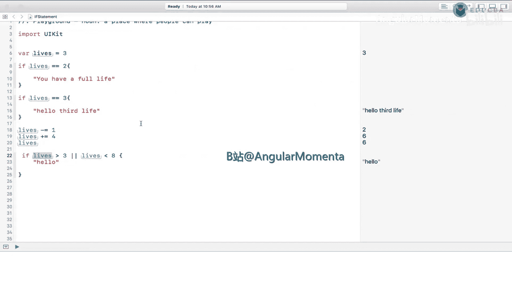
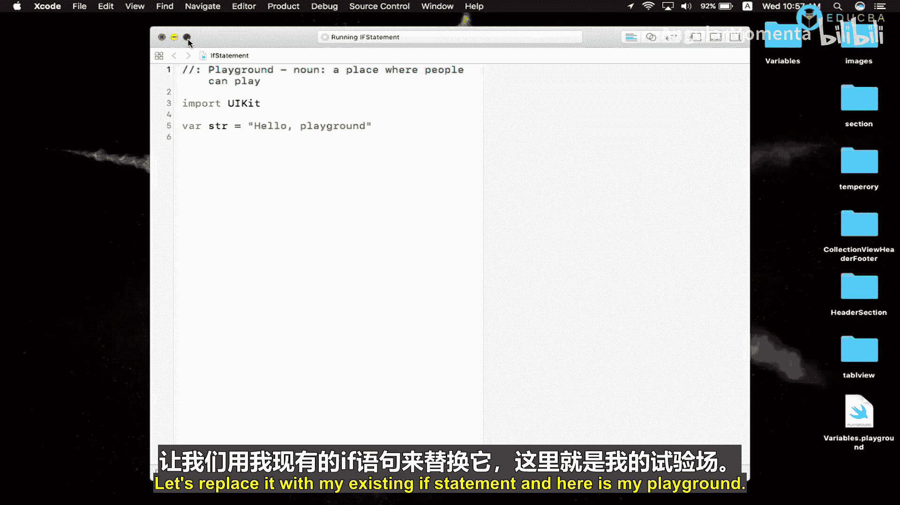
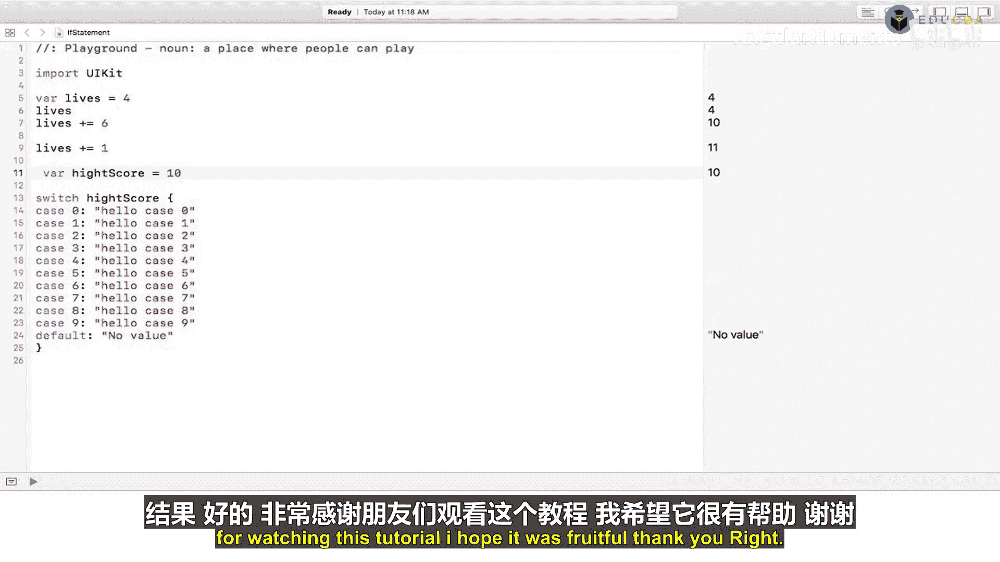
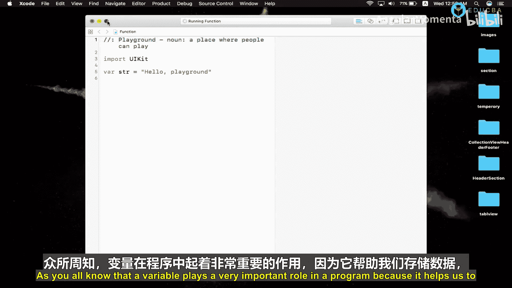
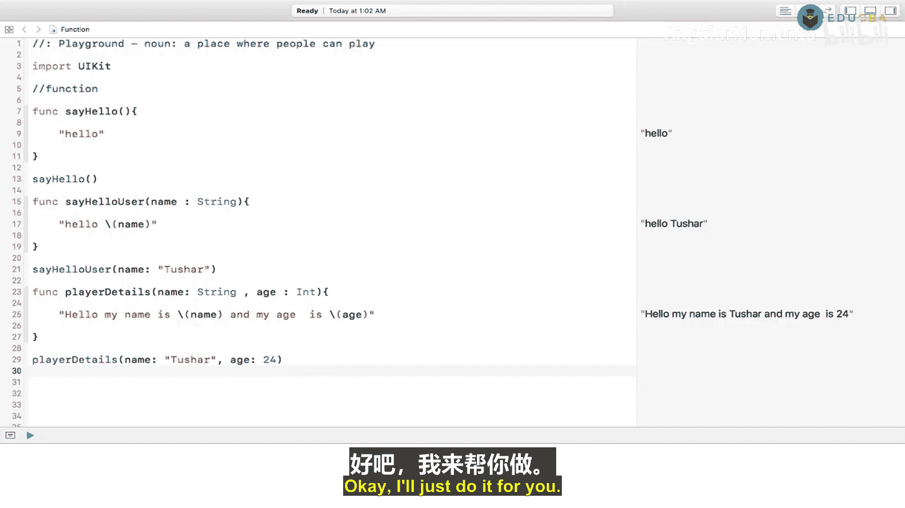

# 【EDUCBA】运用Swift核心特性进行中级iOS开发 ｜ Apply Intermediate iOS Development with Swift p14 05_02_01_iOS中的if else语句 -BV1RmFUzyEXJ_p14-

Hello friends， a very warm good morning to you all Today I will be giving you presentation on very basic concept of self that is a health statement。

And it would be under part two of basic concept of I O。 So let's not waste time and。Create an X code。

So as I already have an exclude open。

But just close it， and reopen it。And as in my first tutorial I taught you like about variables and like how useful is playground to code and to get an instant result instead of like creating a single way application and just practicing on that so my today's statement will be tutorial will be if statement right so just create a playground replace it with my existing if statement。

And so this's my playground。

So let's suppose I take variable。年。raves。And I gave it integer value4。So now after this。

 it will come， the playground will compile and give me the result for。The lives is and it has data 4。

 which is of data type in。 So if I print lives。It will give me four now。

 if I want to subtract something from this right at6， it will give me 10 right so now。

What is if statement？If statement are those kind of statements like they work in blocks， right if。

This would happen， so my answer would be this if this would happen。

 my answer would be that so it is like that so I right if。Lives。Equal equal to 5。Man saidrup be。

 hello ffe。f。nice。E equal equal to6。My answer would be。Iello 6。and。If。Nice。We good。Equal equal to 7。

My answer would be hello，7。Since my value of life is 10， so the condition will go inside this。

Only when I'll give the value of life as 10 in my if block。 So if I write if。lis。

It really equal to 10。All right。Hello ten。And yet I have。Okay。

 so this is about if statement like if last would be this， if it6。

 now you must be wondering what is this double equal to？Why can't we just write single？

So the difference between the double equal to and single is that when we use a single equal to。

 we are adding variables like we are adding value inside of variables。 and when we are using double。

 we are comparing two things。 So I was comparing。Lice with an intesger verified to get the desired result。

 So this is about if statement。Now。We can't just every time write write a if statement， right。

 suppose we have condition where we need only。A condition to check like if the value of life is this much。

 it's okay， if not， so let's fight。 So I write if。n。s equal equal to 6。I would write。你。

Ralue would be。Aronic 1，2，6。S。Iright。Right right。Yeah。S 6 and where I get a desired。

 so this is about if L statement， we can just write if the value of this is this and if I write。

10 away since my life is 10， so the result would change。So this is about if L statement。Now。

 let's suppose you have multiple affair statement。What would you do in that case or I am saying let's suppose you have a condition where you need to check multiple data so in that in that case you would just claim this first。

Let's just check if。Knives is equally equal to five。W three dollar five。Yeah， right， Els。Rives。

Nchron equal to6。Great， hello，6。诶。Ns equal equal to 7。Allright。hello， seven。安先。

Nives equal equal to 8。未。Hello8。Right。MC。Where is a44 to9。Allright。helello奶。反车。喂，你过你过了丁。All right。A1。

All right if all this statement is not true， I write else。Right now。fin。安情。

The sense the value of life is1。Isis。我。Is it from you。And if I right。喂。Minus， main。Minus equals2。See。

 what I got the result。It's same咩 error。It's right。Because I have started。From here， right？

 So it's like， hello，10。If I do it。n。what is great doing。

So now it would grow in her condition and it would grow like if not10。

If not like value of life is greater than 10 right so it would go under this condition。

 so this is about if L statement。Previously I did a mistake because I'm just starting the condition from five and just compare it to 10 and after the series decrease so that is the reason。

 but here。I corrected it so ifL statement can be used while creating registration form also where we have lots of fields like email。

 password username。First name， last name。 So there you can add a check right。

 if username is equally equal to null。So you give a message L save password equal equivalent nerve。

 so there you can give a message， so that was all about if statement， if else statement and。

This is about。If L statement， okay， I given a if。If else， if else else statement， okay。

 so now I'll be teaching you the last topic that is switch case now what is switch case and。

How it is useful， then a fell statement。So in if a statement， we need to write。

Like a large number of block of code。Do you know。To fetch an answer from it。

 But before teaching switch， I got another topicppling into my mind was like like conditional operators。

 like operators。 So if I write。If。li。Yes。你 then。6ix。Where if life value is greater than 10。And嗯。来水聊。

Its smaller than。15。So， in this case。Mo to you。sexist。I got， so this is an end operator。

So in if condition， if you add an n operator， so it should be like the both the condition like the first condition this is。

My first condition and this is my second condition right so my both condition should satisfy this statement。

So if it satisfies this statement it will go inside this flow like I did if my life value is greater than 10 as it is 11 and and my life value is smaller than 15 so 11 lies in between that so it went into the success block so in any condition if you want two statement to be2 you can just shoot an an operator lets suppose you want only one condition to be2 for that you write an or operator so like if。

Li。😊，你个啲歌 to系写试咯。Or it's two pipes。Right。Equal equal to 11， as the value。

Please go inside this and print a success。I printed。 Okay， I change the message。 like hello， sex。

And here is my message。 So the difference between an operator and our operator is that in an operator。

Both the condition should be true， but in our operator， only one condition should be true。 Okay。

 so now let's。Head back to Swcase so。Yeah， I write were。And I write high school。

I score would be my integer and we8。 Now， here see， I write switch。 See。

 I got a switch statement and asking me for value。 So I want to compel this high school， right。

 I score high school。 Now， my high school is 8 right。 I make case。Kase 0， I went a message。

 It will give error。 Okay， because I haven't。Started， and write。Hello， this one。你。And it case one。

And general pass。Hello， case one。 Oh here。 I need to read 0。ok。Now， the same thing。Yes's true。

 And you're are right。helello， can do。你你你。T three。Re should give me。look几 train。De four。i'm sorry。明。

Hello， guess four。My right。gue five。耳朵。Okay case fine see it is easier than if this condition。

 the codinging is less in this。G six would be。S6。Kss 7 would be。Hello， guess 7。Guess it would be。

H case 8。See， it went set a case yet because the high school is case。This name。gue name。嗯。

Deer and press。No， you。Okay， so if now yet I change my leg run。Hello， case Ron。F5。我要。Hro case 5。

Right at7。Now look case 7。Friend and。If I write， then。No value Okay。

 so this was all about if statement if statement and about checking out an operator or operator the switch statement so my two tutorial was about like conditional operators like how we can write conditions and on top of that how like how we can check those condition and get the desired result from me Okay thank you so much friends for watching this tutorial I hope it was fruitful Thank you。

我来说。Hello friends， a very warm good morning to you all today I'll be giving you presentation on the third part of the basic concept of iOS that is functions now before telling you like before explaining you what is functions let me first open my code。

And I'll be using playground as in my previous two tutorial that is basic one and basic two which included a variables and if statement so I was using playground so for that now this is the basic third part so even for this I'm using playground okay so my today's topic is functions。

Now， what is the function。As you all know that a variable plays a very important role in a program because it helps us to store data and you know it helps us to retrieve data from the variable and we can change the data if the variable is of war type so。

We also used the F statement which was you know like a block。

 so where can we use all this statement the question is that so the answer is we can use everything inside a function。

A function is a block of code that will perform as and when we required like lets suppose we have a function like a block a function is just like a block which deals with the total score or like total marks of a student。

So like while generating a report we call a this function which will you know generate a total mark of student and every time you need to generate a function every time you every time you need to generate a result you call this function so lets code right my。

Today this topic name function。So。To start with function， we write function。And let's see， see。Hello。

 okay， and it would ask me for a round bracket and an opening as this is just like if statement block opening okay。

 and here I write simple。hello。Okay， so now as this code is not running because I haven't called the function so to call the function。

 I will just write say。hello。诶。It will give me the result。My simulator is running。

 see running function。四 hello。And。😊，One more thing I would like to tell you。 See when I wrote。

 say hello， it's。It is a void function right so the return type is void so void means nothing so it is just returning what is inside this okay so we got hello and now I say。

Okay， one more thing， the two goal bracket is very important as this will contain the member of the functions。

My function name is hello， say hello， but if I want to perform any like any logic into the function and I want some members like。

I say I create a function naming。放心 as是唔。Hello。写诶你。Hello， user sir。好嘅。And I told you。

 I want to set a member now a right name。Okay， which would be of type string name is a form of character。

 so。D string。So what's the message I see。hello。And。I'll just give a space。And just with this bracket。

Just write the name， the member。ok。Easy to understand。So when I call this function。

The playground will ask me to add some variable or add some data into this name parameter。

 right so see I say hello。Hello user and see I have created a name parameter which is of string type。

 so it is asking me to enter something in the string I write to Sha。When I enter， said I。

 hello to Sha。Right。Simple， easy to understand。 So like this， we can make many functions like。

Any you make。放声。诶。你哋知。你。All right。 my function name is player。Nair details。ok， and。Youre al be name。

Passing multiple parameter， which would be of type string。And do it comma。

 I'll just write something else。Like each。Which would be of type intesia。好。

So yeah just open a function away。 Okay， this was a function of one parameter。 Now。

 this is a function of two parameter。 So I'll just write。I just pass a message， saying。hello。

My name is。My name is Suanso。 So is it name。My name is。传输。And my age is like mid H， okay。做完咧。

Just call the function。I cleared the their name。P our end age， I'll be giving 24。

 and I just entering。You get the details。Okay， I'm sorry。 It's in string format。So。

This is the details。 and my presenter is's like my name is T Sha and my age is 24。

Simple is there to understand so like this way we can create a registration form also like we can pass okay。

 I'll just do it for you。

