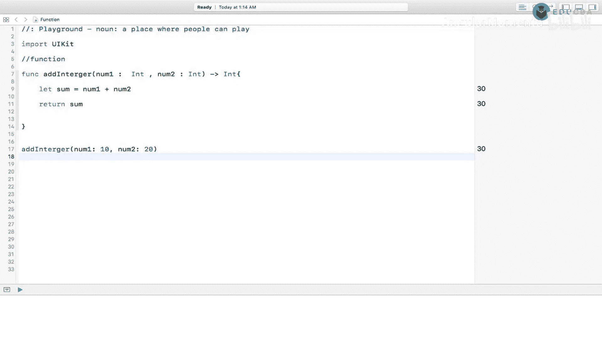
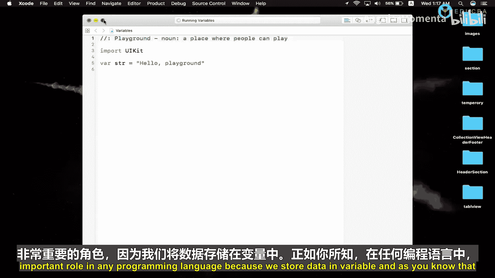
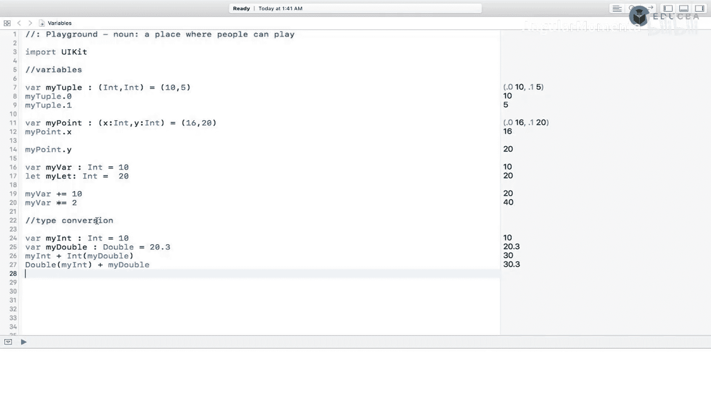
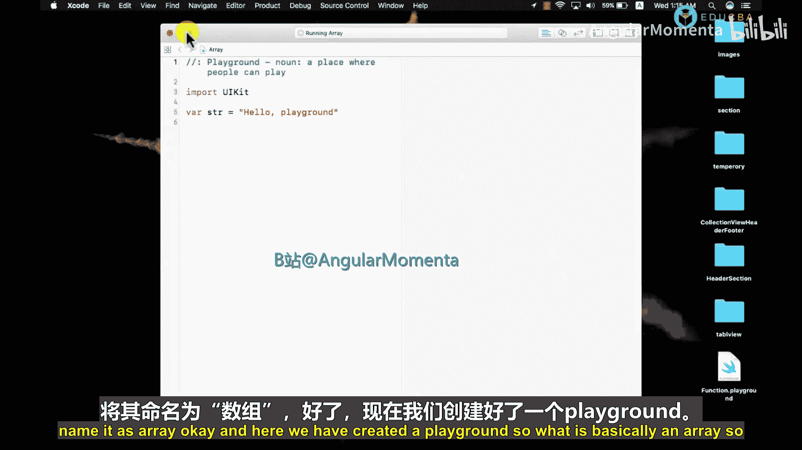
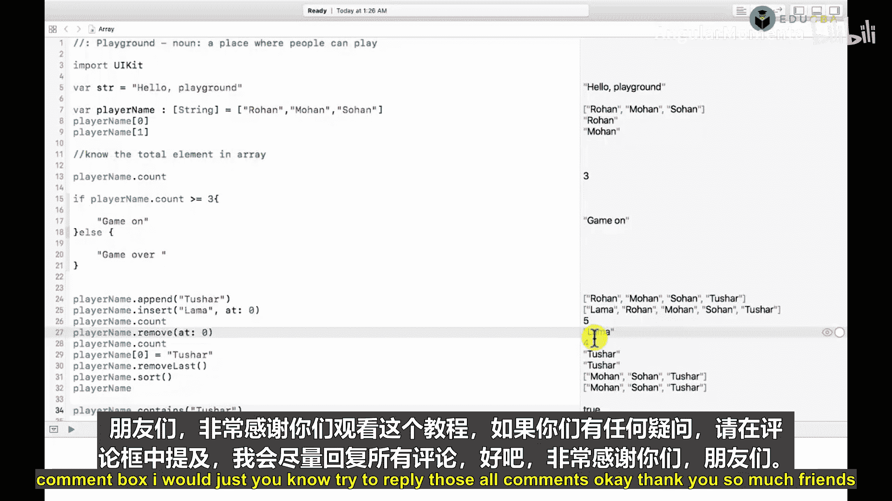
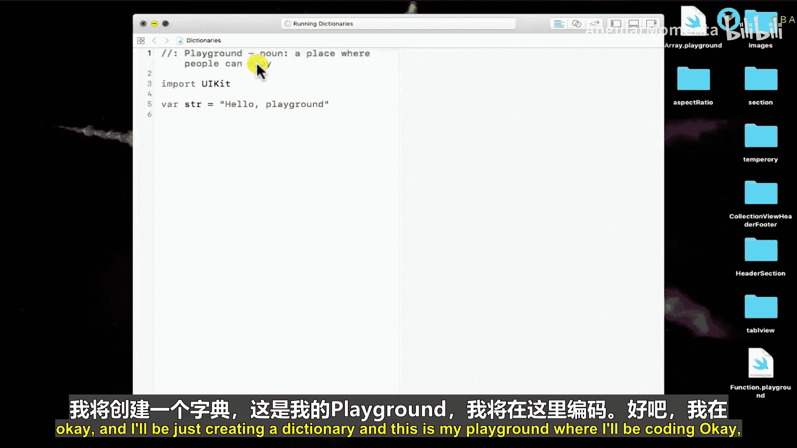
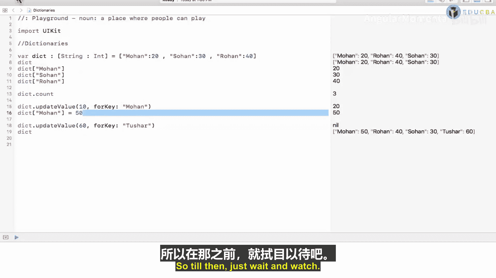
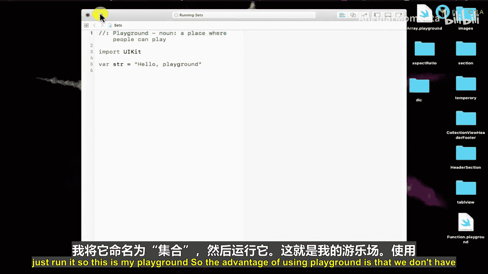
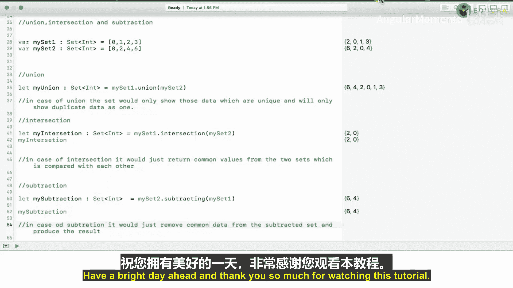

# 【EDUCBA】运用Swift核心特性进行中级iOS开发 ｜ Apply Intermediate iOS Development with Swift p15 05_03_01_iOS中的示例函数 -BV1RmFUzyEXJ_p15-

Now we will be passing multiple functions like multiple parameter。Firstly， I'll be creating this。

 My name is Da， Da， Da， I am。可以。Yes。我。诶 i on。And what else。 And yeah。买。华V yes。但但 dash。好嘅。诶。

I want to become。So let's create a function for this。 So I like。Function， and I write details。

As the user will be giving his details。And inside this details I'll pass first parameter within a nave。

 which would be of type string， right？And second would be age。 So at this right， age。

This would be of type in teacher， okay。Third would be hobby。谁 just你。好比。It would be of type string。

And but like what you want to be， So it's a dream， right。

 it's a dream I'll be taking the form of string。Simple， now I write it。Just copy this instead of。

 you know。Go。 My name is Je passinging。First， I'll put this inside the braces。Okay， and my name is。

And press the name inside this。ok。My ears is。Okay， and my hobby is。And I w to become。

So now let's see， let's call this function。I just write。It is。Retails， it will ask me for name。

 right， name I'll be giving to Sha to Sha。It would be。对科。Hi is。歌厅。Okay， again。

 it's interesting for me。Dream to become。Deam to become a software。Inジer。When I press enter。So。

 I hope。This function is clear now how to create function， how to pass parameter inside the function。

 same thing if you like。You want know create a integer type functions right where。Inte， integer type。

H open。Oh， I'm sorry。 You just write age aware。At end。诶。ok。So when you call this function。

Just give24。 and just， okay。So you get a message is equal equal to24。Okay， so few things more。

Now now Ill declare the scope of function like what is the scope of function。

 so let's suppose I take I take a function simple I write the function name as ABC。

 I just close this and I just you know。And here dec over I right mind the video of integer format equal equal to 24。

 right。And is that my end。I read。Pic water do，2。My aunt。Mus equal to 24。mind。Nal to 0， right？说 now。

你非。A read my。My aunt， see， you won't get anything。It would give an error because the variable what I have declared is inside the function。

 so the variable which I will be declaring inside the function。

 it will have its scope inside the function。But。If I do this。Im sorry。

But if I create a variable outside the function。Like。Like this。 I just cut it and just paste it。你发紧个。

a b c。You're again going to get the value， because。The scope is global globally access， you know。

 anyone can access globally and since its scope was only inside the function。 So you could not。

 you know， just call this integer。 So this is about the scope of function right。

 So now we have one more kind of function like which would you know。written data。

 unuccessful of completion。So I'll just create a function simple。

 I'll write the function name as function。系。In teacherger， okay， which would be of type。Kt。到吗？

Number2。Would be your type。Inint right， and the written type would be an int。

 So here L be just doing where。Where sum would be equal to number one。Plus。😊，Number 2。Okay。

 and I want to return。As my return is of integer type， I would be returning some。Okay。

 so now whenever I call this function。What is telling me。 Okay， let Okay。

 so wherever I'll be calling this function， like add intesger。It would ask me for two weather at 1。

Another， I give 20， right。 And when I enter this， it would enter into this function。Okay。

 it would add the both the number and in the return， it would give me a sum。Ofvo。

 so I hope you people have understood like。How we can declare function and how it is useful in programming and like how many kind of function are there like a simple function which would not return anything a parameterized function。

Okay， and a written type function， so three types of like declining functions I taught you in this tutorial。

I hope this tutorial was fruitful to you all。 Okay， thank you。

Hello， friends。 A very warm。 Good morning to you today day。

 Ill be teaching you some of the very basic concept of self。😊。

So one of the basic concept of shape is variables， so without wasting any time， let's start。

So this is my X code， so today instead of creating any single V application that is instead of creating a new project we be working on。

呢个。I'll be telling you what is playground， so let's take a name of the playground like variables。

As today， we'll be discussing some of the basic concept。小。Ws。Right， so now what is playground。

Excode has provided a very good interface to， you know， practice coding and。

Practice in getting an instant result like my sulator is launching。

 so here whatever code Ill write I'll get an instant result over。So today as our topic is variable。

 so let me first tell you what are variables variable play a very important role in any programming language。

Because we store dataing variable and as you know that in any programming language we want data right when we store a dataing variable。

 we can pass that。

Variable anywhere we want and we can access data as machinery language is all about passing fetching data。

 So see this is my playground and I have written a hello playground and I have got the instant result I just show it to you and。

If I like something else like。Hello。So， I doing this。Run and get there visit。

So today I'll be teaching you four kinds of variable。So。Let me write the topic name。

So the first kind of variable， what I'll be teaching you is an in teacher。Now。

 what is an intesger intesger is a single digit number， or you can tell it can be a whole number。

 so how do we declare intesger in shift so it's like we take variable where。And I'm taking my int。

And the naming conviction like whatever the name I have written here should be of camel case like the variable what I am declaring should have a small letter in the start and then you can take a capital letter after you complete it so my endt and it will be a type of integer。

And I'll just give you a 10。So when I write integer in test 10。

 I get an instant result right so that is the reason Excode has provided a playground。

 it saves a lot of time because if you write the same piece of code in your。Exco project。

 So when you click on run。First it will compile everything and then it will load the simulator and after that it will we will give you the result so it is not instant and here you can just code and you get result over here right so this was like how do you declare in teacherer in。

Playground or and shift， right， So here we can take like where。I take score。Which would be of。问你心。

And its data type would be a friend teacher， and I write2 many。So see here， it will just。

 it's saying running variables。 And yeah， the result is instant。 what's study。 Now。

 if I write score over here。It will see it has already given me its types of intesger and when I press enter I'll get the result Now the second thing what I'll do is Ill declare my score。

 which is of the data types of。En teacher as 0。上好嘅你。Right scoreエギ me0。是。

So I think it's very easy to learn in shift。To declare a variable to store data in it。

 we can add data inte also， so it's like score。Just write the plus sign。Equals to one。

 And if you do that。We get a result as 1 because here we have declared inte as 0。

The second thing you can do it， score。Subtract。You in right， too。So the result would be minus1。

So isn't that easy to learn， we can even。Multiply score， you can just first。

 I'll just add some data in it score。Plus， equal to 6。And here it， it would be five， right？And again。

 you can just you know multiply a score score equal to2 and the result would be 10 as the previous set of score was5 so that is5 into2 would be 10 right you can even divide it its like score。

Space divide equal by 2。And get answer five。Right， so。

Don't you think it's a very easy concept to learn？就。If I write， let's suppose I'll write score。

Plus equal to this integer what I have declared over here。 So like my int。And see the result。

 it is 15 now。This is like the integer is all about whole number， right？

The number which does not have any decimal point so there is one disadvantagete is like when you divide an even number like you have score like you have 15 so when you divide score。

like two。And see that is it it's human。Doing like a whole number 7。

And what is the expected result as like 7。5？To overcome this drawback， we have a new variable。

Or a new kind of data type， we can say。Double。Double is just like float， but it will give you more。

Precise result and fruit。 So here I declare my double as same， like where。咪。有蚊。

And the data type would be double。We could do。Then I do。

Easy to learn so I have declared double and hour when I write my double。Let give me a result less 10。

2。Right， you can add de double by。Madaable。佢先唔停我哋啲都要啊。不。Weal to。3。 six。Yeah our result has 13。8。

 we can subtract the double right my double。So。Minus equal to I say 3。6。

 you get the whole result back，10。2， you can even multiply a double。咪。They're going three。

We get a result。So this is the advantage of using double over float is like float will give you result。

To a certain limit， but double will give you more。Exact result Ben， right， So this is about double。

I hope you understood like what is integer what is double and now let's suppose you have something in your mind like this is all about integer and double integer helps you to store the whole number double will help you to store。

The numbers which are in decimal point and you can add accordingly。You can divide accordingly。

 you can multiply accordingly， but one thing is there， you cannot add a double programming teacher。

As double is a data type of double。And integer is a data of integer。So for that， there is a。

New concept of type conversion that I'll be teaching you later in this topic。

 but before teaching you that I would like to tell you like。

Now you have done with numbers like now you must be thinking like what is there for characters。

 right， so it's like。To define a character。I see that Sw has given a concept of strings string is nothing but a collection of characters。

 so here I declare my first string as well。My string。

You can take the variable name as anything you want。And the same。Sttrain。

Equal to the string is always inside the courses， and I write。hello， everyone。So it's updating。

 and you wrote the wizard。 Hello， everyone。Right， so this is about strength and if I write。Oh。

 I'll just edit it。 And if I write。喂。liear name。A string。With佢 do。What's the I take that。Okay。

 so if I do that， see in my playground， I'll be getting met。

I have two in string one is my string and the second one is p name right so now you have one more beautiful concept like if you want to add this string can just write。

My stream。Which has a data type of string， which this the next is showing you over here my string。

 the same thing plus equals two。咩 name。So the result would be hello mat。

But as you can see that the result is like not in proper form， right， So if I put a space over here。

So it will the export will update and it will be like hello and the space and mat。

So but this is not a good practice of doing programming。So to do programming。

 you should have a clear concept of your。Like what we want to write and how do we want to express it to the user。

 right， so to do that first and with showing you。Like how to print the data。 Okay， so I went where。

Priinnt beta。It goes through。嗰人。And inside this colon。I's this train。Fedest colorer， I mention。

 my string。先 and。I get the data。Hello， Matt。So this is the way like how you want to show data， okay。

 so this is about string。And you can do one more thing。You can just。At this。恋宁。

It will be like hello Matt， right， So it's asking me to edit something It's like it's asking me for a call。

 but no use like。So no years， I was just teaching you like how to print the data。

So now there is I have taught you three types of variables。

 one is in leisure the second one is double and third is string right so the last form of storing data would be Boolean。

Now， what is bulloleing， Boolean just works as0 or1。

 either the statement is true or either the statement is false。 So it's like where my bull。

The data type would be bullolean。And across to C。False， right， See it。

 it's giving me the answer as false。啊你。Rare。A， are they time。And I can just sayq。Okay， so。

 so these are the four types of variable One is the intesger。The second one is double。

In teacher will help you to deal with。Like the whole number。

 like the number is does not have decimal coin。To overcome this decimal point， we have double。

After double we have strings which deals with characters after that we have bulloleings you know which will deal with like either the statement is true or either it's false so you can just write like if something is true you can just print yeah this is my answer if it is false you can also print that this is my answer so it's all about that so in my next tutorial youll be learning like how we can use like condition if Eds statements like how we can use implement bulloleing so that it will be more clear to you okay so I'll be teaching one more kind of data it would be twople。

Now， what is stupid， right， So let's。It is everything。let me你识。

So that it would be easy for you to see my screen。 Okay。

 so what is tuple Tple also helps to save data。 Okay， so if I write where。买都不。W was too。

 I want to save two integers。 So I write integer。Win dessert and I live。

Weve defined this indigen spin from 5。F， if I read my too。I get ready。顶好。00。

1 no its like 10 and5 right so if I want to retrieve any data from T as you have two data so I just write point and it's asking either you want the first data or the second data is like0 in my zero point there is 10 in my one point there is 15 so Ill just write0 and I just enter and see the result you have 10 for it my two pull dot one。

If I enter， it's loading and it's five。Fine， so but I think it's not a good way to express this to the viewer as you don't know like what tu you are using Okay。

 so it is like difficult to retrieve data so to make it more easier al write let's suppose I'm taking。

A point。A point of the coordinates， you can say， I read my point。Point equal to the bracket。

 and let x。Okay， as I would be an end。好吗喂。B。And。Sorry， and okay。

 and here I define it as let's suppose my x coordinate point is 16 and my y coordinate point is 20。

Better 16 chrommeronic。 So now if I want it， I now see it's easy if I want the X。

 just write my point。Dot x。I get the data 16 with my point。落位。If I enter， you get 20。说。

I think the concept of tuple is now quite easy for you to understand you just define a tuple。

 you just take two values， you take the value name， you just store data on that variables and。

Like you take x the tuple name dot whatever variable you have taken with write the name and you get the value right so this was about tuple。

Now， one more concept it came to my mind is about。In shift。

 there is like two we can define variable by two kind one is rare and the another one is let。Let。

 right， So let's suppose I'm taking a value I'll be writing。喂。My variable。It would be of。Endiit。

And I'll be giving this value as 10。And I let let I my let。F be of inteia type。

And it's asking me for value， So I write 20 simple。Symbol to understand， so。

The big difference between variable and let Ill be just displaying you So if I write。My where。

Plus equals to 10 if I enter it， you get the result 20 because my where initially it had a value of 10。

 and if I add it。Mo than it's2。 If I write my word。Coll，2。2。So it's like 40， right。

 but now if I take my let。Plus， equal to。And。Okay， if I enter it。Would you get an error。Now。

 why you are getting this error and what is the playground trying to tell me？It's like， fix it。

 change LED to where to make a mutable。So， I want to tell you that whatever value you will be defining in shift if you take the variable type as let。

 so shift will be considering this as a constant value。You cannot change the value of this let。

Of this variable， whatever you have defined by the name is let。But if you define it by war。

 you can change any time you want。So this is the major difference between let and where let is used。

 lets suppose you have a variable in your whole program or in your whole project it has it will be like containing only single value right let's suppose you are playing a game and the hero has 10 lives so you can just score like hero life let hero life is equal to 10 and as you know the life of hero would be 10 so you can just define it。

But if。It's not 10 and if according to the game， the life is increasing。

 decreasing so you can just declare air。So， I hope。

That you understand what is the difference between the where where。Variable and the variable。

 So during this video， I also told you that you cannot add a inteser and a double right。

 So we have a new concept of type conversion， So I'll just write type conversion。 Okay。

 so here I right where。My aunt。Of integer type， equal equals to 10。Right， and red， where。

My double my double。F be of data would be double。Equals to 20。3。Right。😊，Now， yet if my end。

My end teacher， plus。买。1even。And as soon as you press enter， it's running and you get an error。

What is aing。Its like binary operator plus cannot be applied to a print of type integer and double see as I told you like you cannot add integer with double so Sw has introduced a very beautiful concept of type conversion you can just write here as integer if you want to convert a double to an integer you can just write。

And。You can just open up please。 You can read。My double and you can just close it。

 And if you press enter。Yeah， there isn't。Right as the result should be 30。3。

 but as we have we are taking intesure。My end is of integer type and we have converted the double to integer。

 so integer is always a whole value so 20 would be the whole value of the double what I am adding so it would be 10 plus 20 so it is 30。

You have the answer。Same thing with double you can do。 It's like。Double， and you convert it to。My in。

My double if we press enter， will get the result as。3ty point three。

Where is the result you cannot add a make two different variables of two different data types。

 So for that shift has introduce a very beautiful concept of type conversion。

So I hope my today's tutorial was very fruitful as it was very much basic about shift so whosoever wants to learn shift they can just go through the basic tutorial so that they know what is variable what is let variable what is where variable what is in data type what is double kind of data type and what is a string what is boolean what is twople and what is the difference between let andware and blasting what tap conversion so thank you so much friends for watching this video I hope you liked it fine thank you so much。

Hello friends today I'll be giving you tutorial on the basic concept of shift and my today's topic is array that is a collection class。

 so let's start with Xcode。And create a new playground。nameame it has。阿瑞。Okay。

 and here we have created a playground。So。

What is basically an array。So array is basically is like a collection of class which。

Handle similar data types So in my first tutorial of variable I taught you what is data types like intesger string double so if I create an array of string so。

The collection class that is array would contain all the string。

Let's suppose I show you an example right where。系你。Cl's name。

And I just declare a bracket open and close this is like we are telling the playground that you are using an array and we are initializing what is the array kind so data type I am giving string equal to here I need to pass the name so I right Rohan。

我肯。And。苏行。So when I print this away。A of string， so it will return with three。

Data is running where see Rohan， Mohan and so on。 So Ar also deals with。The like index。

 So if I say I want the value at0 index， if I write。0。And if I print， so at my0 index。

 there is Rohan。And similarly， at by one， there is more at my2， there is so on。 So I write just。

There， and。你度湾。你。Right，2， hi， so I'll get。All the names， according to the index。 Now。

 let's suppose I want to know that how many data are they in my area。 So I'll just write。你老豆。多得。

Element in a。So I'll just write player dot count。And it will give me three。

 I have three elements in array， so it give me three。 So here if I make a condition if。Clear name。

Dot count。Is either greater than。Or equal to 3。I will pass a message。Game on。Else。

 if it is not Salus， right。Oh， I'm just sorry。你点。开会。See， I have the data if I add something more。如华。

So。It still give me， okay， because。My condition is like， if my count is greater。Then3 or equal to 3。

 if I decrease the number。Let this。So here firstly would give me an error because there is no member and its game over Okay。

 so here right right again。You understood my this land， right。Yeah。

 the count is not greater than or equal to3， so that is the reason it went inside this so now Ill just write so。

Okay， I again， get the message game on。Now， lets suppose I want to add something into the area。

 so Ill just write player name， got a pen Now， since I want to open a new element， I'll just write。

The name at the beginning given is。To share。 Okay， so now when I again print my player。And if I see。

It is running era and to share is been added to the last element right so this is a disadvantage right suppose lets a user want to add something into the middle like into the0 index1 index to index 3 index so how will it do so to overcome this。

And like this disadvantage。 like it has provided， like with。呃 new feature嚟。Clear name， dot insert。

Iner new element， so I write Lama。And I'll just go where I want to insert it to my zero index。

 and if I write player name again， if I print。你叫道吗。Okay， so now if you check the count。

It will give you an count 5， okay， so there is a five element inside this。

So this is the So now if you want to remove certain element， so Ill write player。Pen name。

 blood remove。Now， which you want to remove， I said the recently added at zero index。 Okay， if I add。

Again， if I do player name。It is loading wear。See， B is gone ruinhan Mohan soon and Ts is there。

 So if I again check the count。Just to confirm， it will be4。F， so。You can also do like glare。

Nott first。点么。You know first。And you can just print and see。俾 name。律师。Now， Rohan is also gone。

 Mohan comes to the first。ok， so。If we have two feature， like remove first and remove。Last。See。

 the share is gone。 Now， if I red player。You have only two elements in it， right？就。

If you want to add something more。说。This is like youre inserting this into this， right。

 So this is like a big line of code。 So to。Minimize that you just write 0 and here you right。

Then here， you can just print density。最你系啲。Is running where， it may take time。To compile。So。

Here is it。Your last。Now， let's see。系有。Fine， so I have added to Sha， and I just been。

So now if I want to sort this array。Like sort this array according to alphabet wise so before that thesha is coming two times right。

 so Ill just write a do。Remo last。诶点。Truth just give me to Shah Mohan and so on。Okay。

 now I want to sort this alphabet voice。 So I'll just write that sort。And right player。

So Mohan welcome， Sohan and Tshar welcome， right。So here I can also check like if a certain element。

 certain string is there into my area or no。Dot contains。Im sorry。 if it contains written true。

 if it not。Return false。It give true right because the shah is there in my array。你快到嚟。😔，M dot。今顶。

And you你老。N， you don't give me false because there is no such element。Okay。

 so this were the basic things of array and I have taken this array of type where。

Because we are doing certain changes if I would have taken let。

 it would give me error because in the let we declare everything constant。

 but in where we don't declare anything in constant， it is a mutable type of。Okay。

 themedial type of array so we can just add delete。So， I think。

The concept of array is somewhat clear to your。So by this way， we can declare an array by this。

 we can check the element in array。By count method。

 we can just count how many elements are there in area and we can create a fill condition also with the help of count and if you want to add anything。

To array we can just use dot append but it will append to the last element and if we write dot insert。

 it would give me an option to insert to which index I want to insert and if I write player dot count again so it would give me the new count of the array and if I write player dot remove at which index you want to remove it would ask me if I say0 so it would just remove the zero element from the array and if I again count it would give me a new count so player dot add you can also add by this you can just write player at which index you want to add and just pass a string as it is array of string and if you want to remove the last element player dot remove last it would remove the last element and if you want to sort it alphabetically wise player dot sort and it would sort it alphabetically wise and。

You can also check if certain string。Contains in this area or no you can just write player dot contain you write to share if it is there it would return a true value and if it does not exit it would return a false value。

说你。I have explained you some of the basic features of array。

 hope it would help you while doing programming so friends。

 thank you so much for watching this tutorial if you have any queries。

 please mention that in the comment box I would just。You know， try to reply those all comments。 Okay。

 thank you so much friends。 Hello， friends， a very warm。 Good afternoon to you all today。

 I'll be giving you presentation on dictionary。

It is a collection class and to overcome some of the features of array， we have dictionaries。

As array works with index and diary works with object and is key object4 key。Okay。

 and you can save each objects in the key， like in array we were saving。Data of similar data types。

 okay。But in dictionary， we can save data。In a key so that whenever we want that data。

 we can retrieve that data from that key， so lets not waste time and let me open my X code。

I will be creating a playground， and this topic will come under。Basics of i O。Dictionary。Ditionaries。

 okay， and we just creating additionalary。And this is my playground where I'll be coding。

Okay， I'll write my playground as。Nationaries， how we were defining a if earlier was like that。

Number， if I take。V take。Aray of type in。Okay， and here I was passing an away then。Comma 20。

 commma 30。Foo read my number。It would give me this， right， and if I write number。At one index。

 I would get 20 okay， so。This is the feature of array。

But now I want to save something in the form of key so that whenever I retrieve anything I don't have to write the index number I have to write the key name right so for that I will be just making additionalary al right where。

Dicitionary。Which would have a key of string type。Okay。

 and date of in teacher type and here I would be writing my。Kne Mohan。

 And in that I am saving 20 as my data。Right， yeah， I write。Sohan， and here I am saving data S 30。

Right， can。Here， in the last I'm writing Rohan， and I'm saving data as4。Easy。

 so now I print my dictionary。I get the following values。

Right now lets suppose I want to fetch some data from Mohan So how would I do that。

 I just write dictionary and here I would write just write the key name that is Mohan。

And I will get the data to n T， So in array。We had to write the index number。

But in dictionary we are writing keys so that whenever we are saving data we know the key name and what data we are saving so whenever we want that data we would just write the key name and we get the data right we can write dictionary。

And again， the key name。你苏紧。get 30 conditionary。You're all right。Rohan and here Ill get 40 So easy。

So now what Ill do is now I want to like first how many data are there in my diary address。

 my diary seem like array。Makecount。An if for press enter。

I would get three there are three keys right so this is about dictionary like how to store data in dictionary and how to get data now let's suppose you want to update some data in dictionary lets suppose you want to update to Mohan so I right dictionary dot update asking me what value you want to update so initially in Mohan there is 20 so I write 10。

And in the key， I write。Go on， now， when I press print diary， see what I will get。It's load。

See the new value what I got is Mohan 10 Rouhan 40 soun 30 see initially Mohan at 20 now since I updated so。

If I do like this， update。Then。2 lets suppose write mining to sh okay now if I press enter it will give inil because we do not have any key of such names so we cannot update right so this is also one of the good feature of diary you can see。

And now let's suppose I want to write update put in short form right if I write diary。Then， I write。

I at 50。Okay， no， additionalary， I write the key name。 So I write。Dary， I write Mohan。And gaps。

Mohan and I write here。What should I I write 50。And now I pass the dictionary again。

 print and see what I get。Alright get the Mohan as 50 so like this way you can just write the key and what value you need to pass okay if it is intesger you have to pass the intesger。

So。This is fine。 So now like， let's suppose I want to update。

A new key into the dictionaries are a dictionary dot。Update。Okay， so update。

 Ill be writing the value as 60。And we're making a new key， right。The shall。

 And here I just pass the dictionary again and print it。See， you got the new value。

As the Sha right so now is it easy to understand see first I created a a diary okay with my with the name tick。

And。I pass that my diary should have。 this dictionary should have。Key， which would be of type string。

 data type would be of type string and。The value stored in that string would be of integer type。

 so I just wrote。Into the same format， how I have declared my key name in string and the value what I want to store is in inteser。

 same thing with Sohan and same thing with Rohan。 So now I wanted to check that whether the value what I have stored。

 I it stored in the dictionary， So I just print the dictionary here。 and I got the values。

 same thing I checked with like each element like in the diary， I just passed the keyword Mohan。

 which is here。 So I got the value 20。 same thing with Sohan and same thing with Rohan。 Now。

 I just wanted to know that how many keys are they in my dictionary。

 So I just write diary dot count and。I get the value。ok嘅。And。Dicationary dot update value。

If I want to update something into the keyword， so I write。冇。Okay， so I got 20。 and here dictionary。

Again， I want see this is like if you want to update something into the key you can do like this or directly you just write the key name and you do this and if you update value。

Okay， so now if I want to update any new key， I just wrote T Sha and I got the。Okay， right。

So this was about updating value。No， let's suppose。I want to remove some value from the dictionary。

So thats said they dot。Remove value from which value I say。I shall and again， I print this。人呢 see。

Now the value is gone。Right。😊，And if I remove this line， again， it will come。Again， there is again。

 the share will come。This was about dictionary like how to add data into dictionary。

 how to check whether data exist into dictionary the count keyword would like。

Do not tell you how many keys are there in dictionary and update value。

 you can update value to the dictionary。Okay， so。This was about dictionary。

 Thank you so much friends for watching this tutorial。

My next tutorial would be on sets so till then just wait and watch Thank you Ho friends。

 a very warm good afternoon to you all today I'll be giving you presentation on the third。

Topic of collection type that is sets so I gave you videos on diary array and now this is set Now what is the difference between array and set so in array whenever we store data firstly we store data in array of similar data types and when we print the data we get the data in ordered form right but in sets it is nothing like that we store the data in same data type of same data type but when we print the result the data are not in ordered form so this is the difference between array and set secondly in set we cannot store duplicate values is as in array we can store duplicate values but in set we cannot so lets start our Xcode so I'll just create a playground I'll just name my playground as sets。

And I this。Bt。So， this is my playground， so the advantage of using playground is that we don't have to wait to load a whole project like an export single application if we do testing。

Or if you want to learn something we have to code and we have to like run and we have to wait for the simulator to load all the libraries which is then our project that to load and then after that it would give us the result and every time we would run every time the same process would happen and it would take time so this playground is just like time saving we get instant result in this playground so let's first I want to show you the difference between array and set right so lets let me print one array。

hi would be of type， the data type would be of int and the value in this area would be 1020。And 30。

 Now， when I print my array。See what result here。Okay。

 same thing as I'll be taking my set of string form so if I just do like this。几个 do。唔该死你。老han。我肯。

Sohan， okay， and when I print my array。It would give me the result。 right now。

 Ill show you the difference between sets。No where。I'll take my status。系，你。My set。How do I write set。

We should have a data type of strain。Sa。Yeah。Just passing the data。Set。String。ok。

And here I be passing like the names。Rouhan。我喺。And soan。

Just asking me for a data type of string and see here I have the result the array and set so it is like that C in array the data is in order form like I pass the data and I print。

 but in string C I pass Rohan Mohan and so on， but when I got the result when I print here，Myet。

It would give me a Mohan so the data is not in。Ordered form right so my first difference is clear Now string does not work in any index。

 so if I write。Sorry， set does not work in any index if I add 0， it would give an error。Okay。

 cannot convert a value of type into expected set index， right。So。

This is about like string sets it is not in order form now it is just a collection of order okay but not in order form now if I want to insert something into my set so I will just write my set。

Dot insert。In insert new member， Okay， so if I write here Rohan。Rohan， any5 press enter。

And if I write my set。再见。See， it would return a false because we cannot store duplicate values in it。

 Okay， but if I add my said dot。Insert， And here I write。Sure。

 it gave me a true value in case of row， it gave me a false value because it it cannot store any duplicate and if I print a mindset set。

I get the values okay so in my set as I told you inserts as I told you we can store data in order form but in result we won't get in ordered form secondly in set we can also duplicate value which I prove just now so this is about set and if you want to insert any new data okay so if you want to remove when set is giving the facility to insert it will also give us the facility to remove so remove and I write to share。

And if I print my set again。See the result。The share is gone right so we can insert。

 we can add and we can remove and if you want to know the account of your set how many data are there is just right count。

And see the result。3，3 members are there。 Now， you can also check whether your set contains that。

Some members。So， if I write。Presenters。Frenning。It will give us a false because it is a wrong statement to shall name is not the and if I write。

My set do contains。F right， Mohan。 I would get a true result。Okay， so this is about set like。

Like you can insert data in set， remove remove data， you cannot insert duplicate data。

 you can remove data from set， you can just count the set number how many data are there。

 you can just ask set that whether my this key is there inside the set this member is there or this member is not there so all this thing set would return true false if member is there it would return true if member is not there it would return a false。

So this was basic about said but。Set also has a feature， three cool feature of set that is。ju年。You莲。

Intersection。诶。Subtraction。Okay， so these are the three cool features of set。

 so if I write ver I am taking it where because you know， it my value may change。

I define a new set naming。My said one。And I write set。And give it a type of intesger。And here。

 I define it as。0，1， comma 2， comma 3。O， I made a set。

 and one more set I'll be making for see again that it is not in correct form。 Okay， so my。Z 2。

And to set。And。Equal to， I would write。Okay， I'll take 0，2。4 and 6。Fine， so Ive defined two sets。

 So now I'll just。Show an example of union。I just make some space for you so that。That's union。

 right。So what is there in union， So Ill just write let。My union。Which would be of types set。那 right。

And。Okay， it contains in and my Ill write my set1。Okay， my set one dot union。And then write my set。

True。And when I print union， my union， see the results。In union C， my union set union  one and set N。

 So in set C 0。1，2，3， so 0， see how many members are there，1，2，3，4，5，6，7，8。So。

 in union we have the values but they are not duplicate values right so so in union the set is merging the two like set 1 and set2。

 but it is not showing the you know。The same data， like 0。0 we have toys so it has only shown once。

 two we have toys so it has just shown one and one。

3 and 4 and 6 okay so union is a union of two sets one and 2 but it will only show those data which which are like single like if0 x twiceys so it will only show one okay so it would only show unique values format it okay so this was about union right。

In case of。You年。Duplicate data as once。S1。😊，Because before starting this tu I told you and said there is no duplicate values Okay so this was about union so I told you about intersection also right。

intersection section。Alright， let。My intersection。W what we have type set， and I write。Again。

 I would take intesger。I just close。 I just make it。Capital， okay， and I write。Myet。1。

 dot intersection and write mindset too。And if I print my， okay， Im sorry。

 if I print my intersection。See the result。It is just running the set， so it gave me。2 and 2。

 so what is the intersection it was just remove the common values between the two。O， so。

So in case of interest intersection， it would。这es。Reten。Common values from the。Two sets。

Which is compared with。Compared each other。Fine， so this was the case in union it would just combine both the set and make it a union but no duplicate and in intersection it would remove the common values okay and last the subtraction。

To let my subtraction。Which would be of type set。And again， here I need to pass the integer。

And I'll just write my set one。Not。Subtract， and here I right。My said， too。

I just write my sub and see what I'll get the result。Should get three and1。 Yeah。

 I got three and1 right， So what did it do over here。It did it subtracted set 1 from set 2， So 0，0，4。

And， you know，4 and 3。So it just subtracted it and it just gave us the result like forward。ok。

So it just attracted the values which is there in set  one from set  two， so set 0 is there in set 2。

 so it removed 0。0 value from set 1 and 2 is there in set one so it removed2 and it just gave us the results and if I write。

Let。Or okay， I'll just change over here only and just do it。2， and as just， the condition is one。Now。

 if I had it would give me  six and4 see it just removed subtracted two from one。 just check that。

From2 a set number two， like my set20 is there in my set 2 and 1 is there， so it remove 0。

Okay two is there in my set two and one is there in my set two。

 so it remove that two also from my set two， so the remaining was64。

 so it produced the64 so this was about。My said， I would just write here。七。

Remove data from the remove。Common data。Okay， so this was about union intersection and subtraction。

So I hope friends now my。Collection class topic you have understood like I have said define array Ive taught to diary and the last which was your was said so thank you so much friends for watching this tutorial I hope this tutorial was very fruitful and if you have any queries please mention that in the comment box and I will respond it as soon as possible。

 Okay friends thank you have a bright day ahead and thank you so much for watching this tutorial。

