# 【EDUCBA】使用Swift开发一款滑动匹配iOS应用  Develop a Swipe-Match iOS App Using Swift p05 02_02_01_卡片堆栈管理 -BV1WNFozjEHe_p5-

Now well be adding an action to UI Pangea recognizer this one。And in action 2。

 you are tab gesture recognizer is this one。So for pan gesture recognizer， we have already added。

 we will use this one。This particular function has been marked as a object you see。

So that this can be used for objectacy classes as well。Hash selector。So I people view。😔，Dot。

Banage recognized。With no parameter。And for tabab gesture recognizer as well。

 we will be adding one function。

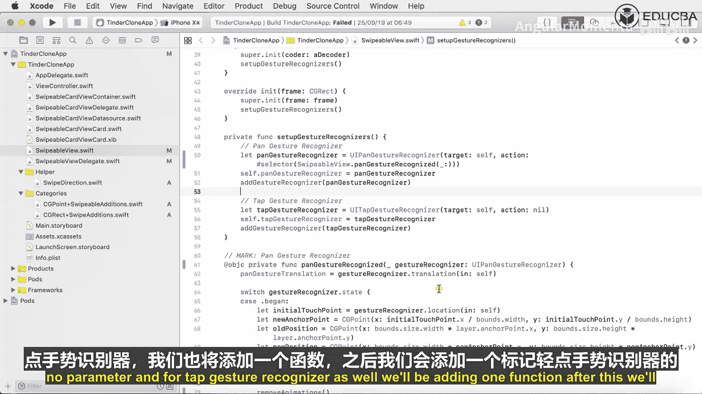

After this， we will be adding one function。

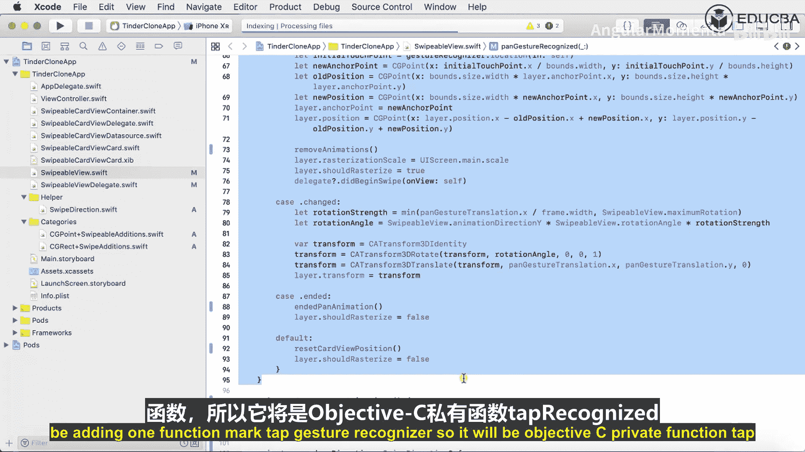

Mark。Pap gesture。Recognizizer。So it will be object to C。😔，Private。Function。Bb。Eracized。Underco。

Recogninizer。You a tape gesture recognizer。Deelete dot de。So， I pay you。So， this one。

 we will call in。😔，Action。Hash selector。A swiable view， dot。Tab just recognized。

We are still getting another use of unresolved identifier。Animation point for direction。

Let's clean it。And build again。Since animation for direction function is already present over here。

Yeah。Okay， now we have only。😔，Oneever， just go to here。And build。ok。Let's clean it。😔，And build again。

Okay， only one，1 build failure。You can see type swipeable container U does not conform to swipeper delegate。

Okay。This means we have change the function。Signature。So we should write this one。Or you？

Now let's build it。😔，There should be no error。😔，I can't see all you。noer。

So now we will create one sample swipeable card。

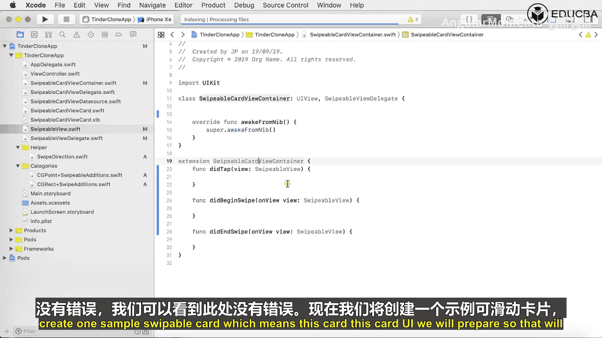

Which means。This card， this card you I will prepare。

So that will be having a ni file and corresponding。In correspondingorreponding your file。

 So all the layout design will prepare， and then we will consume those things。

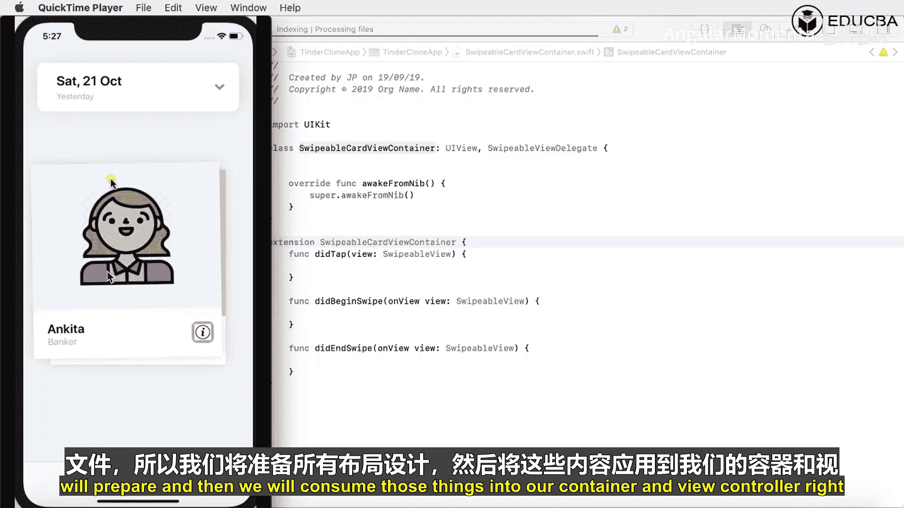

Into our container， and。Container and view controller。I click new file。Swift。Sample。Swipeable。😔。

guardd。And click on create。So let let's create a class first class。😔，Sample。Sy paper。😔，Card。

 which will inherit from。This one。Sable card， you card。

And we will create an ni file for this as well。Sample。Speable。😔，guardard。Not X I B。

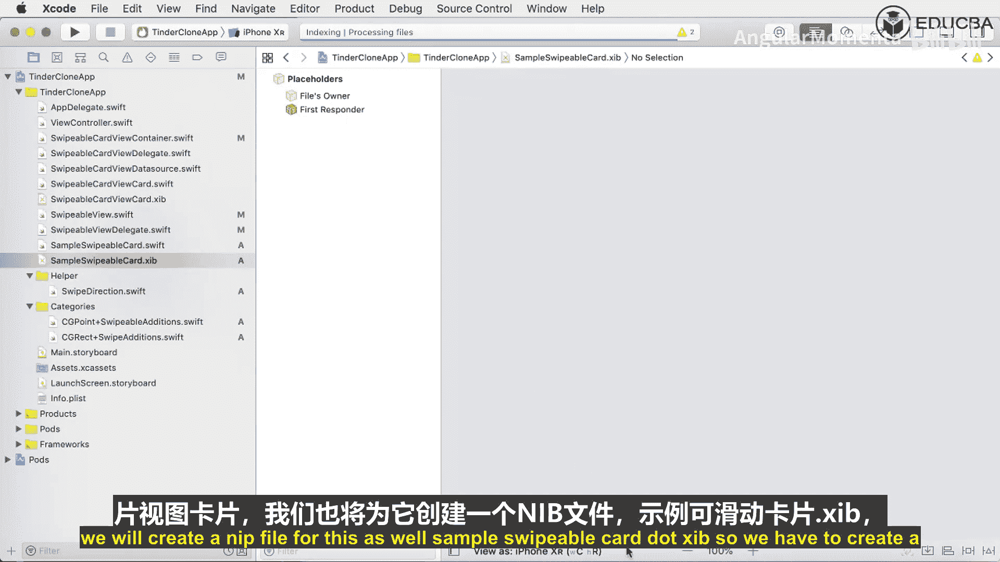

So we have to create a ni file like this， which will have an image background， some label and。

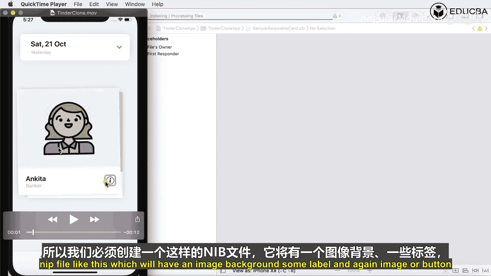

Again， a major button， something。 So this thing we will be creating using storyboard。So。

 add a u viewia。Drag and drop it。Okay， now change。😔，Change this dimension oh here。😔，Select it。

Go to attribute inspector from size change to free form。And change the size2。3，3，5。😔，To400。😔。

This dimension。And make sure that author sizing is enabled that is height width and everything。

Get a as for the device size， this one you can see in the image as well。

Now let's play with this thing。Open this with some other device。😔。

Let's open with this so that you can remove that one iPhone X R。Space you can see over here。

 iPhone X。IPhone X X Max， there is one space coming up。😔，We have removed it。

Now we'll add one U view into it。Dr and drop and add over here。Zoom in。

So some spacing will give x to 20， y to 20。With test 290。😔，High test。3，60。Now。

 background for this will be default。Let's set default， and for this one。😔，As white color。Okay。And。

Autorizing， authorizing this。We have to set it。This one。Now we will add one more view in this。

With x as 0， y 0。😔，And with that 2，90。😔，Hide 2，70。😔，High test 2，70， then we will add。Backroom。Color。

To this image background， this will be image background， which means this one， this background。

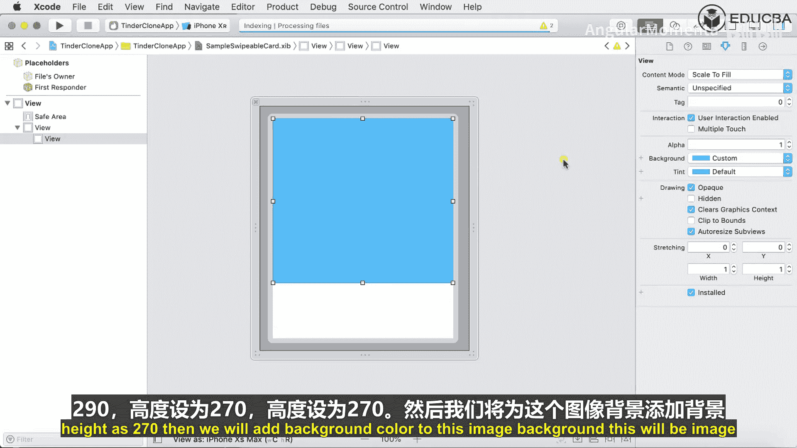

The background won。Then we will add U image you。And drag and drop you。With exposition as。57。5。

 which will be center。And Y 45。With 180 height again 180， which shall be centered。😔，Again。

 we will add you by view。At the bottom。With Y S 2，70。Hide 2，90。With 2，90。Highest 90。So in this。

 we'll be having one Ui view again。😔，With access 25 Y S。20。5。With with such 2，45 and high test。😔，49。

そう。This image is done， background image container is done。This V。

 this U Y view bottom is nothing but this one。 And this view is nothing but。

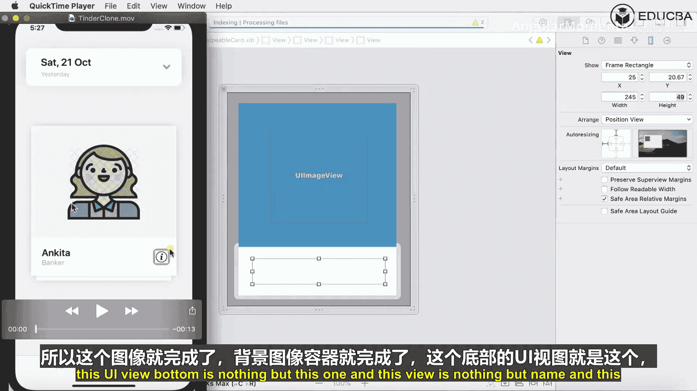

Name and。This occupation， these two things will be there。

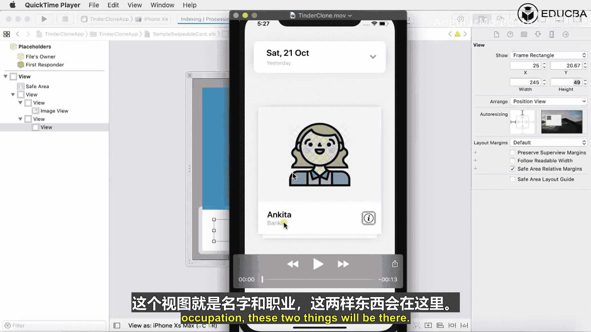

Now， O you will be adding。😔，Two labels。Evalable。And one more label。X has 0。Y 0。😔，2，45， I test 28。😔。

Will change this text。2。Profile name。😔，System， semibol。2， let's make it 23。Deng。And label。Occupation。

And let's make it some light gray font。Light font。😔，And。Xes0， Y 28。😔，With。😔，2，45， high test 21。Now。

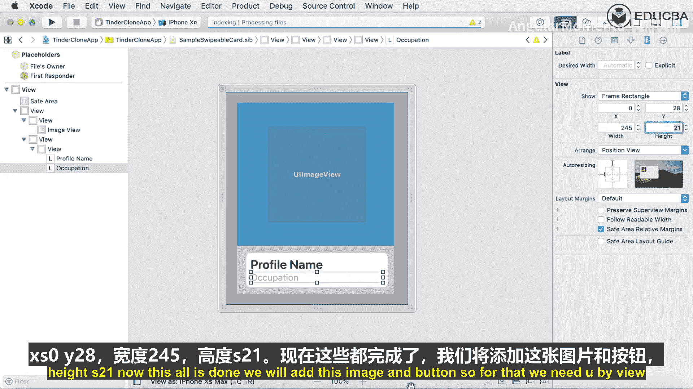

This all is done we add this image and button。

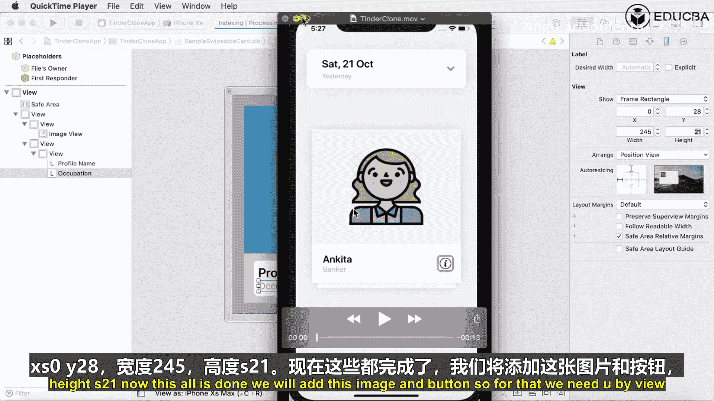

So for that， we need UY view again。😔，Dragon drop。😔，After this。

Let's change the dimension of this x to 24 p。Y，45。😔，40 width 40 height。

And then we will add U image U。Over to this。Change access to 45。30 y with 30。And high 30。

 we are changing all this dimension。Asper。Like asper the Supervi and everything。Now。

 lets better rename it。So， that。Aver the confusion。So， this will be。This will be。😔，Background。

Container view。Then， image。Background。Go love you。Then， this will be。Profile。😔，Container view。

This one S。Profile。View。Profile name occupation， and this will be。Add a button。Now。

 we will add constraints to all these controls。So first。

 let's begin with this background container view。So， for that。Press on new constraints。Leading。

 trailing， top and bottom， all should be 20。Are these four constraints。Then， press control。

Dragon drop these two。Safe area。And place vertical spacing。😔，No。😔，Okay， center horizontally in。

Center horizontally with respect to safe area。 So we have placed leadinging。Trailing， dog。

Bottom and send align line X to center。Which means will be aligned properly。Now。

 go to image color background view。Now this， we have to place it， so。😔，Leading， trailing， top bottom。

0， add4 constraints。And this will be。😔，Center horizontally in container。

And center vertical in container。😔，Now， let's go to image view。Image view。😔。

Hightened width will be constant。And。Press control， drag and drop O。

 center horizontally in container。

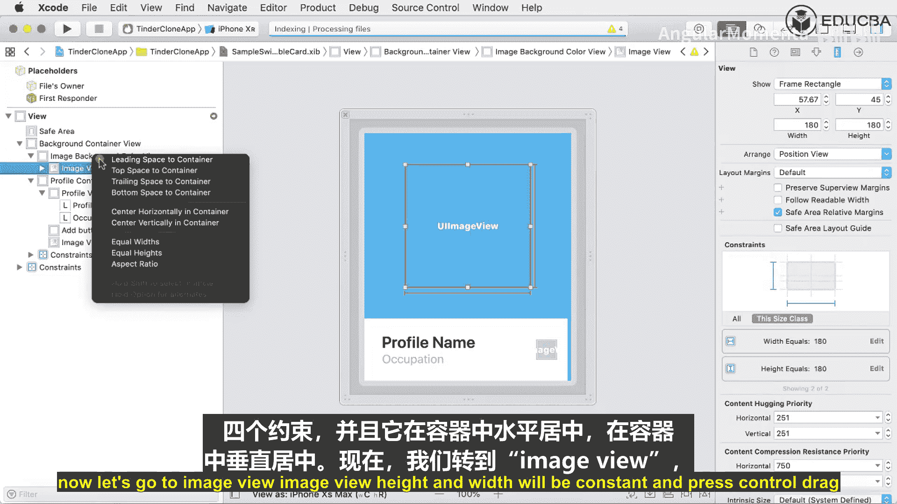

Center vertical in container。So image view Contrain is placed。

 Now let's go to profile container view。Now for this container view， let's add constraints。

Leading trailing talk。Ring trailing bottom。And top with respect to。Background container view。No。😔。

Tough a will。Remove it。And let's。A this。Horizonal spacing。😔，Which means top as0，Leading trailing。

This one，0， and height is fixed。😔，K。Now， this one， we need to align to super view。

So press drag and drop overria。😔，Center horizontal in container view。

So as and when we add constraints， these error will disappear。9 profile view thats are constraints。

Leading 25， Traing 25。😔，Add these two constraints。Then。😔，We add constraints to this as well。

0ero with respect to occupation。😔，And0 with respect to profile view。Add this thing。

And also for occupation as well。Leading， trailing and bottom。And these three constraints。

Of a plus button。Plus button also you will add trailing 15。Highten with this constant。

For image as well。😔，Highten width constant。And this one。So this image view， we have two。

Align it with respect to button， So drag and drop over here。Center horizontally and。

Center vertically。So image is done， now for Add button also con is done。

Now let's see where the constrain is missing。Okay， profile view。😔，Profile view。😔。

Profile container view height night is fixed。😔，Profile view。This one， we will align it to。

This one center。Central vertically in container view。Now， image needs y positional height。Okay。

Image view that see what the issue。😔，So， this one。We sure it't be the respect， too。

Profile container view。嗯。Now for button， we need y position。

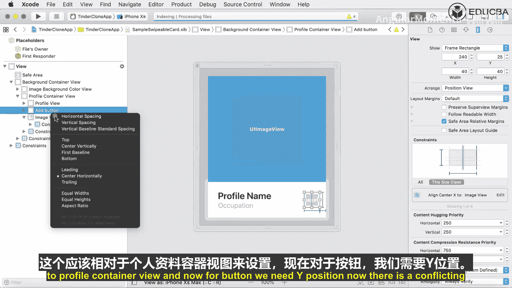

Now there is a conflicting constraint we have to check。With this， which one is creating an issue。

Let's check with each constrain， which one is better。Okay， so that con was not required。That is。

 that is creating a。Conflict， now let's see it again。So this one align wide to image view。

Image background。😔，Color， okay， so this view was trying to align why position to this because of it。

It was creating conflict。 So we remove this one。No。The issue is resolved。So， we have created。😔。

The story board for sample swiable Car view you will create corresponding outlets in the Do suit file。

Now， let's go to corresponding。

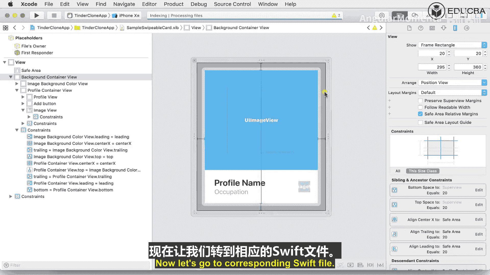

Sft file。 So first we need to connect both of them。 So what well do is open As editor。😔，嗯。And open。

Storyboard file over here。 That isn't it file over here。And now let's connect it。

Or what we can do is。Better open ni file on the。Right side。 left side。And。Sft file over you。First。

 we will go with this one title label。Dragon drop over year。Outlet。Far names。Title label。off。

Ty Ui view。Okay， that should be this one title label。😔，Outlet file ownerar。This will be title label。

Weak and connect。Again， we have occupation。Okay， we need to import。You are kid。

For occupation as well。Will add。Subtitle label。And click on connect。Yeah。Okay。

 then there is no referencing， okay。Med。This class view is not connected， so go to file owner。😔。

For example。😔，Now this will be connected。Nice to go to go over here。You can see it's subtitle。

 title level， subtitle。Simply， drag and。Drop over year。And title label， drag and drop over here。Then。

 add a button。R and drop 보요。Add button， click on connect。Then this one。Image。😔，Background。

Coll of you。Click on connect。Then in that， we will bind this imageu as well。😔，Image。😔，Background。

Okay。😔，Let's make it better naming。Image view。😔，Mag ground。Container view。And click on connect。Now。

 let's go to this。File luar， you can see exclamation。Okay。😔，Okay， add button。

Adward and drag and drop over here。😔，Then， background container view。As this one。

Image background color view as this one。An image view as this one。😔，You can see。

All all of these outlets are connected properly。Now let's close this and open Sw file。😔。

We require core animation as well， core motion。Comotion。I create instance of。Core motion manager。😔。

Private lead。Motion manager is equal to。😔，Cm。Motion manager。😔，Then we need to create a shadow view。

Private week， where。Shard of view。😔，of type。U view。😔，Then we need an inner margin。Private。

Stistics LED。Okay inner marginin？Of type Cg floor。Float20。0。😔，Now， we require one model。

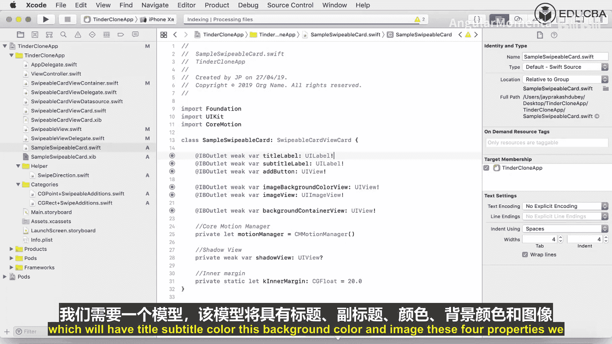

Which will have。Title， subtitle。Color， this background color and image these four properties we will have。

 So for that we will create one model。

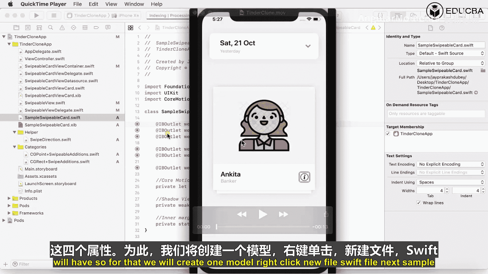

Right click， new file。Serft file， next。😔，Sample。Swipeable。😔，Guard。Sin。View model。And click on create。

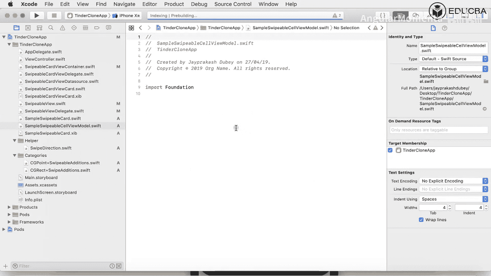