# 【EDUCBA】使用Swift开发一款滑动匹配iOS应用  Develop a Swipe-Match iOS App Using Swift p06 02_03_01_自定义可滑动单元格结构 -BV1WNFozjEHe_p6-

Now， we will create structure。😔，Spped。Sample。Swipeable。Sellview model。😔。

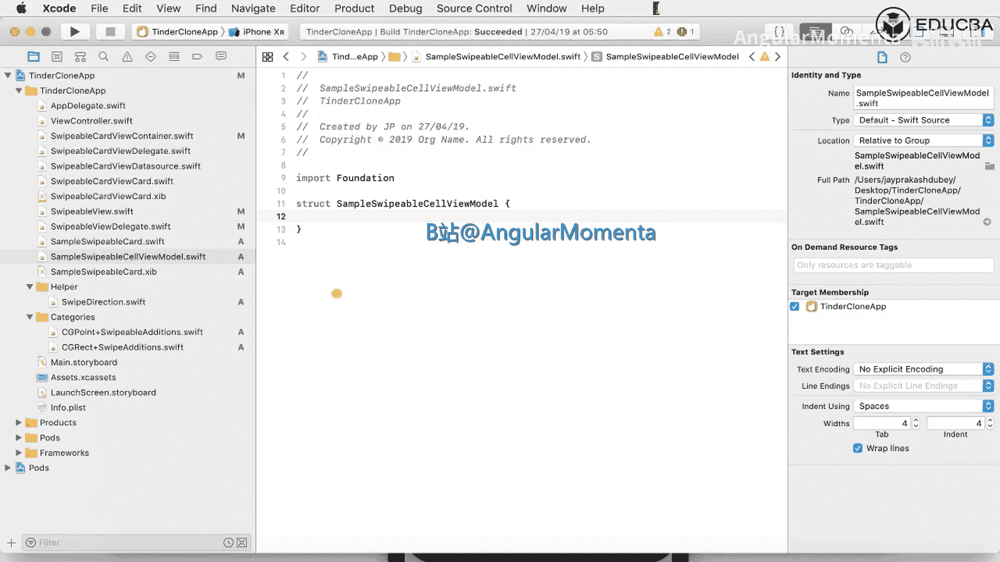

We will have title， subtitle。Color， this background color and image。

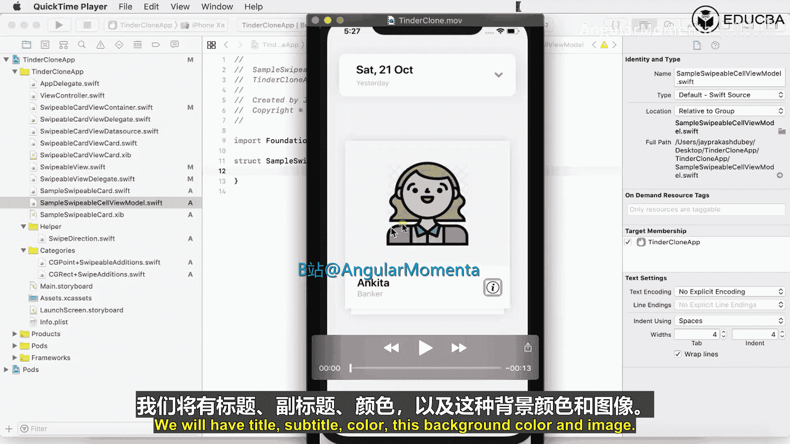

Let。Title。Let。Subtitle。Let。Color。And。Image。S Ey image。Now， we will use this model。In。

Sample swipeable card。So， over here。We will。He will set view model。Yeah。That。View model。Sample。

 swipeable self view model。😔，Did said。Configure。Yeah。For view model。Collon view model。Now。

 this configure method， we need to define it。Private function。Configure。4。View model。View model。

Sample swiable cell view model。Which will be of type optional。Mao。

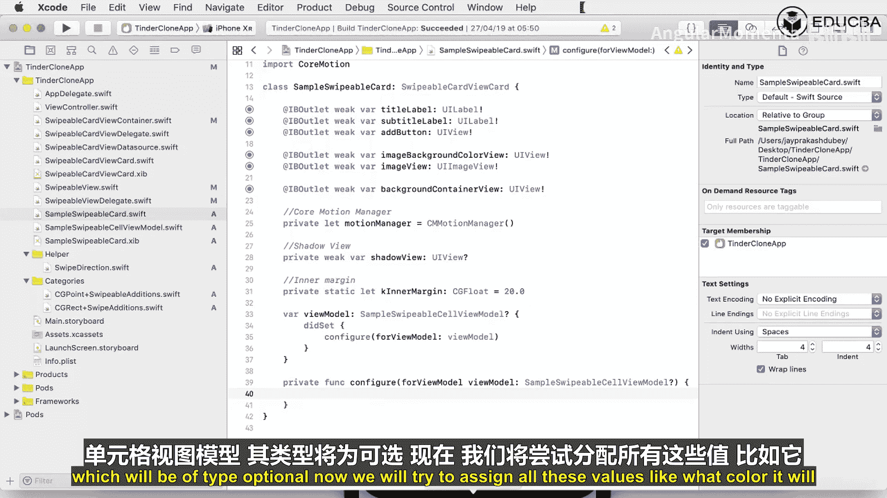

We try to。Assign all these values， like what color it will be。Images， text， title and subtitle。

 these things will assign it。

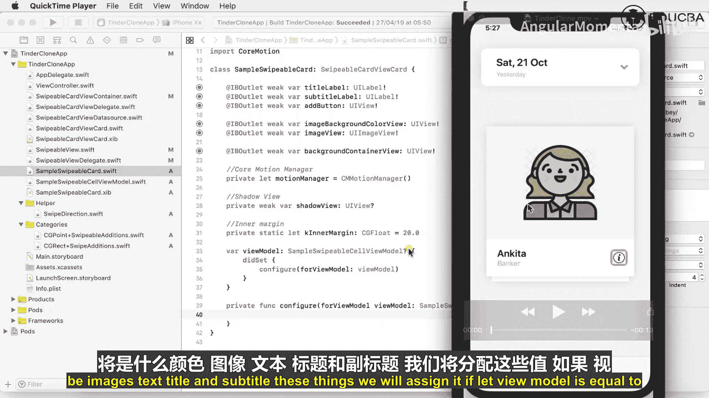

If fled。view model。Is equal to。View model。Title level dot text is equal to view model。Dot。Title。

 title label。Title label， then subtitle label。Subtitle label dot text is equal to。Few model dot。

Subtitle。Then。Then。Image background color view。😔，Dod。Background color is equal to。View model。😔，Dot。

Color。Okay。😔，Then。Image view。😔，Dot image is equal to。😔，View model， dot。Image。Okay。

We are getting an error。It is not able to find it。Even you can see if I type dot color over here。

 you can see the return type as error。😔，Let's figure it out。Okay， let's。Import U Y kit。Clean it。Now。

 you can see。😔，Now， we will。Make the corner radius layer dot corner radius is equal to。😔，15。

0 so that it should be curved at edges。Add button dot layer， and will also add。

Coronner reduce for button also， add button dot layer dot。Dot corner radius is equal to add button。😔。

Dot frame， dot。Not size。Dot hide。He， divided you are by4。So， lake。

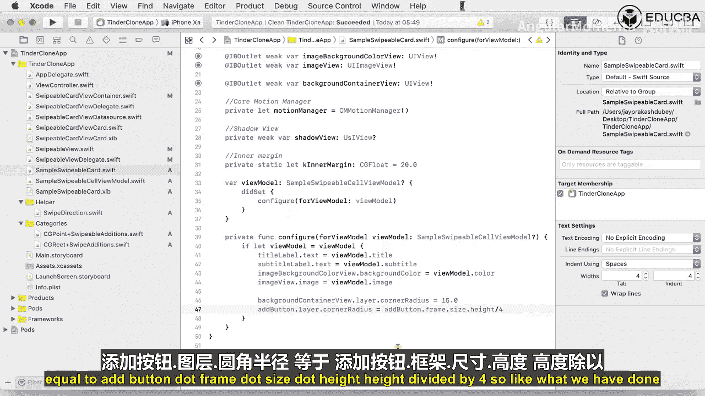

What we have done is。We have set the title， subtitle。Image background color， this one。Image。

 then corner radius， this one corner radius， it should be some some edges。And for button as well。

 these things we have set in。Configure of did set。Now， we will have。😔。

We will have some shadow like this。 You can see the shadow at the edges at the edges。

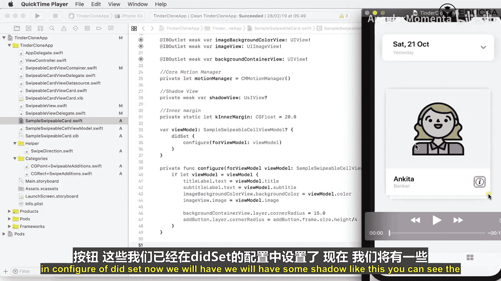

So for that， well use。Layout。Override。Function。Layout sub。Super do。Layout。Sub views。

Now we will configure the shadow。Private function。We have a shadow view。 So we will first remove it。

 self dot a shadow view dot。😔，A remove from。Super view。😔，Okay， it should be U I view。

Remove from super view， then let。Shadow view is equal to。😔，Okay。UI view。😔，Frame。Cg。Xposition S。

Sample， soyable card dot caner margin。Why as sample So card dot。개인 내 marginin？And it will be。Bs。Okay。

Okay。We are not getting this property。Then。Slf。Dot。Self dot bounce。Bouce dart。Of wit。Mus。2 in2。

Sample swipeablecard dot k their margin。Then same for self do。Shadow view， dot bounce， dot hide。

Minus。To into sample swiable card dot。개인 말신。So what we have done all year is。

We have removed the shadow view。 That is this one。From SuperVi initially。

 then we have created a new a new instance of shadow view。Witht exposition。

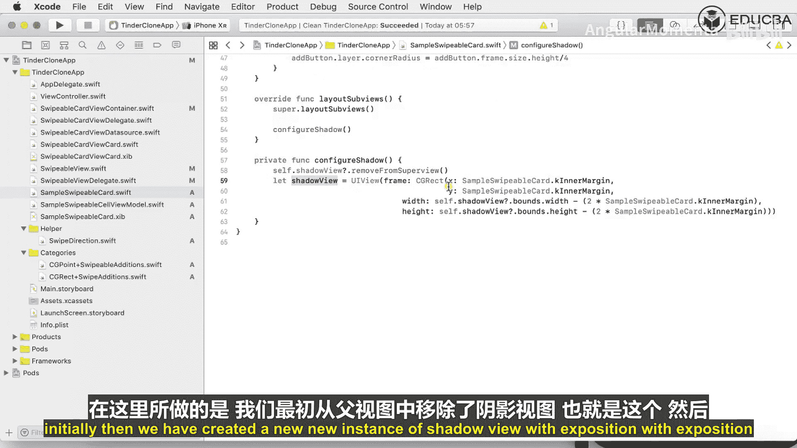

With x position as constant， which is nothing but 20 and y position also 20。And it will be。

The width of device， minus two times of。

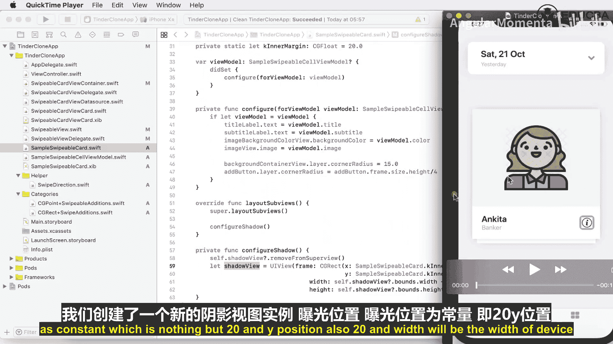

Two times of this one caner margin， which is 40。

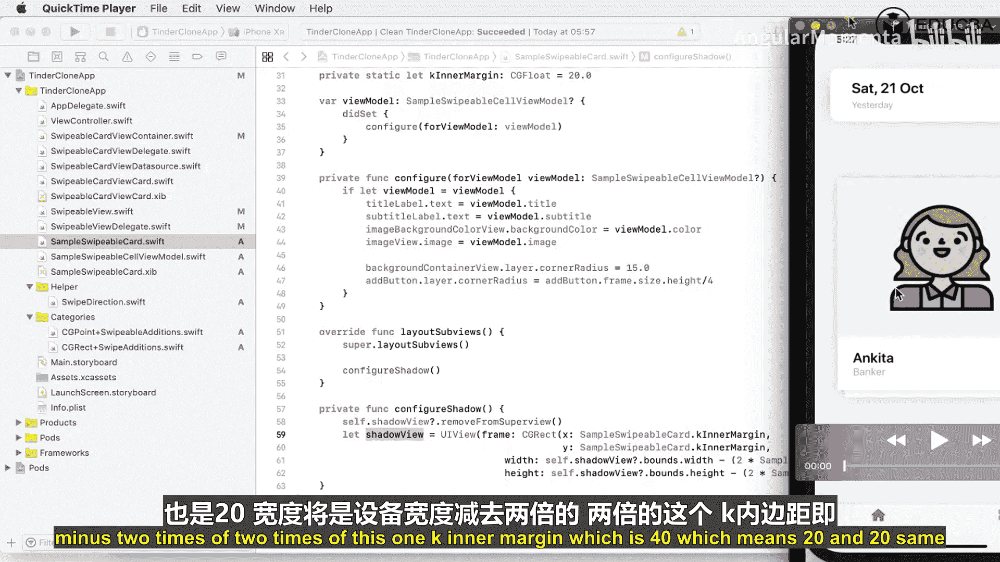

Which means 20 and 20 same goes for height as well 2020。

 so the padding for this particular shadow view will be a 20 across all。Yeah。Now we will insert this。

Insert。Sub view。Why is not present。We have imported UIQ core motion。Let's clean it。😔，Insert。Sub view。

Shadow view。Ad。Addd 0。Then weve add self dot shadow of view is equal to。Sharreow view。

Then we will have one function。Private function。Apply。Shadow view。😔，With。Ciji float。Hide。Ciji float。

Now， we will use this width and height。😔，To apply the shadow。 So if let。Shadow view is equal to。😔。

Shadow view。Let。Shadow。嗯。Shudow path。Is equal to Ui。Do you have brard part。

Around direct and corner radius。Shard of view dot bounces。Cnerary。14。0。

Then we'll make Sha view dot layer dot。Mask。2 bounds is equal to as falses。😔，Sharre of view。😔。

Dot layer dot corner radius is equal to 8。0。 Then you will add a color。

 layer dot shadow color is equal to U color dot。😔，Black。Dot Cg color。Shadow view， dot layer dot。

Dot shadow of set。Is equal to。C机。Cgize。With1 height。Shard of view dot layer dot。

Shadow opacity is equal to。0。15。Shadow view dot lair。😔，Lair do。Shahardow path is equal to。😔。

Shadow path， do。Shadow part dot Cg part。 now will apply this function。Self dot apply。Sharreed a view。

Cg float。0。0。Sa she floated。😔，0。0。So what we have done is。In layout sub view。

 layout sub view is called in order to redaw your view again。 So in that we will add a shadow。

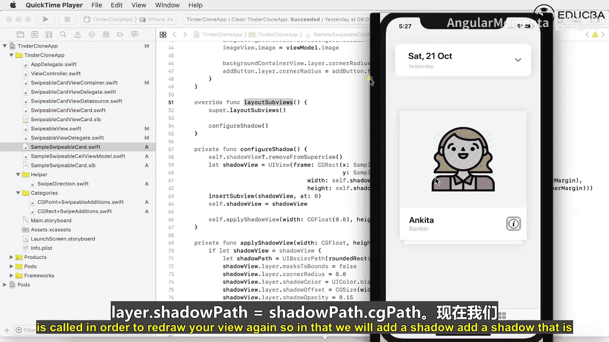

Add a shadow that is configure shadow， we have removed the existing shadow and created new instance with X y and certain with thenhe。

 and we have inserted as a sub view。At the background， at the first one that is index 0。

 Then we have assigned the same value。 Then we apply a shadow。In that width height is 0。

 So in you by using ber path。We add some rounded red at the at the corner， then some corner radius。

 then。By setting corner ra shadow color， offset opity and shadow path。By setting all this property。V。

Set up a shadow to the existing sample card。

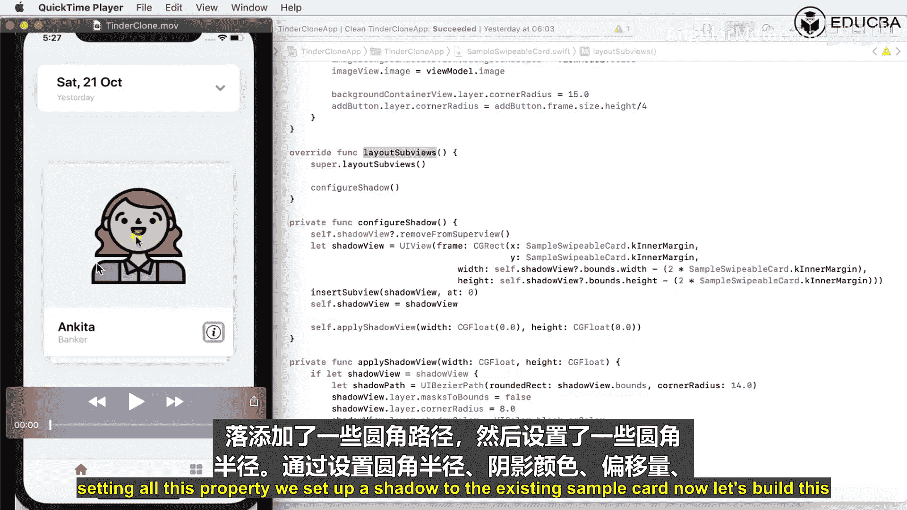

Now let's build this much whether we are able to build it completely。

So for building the command is command B。Okay， we are getting so much error。

Method does not override any method from superclass。Okay。Which means。We have to check。This class。

Swipeable Car view car。Press command T to open the new window， this one commande。Okay。

 we have to write over here。Let's check whether。Swipeable view is ready。😔，Okay。So， we can inhererate。

So people view over here and we can uncom this block and this block as well。😔，Now let's build it。

So there were four errors to have gone。😔，Not all year。

Value of optional type Cg float must be wrapped。Okay， what we can do is。We will try using this。😔。

Okay， we are able to build our application successfully。Now let's go into this。😔，Okay， bounce。

Property of U Y view， which is open。 Open means that can be。Accessible across all modules。So。

 until this。We will commit all our changes。Okay。So source code， commit。Will add something。Step 2。

Sample card。Prepared。And。Shadow。Added。As added to it。で。We added model as well。HaS。Swipeable。😔。

Sell view model。Also， created。Now we will commit it once we commit all this SV source control state that is a stands for added M stands for Mo。

 and if there is D， then it stands for deleted， so if we commit it all these states will change。

 you can see O。Now you can see the history in source control over here。

Soce control navigator upon this。You can see。All the branches suppose if if I have a branch from this。

 you can see。These are branches as well， if we have certain tags you can see over and if there is any setup for a remote server。

 then you can see those branches over here。Soin master。

You can see the initial committee on this state。hen。The next commit on this date。

 and this is today's commit。This is commit number that is a unique commit number for each commit you what you do。

I should double tap on this。You can see all the changes。 what you have done。

So this is about source control。

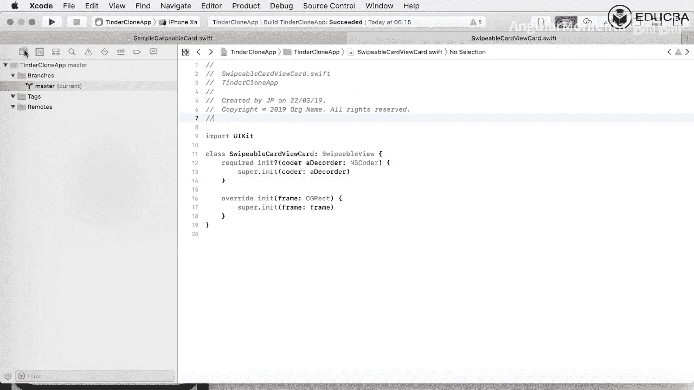