# 【EDUCBA】使用Swift开发一款滑动匹配iOS应用  Develop a Swipe-Match iOS App Using Swift p07 03_01_01_匹配屏幕用户界面 -BV1WNFozjEHe_p7-

Now， in helper， okay， we require one file。In Nb view， we will require this file。

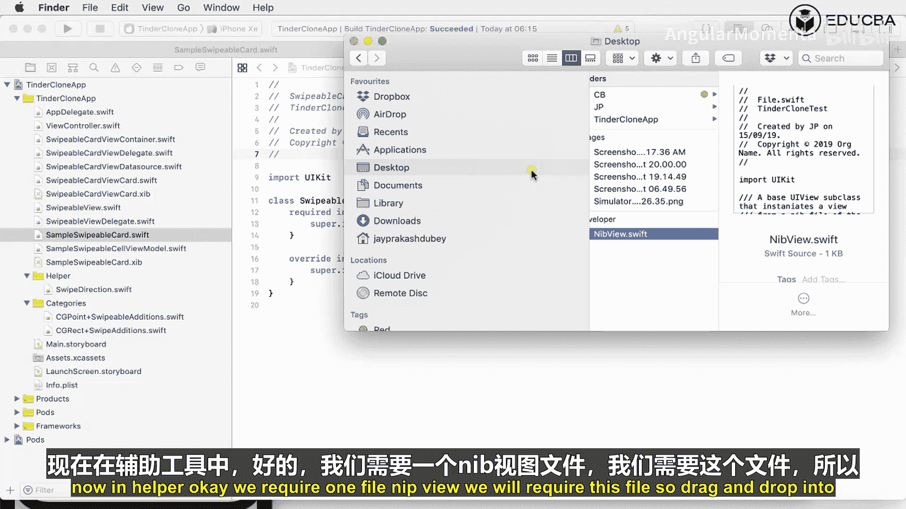

So drag and drop into helper helper folder。 make sure that this is selected and target is selected。😔。

Okay。Now， we'll use this Nephbu audio year。😔，New。And we will call X I B setup， and。😔，X IB setup。

 so what this does is initializes the view from X IB file and configures initial constraints。So。

 let's go into this。Okay。We need to add this。Will add that extension in。Category。

So what does this file do is So what this file does is we have an extension of U view。😔，In U view。

 we add。As edge constraints a view， which means this adds a view as a sub view。

And it constrain it to the g。Of new containing view。Then。Like this calls itself。

 edge constraint in edge constrain we have， we are placing the constraints programmatically that is NS layer constrain activate top。

 bottom， left and right using NS layer constraints。So this thing， we are calling over you in Neu。

In Ne， in X I Verta function。We first clear the background， Then we load the Nebbu。

 Lord view from Nb。Okay， so this initialize the bundle， then the U nib。

Then instant shape the ni file and simply returns the view。😔，Which is then。Added to a constraints。

So this thing is done by Nephew extension。And this， we call over here。And in setup。

 we call the X I setup and in。Overriding the frame。Weca this。Now， let's build it command B， okay。

 which means build successful。

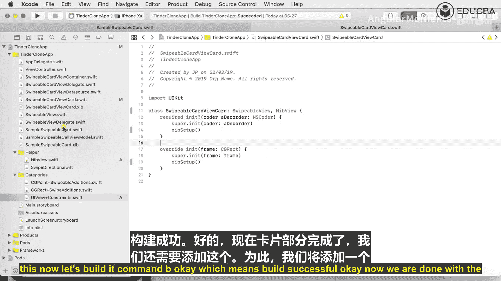

Okay。Nao。😔，We are done with the car part。 Now， we need to add this one also。

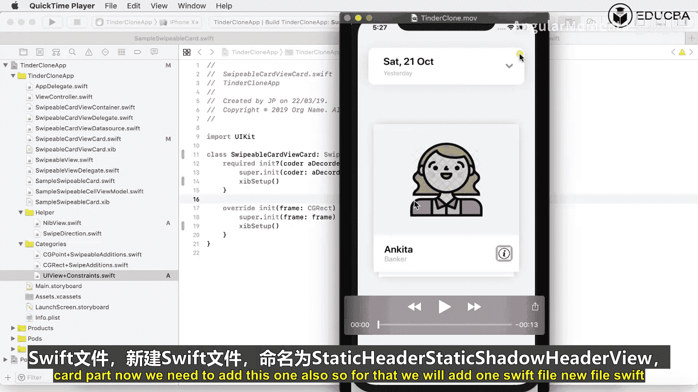

So for that， you will add one swift file。New file。😔，Swift。Named static。Header。Static shadow。

Heard of you。And click on create， and。😔，New file。N。Statatic。Shadow。Heard that view。Dot X。

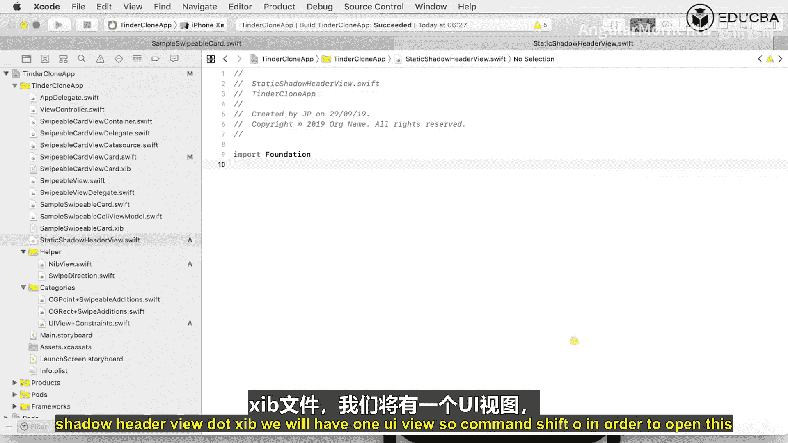

Well have an U view command shift O in order to open this shortcut key。😔，Ui view。😔，O this for file。

 we have to open this。Ui view。😔，Dg and drop over year。NowChange the dimension of this。Freform。Okay。3。

8，2， and0。😔，Okay。Change this one。Now you have to autoize it。That is。

 it will adjust according to device height and width。Now we will add again one U I view。Inside this。

Xces 20， Y S 10。Then with does 3，4，2。And height height is 80。

So let's rename it in order to avoid confusion。Background。Container。Vi。

Let's add one more view in this。Exces 15。Y 14。Then。With does 3，1，2。Height at 52。Now。

 we will add label。You are label。to this。Label 1， and again， one more label。Okay， so label 1。

 you have frame for this20。😔，2，7，2 and 29。Ha say Saturday。29 September。A semi bowl as 24。

 Let's skip it 24。Now， the another label。Ex S 20。Y S 34。2，7，2， and height 18。Now。

 let's set font O year。Say， issued should today。We add。 okay， better we add yesterday。

Of last scene yesterday。And color， say light grey。Okay。After this， we will add one image。This one。

 Choron image。Ui image view。Dragon drop over here。They should be outside of this view。😔，Okay。

X will be 2，9，4。Y 34。😔，With test 20， high test2 well。

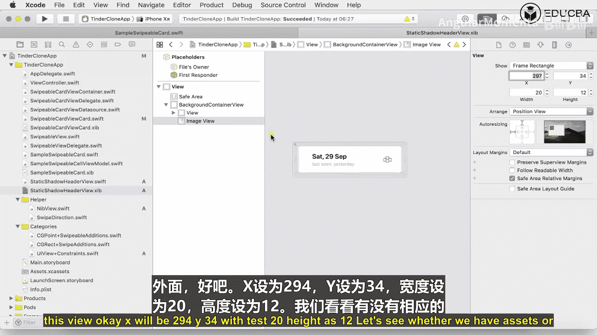

Let's see whether we have assets or not。 Okay， we need to add Chevron image。 Now we will add asset。

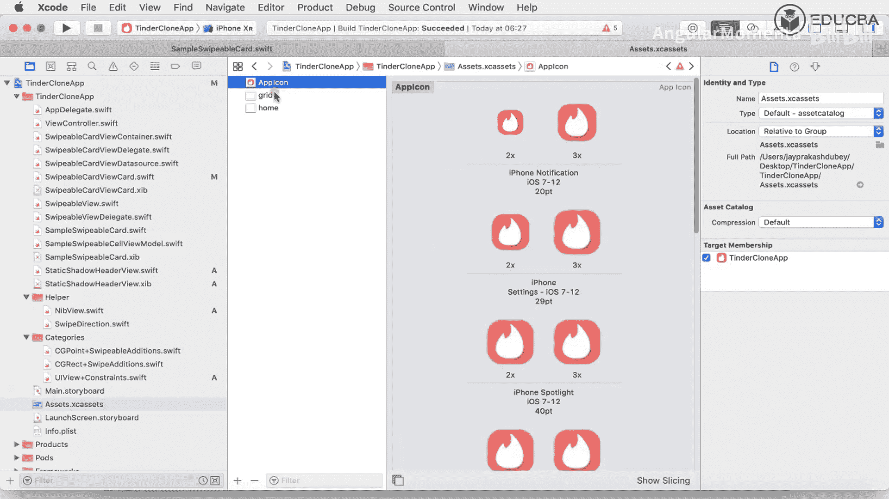

From icons。

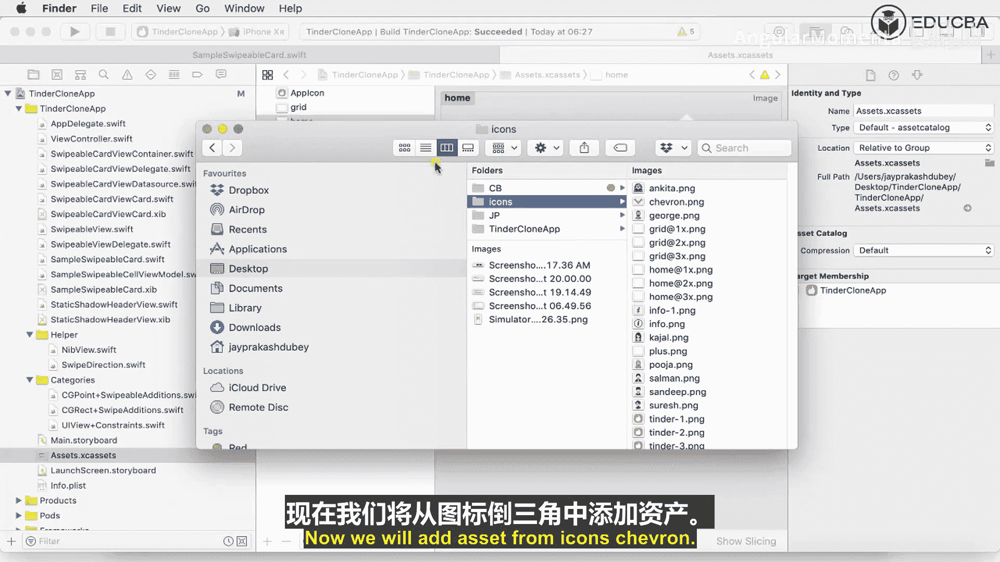

Chevron this one， you will drag and drop over here。

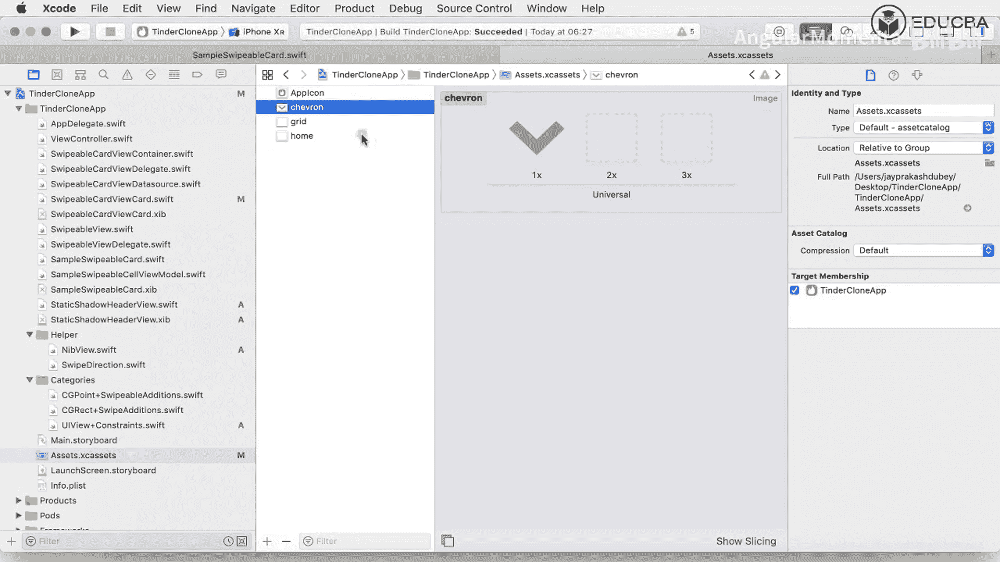

Now， note that this。Is added as an asset。The structure you can see in assets dot X assets。In that。

 there is a content or which will organize all these folders which means all these icons。And。

On each of these， there is an image dot content do J， so this is nothing but adjacent format。

You can see info version， authorex。Now， if I open this。Say home。

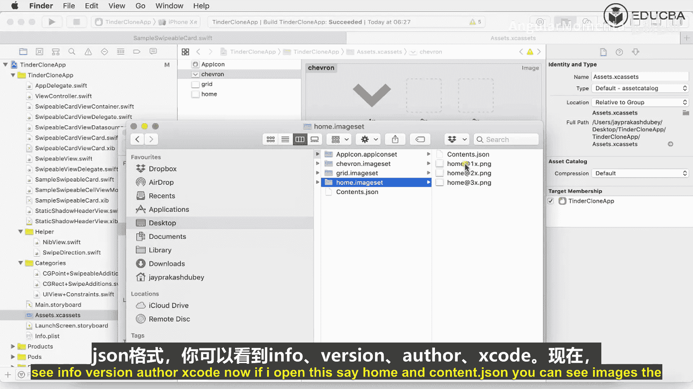

And content geo， you can see images。The outside version is in4。In info。

 we have version 1 orthox code。😔，And we have three images， right？1，2， and3。So。

In images we have item universalal， which means this is of our universal size， file name。

 and scale 1x to x3x。So this is the content of Jason。 Now we have added Chevron。

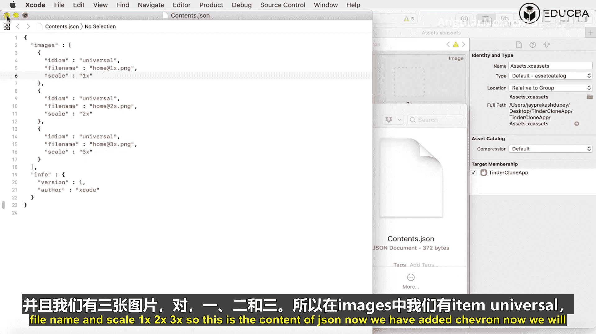

Now you'll use this over here。😔，嗯。ジロ。Now we will add constraints to this。

So for background container view， we will add container。20，20，10 and 10 are these four constraints。

And then， for this view。😔，We have 15，15。And。Okay， we will add these two constraints only initially。

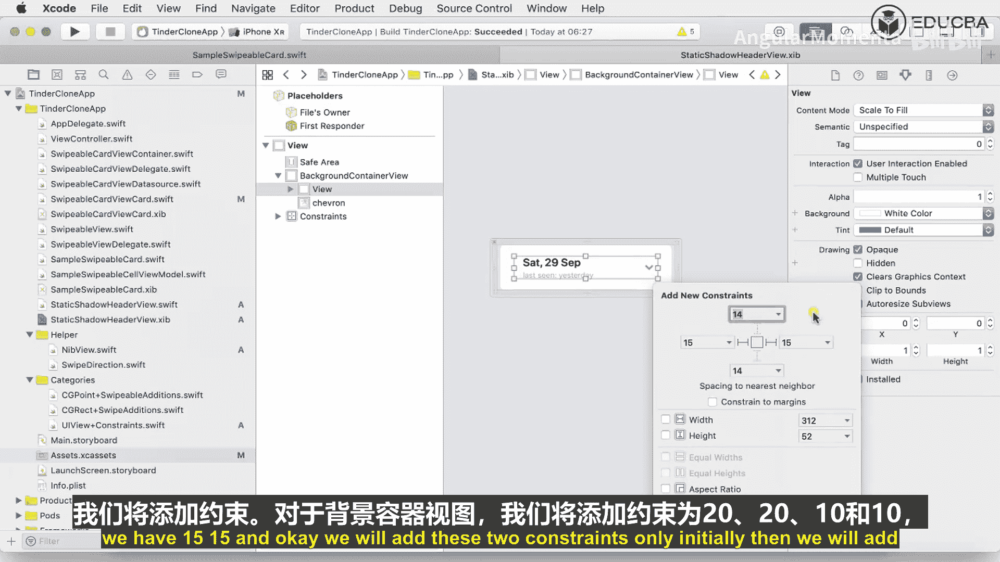

Then we will add con for this label。See。Leading 20， trailing 20， top 0。

 bottom 5 add these four constraints。And for this label， also。Leading， trailing。Top。

 we already have it bottom。S 5。And then Chevron also。For Chevron trailingist。25 width10 height。

 as constants。And this should be。Plaed in center horizontally。A sorry center， vertically。To the view。

ok。Now， let's see the missing constraints。Chevron needs y position。 wave needs height， okay。Chevron。

 we have these constraints。😔，嘴玲。Aign y to view。And is this okay。😔，Okay。

What we have done is we have placed this view vertically with respect to background container view。

So， we have design the。

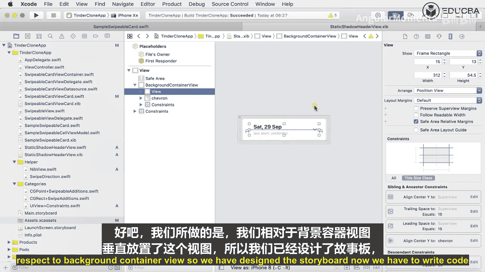

Story board。 Now we have to write code for this thing。Well have class。Static。Static shadow。

Heder view。😔，Will import this from U view。😔，Okay。We import E Y kit， and。Core motion as well。

Willll have you by view。And。Nview。😔，First， let's bind this with static head of view。

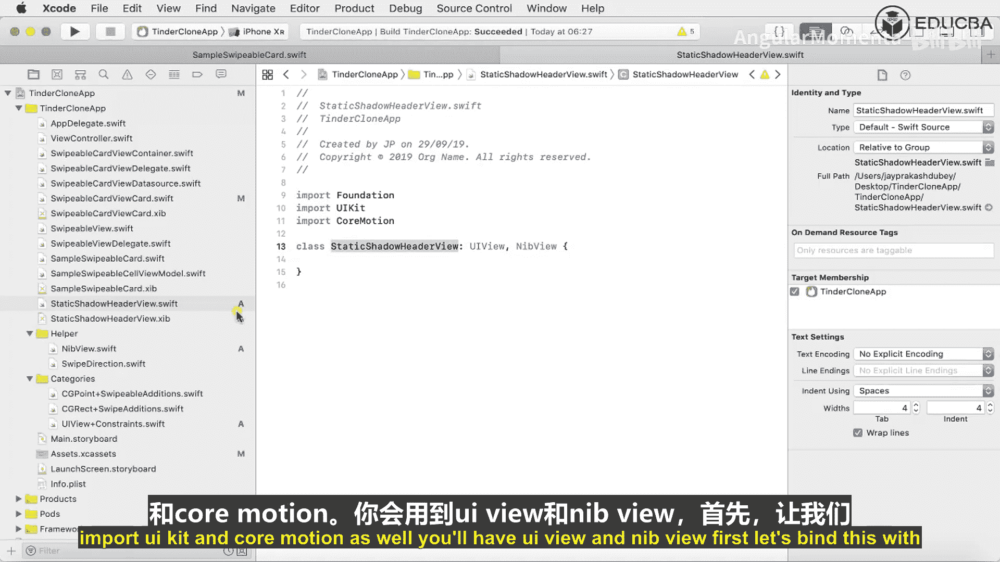

No sorry not here。 It should been file owner， who is the owner。And also， like。

 we should set background color to this。Container view。As default。Okay， now we need to connect。

This select this。😔，Okay。finine， now we'll add。Outlet over you。Now， let's open a session to。In this。

 we will open。

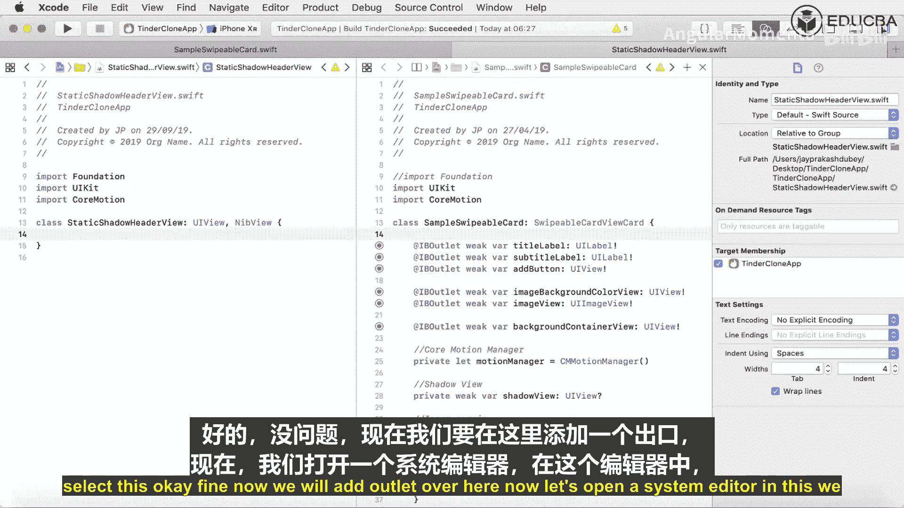

The ni file。Okay， not nip this Np file。😔，Static shadowhead of you。

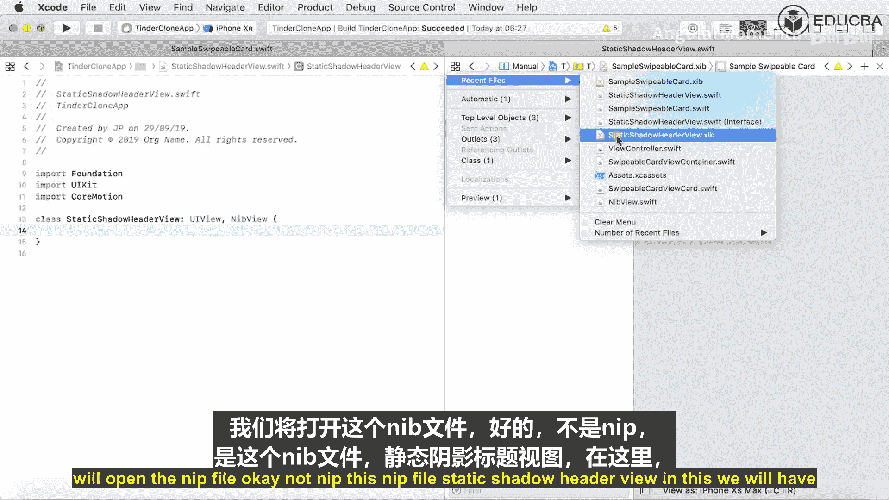

And this will have background。Background will。Connect to outlet， I outlet。Background。Container。

View and click on， connect。Now， we require。Co motion manager。😔，So， let。Motion manager is equal to。😔。

See young。Motion manager。😔，Make it private it let motion manager。Then， shadow view。Private。Weak。Let。

Shadow view。U I view。😔，we are getting a。Warning， okay。Find this will get resolved once we。Mechanizer。

In their margin。Static。Will let。K， inner margin。Cg flow is equal to 20。0。😔，Make it private。Now。

 we will implement required it。Super dot。In it。😊，Cder。As。A decoder and。Super do。

You need to frame as frame。Now I can see one warning has disappeared since we。😔。

Have initial the class。Now。Weak must be mutable variable。Because it may change at run time， okay？2。

We will make it as well。So for both required in it， well call。X I， v setup， and。X I v setup。

So we have seen earlier that X setup is used to。L D X， Ib。And add the constraints properly。Okay。

 then。Background container view dot layer dot corner radius is equal to 14。0。And same in it as well。

Background container view dot layer dot corner radius。Zal to 14。0。Now in we will have La sub view。

Overideide layer of view， super do。Lays sub view will have one shadow shadow method， private。Private。

Function。Configor shadow。In this， we will first remove the shadow view， self door shadow view。

A remove from super view， then0。Will create an instance of shadow view， let。Shadow。Vi。😔。

Is equal to U Y view。😔，Frame， Cg。Static， shadow headerview dot K。

In their margin for x also and for y also。And it will be bounce。Dot。With minus two times of。

Ker margin， same goes for height as well。Boce dot height。Minus。

Two times of static shadow header view in2。😔，개인대로 말진。Now， we will insert this。😔，Insert， sub view。

Shadow view。At index 0。Then。Self dot shadow view is equal to。Shadow view。

Then we will have one function。Private function。Apply。Shadow view。Wt。Cjif。And height。Cg floor。

Then we will use this shadow view。😔，L shadow path。Is equal to U Y。Breezer part。Yeah。

Shudter view dot bounds and corner already as 14。Shadow view dot layer。😔。

Dot mass to bounce is equal to。False。Then。Sharre of view。😔，Dotlayer。Lare do。

Shadow radius is equal to 14。Yeah。Then， shadow view。Dot layer。Dot shadow color。Is equal to Ui color。

Dot black。Dot C color。Then shadow view dot layer。Not shadow of said。Is equal to。Cgect。Okay。

 it should be of size Cg Cg size。Withten height。Whit。😔，Hide。And shadow view door。Cl。

Dot shadow opacity。Is equal to。0。15。Then， shadow view。Dot layer， Do shadow path。Is equal to。

Shadow bath。Dot si pot。So now we will use this function over here。😔，Apply shadow。Cji floated。0。

0 and Cg flow。0。0。So will call this function in layouts of view。Configure， shadow。

Now let's segregate this function。Mar。滚伦。Configure shadow。And。Mark colonen。Initials。

You can see over initializer configure shadow。And then。Oh。Mark。滚伦。Lud。😔，Subuse。Now。

 what we have done is。

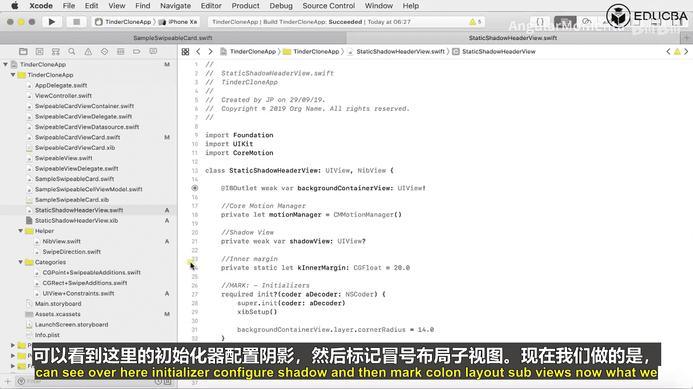

This static header view we have created as an X file and its corresponding shift file in shift file。

 we have added the round rack for this thing and a shadow to this particular。

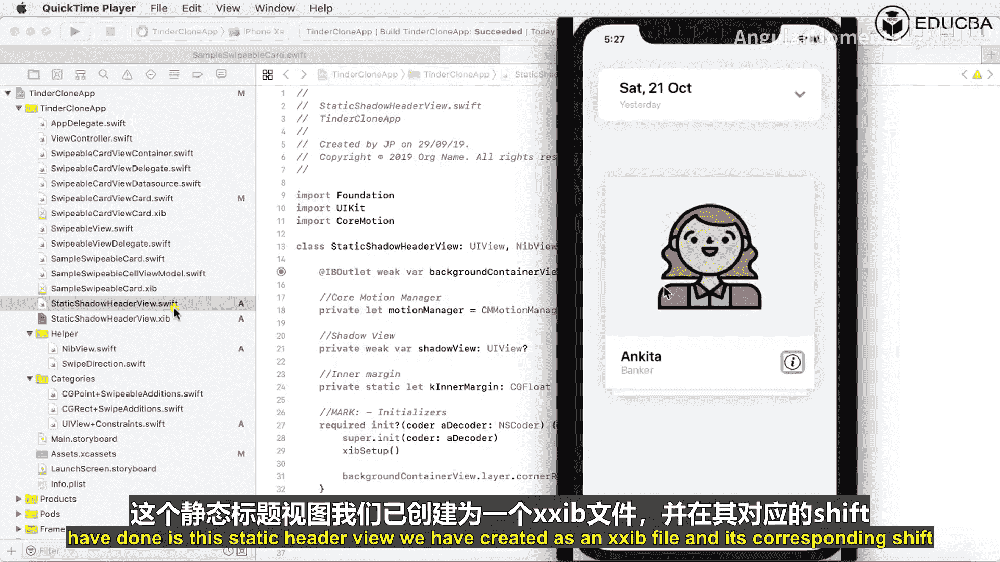

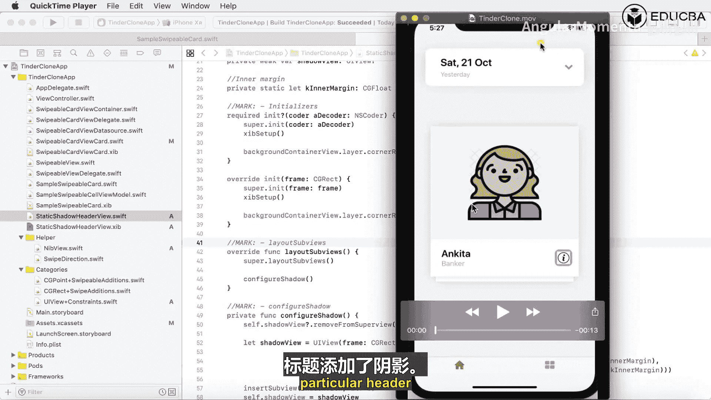

Herddo。

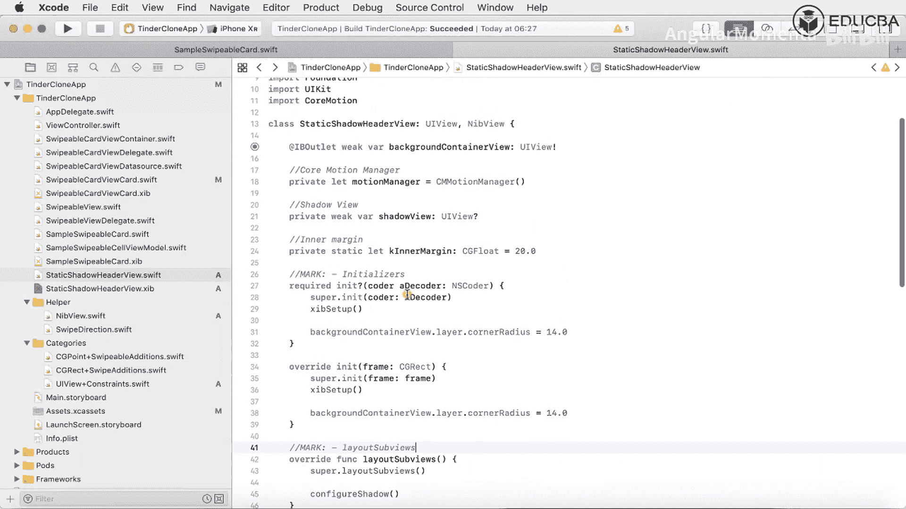