# 【EDUCBA】使用Swift开发一款滑动匹配iOS应用  Develop a Swipe-Match iOS App Using Swift p08 03_02_01_导航转换 -BV1WNFozjEHe_p8-

Now， what well do is we have。😔，We will try to use all these files。Together， now， in view controller。

We control is nothing but the initial screen that will come up。Here we need to open the N file。So。

 go to recent。Okay。Main story board。Okay， here we need to add the container。

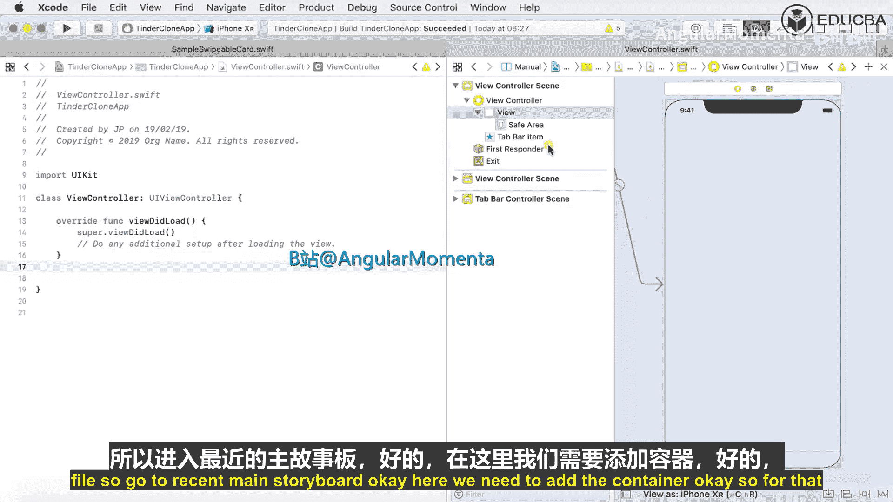

Okay， so for that thing。Let's open the main story board。Now， here， we will have one view。Ey view。😔。

I can drop for you。

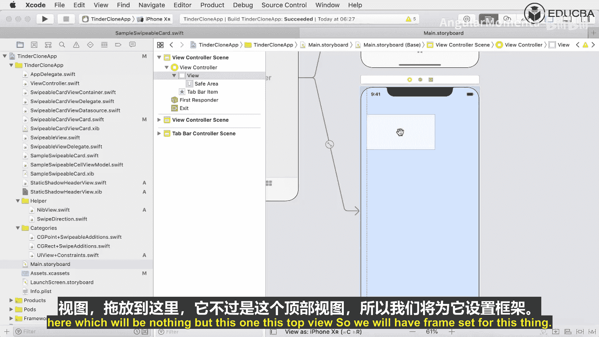

Which will be nothing but this one， they top view。

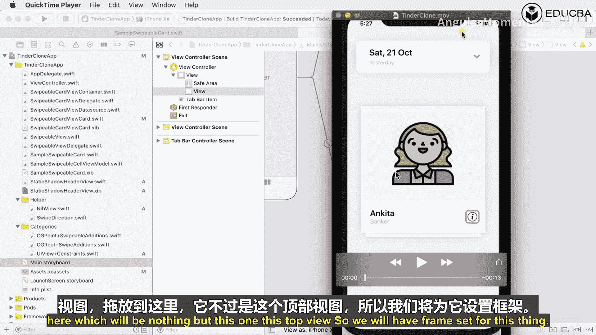

So we will have frame set for this thing。Acccess 5。Y， y 64， fit test 3，6，5， and height test 1，1，0。

Okay， this should be in home page， not in the second tab， they two tab first and second。

 So we want to place into home， so just delete it。And adding home。

Will use better device the latest one， iPhone X。Okay。Excess5。Y S 64。With does 3，6，5。And high ties 1。

1，0。Then， we will have。Another Ui view。Doagon draw here。Acccess 5。Then y S 1，86。67。Hide。With does 3。

6，5， height is 400。

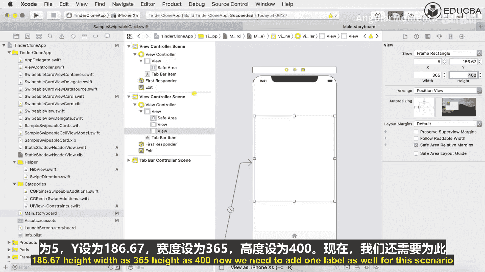

Now， we need to add one label as well for this scenario， like when。This card is completed。

And even this card is completed， so it should display some message that all cards spe has been completed。

So this label will add it。

For that， you are label。

R and drop 보 year。Excess 1，3，5。Y S 3，7，6。1，0，6 and。😔，High test 21。Will add a message。All caught up。

Which means all card has been completed。Color as light gray。Fort this one。

 it is not visible because it has been covered by dish to view。Now。

 the important thing to note is that。Whichever。Control is our component is placed on top will be visible on top。

 It's like a stack。 This will be at the bottom and and then on top of that will be this。

And then on top of thatrupes， So the。Thing that will be present is。So， the。😔。

View that is visible is this one， not this。Lbel。Now， we will add constraints for this static。

Let's first rename it， static。Heard of you。And then。Swipe people。Card view。😔，Now。

 let's add con to this。Leading fight， trailing5， top 20。And bottom。A2。

 so I publish container my view as。12。67。Okay。You can see constraints over here。

And a height fixed at。1，1，0。Then we will have swiable card view or swiable card view。

 We will have leading fight trailing fire。And height4 as constant。And the most important thing。

 this should be。Center horizontally and center vertically。Okay， in static shadow header view。

Bottom space is greater than equal to。This one。Okay， and even。Okay。

 we will first add all the constraints and then we' will fix resolve this one。

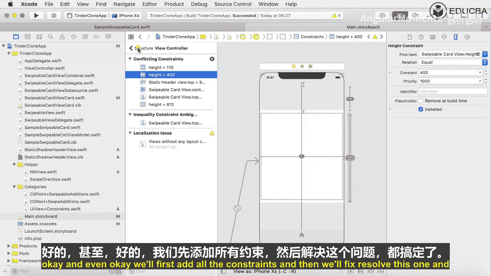

And all caught up。 This should be， this should be。Center horizontally in safe area and center vertically in safe area。

Now let's resolve this issue。Okay。Okay， if you look at this， there is some conflicting constraints。

So。Go toya。Height is 110， and at the bottom we are okay， let's reduce this to say 10。😔，Okay。

Now you can see most of the all the conflicting country is gone。😔，Now， the only。Problem is this。

 this is mispleasd view。Okay， you can tap on this and click on update frames。

 so it will reposition is properly， So now we have added all constraints to all these things。

Now we will create outlet for this， so select this one。Go to class View controller， O。And。

Will have background for this。Vi。😔，As。Default。K default is black。

 will have something better instead of default。

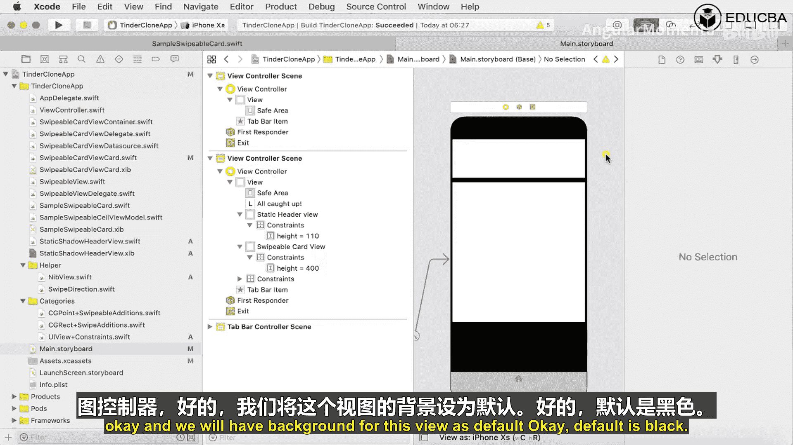

As。Group table， background color。 Okay， now that's better。Let's go to。Aview controller file。

We will create an outlet at the red IB outlet。Private。Weak where。Spe peopleable。Card view。Spe people。

guardd。View container。Okay， we have okay， initialize that this will get solved。

IB outlet property has optional value， okay。IB outlet property has non optional type。

Syable container。Carcycl car will container。Add question mark to form the optional type or implicitly unrapid。

We will do it implicit and unwrap， because。We will connect these， to。Story this one ni file， so。

This will be mandatory present。Nao。

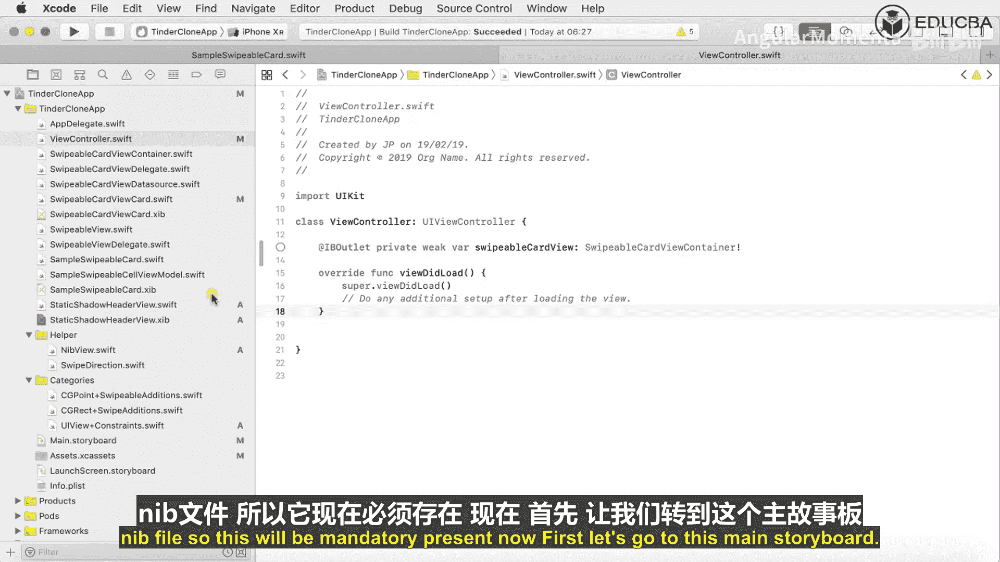

First， let's go to this main story board。In this view controller over here。😔，Okay。

 we are not able to connect this one because。The type of this particular U view is normal U view。

So we'll make it swipeable。Guard view。Container。Now， if we connect this。So。

 connection is established。

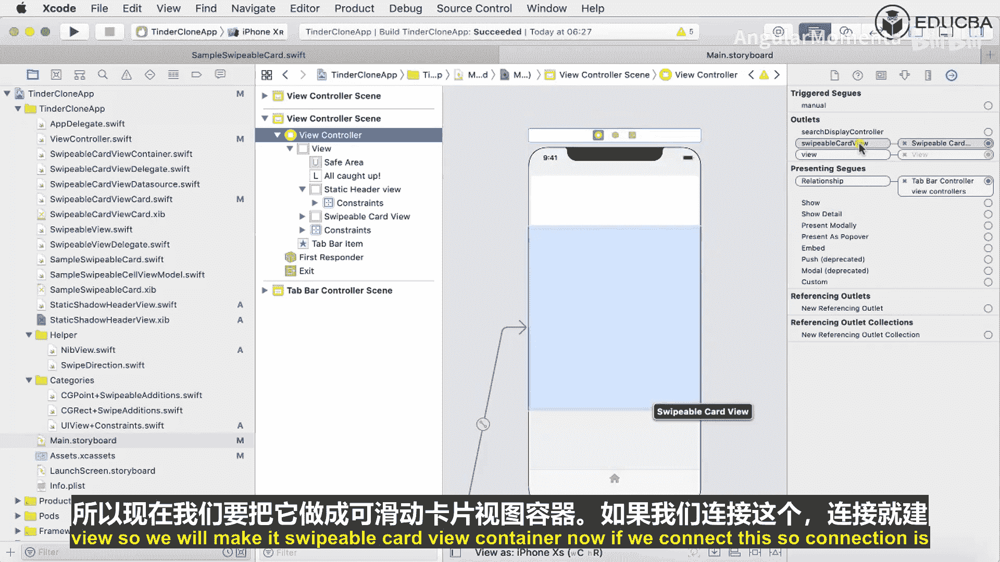

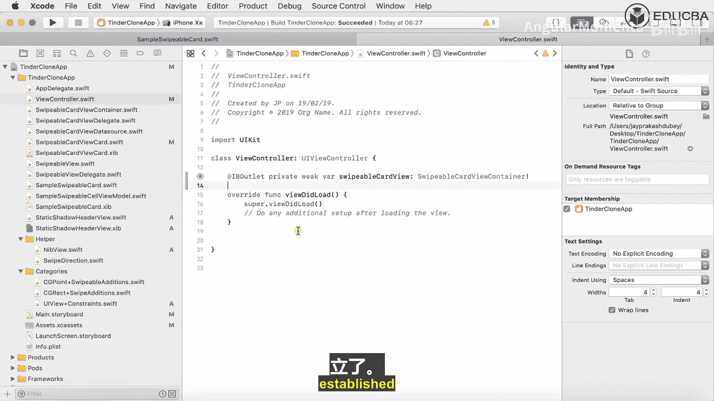

Now， let's connect。Swipeable。Carew， dot。Okay， there is no data source。😔。

Let's go to sable card view container。Okay。Implementation is pending for this file。

 So let's create data source over where data source。Couldol't se people。😔，Card view data source。

 which will be optional。😔，Did it said。And it said we will reload data。

 we will add this function in order to set the data source。Then， we will have。Where。Delegate。

Swipeable。Swipeable。Guard you delegate， which will be also of type option。

 Let's comment it out so as to avoid the error。Then we will have some variables。Private where。

Card views。Swipeable。Card view card。An empty initialization， then。We will check for。

Visible card views。😔，Then speable card view card is equal to。😔，A return。Subuse。As。Sy people。

Guard of you。Car。Or。And em。Instance of members。Now we will have some variables。😔，Some properties。

File private。That。The remaining cars。Of type in teacherger is equal to 0。Static net。Number of。😔。

Visible。😔，Visible cards。Is equal to 3。Of typeping tea。We also require some margins。So。

 that will add static。L。Horizontal insight。Colon Cg float。😔，12。0。And same applies for。

Vertical insert。Cg float is equal to 12。0。Now， in a wake from nib， that is。Kit file of this。

 What you will do is first make the background color as is equal to clear。😔，And then。

Translates autosizing mask into constraint。This。Generally determines whether the views authorizing property。

Is to be translated into auto layer constraints or not。

We will disable this because we have already done this using。Nbews。Now we will write one function。

Function。Reload data。Let's un this out。

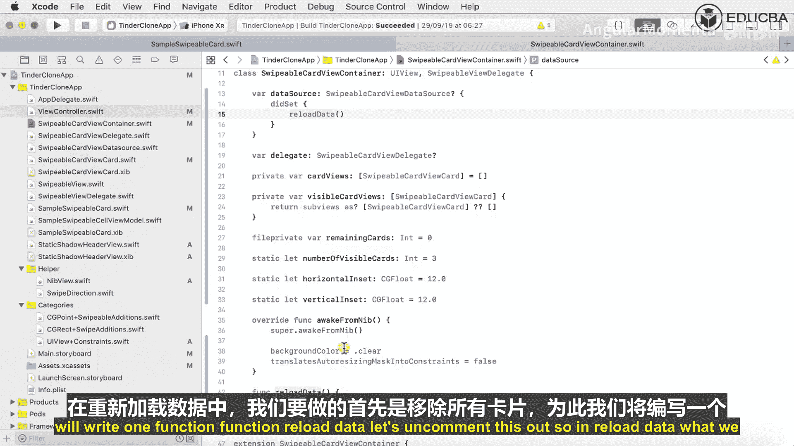

So， in the data。What we'll do is。

We will remove all the cards first。So for that， we will write one function。Private function。

Remove all cars。four。Gd。In。Visible card of use。Gard。N。A remove from super view。And then， card views。

Could when empty。Okay， let's better rename it to card views。So we will use this function in Re data。

 so remove all card views generally。Itrates the content of visible card view。

 which is nothing but speable Car view card。 We will remove each of them from super view。

 which means each of these card is removed from super view and then we will。

Initize this to an emptyRA。So， in reload data。Well call first removal card views。 then let's check。

Garlet data source is equal to data source。😔，Else， a return。They should be guard。😔，Then， let。

Number of。Cars。Is equal to。Data source dot number of cards。A remaining cars。

Is equal to number of cars。Now， we will iterate through each of them， and we will add。2。

Our card view。So for that， we need we need to have one more function。Add card view， private。Function。

而。Gard of you。Gard view。Spe people card you car。😔，Add index， index of type inteia。Now。

 we will set delegate to this Carview Carview dot delegate is equal to self。😔，Okay。

 so what we are doing is we are trying to add the cards。Add card use in we are set to delegate。 Now。

 we need to set the frame。So for that， we need another function。Private。Function set frame。

For card view。😔，Car view。Then s people card you card。Add index。Index。Inteia。Where。Gard you。😔。

Frame equal to bounds。F。Horizontal。😔，Inset is equal2。Ciji floated。😔，Index into。Swipeable。

Card view container。Dot。Horizontal In。And same applies for。Okay。

 binary operator cannot be applied to In C G float， okay。Okay。This Cg flow should be here。 Now。

 they should work。😔，Now same applies for vertical insert。Vertical insert is equal to。Cg float。😔。

Index。Into sy people card。View container dot vertical insert。Then， card view。😔，Freme dot。Dot size。

 dot width。Minus equal 2。To into horizontal inside。Guard view。😔，Frame dot。Origin dot。X。Plus， equal 2。

Horizontal instance then， again， card frame。Dot origin， dot y。Plus， equal to。Vertical inside。Then。

 card view frame。😔，Card view dot frame。

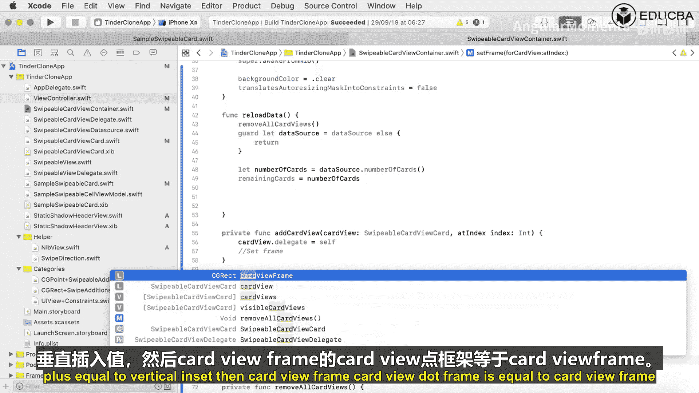

Is equal to card view frame。😔，Now we will use this function to set the frame， set frame。

For card view at index， the selected index。In card views dot append， we add this card。😔。

Then we will insert this as sub view。Car views。At index 0。And remaining cards is equal to -1。

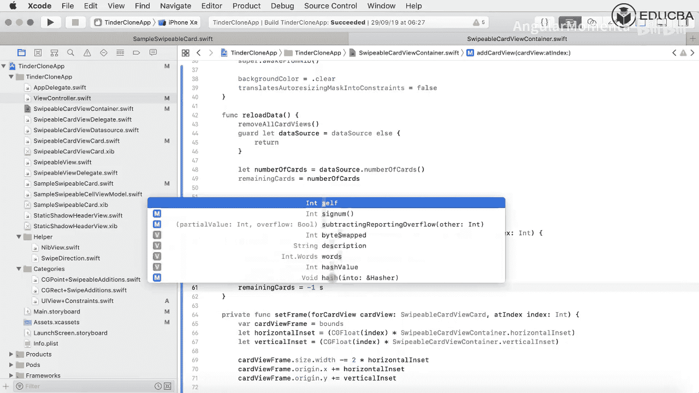

So add card view we will be using in reload data。4。Index。In 0。Listen。Minimum of。Number of cars。

Number of cars。Commer swipe peopleable。It's not working。Okay。Swipeable。Car view container。Dod。

Number of visible card。Add card view。Data source dot co。Index are index index。

 we are getting an error。Cannot convert value of type these to s card view card。Okay。

Let's remove this。😔，Now error should disappear。 Let's come and build。😔，Cll succeeded。Now。

 for empty view。If LED。😔，Empty view is equal to。😔，Deta so thought。View for empty cars。

Add edge constraints of view。😔，To an empty view。And after this， well call。Set needs layer。Now。

 what we have done， just we will do a quick overview。

So in spepe Car view container we have we will reload the data during dataset set that is when it is ened。

Then we have this declaration and in away from Nb， we set the background color to clear。

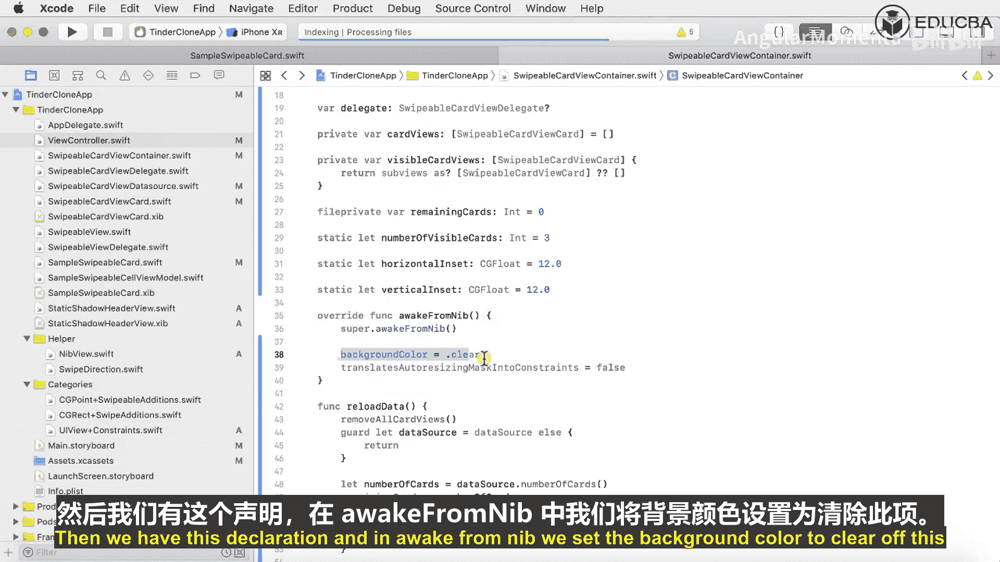

Of this one。

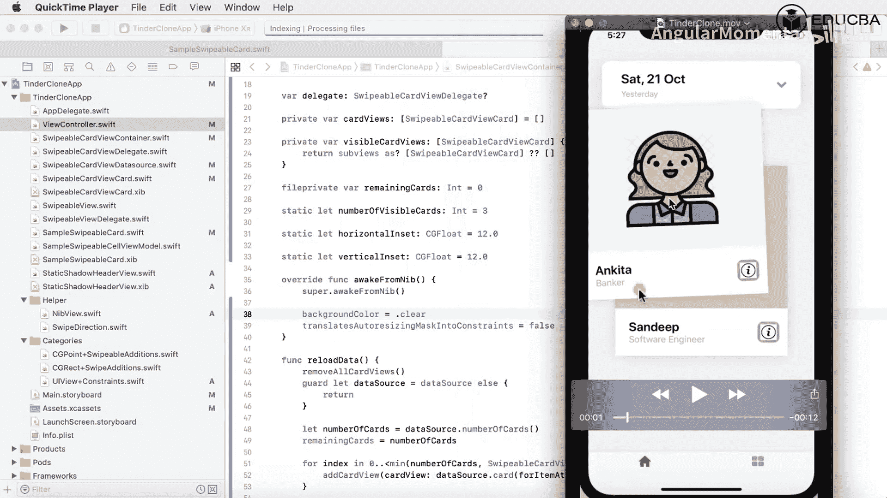

Card container view， container view background color as clear。

 then translate authorizing mask into constrain this boolean value as false。Then in reload data。

 what we have done is we have removed all the existing card initially。

 then we are trying to fetch from data source and then number of cards we are determining and then which is minimum either number of cards or this syable card we contain a number of visible card。

 we will iterate it and we will。

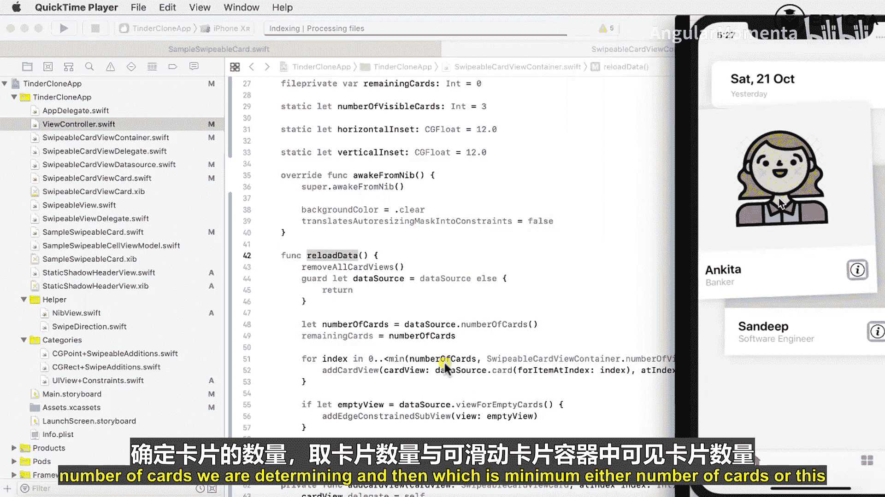

Add this。To card view。 So in this， what we have done is。Add Car view， we delegate， we frame。

 frame settings is done over here。😔，Then weopend the card views。

 card views with each of these card and insert this as sub view at index 0 and remaining card as minus1。

So this we have done now， we will go with delegates。 so indeed tap。😔，If LED。😔，Guard of you。

Is equal to view as。Sy people card view card。😔，Then let index is equal to。😔，Cardews， dot。

Dot first index。Of card view。In this will call， delegate dot did select。😔，K， did select。

 we need to modify it。😔，You will modify this as card。Swipeable。😔，Card view card。Add index， index。

Integer。Dot did select car will pass。Discard view。At index as this index。And it begin swipe。

 we will just add a print statement。Did begin swipe call。Now， in didn't swipe。 what we'll do is。Gard。

led。Data source is equal to data source。Else， return。We will remove the card that is swiped。

That is a remove card。That。He swipe。If。A remaining cards is greater than 0 then。😔，Let new index。

Is equal to。😔，Dta so out。😔，Number of cards， minus。Remaining cards。Then we will add card of view。😔。

Data source dot co。New index are index2。 Now we have to update all the indexes of cards。😔。

So we will do this， youll have foreign statement。😔，4。Card index comma card view。In。Invisible。😔。

Visible card use。Dot a reverse， Dot enumerated。Dot。A reversed。Dot。Enumerated。He wife you do。😔。

Animate。With duration and animation。Durration 0。2 and animation。

Card view dot center is equal to self。😔，Dot center。Self dot set frame。It will be Car of you。

And card index。And then， we'll call self dot。Lalay out， if needed。So in De end swipe。

 what we have done is we will fetch the data source。If we have a data source。

 then we will proceed else simply return。Then we will remove the card from super view。

Then we'll check if we have。Any pending cards， if you have pending cards， then we will add the card。

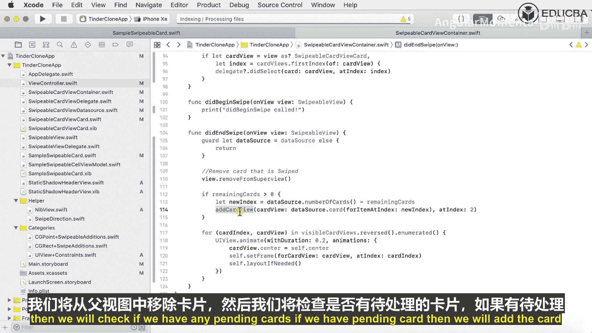

To the view， which is this one， this these cards you add it。

Then we will irate everything with animation so that the remaining cards can animate it properly。

That is， during swipe did end swiping。 You can see Ou。

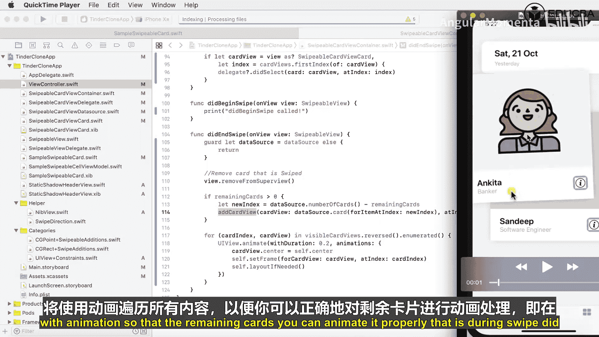

Did end so I think， okay。

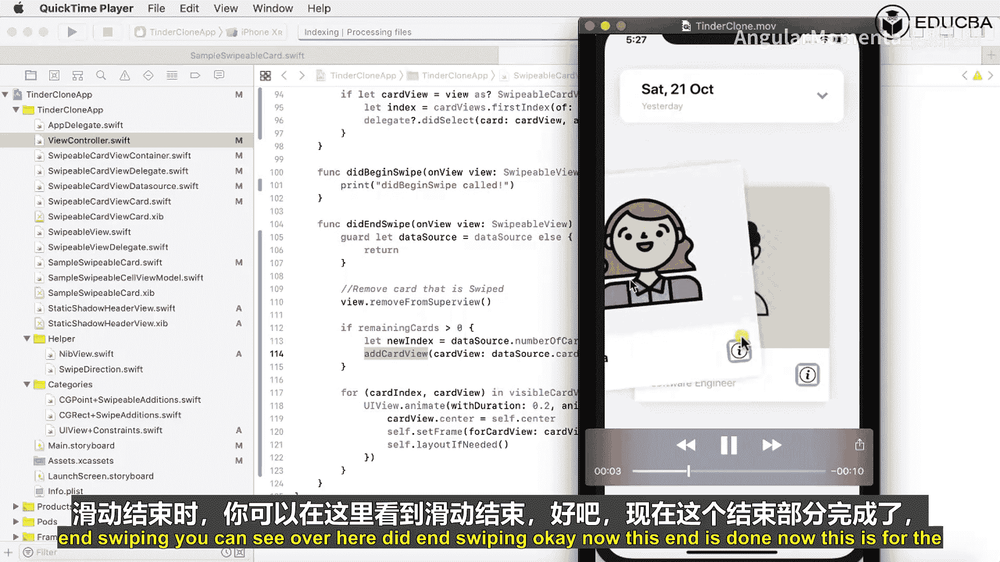

Now， this end is done now。This is for the rest of the cards。

So I think we are done with this file sable card view container。

Now we will use this in view controller。Now let's un this。

 sable Car U do data source is equal to self。😔。

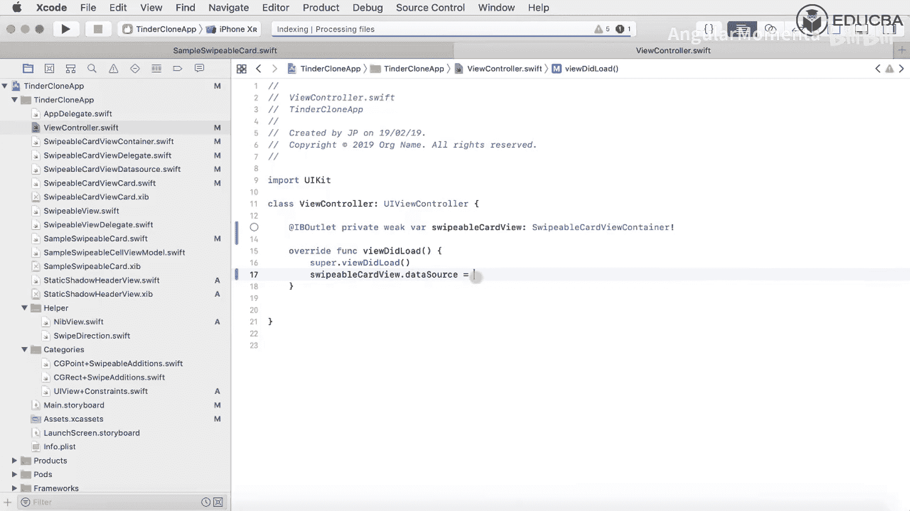