# 【EDUCBA】使用Swift开发一款滑动匹配iOS应用  Develop a Swipe-Match iOS App Using Swift p09 03_03_01_最终用户界面润色 -BV1WNFozjEHe_p9-

We are getting an error。Okay， now let's go to this data source。Data source， okay。그。Okay。Will add。

Swipeable。Carew dinosaurs。😔，Okay。Okay， in extension。Extension view controller。You'll add those。

Data source， which are number of cards。 cards view for empty cards。In extensionin。Okay。

Number of cards will be returned。View model。Okay。Prior to that， we need to。

Create the empty view models。Extension。View controller。Yeah。Okay， where view models。😔，Sample。

Syable cell view model。Yeah。Let。See we will have few users， like。Surish is equal to sample。😔。

Sopepe will sell view model。그。Titon。Surish Raheja subtitle。😔，Fitness trainer。Color， S U， Y color。😔。

Red， green， blue， and alpha。0。98。Green 0。81 and blue 0。46， Alpha 1。0 image name S hash。😔，Image。

 lital。Yeah。Yeah。Okay。Youll have this image。😔，So prior to that， let's add all those thing in assets。

So in assets， we will add all depending things。Lake。This image required。This one。In for。As will。

Simply drag and drop over here。Hush。Okay。Hsh image lital。😔，Okay， let's do one thing。嗯。

This one we required， will drag again。😔，Gropvo。That doesn't work， seems。He。Yeah。Okay。Yes。

Let's command this block and now add image。😔，Iage。😔，Literral。Iau's name。😔，Yeah。As Sw。

Now lets un this， you can see corresponding images there。If you click your hoier。😔。

You can select which image you want。ThoughThis will be su。 we have set it。no。

Control I to indent it indentation。Now， let we will have another thing。You have another user let。

Yeah。George is equal to samples sable self view model。😔，George Christ。Subtitle。Travel business。

Color as。UI color。😔，Yeah。Yeah。0。290。64，0。96 and 1。0， and in image。😔，Yeah。Okay。As this one is George。

😔，Now， we will have another user let。Yeah。Pja is equal to sample swipeable cell view model。😔，부장。

Dwari。Subtitle as。😔，Yeah。Account executive。Color as E white color。그。0。29。0。63。😔，And 0。49， null5 1。0。

😔，Alpha should be 1。0 and in image。We will have。그。This one。Now we will have another user。

Cagel is equal to sample sable cell view model。😔，Cail。Yeah。Dangle car， subless。hoomemaker。

Color white color。😔，69。😔，52 and 38。😔，Alpha 1。0。😔，And。This one as。Okay。

We are adding many users like it should be around 6 or 7 so that if we can see better animation。

 we have4。

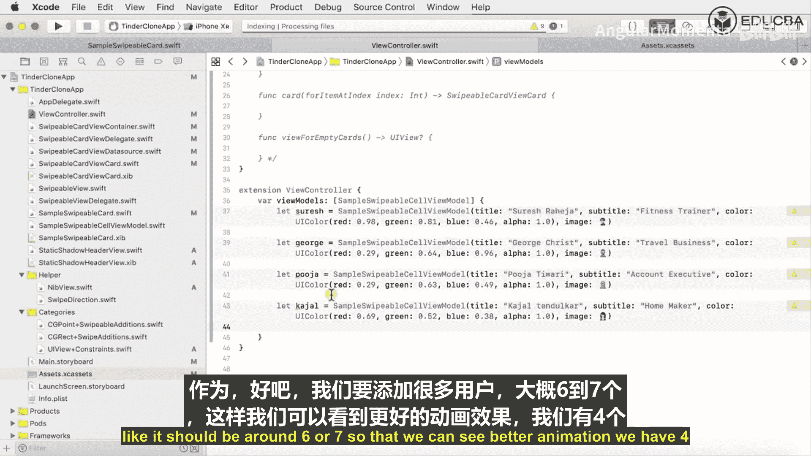

Now let's add two more。And guitar is equal to sample sable cell view model。😔，Subtitle。Yeah。

Software engineer。Color U white color。😔，Yeah。0。90，0。97 and 0。99， Alpha 1。0。😔，And image as。그。Yeah。

The last。Model， we have。Some deep is equal to sample swipeable cell view model。😔，3的。M로ra。Businessman。

Color U white color。😔，Yeah。53。82。And 69， alpha P is 1。0。An image S。😔，Yeah。

Now we will add this in return this in an array。Sasarish comma。😔，George。😔，Yeah。Comma不ja。😔，Commaca。

그만 안기た。And。Sun deep。Yeah。Now we will use this view model over here。Number of cards will be。

View models dot com。And here， it will be let。View model is equal to。😔，View models at index。Yeah。

Let car view。Is equal to。Sample。Sample swiable car。

Then card view dot view model is equal to view model。😔，H。Return。Discard view。

So what you have done is。In number of cars for initially。We created sample view models。

 which are some static values。 So this one， we have passed in number of cards， then in card for。

Item at index， we have fetch the index， which is 0，12 which card is selected。

And that one we simply assign to instance of this one view model， sample， swipeable card。You。Yeah。

Here。Now for empty car view。Will simply run asil。Yeah。Now let's go to view controller storyboard。

Okay， this is connected。Now let's clean and run。😔，Hope we are able to bind everything。😔。

We should be able to see something。理外。Commar to run the application。Bill succeeded。Yeah。Yeah。Okay。

 waiting for iPhone X R to start。Yeah。Yeah。Okay， let's do one thing。😔，Good simulator and run again。

Yeah。Cable succeeded。Okay， we are not able to see anything。😔，Okay， let's go to main St board。😔。

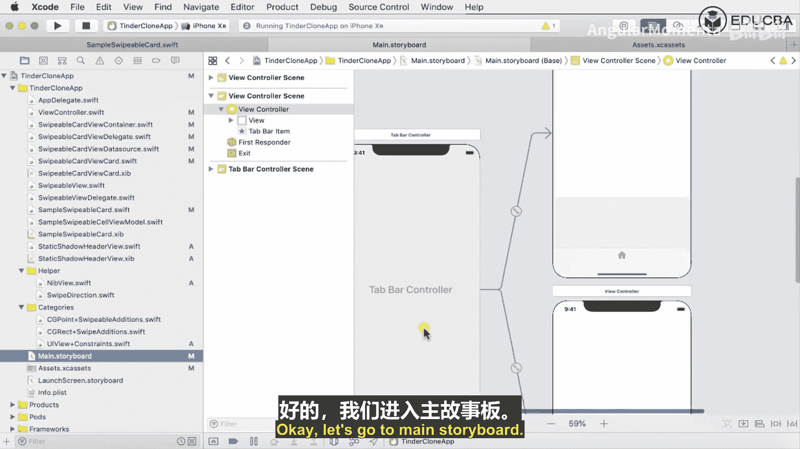

Okay。Now， let's first go to。 Let's run it and see。The root cause of grass。

We can read it from the logs， as well。Okay。Just observe the root cause of crash is that it is trying to load swipeable car view car many times you can see the loop。

It's going up till。😔，253，9，5。 And because of memory。Like a memory that running out of bound。

 we are getting a crash。 Now， let's go to this one。So I people card you card。Yes。Okay。Okay。

 this class is inhered by swipeable。Samples， swiable card。Go to sample swiable card。

That is go to storyboard and see whether outlets are connected properly or not。Okay。

 see the important thing is that we have connected to view。I can see oh yeah， it should be。

E Y view simply had the inter。Read the enter。And disconnect all these。

 You can see all this has become yellow。Because these are invalid。Now go to file owner。

Here class name should be sample sable card。And in outlet。You can open all this。Now go to file owner。

From here， this one tap to add a button。😔，This one to background container。

This want to image background color。This to image view。And this one to subtitle。

 it goes to occupation。And this one to title， which is profile name。

Now here you need to add an image， so go over here。😔，Go to。Atttlebo section。An over year。In image。

 enter。Info。And let's add some background color。To this as say light gray。Okay。

 now let's run and see。Okay， now you can see。The profiles。Now， you are able to see the。😔。

User details， so you can see over here。Did swipe， you can swipe it like this。 You like it。

 You didn't like it， okay。This one liked it。Now， only two records is being displayed。

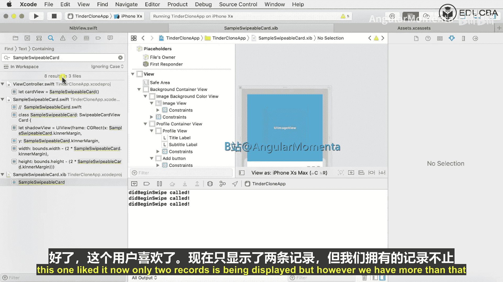

But， however。We have more than that record。 Okay，12 record will。Now， let's do it。 Remove this one。

And。Add this one， now let's run and see。 we should be able to see。😔，Total of6 records。Okay。

 I can see 3。It's kept like a stackg。1。😔，True。3。😔。

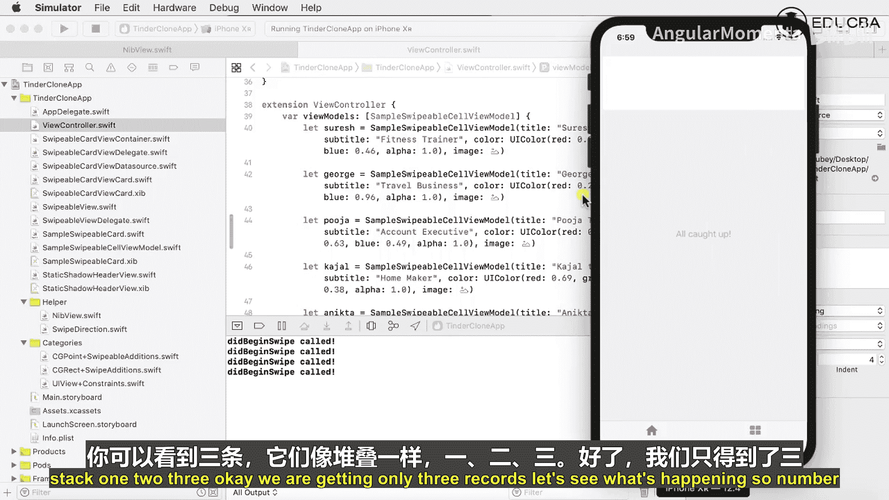

Okay， we are getting only three records。Let's see what's happening。So number of cards should be 6。😔。

Again， Raid。O， view model。Bt count， which is nothing but number of rows。It should be 6。

 That is correct。😔，Then。😔，Okay， see， this is being。

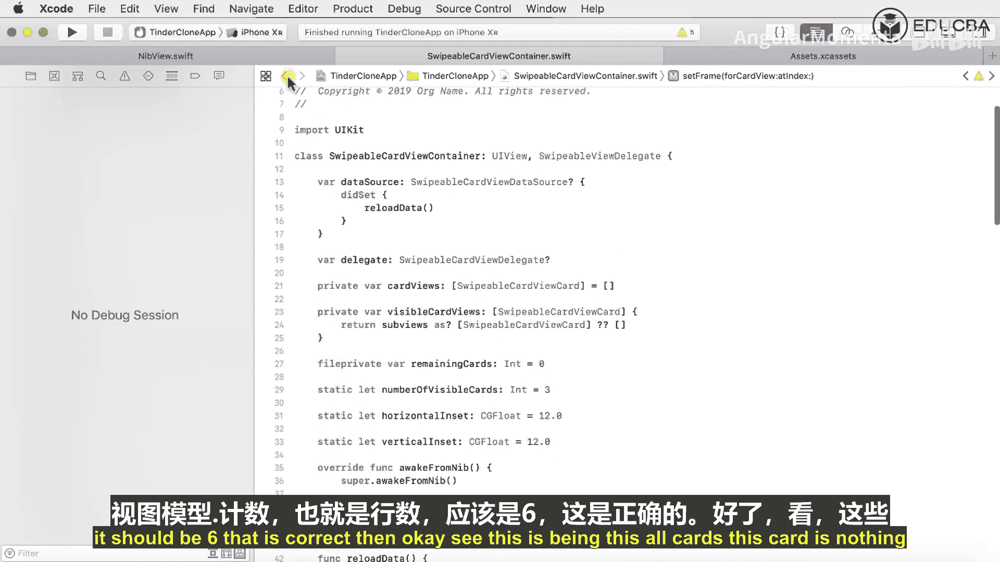

These all cars。

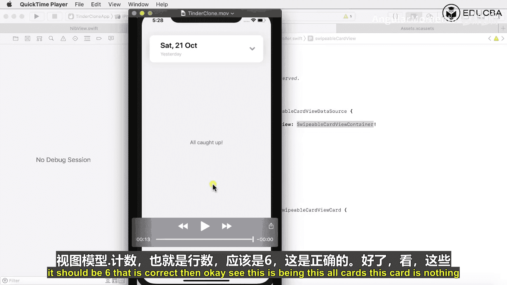

This card is nothing but。So people card view container in this， let's see there may be some mistake。

😔，So initially， we reed data。In reload data， we fetch data source and we I through all this car。

 then empty view then set its layout。😔，Okay， in this， we are the card of view。😔。

Card view is at a delegate set frame Append view， remaining card is equal to -1。😔，Kate should be。

Remain cards equal to remaining cards， -1。Should be like this shortened operator。Now， let's try this。

😔，Now， the mistake that we did over here。We had written remaining card is equal to simply minus1。

But it should not be the case。We are trying to decrement。

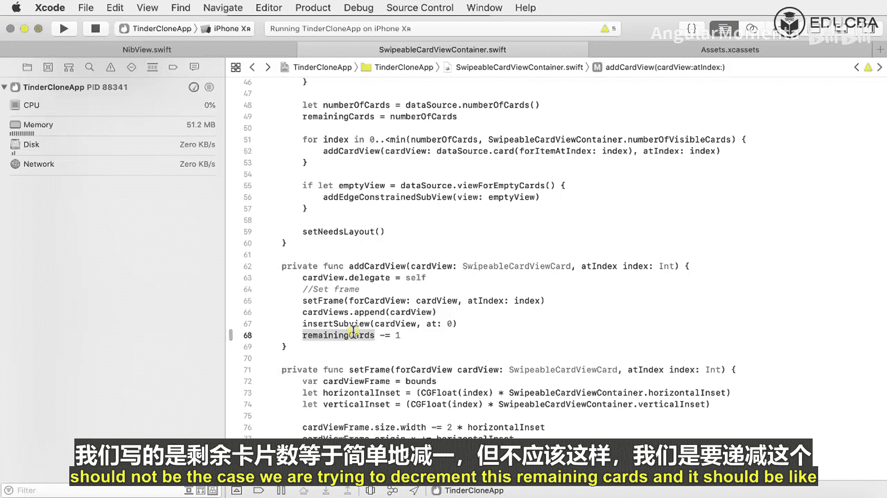

These remaining cars and should be like shorthand operator。So， one。😔，2。😔，3。😔，4，5，6。 yes。

 we got all six records。😔，And after the records are completed， we are able to see all Q up。Now。

 the problem is we are not able to see the top one。😔。

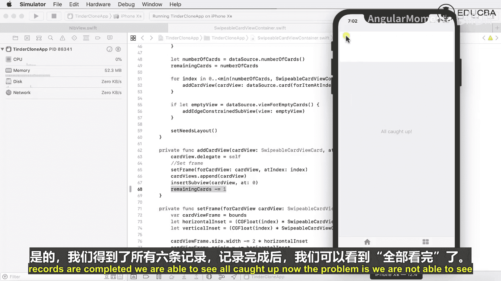

Okay， so for that thing， with static shadowhead of you。😔。

Let's see whether an outlet is connected or not。Go to static shadow Head of view。In file owner。

 strategyshader headder reviews there and output it is also connected。😔。

Background container view upload is there view Chevron。😔，In view， we have these labels and Chev on O。

😔，My main story board， let's see where we are using this。

Static head of view do we have a class binding to this no。😔，We should use it。And now。

 let's run and see。😔，Now， we are able to see the cards properly。 along with that， we have a date。

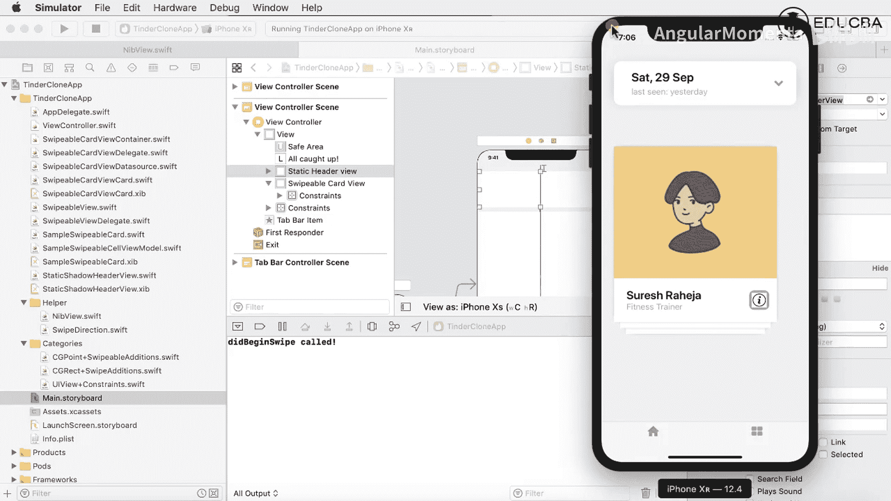

So the actual implementation of Tider， like on which date。We are able to see the users。

 So actual implementation will be like。Did all these details will be coming from server。

 So you need to。Need to bind your records with server we have implemented it using static data。

 Now you can see if I swipe it left then。You like it。 If I swipe it right， you do not like it。

 so you can add some messages over here， like favorites or say。😔，Personal info or say， reload。

 refresh those things you can add buttons and configure it。 So these， we have used dummy photos。

Can swipe it anywhere。

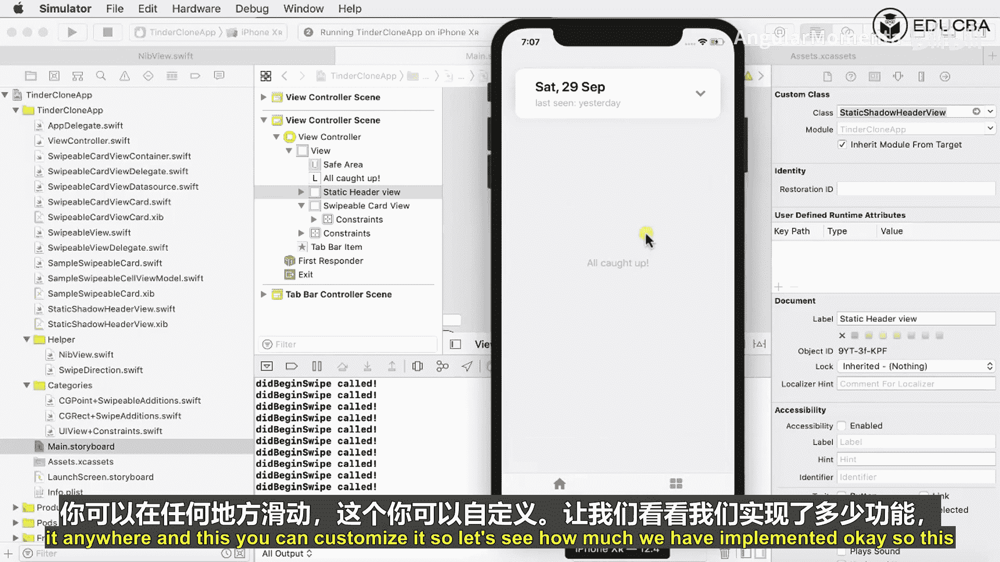

And this， you can customize it。So let's see how much we have implemented。😔。

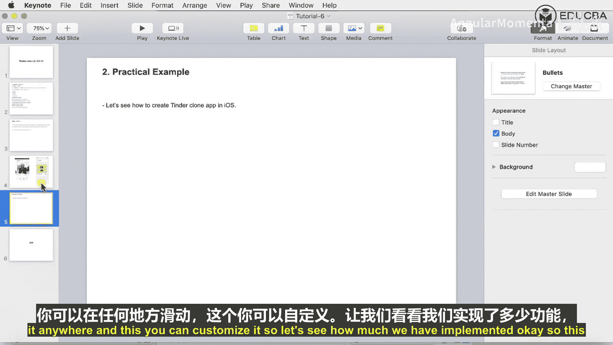

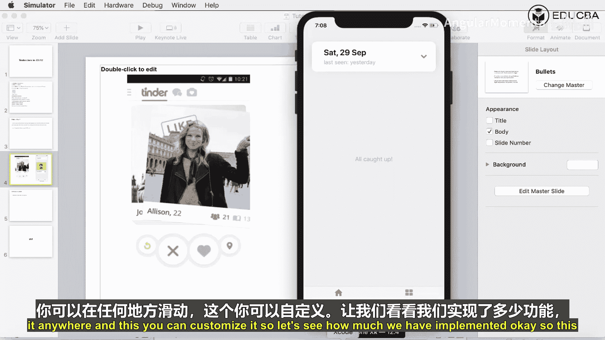

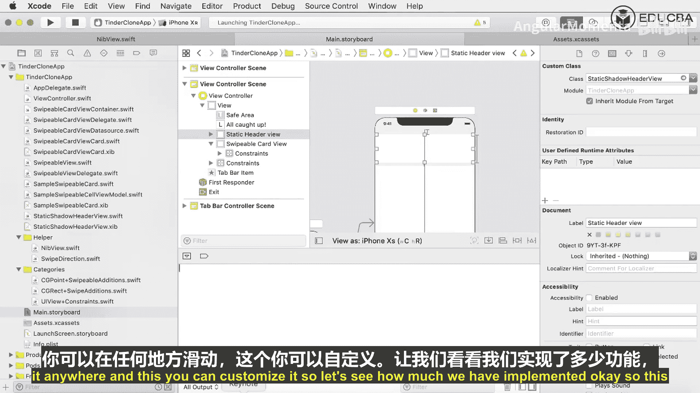

。Okay， so this is the actual Tider application screenshot。

 So you can see you have implemented the main concept of Tder that is。

Swiping the cars left to like right to rejected。the main functionality is implemented。

 you can like customize it by adding some logos and chatting chat board and photograph。These things。

 you can simply add。Soviet。Implemented the Clean application clone。Using So 4。And now is dwell。

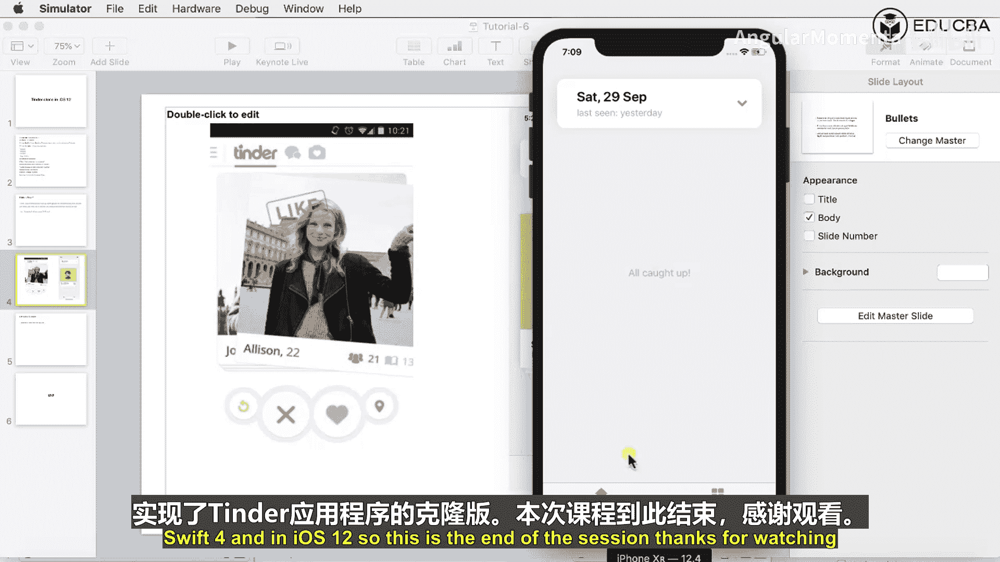

So。😔，This is the end of the session。 Thanks for watching。

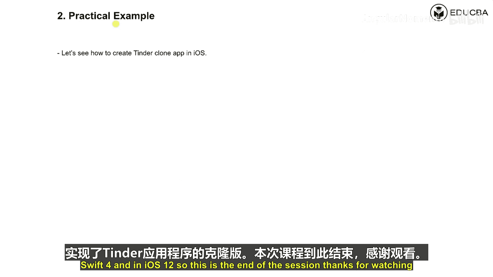