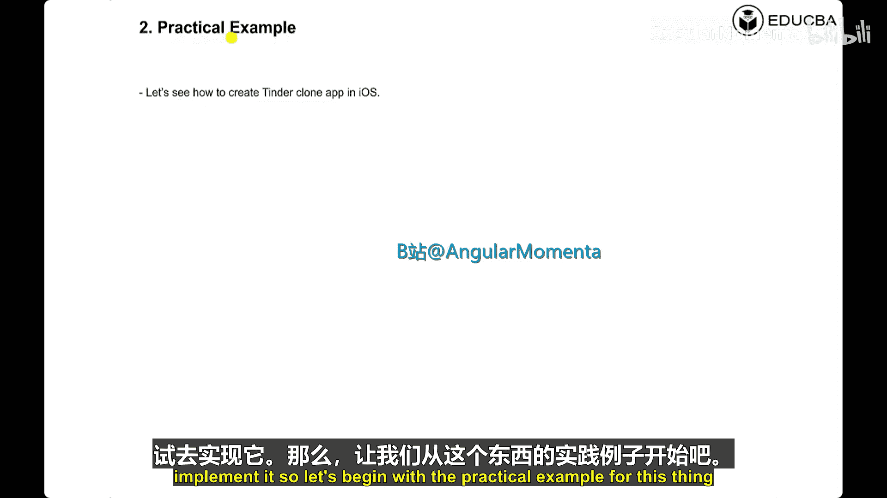
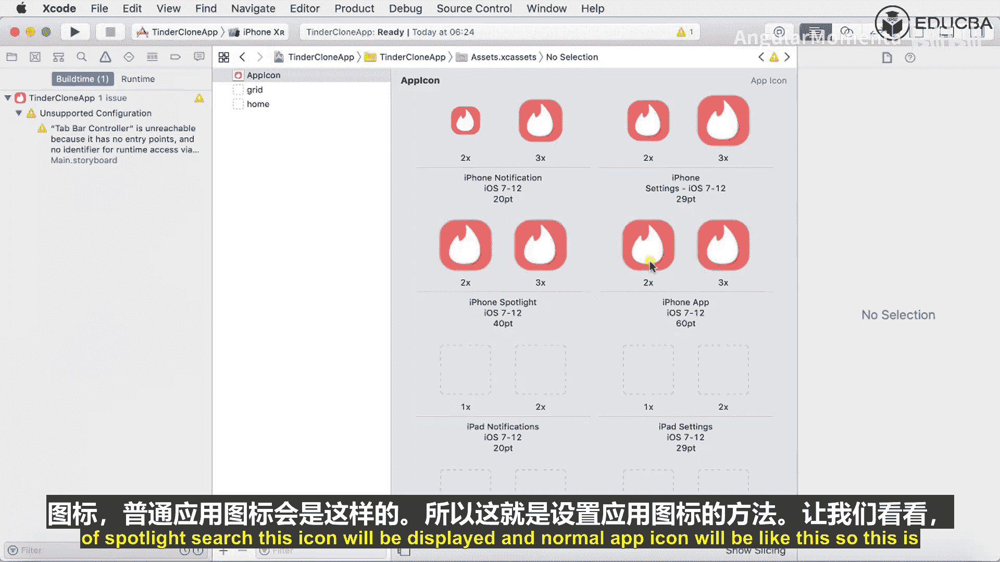
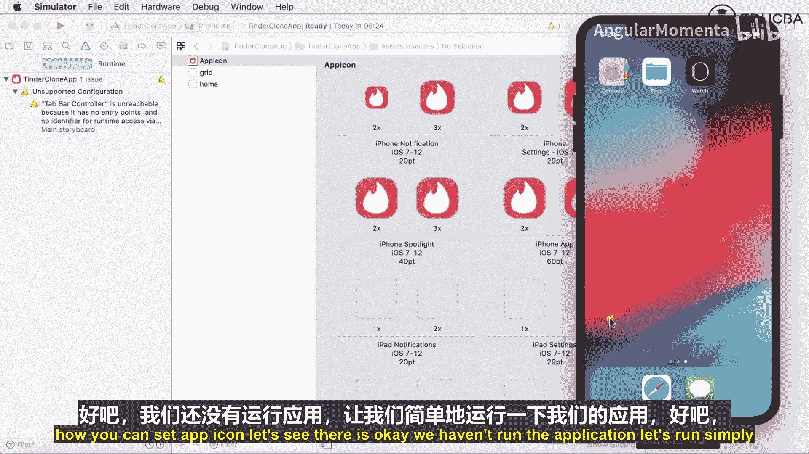
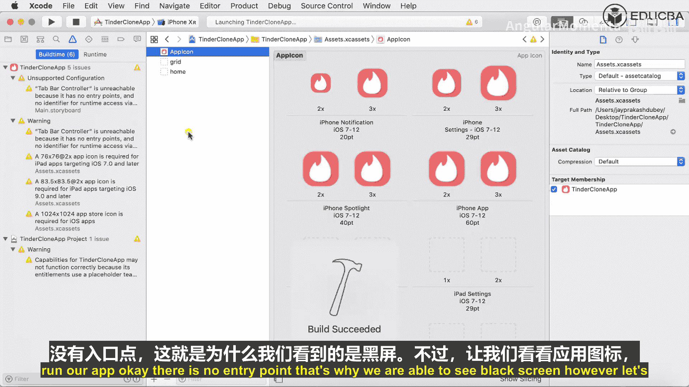
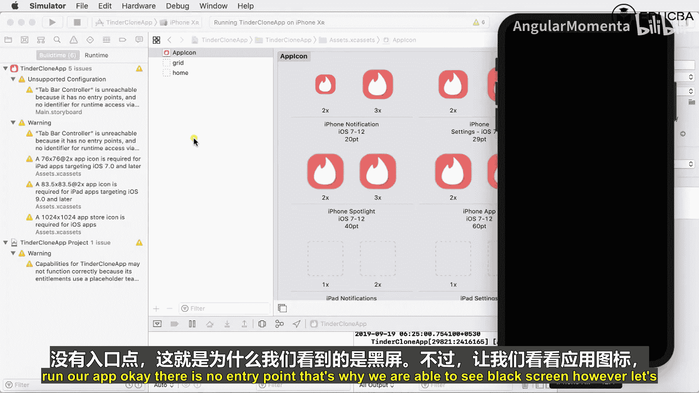
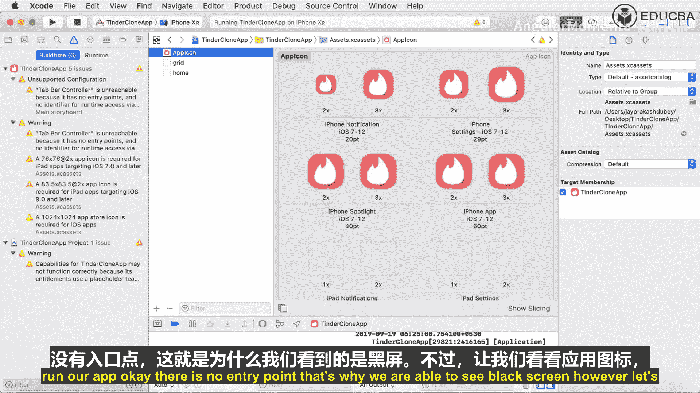
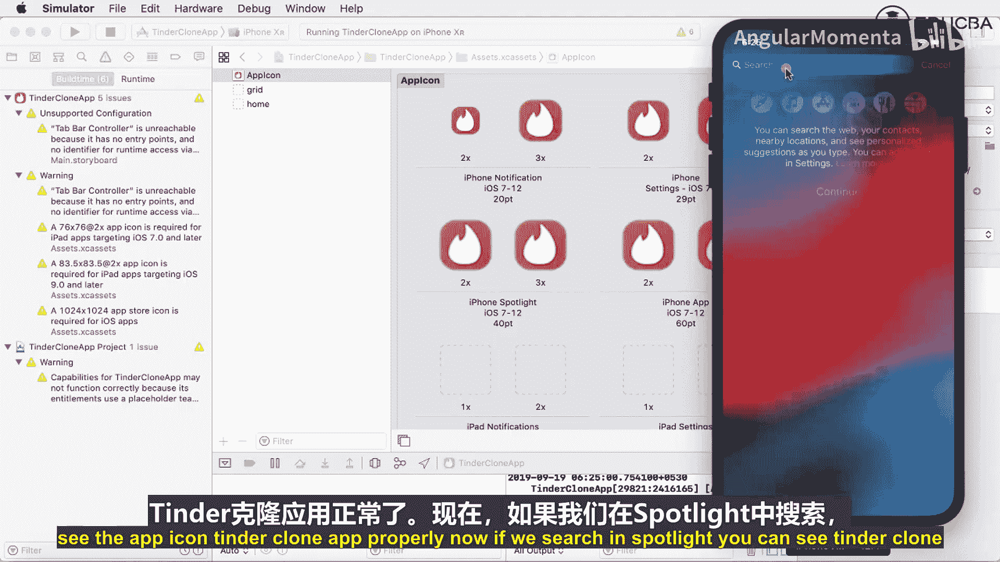
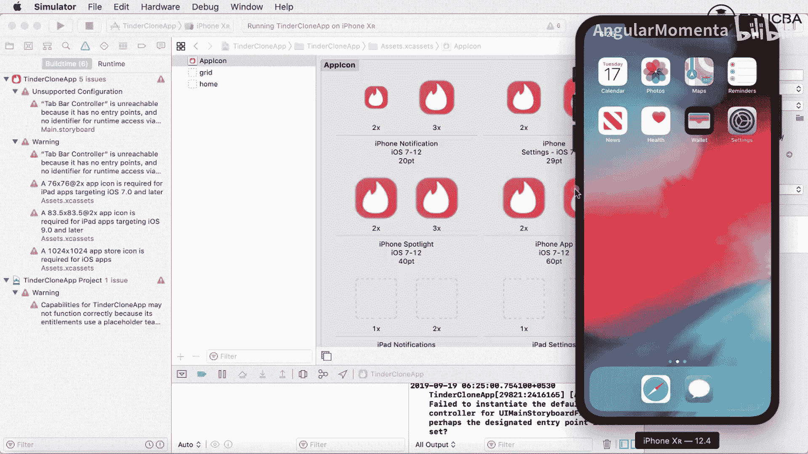
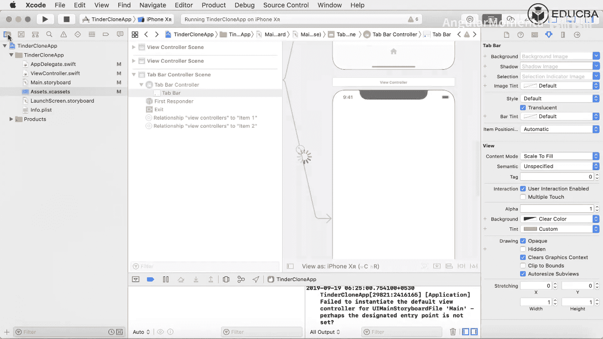

# 【EDUCBA】使用Swift开发一款滑动匹配iOS应用  Develop a Swipe-Match iOS App Using Swift p01 01_01_01_Tinder克隆应用入门 -BV1WNFozjEHe_p1-

Tinder clone in ice dwell。In this tutorial you are going to see Tinder clone application in I2 so this is for iOS mobile La and this particular course will help you to learn how to create a clone of Tider in I2 using Si4 in this thing you are going to learn water categories。

 water delegates， constraints， how to add gestures like swipe gesture tab gesture。Pan， pinch。

 these things you'll be able to see and the difficulty level for this particular tutorial is intermediatemit。

In this a student can learn how to create a clone of Tinder app。

 the basic requirement for this particular tutorial is that you should be much familiar with your swift concepts and the targets for this is students who are really interested in developing I mobile app now before beginning with like practical example let's see what Tinder is all about Tinder is a location based social search mobile app and as well as a mobile web application that often deal with dating surveys。

It allows user to do a swipe motion like if you swipe on right， there will be like。

 if you swipe on the left it will be dislike， so this allows user to to express an interest。

With the other person， So if both the person have a like match。

 then they can proceed further with chat and discussions like that。

 The best thing about this app is that it has got 1。4。

1 rating from 5 with total reviews of 5572 users。So a discch for Tider is shown on the left side。

Like there are， say，5 to6 users。If I swipe on right。

 you can see like proation and if I swipe this particular photo on the left it will show as rejected so will be developing a somewhat similar application。

You can see the right set screenshot， we have certain list of users。Although these users are like。

Static users we have showed it in local storage， so these users will be able to swipe left right So that kind of thing we are going to develop。

Let's see the video that we are going to develop。So like you can swipe the user anywhere you want。

I have swiped it。 Now you can again swipe it。And again swipeping so all the users are completed。

 so the main purpose of like creating a card and swiping it to the left right or any side of the screen。

 so this core core concept that is introduced but in the we are going to we are trying to implement it。

So let's begin with the practical example。For this thing。

Tinder clone in I 12。In this tutorial we are going to see how to create a clone of Tider in I 12。

 so this is for I mobile app， this particular course will help you to learn how to create a replica of Tider application Now in this course you are going to learn what categories water delegates。

Constrains how to add different types of swipe gesture that is pinch， swipe， left swipe， right swipe。

These things you are going to learn the level of difficulty for this particular tutorial is intermediatemitent and the students in this student can learn how to create a clone of Tider application the requirement for this particular tutorial is that you should be aware with swift basic concepts targeted students for this particular tutorials students who are really interested in developing I app。

 so lets begin with the practical directly。So open the X， version 10。3。

Click on create a new Ex project。Select single View application。Click on next。

 enter the product name。Tinder cloneap。Organization name。Will be your the name of your organization。

And this will be Uni identifier。But the identifier will be combination of organization identifier and。

Product name， this bundle Id would be used to uniquely identify your app on the app store。

Select the language what you want， Swer object C。We are going with Sift， click on next。

And choose the location where you want to save。 Make sure that you enable this one。 So kit。

 create Git repository or Mac。 Now， Git repository means S U will be set up on a local Mac click on create。

This will create your project with default settings。Before beginning with the actual development。

 lets see what Tider is all about for those who don't know the Ti application。

 it is a dating website。There is an app also dating app。

 so we are going to create the launch the initial screen of Tider。Let me show you an example。Okay。

 so your app should be like this one。You can swipe it， swipe right to like， swipe left to project。

 so there will be different swipe gestures。 there will be different cards。Like 1 person，2%，3%。

 you can see over here。And there will be some options like to find the location and everything。

 So this kind of UI we are going to develop for。Over Iis。Soon， let's。

Create storyboard for this thing。So initially delete this one。We need a tab bar， So open U tab bar。😔。

You babar。😔，Der view controller， O， drag and drop over here。So Taber will always have it。😔。

At least two view control associated with it because you can see oh here tab bar should have at least one and2。

There is no point of having tabbar with one。😔，With one item。So this will be our view controller。So。

 over year。😔，Select this tab bar item， we need to change this one。Go to。😔，This ensure of title。

Simply add an image for adding an image。We need to have an asset； these are the assets。Go to。😔，Ass。

Hard agreed。The first one。2 x。And3 x， these three image added， same for whom as well。Home。1 x。2 eggs。

 and。And3 x。And this one， you need to add oh here。First one would be home。Second one as greed。

Change the tin color of this one。这个人。We can see tent color change from here and here。

This is somewhat。Similar to Tider。可乐。Now， let's add。A icon， as well。

So there are different dimensions of app icon， which you need to add it。

It should be noted that size should be same as that of given dimension。So if you go with this。

 it showing 60 by 60， let's drag and drop over here， you can see warning is increased to 2。😔。

It should be 40 by 40， not 60 by 60。 so delete this one。So search for 40 by 40。72，72。😔。

This is 40 by 40 dimension。Then。😔，Put it over here。 Okay， there is no warning。

 then this will go to2 exact。😔，Okay， so which means dimensions are correct。😔。

You can see there is no warning coming up。Okay， so。What you have done is we have added an app icon。

For different types of。Different types such as when there is a notification。

 so this app icon will be shown。IPhone notification for i 12 to7212。

 so this kind of notification will be displayed for a non retina device it will be like this for retina device it will be like this。

And in case of iPhone settings， you will be able to see these icons for non retina and for retina device。

In case of spotlight search， this icon will be displayed and normal app icon will be like this。

 so this is how you can set app icon。

Let's see。

There is。Okay， we haven't run the application。Let's run simply run our app。

Okay， there is no entry point that' is why we are able to see black screen。

However。Let's see the app icon， Tinder clone app。Properly， now， if we searching in spotlight。

You can see window clone nap。This is our local app， this is which is available on App Store。

