# 【EDUCBA】使用Swift开发一款滑动匹配iOS应用  Develop a Swipe-Match iOS App Using Swift p03 01_03_01_滑动动画 -BV1WNFozjEHe_p3-

Now， we will write functions for pan gesture recognizer， then tab gesture recognizer as well。

Let's initially add a mark so that all the functions are distinguished properly。Ban。Gistture。

Recognizizer。Private function。Pan gesture。Lconizer。Gisttured。Recoizer。UI pan gestureure recognizer。

Now， we have。😔，P gestureure translation， we will use this one。Pangeure translation is equal to。

Gesure recognizer， dot。Translation in view， self。그。I will check the。😔，State of this translation。Yeah。

Pan gesture。😔，Translation。Dot state。Okay。It should be。Gesture recognizer。😔，Dot。State。Case will be。

Begin。Yeah。There will be another case。Yeah。Case dot。Ended。그。Case do。😔，Okay。Change。Change。

And some default block。 So in case began。We will have some block of code。 So first。

 I will write all this code and then explain what we are going to do。Let initial。

Touchpoint is equal to。Gesure recognizer， dot location in self。Glad new。그。

Anchor point is equal to Cg point。😔，Yeah。Initial touchpoint， dot x。Divide by bounce。Dot。

W and same applies for this one， initial touchpoint dot y。😔，Divide by bounds。Dot height。Then。

 let old。😔，그。Position is equal to Cg point。😔，Yeah。Bounce dot size dot width。And 2。Laar do anchor。

Yeah。Point Lotex。Bouce dot size。Dot height。In2。Glare dot， anchor point， dot y。And let。Yeah。

New position is equal2。😔，Cg point。😔，Yeah。Bouce dot。Size do width。Yeah。In2。New anchor point dot。

A new anchor point dot X and per Y position to be。Bouce dot size dot hide。And do。

New anchor point dot y。Yeah。Layer dot anchor point is equal to new anchor point， Now will set。😔。

Lair dot。Anchor position。Position is equal to。Cg point。😔，Clre dot position， dot。X。Minus。

O position dot x plus。Okay。New position。Yeah。New position do。Ls。Then for Y position to be。

Lair dot position。Dot why。Minus old。Pos， dot， why。Plus， new。😔，Po， dot why。

Then you will have layer dot。😔，ARization scale is U screen dot main dot。Scall。Then， lay dot。

Should ra rise is equal to true。😔，no。We have this delegate will be will be using this delegate。

Deleate do。Yeah。Okay。Will go with did begin spe。So this。

 we need to change that begin swipe over year。 we should add on self。Which means oh yeah。😔。

We need to modify this one。hich means oh yeah。😔，Did tap view。Spep view。

 which is now created this one。And again。On view view。Swipe people view。Did end on view。B30。

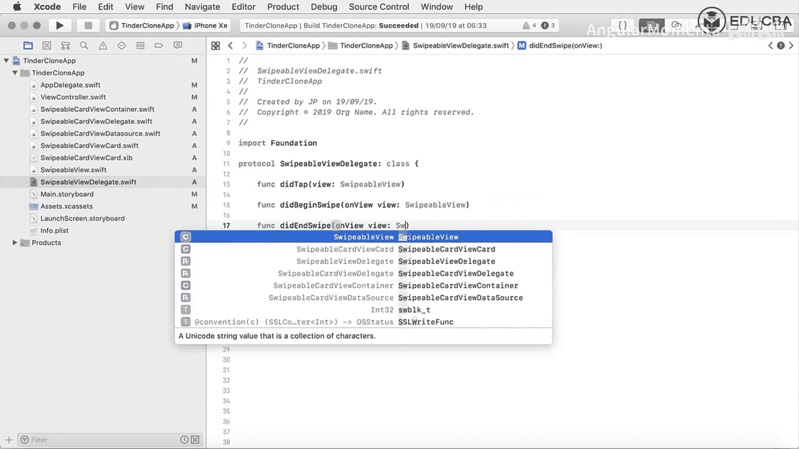

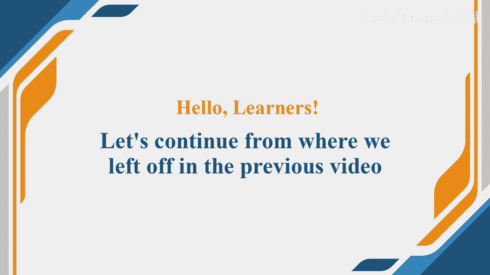

Now， this also gets modified。You can see over you。😔，If I press a escape。Swipeable view means self。

Now， for case change will write under condition。Let。Roation。Yeah。Change is equal to。Routation。

Strench is equal to。Minimum of。Pan gestureure translation dot。X divide by frame， dot width。

Sy people view， dot。😔，Maximum rotation， this will be the rotation strain then a rotation angle。

Angle is equal to。Swipeable view dot animation direction， y。😔，Into syable view dot。

Rotation angle into。Rotation strength。 Now we will have some transformation。That。

Transform is equal to C， A transform。😔，3D identity。Transform。Is equal to C transform 3D。😔。

Or rotateed。Will be transformed。😔，Dish transform。Then， a rotation angle。Rotation angle。Then 0，0 and1。

Transform is equal to C。C a transform3D translate。Transform。Then。It will be。

Pan gesture translation dot x。Then pan gesture translation do Y。😔，Then zero。

Then layer dot transform is equal to transform will will simply assigning to the layer。

 then for case ended。😔，Yeah。Lair dot should rationalize is equal to falses。And for default， also。

 layer dot should rational is equal to falses。So what we have done in pan gestureure recr is。

First of all， pan gestureure recognizer means you are trying to move your fingers across the screen like you you have hold the car and you are trying to swipe it from left to right。

 so it's panning kind of thing。So in this， there are different gesture organizer that is first begin。

Then change。 then entered。So in begin， what we have done is we are trying to fetch the initial point like when the user has clicked it。

So like it will be better to explain this video。Okay。😊，Now， you can see oh here。😔，This initial point。

 I am trying to pan it。From different position。So begin， begin wins。 Now， Ive just initially started。

So in begin， we are trying to fetch the initial point。

Then the anchor point position and then old position new position。Then assigning to the layerir。

 which means。This is used for animation layer and then fetching the position some calculation then rational scale then enable it true and all these things we will happen on did begin swipe whenever we swipe it it we begin to swipe it So this delegate we will call it。

And when the state of gesture recognizer is change when it means from begin。To change。

 then this is called。In this what we have。Done is just fetching some rotation that is how much it is rotate rotation strength。

 then we are calculating rotation angle。Then in we create instance of C a transform 3 d identity。

 that is， it should appear like。transranformation in 3 d and then we have passed these values rotation angle into this and transform and then again translate this to transform over here the x y position and simply assigning the instance of this to layer or transform So this we have done in change begun change and ended ended means I have。

Talpped it。So。In that case， layer do should rise two falses。Now， what does rash rise mean。

So like when this value is true。😔，The layer is simply rendered into bitmap。It's local coordinate。

 And this is composed into destination。 And by default is false and。

If you set it to false explicitly， then the animation that then the C layer instances is composed directly to destination point。

 so this is basically used for animation。Yeah。Now in begin animation。

 we will write one function pending。Remove。Animations。Anyends。Oh。Ened pan animation。Yeah。

And in default。Re said。guardard。Animation。So this function we need to implement this three thing。

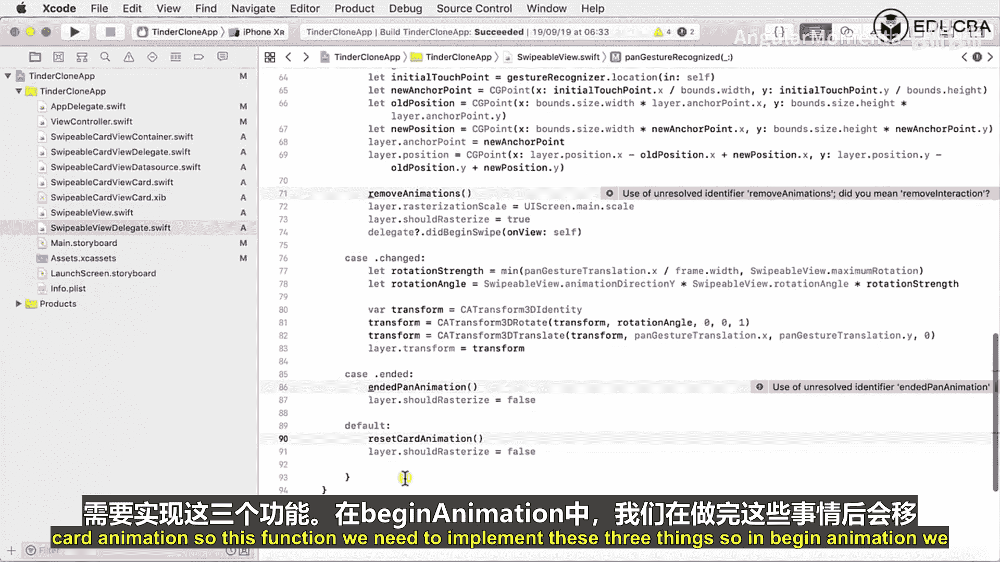

So in begin animation， we will remove the animation。After doing these things and in ended。

 we will end pan animation。

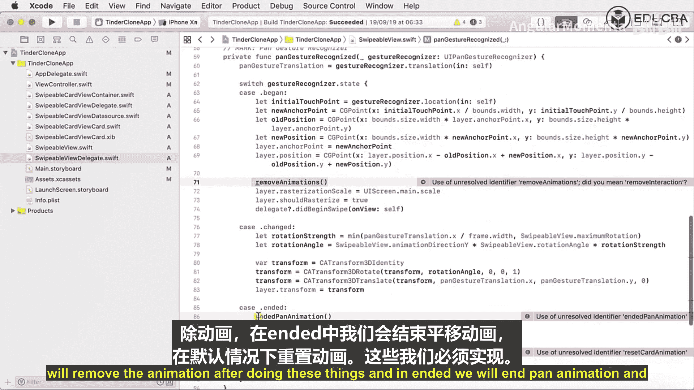

And default case reset animation， This thing we have to implement。Now， the most important thing。

Did you be using pop cocoa ps。

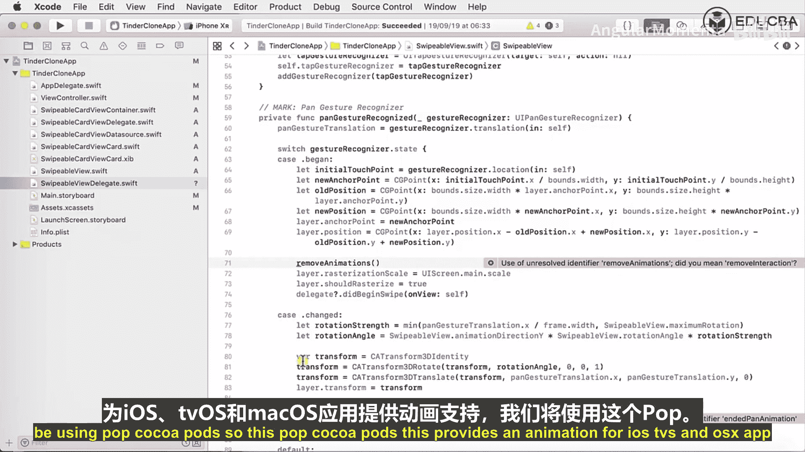

Yeah。Okay。So this pop Cocoapos， this provides an animation。For I TVV and OSX app。using this one pop。

 this is being used by apps like Tiktk， Instagram， Messenger，napchat and Facebook。

 This is mentioned by Facebook willll be using this one。

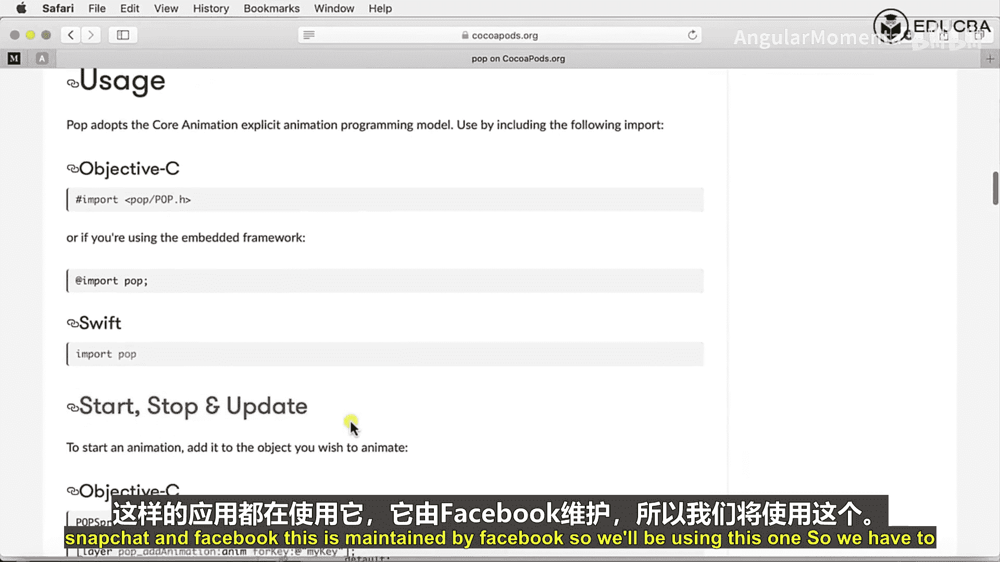

So we have to simply write part， pop， and specify the version。

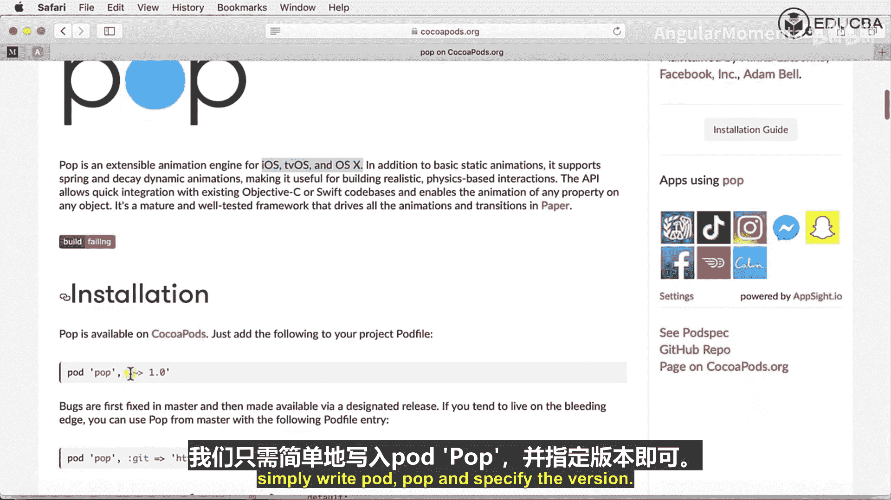

Initially， let's comment it out。

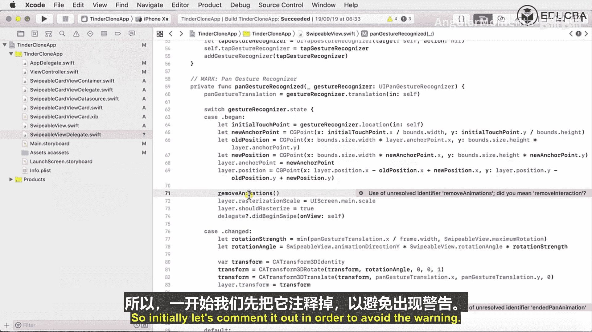

In order to avoid the warning。So now we will install board first。😔，So for that thing。

 open the terminal。In terminalminal。Under C D space。Drag and drop your app。

And change to directory where your project is present。Over year， enter command po identity。

This will initialize the part。Make sure that you have cocoa partss installed in your system， if not。

Then just have a look into our tutorial called cocoapos。 So over there。

 we have explained in detail how to install gens。😔，B partss and these things。

So port initialization is done。 now we need to open the file。W should be open。😔，Ihon open profile。😔。

Pyhen a X。😔，So our portfolio is open here you have to write the。The port name and version。

So will using power。😔，Bob。Virgin as。😔，1。0。1。Now， close this border file。嗯。

Try to install the port par。Install。Okay。We are unable to find this specification for pop。

Of this version。You might have either out of date。Porruppo or mistypepe ne version。

Let's shake the pop。

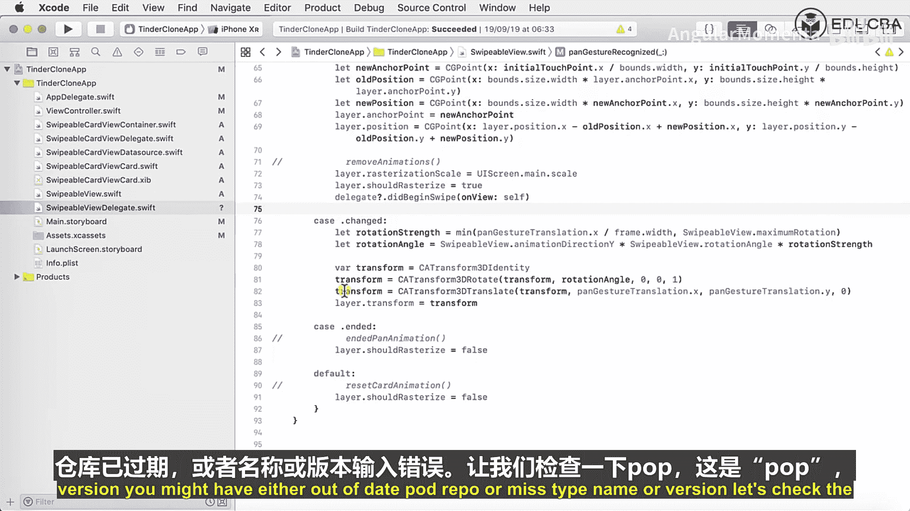

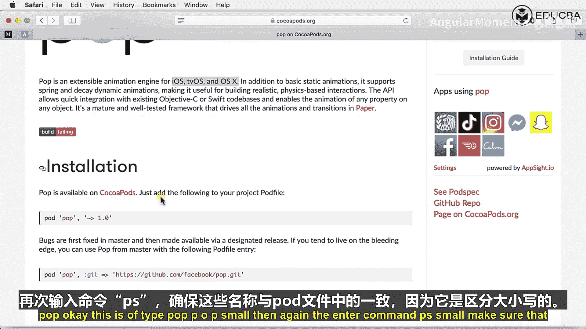

Okay， this is of type P O P P is small。Then。Again， the intercom。Be as small。 make sure that。

These names should be similar to the port。

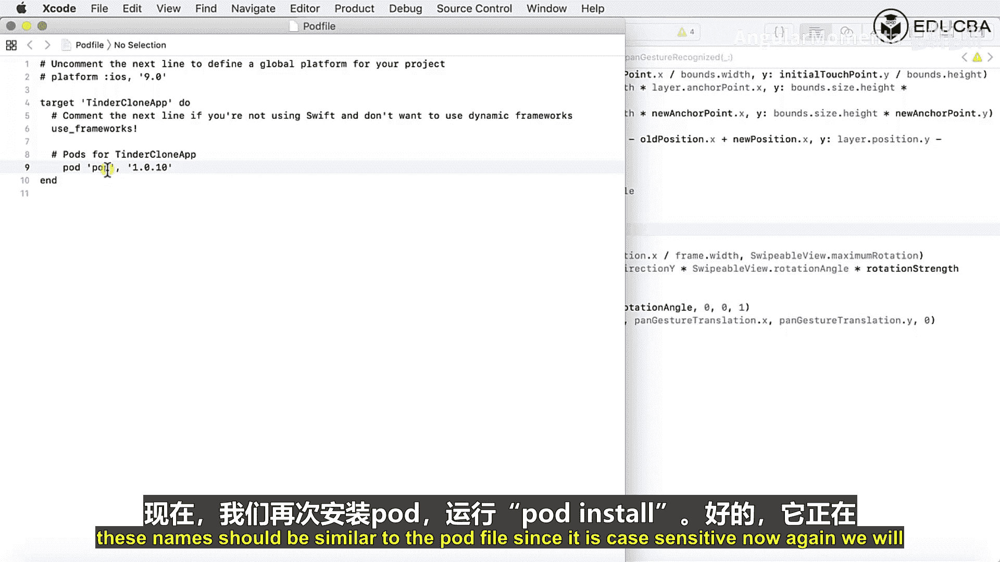

Sinceens it is case sensitive。Now again， we will install the port。Pod install。Okay。

 so this is trying to download the dependency called pop of version this。

This has been downloaded successfully。 Now this mentions you have to close this project and open it using workspace。

 so let's do it。Now let's close our project。

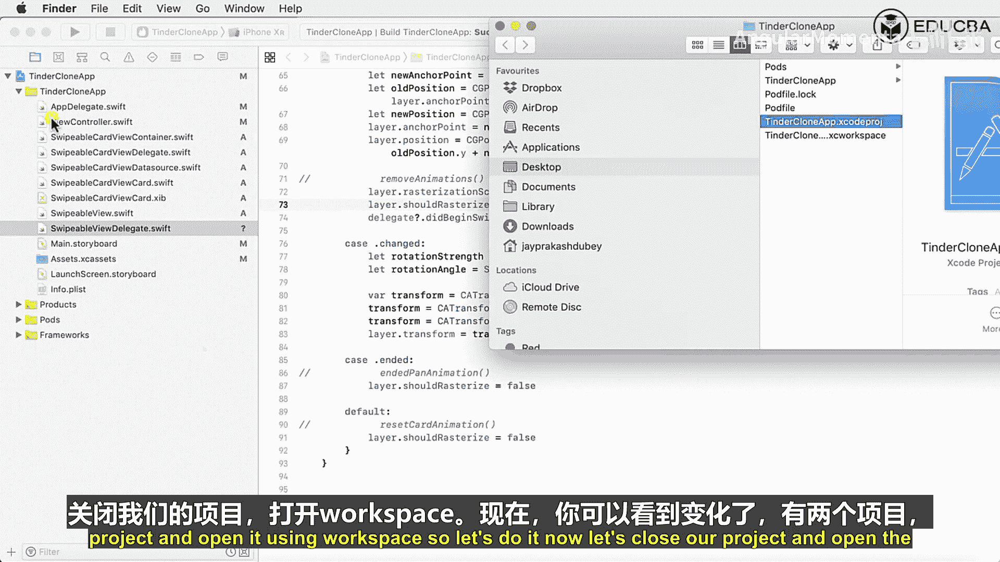

And open the workspace。Now you can see the changes there are two targets first is for project。

There are two different projects， not targets。The first is your T clone application and the second project is pods。

Here， you can see。Deport version。Now， let's commit until here。Yeah。Project set up done。

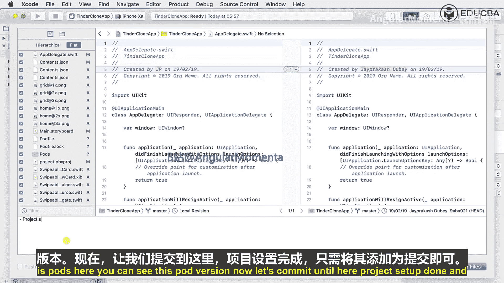

And simply add as commit。So you can see the port file over here。

 now if you want to add install other partss， you can simply add over here。Now。

 well be using that pop over here。For remove animation。嗯。So in order to use that pop。

We need to import it， import。Pop。Pop underscore her remove all animations。

Then should we remove animations。😔，Then， layer do。A removal animation。

Pop ponders for remove all animations。 This is for remove。

Let's restrict the access for this function in this class only that's why we have mentioned private。

Now real animation is done， now entered pan animation。Private function。Anded。Ban animation。

So in enter pan animation。You fetch the direction。Drag direction is equal to。Okay。

So we are not able to get the direction property。😔，Which means。Swipe direction， okay。So。

 you will first add。This swipe direction file into our project。

Make sure that copy items if needed is selected and this target is also selected。

So in swipe direction。What the code is like， we have in emmiation of spe direction。

The direction in which user is swiping that is left right， up down。

 top left and top right these things。And they are different。Properties like。

If you want to fetch all direction， you will simply get all directions。

If you want to fetch horizontal position。You will get the these positions， vertical positions。

Then this corresponding position。The point。At which it is， then horizontal position。

Vertical position and bounds。So this file you will be using five direction。So we will first write。

Drag direction function。Clt where。Drag direction。Swipe direction。Let。Normalized point is equal to。😔。

Drag point is equal。Pan gesture translation dot。Und。Dot normalized， okay。We are missing one file。

So this one， this is nothing but category。SoS drag over here and click on finish。

 So let's move this into one directory。This is nothing but category， so we'll move this into。

1 folderer called。Pategorees。And this is helper file。We will move into different category。Helper。

Now we will use this one。So， in this。What we have done is， simply。

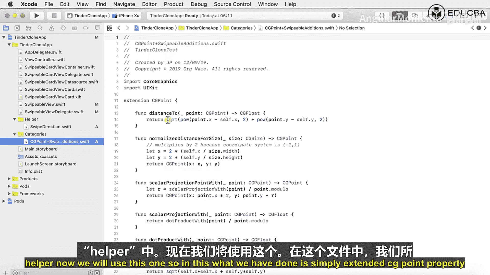

Extended C G point property and added certain functions。

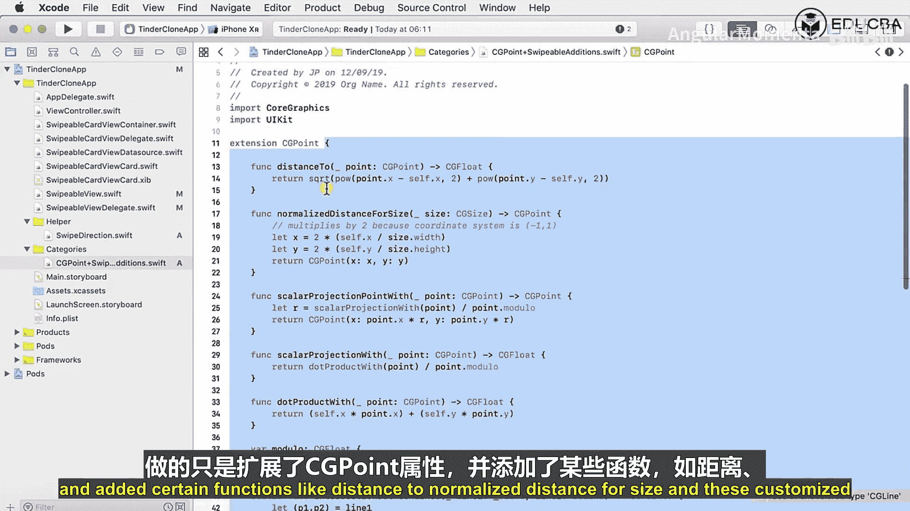

Like distance 2， normal distance for size and these customized functions。Okay。

 use of undeclared type Cg line。Okay。We have to add this one， also。In two categories。

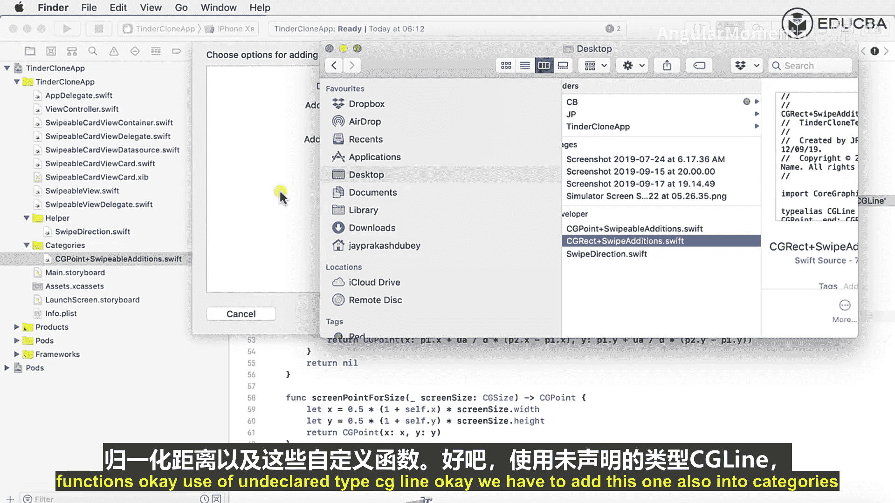

So over here we have extended CG in CG we have top line， left line， bottom， right and peri。Now。

 the error should disappear。Okay。So we'll be using this one over here。😔，Now。

 let normalized dragpoint is equal good look pan gestureure do。Normalize distance for size。

Boce dot size。Will return D return。Swipe direction dot。All direction dot。Reduce。Distance。Cji float。😔。

Dot infinity。Infinity comma and。Direction as nil。When we have closest comma。Direction in。Cg float。

 comma。😔，Swipe direction。Let。Distance is equal direction， dot point dot。Distance 2。

Normalized dragpoint。If。Distance is less than。Cllosest dot。Yeah。Distance。Or return。好。

Distance comma direction。Else， return。Cllosest。Dot。We are getting a warning。

Value of tuple has no over D Oculls compute。Directions。Okay。Now drag function， drag direction。

 we are able to do it。Now we require another function that will be drag percentage now in this。

 what we have done is we are trying to fetch the direction in which user is swiping。

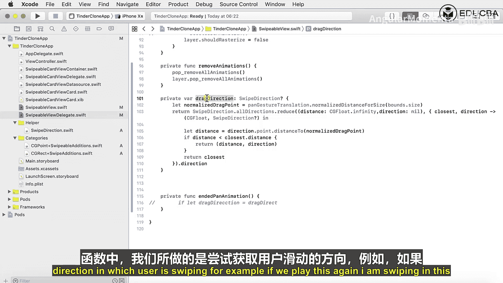

For example。If we play this again。I am swiping in this direction。

 So we are trying to fetch the swipe direction。Using this function。

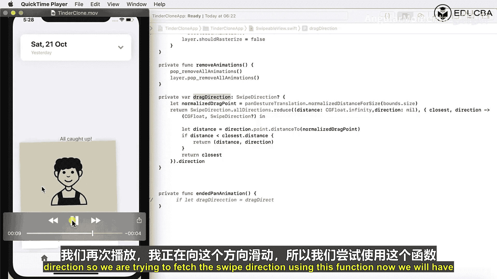

Now， we will have percentage。

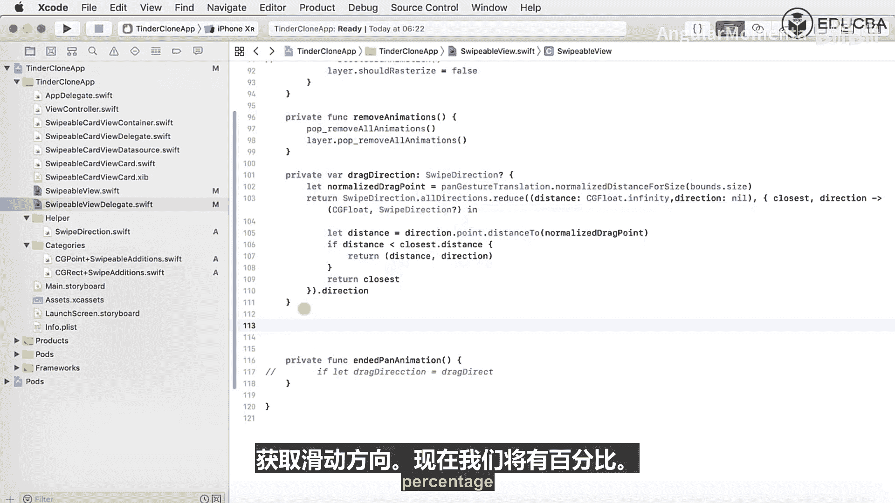