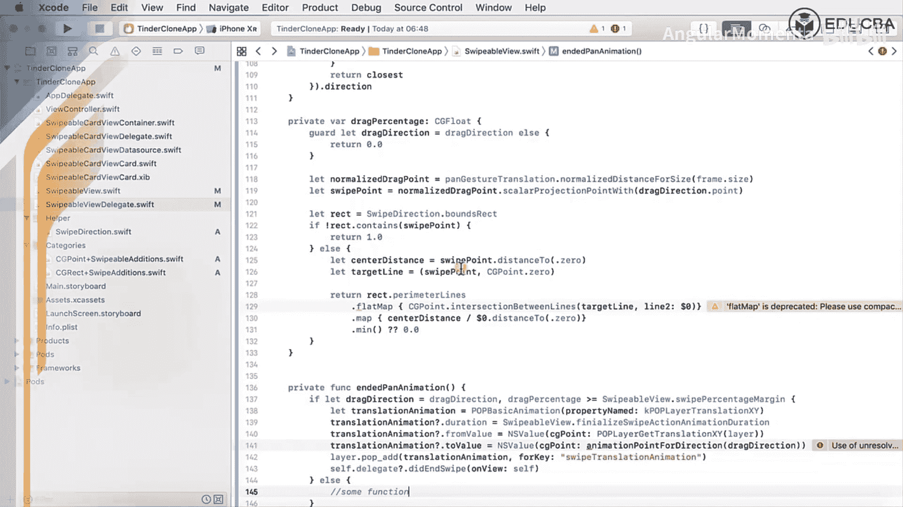
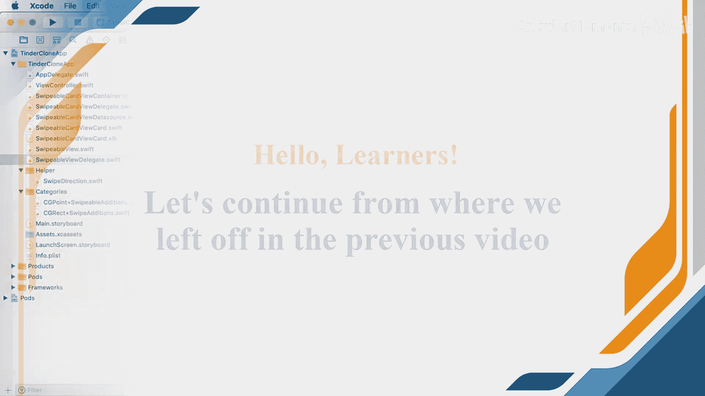
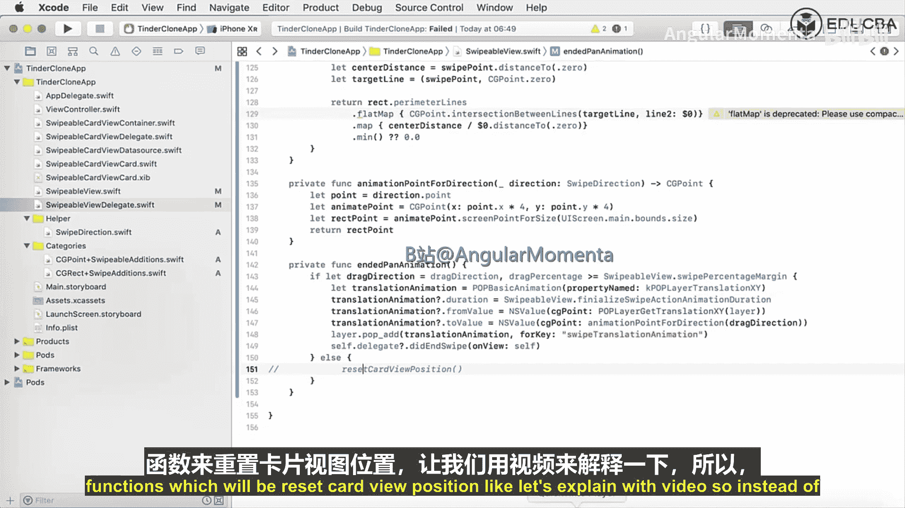
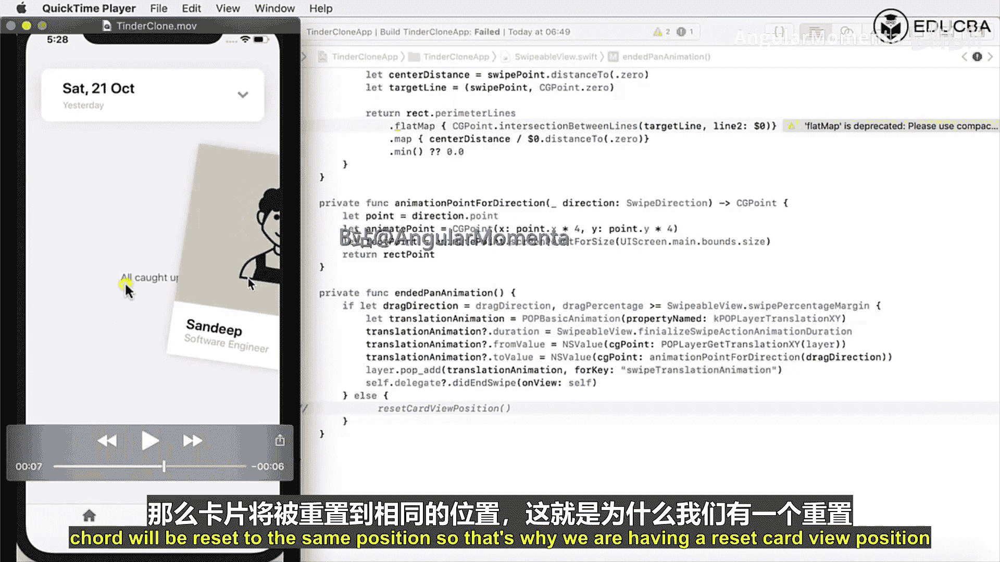
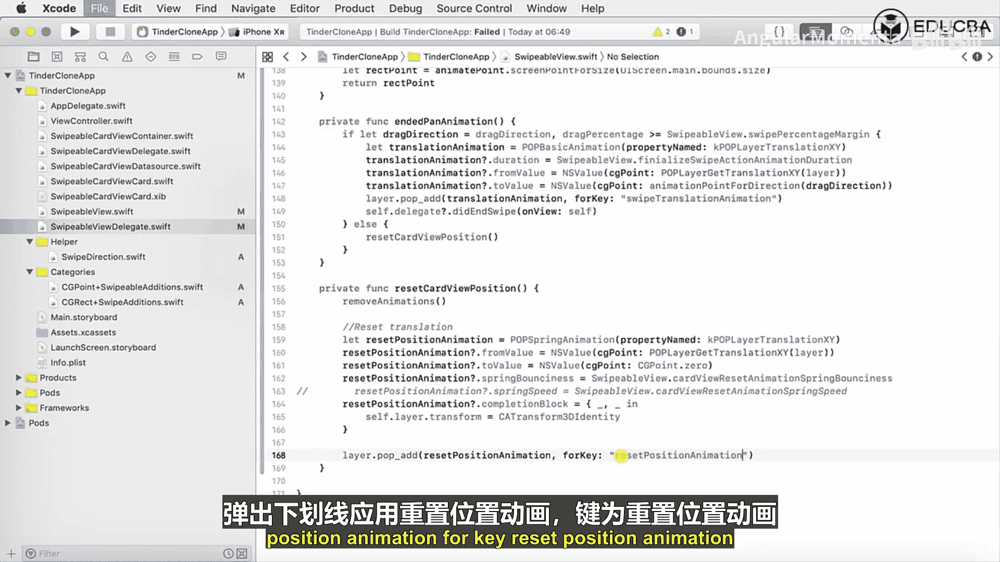
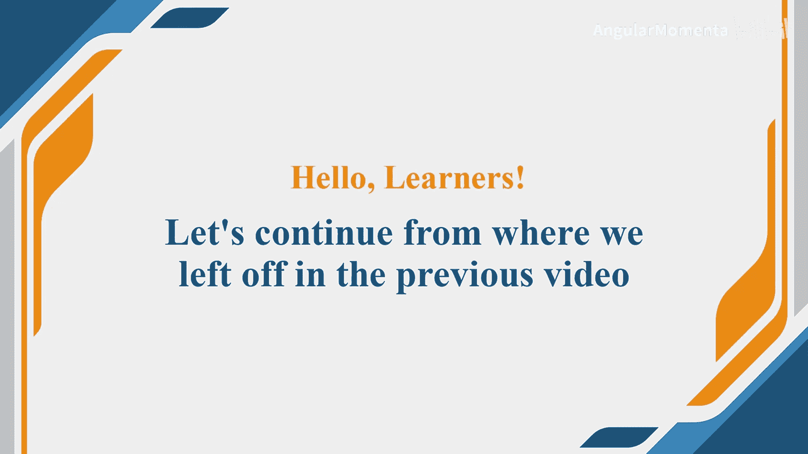
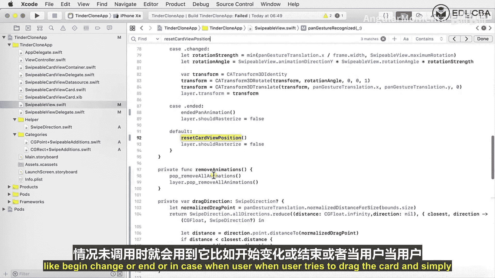

# 【EDUCBA】使用Swift开发一款滑动匹配iOS应用  Develop a Swipe-Match iOS App Using Swift p04 02_01_01_可滑动卡片模型 -BV1WNFozjEHe_p4-

Now， we will write。The percentage。Is drag percentage。Private， where。Drag。Percentage。Cg float。Gar let。

Drag direction。Is equal2。Drag direction， we have this instance。Which is from。This one。Drag direction。

 swipe direction。The recently， which we created。Ese。A return， 0。0。Then， let。Normalize drag。

Drag point is equal to。Pan gesture translation dot。Normalize distance for sight。Frame dot size。Let。

Swipe point is equal to。😔，Normalize dragpoint dot。Scalar prediction。Yeah。B position。Drag direction。

 dot point。Let rec is equal to。Swipe direction dot。Okay。Bce right。If。Arrect。Dot contains。Swipe point。

We return。1。0。Wells。Okay， we will make it as not equal to if erect dot contains 5。Return 1。0。

Thoseose。Let。Center。Distance is equal to。Spe point dot distance。2 dot 0。Let。Target line is equal to。

Spe point， comma， C G point。Yeah。Dot 0。A return。Aect dot perimeter line， dot flat map。그。Yeah。

Cg point dot。Intersection between line。Target line。Line to s dollar0。Dot map。Yeah。Central distance。

Divide by。Dollar 0， dot distance2 dot 0。Yeah。Dot minimum。Yeah。E0， 10。Okay。

 so what we have done in drag direct drag percentage is that。

We are trying to fetch whether we have a direction or not。 If figure the direction。

 then we will proceed else we will return。Drag percentage is 0。00。Then in normalized drag point。

 we are trying to fetch the distance from the frame。Then using that， we are trying to。Pot that point。

And fetch the point。And then we will check whether that particular point is present or not。

 if it is not present， we will simply return 1。0， and if it is present， then will。

Return the percentage using this flatm map and minimum。This is drag percentage。

 we have drag direction and drag percentage。We will complete our function， and pan animation。

Over here you have。He fled。Drag direction。Is equal2。Drag direction。Commer drag percentage。

Great than equal to syable view。Dot swipe percent margin。We have let。Translation， animation。Musicor2。

Pop basic animation。Yeah。Property name。Keep up layer。😔，Translation。X Y。

 then translation animation dot duration is equal to。So people view dot。Yeah。

fininize swipe action animation during。Then translation animation dot。From。Value is equal to。

Un S value。Cg point。😔，Yeah。Pop layer， get translation。Xy， layerir。

Translation animation dot2 value is equal to。Un less value。Cg point。animation。Point。

Animation point for。😔，Direction。Drag direction。Yeah。Clre dot。

P underscoreerco add animation this translation animation4 key。Swipe。Trans。Laation。Animation。Yeah。

Self dot delegate， dot did and swipe on view as self。Else。Will have some functional here。

Now we need to write this function， we will write over here。Private function。😔，Animation。😔，4 point。

Yeah。4 direction。Underdisco direction。Swipe direction。Cg float。😔，Let point is equal to。😔。

Diion dot point。Let animate。😔，Point is equal to Cg point。😔，Yeah。Point dot x。And to4。😔。

Point dot y into 4。😔，Let。Rec point is equal to。Animate point dot， screen point for size， U I main。😔。

You was screen。😔，Yeah。Dot main， dot bounces。Dot size。Return。That point。Yeah。

So you'll use this function over here。Contract direction， O deep。😔，O this should be Cg point。

 not Cg float。그。Okay， so what we have done is。Drag direction and drag percentage。

 this two function will determine the direction in which a user is dragging。

This will determine the percentage。How much user has dragged it to which direction。

 So in ended pan animation， which is called in ended。In end function。This one。So over here。

 what weird。Trying to get his first drag direction。 And if we get the drag direction。

 you will fetch the drag percentage。If drag percentage is greater than equal to this value。

 which is determined by translating animation， duration firm and to value， these things。

And if it is greater than equal to this， then what we do is we will pop the basic animation duration from to value and pop it。

And then we called， didnt swipe delegate。If this condition fails。

 then we will have some other functions。hi will be reset。Carard view。Position。Like。

 let's explain which video。

So instead of dragging and dropping， if I。CA interrupt of this swiping， if I just。Leave it across。

 then the cordord will be reset to the same position。

 so that's why we are having a reset card view position function。

Now， we are done with。This entered position。😔，O， remove any also you will require。😔。

And through more animation， we have done it。These things。And。Ended pan ended pan animation。

After that， we will go with a reset card animation。Yeah。O， it should be reset card view position。그。

We'll write this function over here。Private function。Reit card view。😔，Position。

We will remove all animation existing animation， then we will。Reset translation。그。Let hurry。

Position animation is equal to。😔，Pop spring animation。

Willll be property named K P layer translation X Y。

Or he said position animation dot from value is equal to。Unness value。Cg point。😔。

Pop layer get translation X Y。And lair。A reset position animation dot2 value。Is equal to n S value。😔。

Cg point。Cg point dot0。A reset position animation dot。Bring bound in S is equal to。

So people view dot。Card view reset animation， spring bouniness。

 reset position animation dot spring speed。Is equal to spable card， spable view dot card。😔，bring。

Speed。Card view。😔，Speed。😔，Do you。Guard view。😔，Aice said。Yeah。Animation。Bring speed。Okay。

We require this missing property。A reset position dot。Compleition block。Is equal to。Yeah。Undersco。

 comma， underscore in。Self dot layer dot transform is equal to。😔，C a transform 3D identity。😔，Yeah。

Then， layer dot。Pop underscore a reset position animation。For key reset position animation。

This is regarding reset translation。We will have reset。A rotationation as well。Let。A reset said。Yeah。

ARoation animation is equal to。Pop basic animation。Yeah。Property name， cave pop。Yeah。

K popular rotation。A reset rotation。Where already said。Rotation animation dot from value is equal to。

Popular。😔，Get。Yeah。Pop Le。😔，Get。Scall get rotation z。As lair。Reet rotation。

Animation dot2 value is equal2。Un S value。Cg point。Cg point。😔，Dot 0。Marice said。

Routtation animation dot。Duration is equal2。Syable view。Dot。Animation duration。Yeah。Then， layer。😔。

Dot add。嗯。Or reset， or rotation animation for key。A isit。Rotation。Animation。

Cannot assign the value of type Cg float。C you time interval。Okay，2 value should be Cg flow。😔，0。0。

Yeah。we are still getting error， cannot assign value of type Cg flow to time interval duration。

 lets check this。Okay， this should be time interval。嗯。Now， the error should disappear。Okay。Okay。

 we need to declare this property。So for that， well be using over here。Simply copy it。Okay。Static。

That。Sji floor。😔，Zequal to 20。0。Okay， so now this is done， so reset card view position。

 this is called in this and this in default10。Enroid animation Now let's see what we have done over here is in in a reset card view position。

 we will remove all animation。Which is over that is pop removal animation and from layer as well。

Then we will reset the translation and reset the rotation as well。

Translation research is done using pop spring animation and we set the from value to value。

And this spring bo in as these things。 And then we add this。Property， this instance。

To layer dot pop underscore the squared to this， which same key。Same goes for reset rotation as well。

 We create instance of。Pop basic animation with popular rotation and from value to value duration sum。

 and we will assign this value to。Player underscore， layer dot pop underscore add with same key。

 So this is being done at reset card view position。 Now this comes into picture when。

When none of this is called， like begin， change or end。Or。😮，In case when user。

When user tries to drag the card and simply releases it so that the card reset to its original position。

 so in that case it is called。