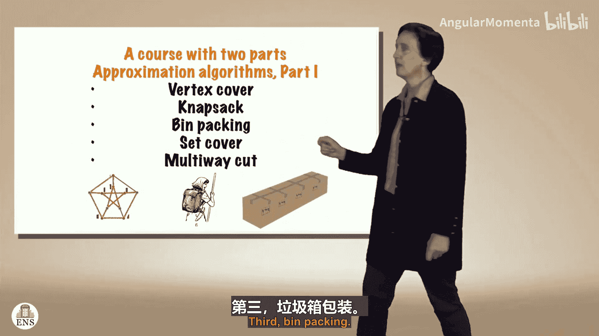
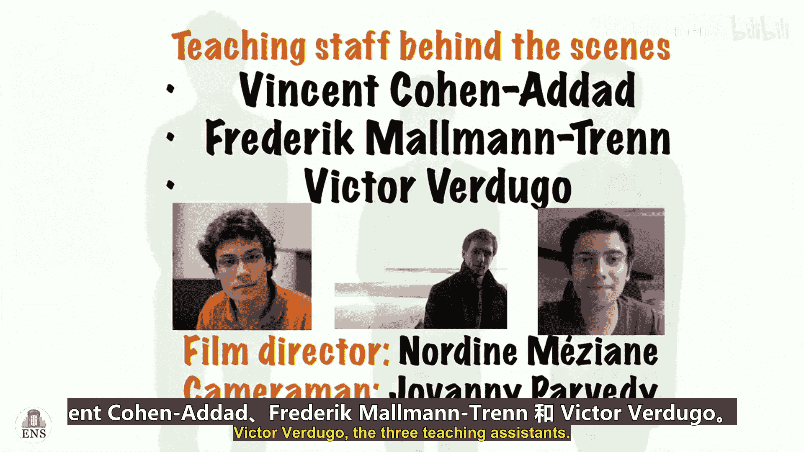

# 001：课程导论 🎯

在本课程中，我们将学习近似算法的基本概念、设计动机以及其在解决组合优化问题中的应用。我们将探讨为什么需要近似算法，并介绍本课程第一部分将涵盖的五个核心问题及其对应的算法设计技术。

---

组合优化问题在日常生活中频繁出现。例如，安排课程表时，需要避免学生所选课程的时间冲突，确保教室资源充足，并满足学校的各种约束条件。又或者，经营一家货运公司时，需要规划卡车的配送路线，以最小的油耗将所有货物送达客户手中。

不幸的是，大多数组合优化问题都是NP难问题。如果P不等于NP，我们无法指望为所有情况都找到一个高效的最优解。那么，我们该如何应对NP难问题呢？

以下是几种可能的应对方式：

*   **放弃**：认为问题不可能解决，无法在合理时间内找到好的解决方案。但在处理现实问题时，这通常不是一个可行的选项。
*   **暴力求解**：尝试枚举所有可能性并选择最佳方案。然而，对于许多稍大规模的问题实例，这种方法将耗费极长的时间，实际上与放弃无异。
*   **依赖启发式方法**：尝试某种方案并寄希望于运气。例如，随意规划几条配送路线。但对于理论研究者而言，这种方法不可接受，因为你无法保证或控制解决方案的质量。
*   **采用近似算法**：在多项式时间内，寻找一个足够好的解。这意味着我们放弃寻找绝对最优解，转而寻求一个在可证明的范围内，其目标函数值不会比最优解差太多的解决方案。

那么，我们如何设计近似算法呢？首先，我们认识到现实问题通常过于复杂。为了能够进行理论证明，我们将研究这些问题的理想化版本。例如，背包问题的理想化模型。在这些由少数参数定义的简单理想化问题上，我们有望证明定理。这些定理能为我们提供关于问题难度的新算法见解和结构洞察。

因此，我们的路径是：从现实情境出发，提炼难点以定义基础的理论问题；在这些问题上进行理论研究，设计算法并证明相关定理；在此过程中获得新的思路；最终，将理论成果应用于实际问题。本课程将聚焦于基础问题的近似算法理论。

本课程对问题的选择基于两个考量：第一，选择著名且被深入研究的问题，以丰富大家的知识储备；第二，确保每个问题都能提供一个学习特定近似算法设计或分析技术的机会。

在本课程的第一部分，我们将学习五个章节，对应五个问题及五种不同的技术：

1.  **顶点覆盖问题**：介绍近似算法设计中的一项重要技术——线性规划松弛。
2.  **背包问题**
3.  **装箱问题**
4.  **集合覆盖问题**
5.  **多路割问题**：这是本部分课程中最难的问题。

接下来，我们将从列表中的第一个问题——顶点覆盖问题开始，并借此机会引入近似算法设计中的一项关键技术。

在开始技术部分之前，请允许我介绍为本课程提供帮助的团队成员：助教Vas Coenaad、Fredderic Malmanen和Victor Verdogo。此外，还有我们的导演Nodine Mian和摄像师Joe Parvidi。再次欢迎大家参加近似算法（第一部分）课程。

---

本节课中，我们一起学习了近似算法产生的背景及其必要性，了解了应对NP难问题的不同策略，并明确了本课程第一部分将围绕五个核心组合优化问题展开，每个问题都将揭示一种特定的算法设计技术。从下一节开始，我们将深入第一个问题：顶点覆盖。