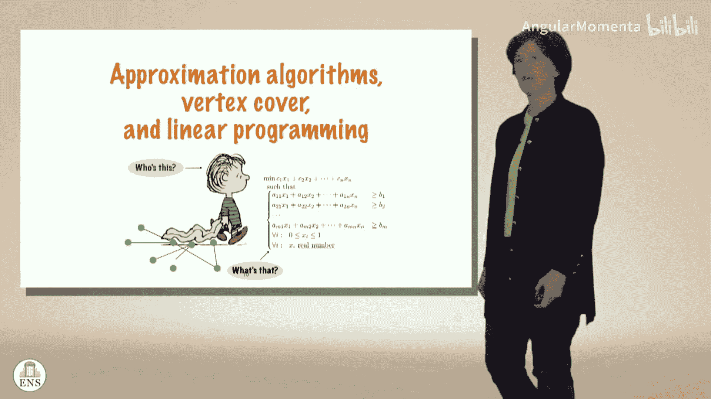

# 002：顶点覆盖问题定义 🎯

在本节课中，我们将学习近似算法中的一个经典问题：顶点覆盖问题。我们将从定义开始，并通过一个具体例子来理解其核心概念。

---

## 概述

顶点覆盖问题是组合优化中最基本的问题之一。给定一个带权重的图，目标是找到一个顶点子集，使得图中的每条边都至少有一个端点在这个子集中，并且该子集中所有顶点的总权重最小。

---

## 顶点覆盖的定义

顶点覆盖的定义可以直观地理解为：用一组顶点“覆盖”图中的所有边。这意味着对于图中的每条边，其至少有一个端点属于这组顶点。

以下是顶点覆盖问题的一个具体例子。

考虑图中展示的毯子图案。毯子上的角色（Linus，来自漫画《花生漫画》）正盖住图底部的所有边。毯子下的三个顶点构成了该图的一个顶点覆盖。

我们从一个常用于证明反例的经典图例开始，说明如何构建一个顶点覆盖。

我们需要选择一组顶点。假设首先选择顶部的顶点 **A**。顶点 **A** 覆盖了图中的三条边（图中已用红色标出）。目前进展顺利，但图中仍有边未被覆盖，因此需要继续选择顶点。

接下来，可以选择图左下角的顶点 **B**。顶点 **B** 覆盖了三条边。现在，需要继续选择更多顶点以覆盖所有边。再选择顶点 **C**。顶点 **C** 覆盖三条边，但其中一条边已被顶点 **B** 覆盖。这没有关系，一条边被两个端点同时覆盖是可以接受的。顶点 **C** 额外覆盖了两条边。

继续选择顶点 **D**、**E** 和 **F**。至此，我们得到了一个包含六个顶点 **A、B、C、D、E、F** 的集合。这就是图的一个顶点覆盖。图中的每条边都至少有一个端点在这个覆盖中。例如，边 **B-C** 被覆盖了两次。总之，每条边都至少有一个端点在覆盖内。

这是一个大小为6的顶点覆盖。如果每个顶点的权重都是1，那么这个覆盖的总权重就是 **1+1+1+1+1+1=6**。这个解是最优的，不可能用五个顶点覆盖这个图的所有边。

原因如下：观察图的外围部分，它是一个长度为5的环。要覆盖一个五环的所有边，至少需要三个顶点。再看图的内部部分，它是一个五角星。五角星本质上也是五环的另一种画法，因此同样至少需要三个顶点来覆盖内部的边。综上所述，至少需要6个顶点。因此，给出的解 **A、B、C、D、E、F** 是最优的，它最小化了所选顶点的总权重。

综上所述，顶点覆盖问题的定义是：
*   **输入**：一个图，其中每个顶点都有一个权重。
*   **输出**：图的一个顶点子集，满足：
    1.  覆盖图中的每一条边（每条边至少有一个端点在该子集中）。
    2.  该子集中所有顶点的总权重最小。

---

## 另一种表述：整数规划

上一节我们通过图示和例子介绍了顶点覆盖问题的直观定义。本节中，我们将从更代数的角度，给出该问题的另一种表述——整数规划形式。

顶点覆盖问题可以表述为以下整数规划模型：

设图 G = (V, E)，每个顶点 v 有一个权重 w_v。对于每个顶点 v，定义一个决策变量 x_v ∈ {0, 1}：
*   **x_v = 1** 表示顶点 v 被选入覆盖。
*   **x_v = 0** 表示顶点 v 未被选入覆盖。

目标是最小化总权重：**minimize Σ_{v ∈ V} w_v * x_v**

约束条件是，对于每条边 (u, v) ∈ E，必须满足：**x_u + x_v ≥ 1**

这个约束保证了每条边的至少一个端点被选中（即对应的变量值为1）。变量 x_v 的0/1取值要求使得这是一个整数规划问题。

---

## 总结

本节课中，我们一起学习了顶点覆盖问题的核心内容。我们首先通过一个生动的毯子比喻和具体的图例，直观地理解了什么是顶点覆盖——即用最“轻”的一组顶点覆盖图中所有的边。接着，我们证明了示例中六顶点解的最优性。最后，我们将问题转化为更形式化的整数规划模型，用数学公式 **minimize Σ w_v x_v** 和约束 **x_u + x_v ≥ 1** 来精确描述它。这种从具体到抽象的理解方式，是学习组合优化问题的基础。