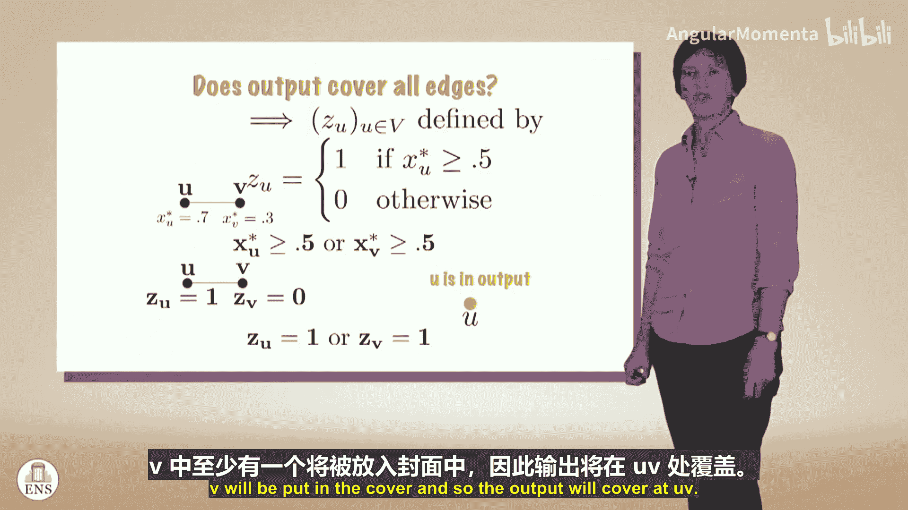

# 005：基于线性规划的顶点覆盖近似算法

欢迎回到近似算法课程。让我们继续学习顶点覆盖问题。我们已经为顶点覆盖设计了一个线性规划松弛，现在来看看如何利用它来设计一个算法。

## 算法概述

在本节中，我们将学习如何通过求解线性规划松弛，并对解进行舍入，来构造顶点覆盖问题的一个近似解。我们将分析该算法的正确性和近似比。

## 线性规划松弛回顾

首先，我们回顾一下之前设计的线性规划松弛。对于图中的每个顶点，我们有一个变量，其值在0到1之间。对于图中的每条边，其两个端点对应变量的值之和必须至少为1。目标是最小化所有变量的加权和。

用公式表示如下：

**最小化**：∑_{v ∈ V} w(v) * x_v
**约束条件**：
*   对于所有边 (u, v) ∈ E：x_u + x_v ≥ 1
*   对于所有顶点 v ∈ V：0 ≤ x_v ≤ 1

## 算法步骤

以下是算法的完整步骤：

1.  **求解线性规划**：在多项式时间内求解上述线性规划，得到一组最优解值 x_v*（对于每个顶点 v）。
2.  **舍入解**：对于每个顶点 v，根据其对应的 x_v* 值，将其舍入为整数 z_v。
    *   如果 x_v* ≥ 0.5，则令 z_v = 1。
    *   如果 x_v* < 0.5，则令 z_v = 0。
3.  **输出顶点覆盖**：输出所有满足 z_v = 1 的顶点 v 构成的集合。

## 算法分析

上一节我们介绍了算法的步骤，本节中我们来分析其正确性和运行效率。

### 运行时间

该算法在多项式时间内运行。求解线性规划可以在多项式时间内完成（作为一个黑盒使用）。对解进行舍入和输出结果只需要线性时间。

### 正确性证明

我们需要证明算法输出的顶点集合确实覆盖了图的所有边。

考虑图中的任意一条边 (u, v)。根据线性规划的约束条件，我们有：
x_u* + x_v* ≥ 1

由此可以推断，x_u* 和 x_v* 中至少有一个大于或等于 0.5。因为如果两者都小于 0.5，那么它们的和将小于 1，这与约束矛盾。

根据我们的舍入规则：
*   如果 x_u* ≥ 0.5，则 z_u = 1，顶点 u 被加入覆盖集。
*   如果 x_v* ≥ 0.5，则 z_v = 1，顶点 v 被加入覆盖集。

由于 x_u* 和 x_v* 中至少有一个 ≥ 0.5，因此 z_u 和 z_v 中至少有一个等于 1。这意味着边 (u, v) 的至少一个端点被包含在输出的顶点覆盖中。

上述论证对图中的每一条边都成立。因此，算法输出的集合覆盖了所有边，是一个正确的顶点覆盖。

## 本节总结

本节课中，我们一起学习了如何为顶点覆盖问题设计一个基于线性规划松弛和舍入的近似算法。我们详细介绍了算法的三个步骤，并证明了该算法是**正确的**，即其输出总是一个有效的顶点覆盖。关于这个算法输出解的质量（即近似比），我们将在后续章节中进行探讨。