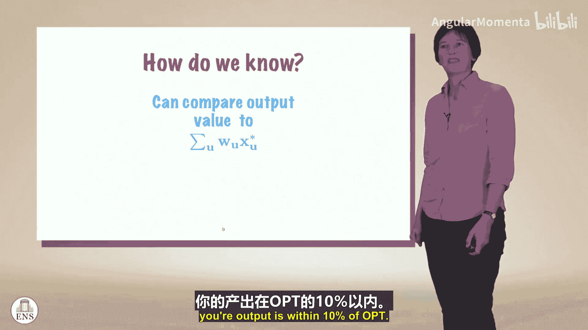
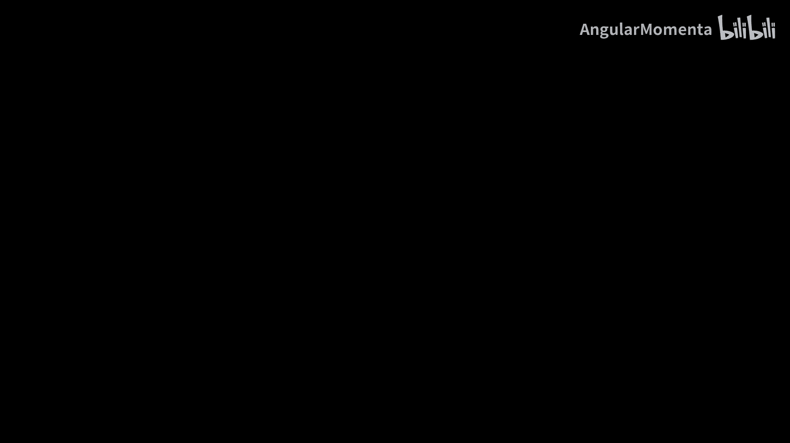

# 006：顶点覆盖算法分析 🧮


在本节课中，我们将学习如何分析之前设计的顶点覆盖近似算法的质量。我们将证明该算法的输出成本最多是最优解的两倍，并探讨这个分析是否是最优的。

---

上一节我们证明了算法的正确性和多项式时间复杂度。本节中，我们来分析算法输出解的质量。

我们需要将输出解的成本与未知的最优顶点覆盖成本联系起来。我们将从输出解开始，逐步推导其成本上界。

以下是分析步骤：

首先，输出解的成本可以表示为所有被选中顶点的权重之和。设输出顶点集为 **U**，对应的取整变量为 **zᵤ**（取值为0或1），则输出成本为：
```
输出成本 = Σᵤ (wᵤ * zᵤ)
```

接下来，我们需要将 **zᵤ** 与线性规划（LP）的解 **xᵤ*** 联系起来。回顾一下，**zᵤ** 是通过对 **xᵤ*** 进行取整得到的（若 **xᵤ*** ≥ 0.5，则 **zᵤ** = 1；否则为0）。因此，对于任何顶点，始终有：
```
zᵤ ≤ 2 * xᵤ*
```
这个因子2在 **xᵤ*** = 0.5 时达到。

然后，我们需要将线性规划的解与最优整数解（OPT）联系起来。线性规划是原整数规划（IP）的松弛版本，其约束更少。因此，线性规划的最优值（即 **Σᵤ (wᵤ * xᵤ***)**）不会大于整数规划的最优值（OPT）：
```
Σᵤ (wᵤ * xᵤ*) ≤ OPT
```

最后，结合以上所有观察，我们可以完成证明：
```
输出成本 = Σᵤ (wᵤ * zᵤ) ≤ Σᵤ (wᵤ * 2 * xᵤ*) = 2 * Σᵤ (wᵤ * xᵤ*) ≤ 2 * OPT
```

由此我们证明了一个定理：我们算法的输出是一个顶点覆盖，其成本最多是最优解的两倍。这是一个2倍近似算法。

---

但这个分析是否紧致？这个因子2是否不可避免？答案是肯定的。

在某些情况下，算法确实会达到2倍的近似比。考虑一个包含8个顶点的环，每个顶点权重为1。最优顶点覆盖可以选择环上间隔的4个顶点，成本为4。然而，线性规划可能给出所有 **xᵤ*** = 0.5 的解。取整后，所有顶点都被选中，输出成本为8。此时，输出成本恰好是最优成本的2倍。因此，我们的分析是紧致的，该算法在最坏情况下就是一个2倍近似算法。

不过，我们讨论的是最坏情况。在实际应用中，该算法的性能通常接近最优解（例如在10%以内）。该算法的一个优点是，当输出解确实接近最优时，我们可以通过比较输出成本与线性规划的值来验证这一点。因为线性规划的值是已知的，如果输出成本接近它，那么我们就知道对于该特定实例，输出解也接近最优解。



---



在本节课中，我们一起完成了对顶点覆盖近似算法的分析。我们证明了该算法是一个2倍近似算法，并通过实例说明了该近似比是紧致的。我们还了解到，尽管最坏情况性能有保证，但算法在实际中的表现通常更好。