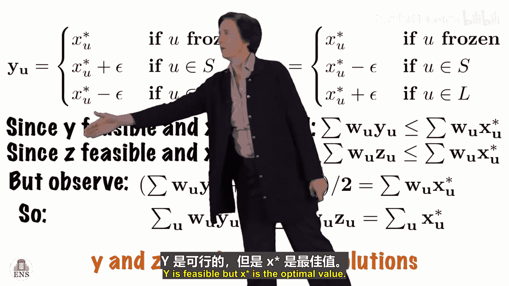
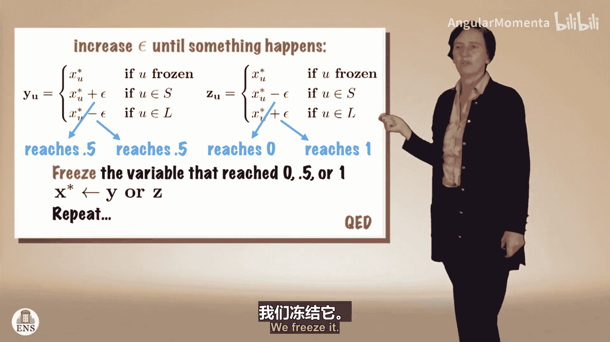

**近似算法：1.8.4：半整性**

在本节中，我们将学习顶点覆盖问题线性规划松弛的一个关键性质：**半整性**。我们将证明，总存在一个最优解，其所有变量值均为0、1/2或1，并且可以通过一个多项式时间算法找到它。

首先，我们明确要证明的定理。

**定理**：对于顶点覆盖问题的线性规划松弛，总存在一个最优解，其每个坐标 `x_i` 的值要么是0，要么是1/2，要么是1。并且存在一个多项式时间算法来构造这个解。

接下来，我们将详细描述这个算法。

**算法步骤**

1.  **求解线性规划**：首先，求解顶点覆盖的线性规划松弛，得到一个最优解 `x*`。这个解满足所有约束，并且使得目标函数值最小。此时，变量值在0到1之间，但不一定都是0、1/2或1。
2.  **初始化分类**：我们将变量分为三类：
    *   **冻结变量**：值已经是0、1/2或1的变量。这些变量在后续步骤中保持不变。
    *   **大变量**：值严格介于0.5和1之间的变量（即 `0.5 < x_i < 1`）。
    *   **小变量**：值严格介于0和0.5之间的变量（即 `0 < x_i < 0.5`）。
3.  **观察性质**：根据线性规划的约束（对于每条边 `(u, v)`，有 `x_u + x_v >= 1`），我们可以得出一个重要性质：**一个小变量不能与另一个小变量相邻**。因为如果两个小变量相邻，它们的和将严格小于1，违反约束。
4.  **构造扰动解**：我们尝试对当前解 `x*` 进行两种微小的扰动，得到两个新解 `y` 和 `z`。设 `ε` 为一个很小的正数。
    *   对于解 `y`：将所有小变量的值增加 `ε`，将所有大变量的值减少 `ε`。
    *   对于解 `z`：将所有小变量的值减少 `ε`，将所有大变量的值增加 `ε`。
5.  **可行性分析**：对于足够小的 `ε`，解 `y` 和 `z` 仍然是可行的（即满足所有约束）。原因如下：
    *   如果一条边连接一个小变量和一个大变量，在 `y` 和 `z` 中，一个增 `ε`，一个减 `ε`，总和不变，仍然满足 `>=1`。
    *   如果一条边连接两个大变量，在 `y` 中两者都减 `ε`，但原来总和 `>1`，对于足够小的 `ε`，总和仍 `>=1`；在 `z` 中两者都加 `ε`，总和变得更大，自然满足约束。
    *   如果一条边连接一个小变量和一个值为1的冻结变量，在 `y` 中小变量增 `ε`，总和 `>1`；在 `z` 中小变量减 `ε`，但原来总和 `>1`（因为1加一个正数），对于足够小的 `ε`，总和仍 `>=1`。
6.  **最优性分析**：由于 `x*` 是最优解，任何可行解的目标函数值都不小于 `x*` 的值。因此，`y` 和 `z` 的目标函数值都 `<=` `x*` 的值。同时，`y` 和 `z` 的平均值恰好等于 `x*` 的值（因为增减 `ε` 相互抵消）。这意味着 `y` 和 `z` 的目标函数值必须都等于 `x*` 的值。因此，`y` 和 `z` 也是最优解。
7.  **增加ε直到变量“冻结”**：现在，我们不再将 `ε` 视为无穷小，而是逐渐增大它。随着 `ε` 增大，以下四种事件之一会最先发生：
    *   某个小变量的值增加到0.5。
    *   某个大变量的值减少到0.5。
    *   某个小变量的值减少到0。
    *   某个大变量的值增加到1。
8.  **冻结新变量并迭代**：当上述任一事件发生时，我们停止增加 `ε`。此时，我们得到了一个新的最优解（`y` 或 `z`，取决于哪个事件发生），并且这个解中有一个额外的变量被“冻结”了（其值变为0、0.5或1）。我们以这个新解作为起点，重复步骤2-7。
9.  **算法终止**：每次迭代都至少冻结一个变量。由于变量总数有限，经过有限次迭代后，所有变量都将被冻结。最终我们得到一个最优解，其中所有变量的值都是0、1/2或1。

上述过程不仅是一个证明，也直接给出了一个多项式时间的构造算法。因为每次迭代（冻结一个变量）的工作量是多项式时间的，且总迭代次数不超过变量个数。

**总结**

本节课中，我们一起学习了顶点覆盖线性规划松弛的**半整性**性质。我们证明了总存在一个坐标仅为0、1/2或1的最优解，并通过一个逐步“冻结”变量的**扰动算法**，展示了如何在多项式时间内找到这样的解。这个性质是设计基于线性规划的近似算法时非常有用的工具。