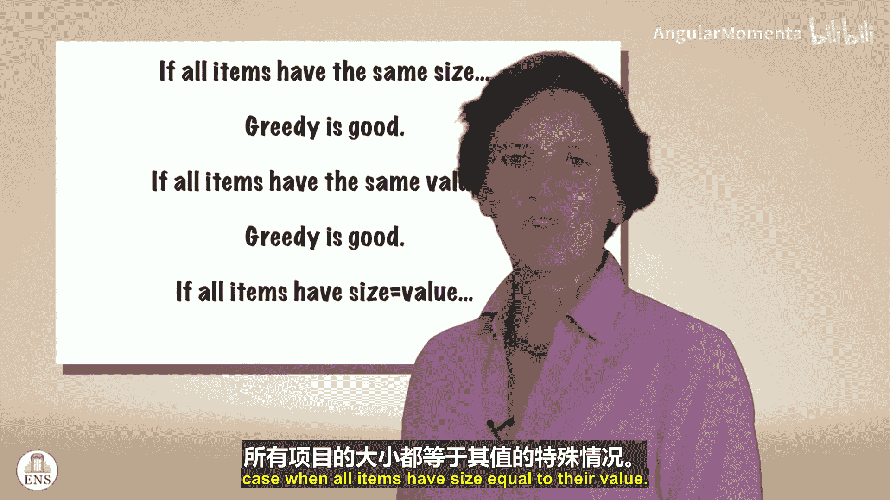

# 009：背包问题定义与初步探索 🎒

在本节课中，我们将学习近似算法中的另一个经典问题——背包问题。我们将从定义问题开始，尝试设计算法，并分析其局限性，最后聚焦于一个特殊的简化情况。

## 问题定义

背包问题是一个常见的组合优化问题。想象你要去露营，面前摆满了可能想带的物品，每件物品都有其重量（或体积）和价值。但你的背包容量有限，因此需要决定带哪些物品，以在不超过背包容量的前提下，最大化所带物品的总价值。

形式化定义如下：
*   给定一个容量 `B`（背包能承受的最大重量）。
*   给定 `n` 件物品，其中第 `i` 件物品的重量为 `s_i`，价值为 `v_i`。
*   目标：选择一个物品子集，使其总重量不超过 `B`，同时总价值最大化。

该问题与另外20个问题一起，在Dick Karp关于NP完全性的著名论文中被证明是NP难的。因此，我们通常无法在多项式时间内精确求解，这使得它成为设计近似算法的绝佳候选。

## 图形化表示与贪心算法尝试

设计近似算法的一个通用思路是寻找问题的良好表示。对于背包问题，每件物品由两个数字（重量 `s_i` 和价值 `v_i`）定义，很自然地可以将其表示为一个长宽分别为 `v_i` 和 `s_i` 的矩形。

当你选择多件物品时，相当于将这些矩形沿对角线方向拼接（一个矩形的东北角与下一个矩形的西南角相连）。这样，拼接形成的“阶梯”在水平方向的总长度代表总价值，在垂直方向的总高度代表总重量。容量限制 `B` 意味着这个阶梯的高度不能超过 `B`，而我们的目标是让阶梯尽可能向右延伸（即最大化总价值）。

这种表示法提示我们，**高价值、低重量**（即图形上“扁平”）的矩形更为理想。因此，一个直观的想法是按照物品的“价值密度”（即价值与重量的比值 `v_i / s_i`）降序（或等价地，按 `s_i / v_i` 升序）考虑物品。

基于此，我们尝试第一个算法：**贪心算法**。
1.  将物品按 `s_i / v_i` 升序排序。
2.  依次尝试将物品放入背包，只要放入后不超过容量 `B` 就保留。

这个算法运行速度快（主要是排序的时间），且总能给出一个可行解。然而，它的近似性能可能非常差。

## 贪心算法为何失败

让我们通过一个例子来说明贪心算法的问题。

假设背包容量 `B = 100`，有两件物品：
*   物品1：价值 `v1 = 1`，重量 `s1 = 1`。
*   物品2：价值 `v2 = 99`，重量 `s2 = 100`。

计算比值 `s_i / v_i`：物品1为 `1`，物品2约为 `1.01`。贪心算法会先选择比值更小的物品1放入背包。放入后，剩余容量为 `99`，而物品2的重量为 `100`，无法放入。因此，算法最终解的总价值为 `1`。

然而，最优解是只放入物品2，总价值为 `99`。在这个例子中，贪心算法的解与最优解相差了 `99` 倍，且通过调整参数，这种差距可以任意大。因此，简单的贪心策略不是一个好的近似算法。

## 探索特殊情形以获取直觉

当通用算法失败时，另一个设计近似算法的通用方法是**研究特殊情形**以培养直觉。

以下是几个简单的特殊情形：
1.  **所有物品重量相同**：此时只需按价值降序贪心选取，直到放不下为止。这是最优策略。
2.  **所有物品价值相同**：此时只需按重量升序贪心选取，直到放不下为止。这也是最优策略。
3.  **所有物品的重量等于其价值**（即 `s_i = v_i`）：此时所有物品的比值 `s_i / v_i` 都等于 `1`，上述贪心算法无法区分它们，选取顺序变得任意。这个情形开始变得有趣，它不再是平凡的。

## 本节总结

本节课我们一起学习了背包问题的定义，并尝试用图形化方式理解它。我们设计了一个按价值密度排序的贪心算法，但通过反例发现其近似比可能任意差。最后，我们通过分析几个特殊情形来寻找新的算法设计思路，并决定接下来重点研究 **“所有物品重量等于价值”** 这一非平凡的特殊情形。在下一节中，我们将针对这个特殊情形设计新的算法。