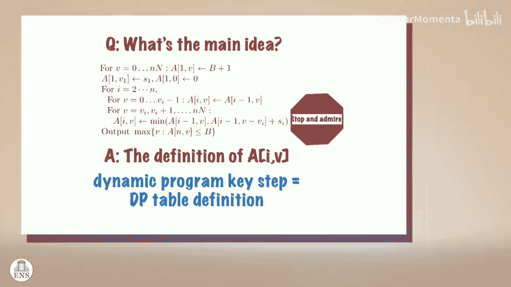

# 012：通用动态规划讲座


在本节课中，我们将学习如何使用动态规划方法解决一个特定版本的背包问题。我们将从一个非常特殊的情况开始，逐步扩展到物品价值为小整数的更一般情况，并最终推导出相应的算法。

## 概述

到目前为止，我们已经解决了一个非常特殊、非常特殊情况下的背包问题。这个情况本身似乎并不十分有趣，但我们将运用相同的思路，尝试解决一个稍微更一般的情况。

## 从特殊到一般

上一节我们介绍了特殊情况的解法，本节中我们来看看这个“不那么特殊”的特殊情况是什么。这种情况是：物品的价值是小整数。每个物品和之前一样，有大小和价值，但大小不再等于价值。大小可以是任意的，但物品的价值是1到大写N范围内的小整数，其中大写N可以是固定的。

## 动态规划思路

我们将扩展先前从非常特殊情况中得出的思路。我们是如何解决那个非常特殊情况的？我们使用了动态规划。因此，让我们再次从动态规划开始。动态规划的思路是，我们必须确定要定义什么样的“接口”。给定一个部分解，对于前 i 个物品，我们希望记住足够多的部分解信息，以便能够最优地完成这个解。

以下是我们的做法：
*   我们将向这部分添加一些物品。
*   我们将为任意一个起始状态最优地完成填充。

因此，我们需要一个接口来告诉我们在这里要记住什么。要记住什么？之前，对于每一个 i，对于前 i 个物品，我们记录了是否有一个子集能够为每一个可能的价值 V 达到该价值 V。现在，我们再次关注前 i 个物品和特定的价值 v，但为了弄清楚能否在某个解的基础上添加物品，我们需要记住大小。我们必须记住大小。

## 定义动态规划表

大小可以是任意的，可能很小，也可能很大，可能是长数字，情况复杂。它们的和有很多种，存在指数级的可能性。因此，我们要做的是记住那些“有趣”的大小。在表项 A[i][v] 内部，我们记住大小。让我们更具体一些。

在 A[i][v] 中，我们将记住：对于前 i 个物品中总价值为 v 的任何子集，其可达到的大小。实际上，并不完全是这样。对于前 i 个物品中总价值为 v 的任何子集，可能有许多不同的可达到的大小。我们只需要记住这些值中的最小值。为什么？因为如果对于相同的价值，我们可以用这个大小、那个大小在背包中实现它，那么我们不妨使用可能的最小大小。

因此，在 A[i][v] 中，我们将这个表项定义为：**任何总价值等于 v 的前 i 个物品的子集所能达到的最小大小**。

## 推导递推关系

现在我们已经定义了动态规划表，我们需要推导出一个递推关系，以便在算法中填充这些表项。

什么时候会存在前 i 个物品的某个子集，其总大小为 S 同时总价值等于 v？这取决于物品 i。这取决于子集是否包含物品 i。有两种情况。

以下是两种情况：
*   **情况1**：物品 i 不在子集中。这很简单，我们只需要查看前 i-1 个物品，并且必须能够以总价值 v 达到大小 S。
*   **情况2**：物品 i 在子集中。那么它使用了背包的 S 大小。因此，子集中的其他物品的总大小必须为 S - s_i。并且它提供了价值 v，所以子集的其余部分必须提供价值 v - v_i。

这个推理现在给出了一个递推公式，可以用代数方式表达如下：

令 A[i][v] 表示任何总价值为 v 的前 i 个物品的子集所能达到的最小大小。

如果 v ≥ v_i，那么 A[i][v] 是两种可能性中的最小值：一种是物品 i 在子集中，另一种是不在。

`A[i][v] = min( A[i-1][v], A[i-1][v - v_i] + s_i )`

如果 v < v_i，那么物品 i 不能放入子集，那么显然 A[i][v] 就是 A[i-1][v]。

## 算法与复杂度

这给出了我们的递推关系。我们将按照 i 值递增的顺序使用它来填充表项，这引出了我们针对这种特殊情况的算法。

以下是算法的大致框架（未详细说明初始化和最后步骤，这些很容易自行检查）：
```
for i from 1 to n:
    for v from 0 to n*N:
        if v >= v_i:
            A[i][v] = min(A[i-1][v], A[i-1][v - v_i] + s_i)
        else:
            A[i][v] = A[i-1][v]
```
重要的是包含 min 操作的那一行。

运行时间是多少？外层循环是 O(n)。内层循环 v 从 0 扫描到 n * N。因为这是可想象的最大价值。为什么？因为每个物品的价值最多为 N，即使每个物品都放入背包，总价值也将是 n * N。因此，由于这两个循环，运行时间将是 O(n² * N)。当 N 是常数时，这意味着算法是二次的。

## 核心思想回顾

我们如何设计这个算法？我们必须考虑尝试动态规划方法。核心思想确实出现在动态规划数组的定义中，这个定义以恰到好处的方式被选择，使其能够拥有一个递推公式。



我们看到它在多项式时间内工作，它为我们提供了将物品放入背包的最佳方式，以便在尊重背包容量的情况下最大化价值。

## 总结

本节课中，我们一起学习了如何在所有物品都具有小价值的情况下精确解决背包问题。在下一部分，我们将以此为基础，最终为背包问题设计一个近似算法。