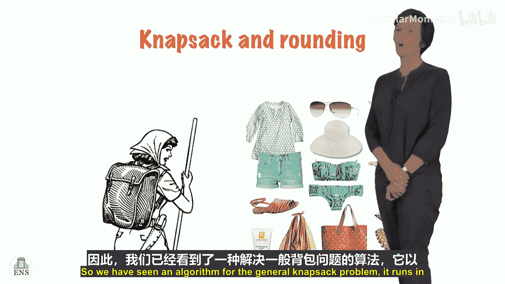

**近似算法：第1章：背包问题的一般情况算法**

在本节课中，我们将学习如何解决一般情况的背包问题。我们将利用之前为特殊情况设计的算法，通过一个巧妙的归约，构建出一个适用于一般情况的近似算法。

---

上一节我们介绍了当物品价值均为小整数时的背包问题精确算法。本节中，我们来看看如何将这个算法推广到处理任意正实数价值的物品。

核心思路是进行归约：我们将修改一般情况的输入，使其价值变为小整数，然后将其作为“黑盒”输入到我们已有的精确算法中。

以下是实现这一归约的具体步骤：

1.  **预处理**：首先，丢弃所有尺寸超过背包容量 `B` 的物品，因为它们无论如何都无法被装入。
2.  **缩放**：将所有剩余物品的价值 `v_i` 乘以一个缩放因子 `α`，使得缩放后的最大价值恰好等于一个我们选择的参数 `N`。即 `α = N / max(v_i)`。
3.  **取整**：将每个缩放后的价值向下取整到最近的整数，得到新的整数值 `v'_i = floor(v_i * α)`。
4.  **调用精确算法**：将修改后的输入（容量 `B`，尺寸 `s_i`，新价值 `v'_i`）输入到之前为小整数价值设计的动态规划算法中。
5.  **输出**：算法返回一个物品集合，我们直接输出这个集合作为最终解。

这个算法的运行时间主要取决于动态规划部分。动态规划的时间复杂度为 `O(n^2 * N)`，其中 `n` 是物品数量。如果我们选择 `N = 100n`，那么总运行时间就是 `O(100 * n^3)`，这是一个多项式时间（立方时间）算法。

---

本节课中我们一起学习了解决一般背包问题的近似算法。该算法通过**缩放**和**取整**将原始问题归约到我们已解决的特殊情况，从而在多项式时间内得到一个近似解。接下来，我们将分析这个近似解的质量，证明其价值接近最优解。