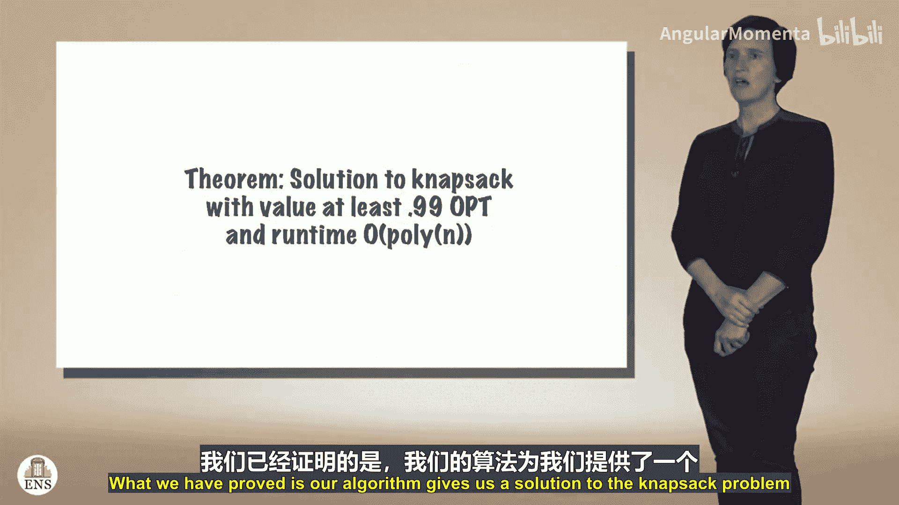

# 014：背包问题近似算法分析 🎒

在本节课中，我们将学习如何分析一个针对背包问题的近似算法的性能。我们将证明该算法能在多项式时间内运行，并且其解的值至少能达到最优值的99%。

---

上一节我们介绍了针对一般背包问题设计的算法，并证明了其多项式时间复杂度。本节中，我们将分析该算法的近似比，这是本章的技术核心。

首先，我们需要一些符号定义。算法输出的物品集合记为 **S**。我们知道 **S** 是针对缩放并取整后的输入的最优解，这是通过动态规划得到的。

其次，记 **S*** 为针对原始输入的最优解集合。由于缩放操作不会改变最优解的结构，**S*** 同时也是针对缩放但未取整输入的最优解。

现在，我们需要将 **S** 在缩放取整输入上的值，与 **S*** 在缩放未取整输入上的值联系起来。

首先，我们通过约简处理了输入，因此需要关注两个值：**S** 在原始输入上的值，以及 **S** 在修改后输入上的值。我们来建立这两个值的关系。

**S** 在原始输入上的值可以表示为：
`value(S) = sum_{i in S} v_i`

经过缩放（乘以因子 α）和向下取整后，修改后的价值 v'_i 满足：
`α * v_i >= v'_i`

因此，**S** 在原始输入上的值至少是其在修改后输入上值的 1/α 倍：
`value(S) >= (1/α) * sum_{i in S} v'_i`

接下来，在修改后的输入上，比较 **S** 和 **S*** 的值。由于 **S** 是该输入上的最优解，其值不小于 **S*** 的值：
`sum_{i in S} v'_i >= sum_{i in S*} v'_i`

现在，我们需要将 **S*** 在修改后输入上的值，关联回其在原始输入上的值。取整操作是向下取整到最近的整数，因此对于每个物品，有：
`v'_i >= α * v_i - 1`

对 **S*** 中的所有物品求和，得到：
`sum_{i in S*} v'_i >= α * sum_{i in S*} v_i - |S*|`

由于 |S*| 最多为物品总数 n，因此：
`sum_{i in S*} v'_i >= α * sum_{i in S*} v_i - n`

这里，`sum_{i in S*} v_i` 正是原始问题的最优值 **OPT**。

现在，将上述所有不等式串联起来：
`value(S) >= (1/α) * sum_{i in S} v'_i >= (1/α) * sum_{i in S*} v'_i >= (1/α) * (α * OPT - n) = OPT - n/α`

我们得到了一个加性误差：`n/α`。

为了得到相对误差界，我们需要处理这个加性项。为此，我们利用预处理步骤中得到的一个 **OPT** 的下界。

在预处理中，我们丢弃了所有单个尺寸就超过背包容量的物品。因此，剩余的任何单个物品都能放入背包，这意味着 **OPT** 至少等于所有剩余物品中的最大价值：
`OPT >= max_i v_i`

将这个下界代入我们的误差表达式。回顾一下，缩放因子 α 被定义为 `N / max_i v_i`，其中我们设定 `N = 100n`。

代入 α 的定义和 OPT 的下界：
`value(S) >= OPT - n/α = OPT - n * (max_i v_i / N) >= OPT - n * (OPT / N) = OPT * (1 - n/N)`

最后，代入 `N = 100n`：
`value(S) >= OPT * (1 - n/(100n)) = OPT * 0.99`

至此，我们证明了算法给出的解，其值至少是最优值的99%。

---

本节课中，我们一起学习了如何逐步分析背包问题近似算法的近似比。我们通过关联原始输入与修改后输入上的解值，利用最优解的性质和设定的参数，最终证明了算法能达到99%的近似保证。在下一节，我们将以此为基础，将其扩展成一个完整的近似方案。