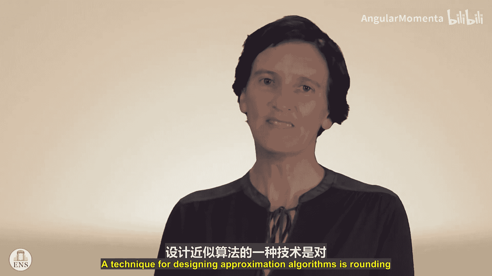

**近似算法：第一讲：背包问题的近似方案** 🎒

在本节课中，我们将学习如何为背包问题设计一个近似方案。我们将看到，通过调整算法中的参数，可以获得任意接近最优解的近似解，同时保持算法运行时间在多项式范围内。

---

我们之前已经见过一个背包问题的近似算法，它能给出一个非常接近最优解的方案。

现在，我们希望得到一个近似方案。也就是说，我们希望做得比之前更好。

如何才能做得更好呢？这里有一种改进方法。我们不再将 `N` 定义为 `1000 * n`，而是使用一个更大的 `N` 值。具体来说，令 `N = 1000 * n`。

其余步骤与之前相同：我们像之前一样进行缩放和舍入，像之前一样应用动态规划算法，并输出对应的物品集合。

这个新算法与之前算法的唯一区别在于，`N` 现在是 `1000 * n`，而不是 `100 * n`。

这个改变带来了什么？它带来的变化是，现在得到的背包问题解不再是 99% 的近似，而是 99.9% 的近似。这个解非常接近最优解，并且运行时间仍然是多项式级别的。

我们可以继续这个过程。也就是说，对于每一个 `ε`，我们都可以设计一个算法，其运行时间是输入规模的多项式，并且其解的值非常接近最优值。解的误差最多为 `ε * OPT`。

因此，我们得到的是一个近似方案。背包问题拥有一个近似方案。我们可以得到最优解的 99%、99.9%，甚至 `(1 - ε)` 倍。`ε` 越小，我们得到的解就越接近最优解。

那么，为什么不令 `ε` 趋近于零呢？这样我们就能在多项式时间内找到精确的最优解了。然而，我们无法做到这一点，因为该问题是 NP 难的，所以我们知道不可能做到。同时，随着 `ε` 趋近于零，运行时间也会增加。当 `N = n / ε` 时，运行时间与 `N` 成线性关系。随着 `ε` 趋近于 0，运行时间将趋近于无穷大。这就是为什么我们无法使用近似方案来精确解决问题。

---

**我们为背包问题设计近似算法的核心方法是什么？**

我们展示了如何首先简化输入，将一个复杂的输入规约到一个简单的特例，然后设计一个适用于这种简单输入的算法。

这种方法的关键在于，在简化输入的同时，不损失太多的最优解价值。

通过这种技术，我们解决了背包问题。这为我们研究“舍入”技术提供了契机。这里的舍入是针对输入进行的，与我们之前在研究顶点覆盖问题时对输出进行的舍入不同。

值得注意的是，在所有近似算法中，这可能是最实用的算法之一。背包问题是一个基础问题，而这个算法易于实现，并且在实践中相当快速。

需要观察的是，运行时间不仅是输入规模的多项式，也是 `1/ε` 的多项式。当然，随着 `ε` 趋近于零，运行时间会趋近于无穷大，但只是以 `1/ε` 的多项式速率增长。

因此，这样的近似方案被称为**完全多项式时间近似方案**。背包问题拥有一个完全多项式时间近似方案。这是本章节你可以记住的核心结论。

---

**设计近似算法的一种技巧是：对输入进行舍入，以简化输入，将其规约到一个特例。**

---

下一讲，我们将看到使用更复杂舍入技术的其他近似方案。