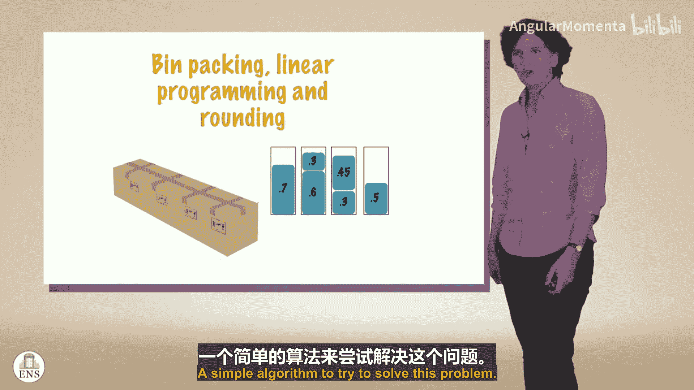

**近似算法：第1章：装箱问题与Next Fit算法**

在本节课中，我们将学习组合优化中最著名的问题之一——装箱问题。我们将介绍一个极其简单的算法，即Next Fit算法，并分析其性能。

---

### **装箱问题定义**

装箱问题的目标是：给定一组物品，将它们装入尽可能少的箱子中。我们研究该问题最基础的版本。

*   输入包含 `n` 个物品。
*   每个物品 `i` 有一个参数 `s_i` 描述其大小。
*   我们约定每个物品的大小 `s_i` 不超过 1。
*   目标是使用最少数量的、容量为 1 的箱子来装下所有物品。

---

### **Next Fit算法**

接下来，我们介绍一个非常朴素的算法，它可能是你首先想到的算法。这个算法被称为Next Fit算法。

以下是该算法的描述：
我们一次处理一个箱子。在任何时候，我们都有一个“开放”的箱子，正试图将物品放入其中。我们按任意顺序逐个处理物品。对于当前物品，我们尝试将其放入当前开放的箱子中。

*   如果它放得下，我们就把它放进去。
*   如果它放不下，我们就关闭当前箱子，打开一个新箱子，并将该物品放入新箱子。

这就是算法的全部。它非常简单。

让我们看一个例子。假设我们有六个物品，大小分别为：0.7, 0.6, 0.4, 0.3, 0.45, 0.5。我们按此顺序处理：
1.  物品1（0.7）放入箱子1。
2.  物品2（0.6）尝试放入箱子1，但放不下（0.7+0.6>1）。因此，关闭箱子1，打开箱子2，将物品2放入箱子2。
3.  物品3（0.4）放入箱子2（0.6+0.4=1）。
4.  物品4（0.3）尝试放入箱子2，但放不下（1+0.3>1）。因此，关闭箱子2，打开箱子3，将物品4放入箱子3。
5.  物品5（0.45）放入箱子3（0.3+0.45=0.75）。
6.  物品6（0.5）尝试放入箱子3，但放不下（0.75+0.5>1）。因此，关闭箱子3，打开箱子4，将物品6放入箱子4。

最终，我们使用了4个箱子来装下这6个物品。

显然，这个算法运行时间很短。但它做得好吗？它确实装下了所有物品，但会不会浪费了一些箱子？它有多糟糕？

---

### **Next Fit算法分析**

为了回答上述问题，我们需要分析Next Fit算法的性能。在近似算法中，我们希望将Next Fit算法使用的箱子数量与最优箱子数量进行比较。

让我们通过一个例子来建立一些直觉。为了便于处理整数，假设箱子容量为100。我们有一系列大小在1到99之间的物品。使用Next Fit算法后，假设我们使用了31个箱子。

观察结果，我们试图找出Next Fit算法展现出的某种结构。让我们关注箱子7。箱子7包含三个物品：25, 14, 25。下一个到达的物品是61，但25+14+25+61 > 100，所以我们关闭箱子7，打开箱子8，并将物品61放入箱子8。

我们观察到：箱子7的内容物（25+14+25）加上箱子8的第一个物品（61）的总和大于100。

**一般规律：**
对于任意两个连续的箱子（例如第 `(2i-1)` 个和第 `2i` 个箱子），这两个箱子中所有物品的大小总和大于箱子的容量（这里是100）。原因在于算法规则：我们不会关闭一个箱子，除非下一个物品放不进去。因此，当第 `2i` 个箱子被打开时，意味着第 `(2i-1)` 个箱子的内容加上第 `2i` 个箱子的第一个物品已经超过了容量。

**推导关系式：**
假设Next Fit使用了 `K` 个箱子。我们可以将箱子两两配对（除了最后一个箱子可能落单）。对于每一对连续的箱子，其内容物总大小大于1（或容量值）。因此，所有物品的总大小至少是 `(K-1)/2`。

**与最优解的关系：**
另一方面，考虑最优解 `OPT`。即使最优解完美地打包，每个箱子最多也只能装满容量1。因此，所有物品的总大小最多是 `OPT * 1`。

**结合两个关系：**
我们有两个不等式：
1.  总大小 ≥ `(K-1)/2`
2.  总大小 ≤ `OPT`

结合它们，得到：`OPT ≥ (K-1)/2`。整理后得到：`K ≤ 2 * OPT + 1`。

---

### **结论与讨论**

我们证明了Next Fit算法使用的箱子数 `K` 最多是最优解 `OPT` 的两倍再加一。如果没有这个“加一”，我们称之为2-近似算法。由于这个额外的箱子，我们称其为**渐近2-近似算法**，即当 `OPT` 很大时，性能比趋近于2。

*   **这个界限是紧的吗？** 是的，可以构造例子使得最优解需要约 `N/2` 个箱子，而Next Fit需要约 `N` 个箱子。
*   **对于小的 `OPT` 呢？** 当 `OPT` 很小时，区分需要2个箱子和需要3个箱子的实例本身是NP难的，所以这种渐近分析是合理的。

---

### **本节总结**

在本节中，我们一起学习了：
1.  **装箱问题的定义**：将大小不超过1的物品装入最少数量容量为1的箱子。
2.  **Next Fit算法**：一个极其简单的在线算法，只维护一个当前打开的箱子。
3.  **算法分析**：我们证明了Next Fit是一个渐近2-近似算法，即 `NF ≤ 2 * OPT + 1`。

我们学到的重要启示是：即使是非常简单的算法，有时也能提供相当好的性能保证。在算法设计中，“保持简单”是一个重要原则，因为简单的算法通常更容易分析。

---

为了获得更好的算法，我们接下来将尝试使用线性规划。